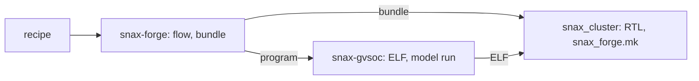

# :hammer: :fire: SNAX-FORGE :fire: :hammer:

SNAX-FORGE is a platform for exploring how domain-specific accelerators perform
when plugged into a SNAX compute cluster, before committing to RTL. You bring a
kernel and a model of your accelerator (a BRM); SNAX-FORGE imports the kernel
into its own dataflow graph, maps it onto the cluster by a recipe you edit,
runs it on a model of the cluster, and shows where the cycles go. The model
is SNAX-GVSoC, a GVSoC model in which a Snitch core runs the real program,
checked against snax_cluster's RTL by running one ELF on both. Humans and
LLMs close the loop by editing the recipe or the platform and running again.

| File | What it holds |
|---|---|
| `docs/ARCHITECTURE.md` | what each component does and how they fit together |
| `docs/CONTRACTS.md` | every artefact between the components, field by field |
| `docs/DECISIONS.md` | the decisions behind it |
| `docs/STATUS.md` | milestones, tasks and open items |
| `docs/PAPER.md` | the paper plan |
| `docs/RUN.md` | a design point from recipe to SNAX-GVSoC and snax_cluster's RTL, each command with its output |
| `kernels/README.md` | the target kernels, staged |
| `examples/` | walk-throughs of the flow: `loop1/` on SNAX-GVSoC; `dot/` dot's six recipes on SNAX-GVSoC |
| `hw/chisel/README.md` | the Chisel accelerator blocks |

# Getting started

snax-forge makes a design point, then the bundle snax_cluster builds from
(the cluster file, the accelerator's RTL) and the program that drives it.
snax-gvsoc, the `gvsoc/snax-gvsoc` submodule, is the model: it builds the
program into the ELF and runs it. snax_cluster is a separate checkout beside
snax-forge (D130): it builds the RTL from the bundle and runs the same ELF
through its `snax_forge.mk`. snax-forge never runs RTL (D123).



Clone both into one folder, `$ROOT`:

```bash
git clone https://github.com/KULeuven-MICAS/snax-forge.git
git clone https://github.com/KULeuven-MICAS/snax_cluster.git --recurse-submodules
cd snax-forge && git submodule update --init gvsoc/snax-gvsoc && cd ..
```

In snax-forge's image (Setup), from `$ROOT`, then `cd snax-forge`, one
command runs the flow (it builds SNAX-GVSoC the first time), the bundle and
the bundle's ELF, checked to be the flow's, and prints what snax_cluster
runs next:

```bash
pixi install
pixi run forge recipes/vecadd.json
```

    forge vecadd: recipes/vecadd.json on platforms/snax_forge.json; every step's output in out/forge/vecadd/forge.log
      flow      passed: design point out/flow/vecadd/design/design_point.json, run out/flow/vecadd/run/
      bundle    out/bundle/vecadd/: snax_forge_shell_wrapper, snax-forge $COMMIT
      sw        out/forge/vecadd/sw/forge.elf from the bundle (sha256 b6b4b1c70d8c8986, the flow's)
    SNAX-GVSoC (out/flow/vecadd/run/stdout.txt):
      forge cycles: 226
      forge data: 0 errors (64 words)
      forge counter add_acc: 19
      forge errors: 0
    snax_cluster on Verilator, from snax_cluster in its pixi environment:
      B=$ROOT/snax-forge/out/bundle/vecadd/snax_forge.hjson
      E=$ROOT/snax-forge/out/forge/vecadd/sw/forge.elf
      pixi run make -C target/snitch_cluster rtl-gen CFG_OVERRIDE=$B
      pixi run make -C target/snitch_cluster snax-forge-sim SIM=vlt CFG_OVERRIDE=$B
      pixi run make -C target/snitch_cluster snax-forge-run SIM=vlt CFG_OVERRIDE=$B ELF=$E
    ...

Then the RTL, on the host, in snax_cluster with its own pixi environment and
the `B` and `E` forge printed:

```bash
cd ../snax_cluster && pixi install
B=$ROOT/snax-forge/out/bundle/vecadd/snax_forge.hjson
E=$ROOT/snax-forge/out/forge/vecadd/sw/forge.elf
pixi run make -C target/snitch_cluster rtl-gen CFG_OVERRIDE=$B
pixi run make -C target/snitch_cluster snax-forge-sim SIM=vlt CFG_OVERRIDE=$B
pixi run make -C target/snitch_cluster snax-forge-run SIM=vlt CFG_OVERRIDE=$B ELF=$E
```

    ...
    forge cycles: 239
    forge data: 0 errors (64 words)
    forge counter add_acc: 19
    forge errors: 0

The counter is equal, the window within 10%. The flow's stages one by one,
the trace levels and the viewer, vsum, `N=512`, Questa and the comparison
table: `docs/RUN.md`.

# Setup

You need [pixi](https://pixi.sh):

```bash
curl -fsSL https://pixi.sh/install.sh | sh
git clone git@github.com:KULeuven-MICAS/snax-forge.git
cd snax-forge
pixi install
pixi run check      # OK  python 3.11…  dace 1.0.2  networkx …  numpy …
```

Every command below runs through pixi, from the repository root.

## In the container

SNAX-GVSoC and the programs built from snax_cluster need tools pixi does not
carry: GVSoC's build tools, snax_cluster's RISC-V toolchain (clang 21.1.6,
bender 0.28.2). One image holds them, with pixi 0.41.4 and zsh (D118). Build
and push it from this repository's root:

```bash
docker build -t ghcr.io/kuleuven-micas/snax-forge:main container
docker push ghcr.io/kuleuven-micas/snax-forge:main
```

Run it from the folder that holds `snax-forge`, mounted at its own path:

```bash
podman run --rm -it -v "$PWD":"$PWD" -w "$PWD" ghcr.io/kuleuven-micas/snax-forge:main
cd snax-forge && pixi install && pixi run check
```

The image holds tools only. `pixi install` writes the environment to
`.pixi/` in this repository; since the path is the same inside and outside
the container, the same environment works from the host too. Adding
`-v ~/.cache/rattler:/root/.cache/rattler` keeps pixi's downloads across
containers.

# The flow and its knobs

`pixi run flow` takes a recipe to a checked run on SNAX-GVSoC (D136,
`docs/RUN.md` section 2), everything in `out/flow/<name>/`. Change a design
point with `--set`; each one is added to the name, so the runs sit side by
side:

```bash
pixi run flow recipes/vecadd.json --platform platforms/snax_forge.json --set W=8                                    # out/flow/vecadd_W8: 220 cycles, counter 11
pixi run flow recipes/vecadd.json --platform platforms/snax_forge.json --set platform.streamers.default.fifo_depth=2 # 232 cycles, counter 26
pixi run flow recipes/vsum.json --platform platforms/snax_forge.json                                                # out/flow/vsum: 255 cycles
```

A `--set` without a dot is a recipe param; `platform.` and `memory.` ones go
to the design step. The flow also starts from a bound graph (a file ending
in `.snaxdfg`, D108), which skips the import and the recipe:

```bash
pixi run sandbox recipes/vecadd.json                                                 # out/sandbox/vecadd/2_bind.snaxdfg
pixi run flow out/sandbox/vecadd/2_bind.snaxdfg --platform platforms/snax_forge.json   # out/flow/vecadd: 226 cycles, as the recipe
```

The flow's tools also run on their own:

| Step | Command | Writes |
|---|---|---|
| Every kernel | `pixi run kernels` | nothing; one line per kernel: directory, tier, dtype, whether its SDFG builds and `import-dfg` takes it |
| SDFG of a kernel | `pixi run sdfg vecadd` | `out/sdfg/vecadd.raw.sdfg`, `.simplified.sdfg` |
| Import | `pixi run import-dfg vecadd` | `out/dfg/vecadd.snaxdfg` |
| Check a graph | `pixi run check-dfg out/dfg/vecadd.snaxdfg --kernel vecadd` | nothing; compares with the kernel's reference |
| Recipe | `pixi run sandbox recipes/vecadd.json [--set W=8]` | `out/sandbox/vecadd/<i>_<transform>.snaxdfg` |
| Undo a recipe | `pixi run sandbox recipes/vecadd_undo.json --graph out/sandbox/vecadd/2_bind.snaxdfg --out out/sandbox/vecadd_undo` | the graph back as imported |
| Design point | `pixi run design out/sandbox/vecadd/2_bind.snaxdfg --platform platforms/small16.json` | `out/design/vecadd/` platform, memory plan, design point |
| Only check | `pixi run design check out/sandbox/vecadd/2_bind.snaxdfg --platform platforms/small16.json` | nothing |
| Keep a platform | `pixi run design save out/design/vecadd/platform.json NAME` | `platforms/NAME.json` |
| Platform from a cluster file | `pixi run design from-hjson platforms/snax_forge_cluster.hjson snax_forge --force` | `platforms/snax_forge.json`, from snax-forge's base cluster (D131) |
| Task list | `pixi run lower tasks out/design/vecadd/design_point.json` | `tasks.json` beside the point |
| GVSoC files | `pixi run gen-gvsoc out/design/vecadd/design_point.json` | `out/gvsoc/vecadd/` (C§16) |
| Accelerator RTL | `pixi run gen-rtl out/design/vecadd/design_point.json` | `out/rtl/vecadd/` (C§17) |
| Bundle | `pixi run bundle out/design/vecadd/design_point.json` | `out/bundle/vecadd/` (C§18) |
| Graphs | `pixi run view-dfg out/sandbox/vecadd/` | nothing; serves http://127.0.0.1:8766/ |
| Runs | `pixi run view out/flow/vecadd_task` | nothing; serves http://127.0.0.1:8765/ (`docs/RUN.md`, "The viewer") |
| Reports | `pixi run report out/flow/vecadd_task` | the folder's `report/` again |

# Chisel blocks

The accelerator blocks behind the BRMs are a Chisel project of their own in
`hw/chisel/`, with its own environment (`-e hw`):

```bash
pixi run -e hw chisel-test    # the chiseltest specs
pixi run -e hw chisel-gen     # every catalogue configuration to out/hw/*.sv
```

See `hw/chisel/README.md`.

# SNAX-GVSoC from snax-forge

[snax-gvsoc](https://github.com/KULeuven-MICAS/snax-gvsoc) is a submodule at
`gvsoc/snax-gvsoc` (D134); CI fetches it in the `python`, `chisel` and `gvsoc` jobs and builds it only in `gvsoc`.
`gvsoc/Makefile` names the image's Python, CMake and host compilers, so it
runs the same from the container's plain shell and through pixi (`pixi run
make -C gvsoc ...`, as the flow does):

```bash
cd gvsoc
make build                      # GVSoC for snax-gvsoc's SNAX_TARGETS (snitch;snax_hjson) into out/snax-gvsoc/
make sw APPS=snax-csr           # sw/ and the named apps, into snax-gvsoc/build/sw/
make run TARGET=snax_hjson GVRUN_ARGS="--param hjson=$PWD/snax-gvsoc/forge/vecadd/snax_forge.hjson" \
    ELF=snax-gvsoc/build/sw/apps/snax-csr/snax-csr.elf
```

`run` prints snax-csr's four lines, `csrw/csrr: 0 errors` to `read-only: 0
errors`; `GVRUN_ARGS` goes before gvrun's `run`. `SNAX_GVSOC=../../snax-gvsoc`
uses a sibling checkout instead of the submodule; `build` clears
`out/snax-gvsoc` when the checkout changes. A design point's program builds
from `out/gvsoc/<design>/` into `out/snax-gvsoc/sw/<design>/` (`docs/RUN.md`
section 5).

## Refreshing a fixture

snax-gvsoc keeps one generated design point per folder in `forge/<design>/`
(vecadd, vecmul, vsum on `accumulate`'s Chisel `TreeAccumulate` at one lane,
and vsum_tree on its adder tree), which its `make regress` runs (D134).
`tests/gen/test_fixture.py` generates each again and compares it byte for
byte with the submodule's copy; it skips when the submodule is not checked
out. When the generator or the design point changes, refresh the folder in a
snax-gvsoc checkout next to this one, the folder cleared first:

```bash
pixi run sandbox recipes/vecadd.json
pixi run design out/sandbox/vecadd/2_bind.snaxdfg --platform platforms/snax_forge.json
pixi run gen-gvsoc out/design/vecadd/design_point.json --out ../snax-gvsoc/forge/vecadd
```

(the same with `vecmul`, `vsum` or `vsum_tree`), commit the folder in
snax-gvsoc as written, then bump the submodule here so the test compares
against it.

# Tests and lint

```bash
pixi run test          # everything
pixi run test-lower    # one block: test-lower, test-brm, test-dfg, test-sandbox, test-design, test-flow, test-run, test-report, test-gen, test-kernels
pixi run lint          # ruff check and format check (CI runs it); pixi run fmt fixes
pixi run clean         # remove out/ but out/snax-gvsoc/, caches and Chisel build trees (--all: out/snax-gvsoc/ too; --dry-run lists them)
```
