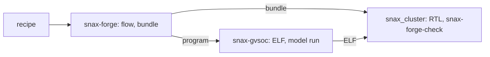

# :hammer: :fire: SNAX-FORGE :fire: :hammer:

SNAX-FORGE is a platform for exploring how domain-specific accelerators perform when plugged into a SNAX compute cluster, before committing to RTL. You bring a kernel and a model of your accelerator (a BRM); SNAX-FORGE imports the kernel into its own dataflow graph, maps it onto the cluster by a recipe you edit, runs it on a model of the cluster, and shows where the cycles go. The model is SNAX-GVSoC, a GVSoC model in which a Snitch core runs the real program, checked against snax_cluster's RTL by running one ELF on both. Humans and LLMs close the loop by editing the recipe or the platform and running again.

| File | What it holds |
|---|---|
| `docs/RUN.md` | a design point from recipe to SNAX-GVSoC and snax_cluster's RTL, each command with the lines to check |
| `docs/ARCHITECTURE.md` | what each component does and how they fit together |
| `docs/CONTRACTS.md` | every artefact between the components, field by field |
| `docs/DECISIONS.md` | the decisions behind it |
| `docs/STATUS.md` | milestones, tasks and open items |
| `docs/PAPER.md` | the paper plan |
| `CLAUDE.md` | the commands and the conventions |
| `kernels/README.md` | the target kernels, staged |
| `examples/` | walk-throughs: `loop1/` a vecadd run, `dot/` dot's six recipes |
| `hw/chisel/README.md` | the Chisel accelerator blocks and their specs |

# Getting started

snax-forge makes a design point, then the bundle snax_cluster builds from (the cluster file, the accelerator's RTL) and the program that drives it. snax-gvsoc, the `gvsoc/snax-gvsoc` submodule, is the model: it builds the program into the ELF and runs it. snax_cluster is a separate checkout beside snax-forge (D130): it builds the RTL from the bundle and runs the same ELF. snax-forge never runs RTL (D123).



Clone both into one folder, `$ROOT`, and start snax-forge's image there (D118: GVSoC's build tools, snax_cluster's RISC-V toolchain, pixi):

```bash
git clone https://github.com/KULeuven-MICAS/snax-forge.git
git clone https://github.com/KULeuven-MICAS/snax_cluster.git --recurse-submodules
cd snax-forge && git submodule update --init gvsoc/snax-gvsoc && cd ..
podman run --rm -it -v "$PWD":"$PWD" -w "$PWD/snax-forge" ghcr.io/kuleuven-micas/snax-forge:main
pixi install && pixi run check
```

One command runs the flow (it builds SNAX-GVSoC the first time), the bundle and the bundle's ELF:

```bash
pixi run forge recipes/vecadd.json
```

    ...
    SNAX-GVSoC (out/flow/vecadd/run/stdout.txt):
      forge cycles: 214
      forge data: 0 errors (64 words)
      forge counter add_acc: 19
      forge errors: 0
    ...

`pixi run forge-set quick` does that for a set of recipes and prints the one line that runs them all on snax_cluster's RTL and compares each with its SNAX-GVSoC run (`docs/RUN.md` section 8). The flow's stages, the trace levels and the viewer are in `docs/RUN.md`.

# Setup

The image holds tools only. `pixi install` writes the environment to `.pixi/` in this repository; since the path is the same inside and outside the container, the same environment works from the host too, for everything but SNAX-GVSoC and the program builds. Adding `-v ~/.cache/rattler:/root/.cache/rattler` keeps pixi's downloads across containers. Build and push the image from this repository's root:

```bash
docker build -t ghcr.io/kuleuven-micas/snax-forge:main container
docker push ghcr.io/kuleuven-micas/snax-forge:main
```

# The tools

The flow's tools also run on their own (`docs/RUN.md` section 7):

| Step | Command | Writes |
|---|---|---|
| Every kernel | `pixi run kernels` | nothing; one line per kernel: directory, tier, dtype, whether its SDFG builds and `import-dfg` takes it |
| SDFG of a kernel | `pixi run sdfg vecadd` | `out/sdfg/vecadd.raw.sdfg`, `.simplified.sdfg` |
| Import | `pixi run import-dfg vecadd` | `out/dfg/vecadd.snaxdfg` |
| Check a graph | `pixi run check-dfg out/dfg/vecadd.snaxdfg --kernel vecadd` | nothing; compares with the kernel's reference |
| Recipe | `pixi run sandbox recipes/vecadd.json [--set W=8]` | `out/sandbox/vecadd/<i>_<transform>.snaxdfg` |
| Undo a recipe | `pixi run sandbox recipes/vecadd_undo.json --graph out/sandbox/vecadd/2_bind.snaxdfg --out out/sandbox/vecadd_undo` | the graph back as imported |
| Design point | `pixi run design out/sandbox/vecadd/2_bind.snaxdfg --platform platforms/snax_forge.json` | `out/design/vecadd/` platform, memory plan, design point |
| Only check | `pixi run design check out/sandbox/vecadd/2_bind.snaxdfg --platform platforms/snax_forge.json` | nothing |
| Keep a platform | `pixi run design save out/design/vecadd/platform.json NAME` | `platforms/NAME.json` |
| Platform from a cluster file | `pixi run design from-hjson platforms/snax_forge_cluster.hjson snax_forge --force` | `platforms/snax_forge.json`, from snax-forge's base cluster (D131) |
| Task list | `pixi run lower tasks out/design/vecadd/design_point.json` | `tasks.json` beside the point |
| GVSoC files | `pixi run gen-gvsoc out/design/vecadd/design_point.json` | `out/gvsoc/vecadd/` (C§16) |
| Accelerator RTL | `pixi run gen-rtl out/design/vecadd/design_point.json` | `out/rtl/vecadd/` (C§17) |
| Bundle | `pixi run bundle out/design/vecadd/design_point.json` | `out/bundle/vecadd/` (C§18) |
| Graphs | `pixi run view-dfg out/sandbox/vecadd/ [--platform platforms/snax_forge.json]` | nothing; serves http://127.0.0.1:8766/: the steps one at a time, Compare for two, each item's Details and the Estimate on `--platform` (D151) |
| Editor | `pixi run edit-dfg [--kernel vecadd --set N=64 --set W=4 \| --recipe R \| --session DIR]` | the session in `out/sessions/<name>/`; Save writes `recipes/<name>.json` and its steps, Export one step; serves http://127.0.0.1:8767/ (`docs/RUN.md` section 9) |
| Runs | `pixi run view out/flow/vecadd_task` | nothing; serves http://127.0.0.1:8765/ (`docs/RUN.md` section 4) |
| Reports | `pixi run report out/flow/vecadd_task` | the folder's `report/` again |

A flow's `--set` without a dot is a recipe param, and `platform.` and `memory.` ones go to the design step; each is added to the run's name, so runs sit side by side. The flow also starts from a bound graph (a file ending in `.snaxdfg`, D108), which skips the import and the recipe.

# SNAX-GVSoC from snax-forge

[snax-gvsoc](https://github.com/KULeuven-MICAS/snax-gvsoc) is a submodule at `gvsoc/snax-gvsoc` (D134). `gvsoc/Makefile` (`make build`, `make sw`, `make run`) names the image's Python, CMake and host compilers, so it runs the same from the container's plain shell and through pixi (`pixi run make -C gvsoc ...`, as the flow does). `SNAX_GVSOC=../../snax-gvsoc` uses a sibling checkout instead of the submodule; `build` clears `out/snax-gvsoc` when the checkout changes, and holds a lock so parallel flows build it once.

## Refreshing a fixture

snax-gvsoc keeps one generated design point per folder in `forge/<design>/`, which its `make regress` runs (D134; its `forge/README.md` lists them). `tests/gen/test_fixture.py` generates each again and compares it byte for byte with the submodule's copy; it skips when the submodule is not checked out. When the generator or the design point changes, refresh the folder in a snax-gvsoc checkout next to this one, the folder cleared first:

```bash
pixi run sandbox recipes/vecadd.json
pixi run design out/sandbox/vecadd/2_bind.snaxdfg --platform platforms/snax_forge.json
pixi run gen-gvsoc out/design/vecadd/design_point.json --out ../snax-gvsoc/forge/vecadd
```

Commit the folder in snax-gvsoc as written, then bump the submodule here so the test compares against it.
