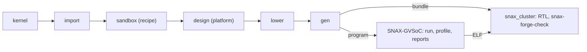

# :hammer: :fire: SNAX-FORGE :fire: :hammer:

SNAX-FORGE explores how domain-specific accelerators perform in a SNAX compute cluster before anyone writes RTL. You bring a kernel and a model of your accelerator (a BRM). SNAX-FORGE imports the kernel into its own dataflow graph, maps it onto the cluster with a recipe you edit, runs it on a model of the cluster and shows where the cycles, the area and the energy go. Humans and LLMs close the loop by changing the recipe or the platform and running again.

- The model is SNAX-GVSoC, a GVSoC model of the cluster in which a Snitch core runs the real program.
- The model is checked against snax_cluster's RTL by running one ELF on both.
- snax-forge never runs RTL: it writes the bundle snax_cluster builds from.



## Install

Clone snax-forge (and snax_cluster beside it, for the RTL check) and start snax-forge's image, which holds GVSoC's build tools, the RISC-V toolchain and pixi:

```bash
git clone https://github.com/KULeuven-MICAS/snax-forge.git
cd snax-forge && git submodule update --init gvsoc/snax-gvsoc && cd ..
podman run --rm -it -v "$PWD":"$PWD" -w "$PWD/snax-forge" ghcr.io/kuleuven-micas/snax-forge:main
pixi install && pixi run check
```

## Quick start

```bash
pixi run flow recipes/elementwise/vecadd.json --platform platforms/snax_forge.json   # recipe to a checked run (builds SNAX-GVSoC the first time)
pixi run flow recipes/elementwise/vecadd.json --platform platforms/snax_forge.json --trace task   # the same, traced
pixi run view out/flow/vecadd_task                                                   # the run's report, schedule and cluster view
pixi run edit-dfg --recipe recipes/elementwise/vecadd.json                           # change the recipe step by step
pixi run forge recipes/elementwise/vecadd.json                                       # the flow plus the bundle for snax_cluster's RTL
```

The first flow ends with `check passed: 214 cycles (main to forge_check); data 0 errors (64 words); counters add_acc 19 (16 beats)` and leaves everything in `out/flow/vecadd/`.

## Read next

| File | What it holds |
|---|---|
| `docs/TOOL.md` | every command: what it does, what it reads and writes, its flags, one example |
| `docs/ARCHITECTURE.md` | what each component does and how they fit together |
| `docs/CONTRACTS.md` | every artefact between the components, field by field |
| `docs/DECISIONS.md` | the decisions behind it |
| `docs/STATUS.md` | milestones, tasks and open items |
| `docs/PAPER.md` | the paper plan |
| `CLAUDE.md` | the conventions, for people and agents |
| `examples/` | walk-throughs: `loop1/` a vecadd run, `dot/` dot's six recipes, `dryrun/` design explorations |
| `kernels/README.md` | the target kernels |
| `hw/chisel/README.md` | the Chisel accelerator blocks and their specs |
