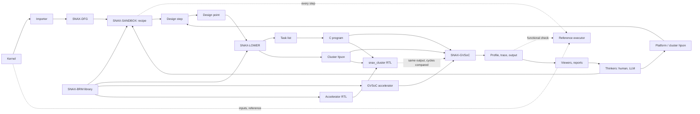

# SNAX-FORGE Architecture

> What SNAX-FORGE is, its components and how they fit together. Why:
> `docs/DECISIONS.md` (Dn); the artefacts field by field: `docs/CONTRACTS.md`
> (C§n); open work: `docs/STATUS.md`. A change to this file comes with a
> decision (D117). Each component's details live in its module docstrings.
>
> Markers: **[PLANNED]** = not built yet, with its milestone. **[OPEN]** =
> undecided.

---

## 1. Purpose

SNAX-FORGE is a platform for deciding which accelerators a SNAX compute
cluster should hold, and how they are composed, before committing to RTL.

A user brings a workload and a library of accelerator block models (BRMs).
SNAX-FORGE imports the workload into its own dataflow graph (SNAX-DFG), maps
it by hand in SNAX-SANDBOX (loops split into temporal and spatial parts,
accelerators bound), pairs it with a platform in the design step, and derives
what a run needs. The run happens in SNAX-GVSoC, a GVSoC model of the SNAX
cluster in which a Snitch core runs the real program (D116), and the same
design is generated for the SNAX cluster itself: the accelerator RTL, the
cluster's hjson and the program (D111). Profiles, traces, views and reports
tell a human or an LLM where the cycles went, so they can choose the next
design.

The user describes the accelerator; the platform around it is the model's
(D51). Model cycles are trusted as far as the comparison with snax_cluster
RTL shows (section 7).

Until SNAX-GVSoC runs the flow, the runs happen in SNAX-MODEL, a pure-Python
cluster model (section 5.7), which is then removed (RET1).

## 2. Positioning

SNAX-FORGE complements analytical DSE tools such as ZigZag and Stream (D23):

- **Cycle-level cluster microarchitecture.** Bank arbitration, affine
  streamers, FIFO back-pressure, DMA and the control the core does, rather
  than analytical cost terms.
- **Arbitrary dataflow graphs**, not only DNN layers: PolyBench kernels,
  stencils, reductions, and later HDC workloads (D113).
- **Composition.** Unit BRMs bound on the graph and stitched into
  accelerators (D112).
- **One description, two outputs.** A BRM gives the model's accelerator and
  its Chisel RTL; the hjson describes the cluster to both (D111, D116).
- **Human- and LLM-in-the-loop.** Every artefact is text (D8).

The simulation technique is GVSoC's, not ours. `docs/PAPER.md` section 8
holds the related work.

## 3. Guiding Principles

1. **The BRM is the user's source of truth.** The model's accelerator and the
   RTL are generated from it and checked against each other by running one
   program on both (D116).
2. **One slice before generality.** Every component is first built in the
   simplest form that carries `vecadd` end to end, then generalised when a
   real kernel needs it.
3. **The user owns the accelerator, the model owns the platform** (D51). The
   platform is SNAX's, read from its hjson, and modelled to match its RTL.
4. **Decisions are separate from derivations.** SNAX-SANDBOX and the design
   step decide; importers and SNAX-LOWER derive; the model measures.
5. **Everything is text and diffable.** Graphs, BRMs, recipes, platforms,
   design points, task lists, programs, profiles and traces.
6. **Extend without editing the core**, by registration and namespaced attrs
   (D19).

## 4. System Overview

**Inner loop:** kernel → importer → SNAX-DFG → SNAX-SANDBOX (recipe) →
design step (platform) → design point → SNAX-LOWER → a run → reports and
views → the thinker edits the recipe or the platform. `pixi run flow` runs it
once (section 5.9). Today the run is SNAX-MODEL's; FLOW3 moves it to
SNAX-GVSoC **[PLANNED, M14]**.

**SNAX link:** the same design point gives the bundle snax_cluster builds and
runs (section 5.8), and its RTL run is compared with the SNAX-GVSoC run.

## 5. Components

| Component | Code | Consumes | Produces | Status |
|---|---|---|---|---|
| Importer | `dfg/import_sdfg.py` | a kernel's simplified SDFG | `.snaxdfg` | built |
| Reference executor | `dfg/execute.py` | `.snaxdfg`, inputs | golden output | built |
| SNAX-BRM | `brm/` | hand-written BRMs | instances, accelerator entries | built; GVSoC output M14 |
| SNAX-SANDBOX | `sandbox/` | `.snaxdfg`, BRMs, recipe | a `.snaxdfg` per step | built |
| Design step | `design/` | bound graph, platform | design point | built |
| SNAX-LOWER | `lower/` | design point, BRMs | cluster file, task list, program | built; C program M14 |
| SNAX-GVSoC | `snax-gvsoc` repo | hjson, program, accelerators | profile, trace, output | M16 |
| SNAX-MODEL | `snax_model/` | cluster file, command list | profile, trace, output | until RET1 |
| HW generator | `hw/chisel/` | BRM hardware bindings | accelerator RTL with shell wrapper | M14 |
| Flow | `flow/` | recipe or bound graph, platform | all of the above, checked | built |
| Viewers | `viz/` | run directories, `.snaxdfg` files | local HTML views | built |
| Reports | `report/` | a flow folder or run directory | `design.md`, `run.md` | built |

Packages are under `snax_forge/` except `hw/chisel/`. SNAX-GVSoC lives in its
own KULeuven-MICAS repository (D116) and is built and run in snax-forge's
development image from `container/` (D118).

### 5.1 SNAX-DFG and the importer

SNAX-FORGE's own dataflow graph, a `.snaxdfg` JSON file (D71, D77; C§11): a
tree of symbols, containers and an ordered body of registered node kinds.
`map` is one variable over a range, `tasklet` is `output = expression` per
output, and `accelerated` is one beat of a bound BRM instance inside the
temporal maps it runs over (D82). Body order is execution order; memlets sit
on the connectors of the nodes that use the data. A map's `loop.kind` is
absent as imported, then `tile`, `temporal` or `spatial` (D73). A reduction
is a map whose output memlet carries a `reduce` op and identity (D102).
Expressions use one grammar shared with the BRM (`expr.py`: ints, names,
`+ - * //`). Streamers are not nodes (D71).

The importer (D78, `pixi run import-dfg <kernel>`) reads the simplified SDFG
that `pixi run forge <kernel>` writes, keeps the kernel's names, decides
nothing, and names what it does not support. Sequential loops and branches
come with the kernels that need them (open item 36).

### 5.2 Reference executor

A NumPy interpreter of any `.snaxdfg`, as imported, split or accelerated
(D79): maps run over their whole space at once, accelerated nodes firing by
firing through their BRM's function, with named rates from `named_rates`
(D104). On the imported graph it must equal the kernel's own reference;
every sandbox step and every run is compared with it.

### 5.3 SNAX-BRM

One hand-written JSON file per accelerator in `snax_forge/brm/library/`
(D68; C§10): a shared part (interface, function with `code`, per-port
dataflow nest, pattern) and implementations (source, supported values,
timing `latency` / `initiation_interval` / `drain`, hardware binding).
Timing is always the user's numbers. `Brm.resolve` makes an instance from an
implementation and its design params. The library holds `elementwise_add`,
`elementwise_mul` and `accumulate`.

Each BRM has two outputs **[PLANNED, M14]**: the GVSoC accelerator (at first
the generic accelerator's parameters, GEN3) and the Chisel RTL with SNAX's
shell wrapper (GEN1). Both are accepted when they reproduce the M16 baseline.

### 5.4 SNAX-SANDBOX and the design step

**SNAX-SANDBOX** (D72; C§12). Registered transforms rewrite a `.snaxdfg`; a
recipe in `recipes/` names a kernel, params, symbol values and the steps;
the reference executor checks every step; `--set W=8` runs one point of a
sweep. Transforms: `split_map`, `bind` (patterns `elementwise` and `reduce`;
design params read off the graph, D73, D104), and their inverses `unbind`
and `join_map`. **[PLANNED]** the composed bind (M13, D112) and a tile
transform (LOW3b).

**The design step** (D84–D87; C§13–15). It pairs a bound graph with a
platform file from `platforms/`, resolves the streamer shell (one streamer
per port, `<instance>_<port>`, D75), makes the memory plan from registered
passes (contiguous by default, with pins), runs every design check, and
writes `design_point.json`, SNAX-LOWER's only input. `--set platform.PATH=V`
and `--set memory.C.l1.base=N` change a working copy. **[PLANNED, M14]** the
platform read from snax_cluster's hjson (LNK1).

### 5.5 SNAX-LOWER

Turns a design point into what a run needs, and decides nothing.

- **Cluster file** (D88, `lower/cluster.py`): SNAX-MODEL's input. Under
  SNAX-GVSoC its role goes to the cluster hjson **[PLANNED, M14: LNK2]**.
- **Task list** (D89, `lower/derive.py`; C§9): one group of tasks per
  accelerated node in execution order, loads before and stores after,
  streamer values from the memlets through the memory plan, `after` holding
  data dependences only, so two accelerators chain through L1 with one wait
  (D105). It stays the hand-off to every backend.
- **Command list** (D45, D64, `lower/commands.py`): the task list expanded
  into SNAX-MODEL's `csr_write`, `csr_read` and `wait`, with only the waits
  correctness needs. Goes with SNAX-MODEL (RET1).
- **C program** **[PLANNED, M14: GEN2]**: the task list as direct CSR writes
  on the Snitch core, with a cycle mark per task, a header of the
  accelerator's CSR names and `data.h`, in SNAX's real register layout. The
  same program runs on SNAX-GVSoC and on snax_cluster RTL.

### 5.6 SNAX-GVSoC [PLANNED, M16]

A GVSoC model of the SNAX cluster in its own repository: a detached copy of a
chosen GVSoC commit with its history, the submodules folded in, the upstream
hashes recorded and the license kept (D116). It holds:

- a **SNAX target** per cluster: `snax_alu` written by hand (SG1), read
  from the cluster hjson later (LNK2);
- a small **core patch**: the Snitch core sends CSRs 0x3C0 to 0x5FF as
  32-bit IO requests at 4 × CSR on its `snax_csr` port, bound to an
  accelerator component per core, so a `csrw` reaches the accelerator's
  registers as in RTL (SG1, D120); the cores' **loads** as the hjson and
  the RTL have them, one integer load in flight and the measured path
  cycles (SG5, D125);
- the **DMA**: GVSoC's iDMA model fitted to the RTL by measurement, with the
  cluster's DMA perf counters (SG2, D121); a **streamer** configured from the
  hjson's streamer template, its ports arbitrated per bank by a crossbar that
  copies the plain interconnect (SG3, D122); the hand-written **`snax_alu`**
  (SG4), and a **generic accelerator** (lanes, rates, latency, II, drain,
  op) that a BRM parameterises (GEN3); each checked against the RTL by
  running the same ELF on both and comparing counters (D123), and the
  whole cluster per phase against a three-tier target, checked by hand from
  fresh runs of one ELF on both sides, while `make regress` checks that
  every program finishes (SG5, SG6, D124);
- **trace events** for the views (grants, stalls, responses, firings, FIFO
  counts), from SNAX's components and from GVSoC's own L1 and interconnect,
  turned into SNAX-FORGE's profile and trace by a converter (FLOW3); today
  they are text traces for people (open item 57).

What it models is what snax_cluster's RTL does; where the two differ, the
RTL wins. Memory-mapped register writes may replace the CSR path later; the
register blocks then sit on the interconnect, with no new core patch.

### 5.7 SNAX-MODEL (until RET1)

The pure-Python, event-driven cluster model that the flow runs today: banks,
interconnect, streamers, accelerators, DMA and L2, a register interface and
a controller instead of a core (D6, D10, D29–D44). Its contracts are C§2–C§8
and its timing is in the module docstrings. It is frozen: nothing new is
built on it, and RET1 removes it with its scenarios once FLOW3 runs vecadd
and dot on SNAX-GVSoC.

### 5.8 SNAX link

For a design point SNAX-FORGE writes a bundle that snax_cluster builds and
runs (D111) **[PLANNED, M14]**:

- **accelerator RTL** from each BRM's hardware binding, through `Emit` and
  the Chisel blocks in `hw/chisel/` (D91), with a CSR adapter and a shell
  wrapper on SNAX's ports (GEN1);
- **cluster hjson**: TCDM size and banks, DMA width, and per accelerator its
  CSR counts and streamer template; SNAX's own generators build the rest,
  and SNAX-GVSoC reads the same file (LNK2);
- a **`Bender.yml`** that snax_cluster takes as one dependency (open item
  51);
- the **program** (section 5.5).

**Cosim** (M10, D52) swaps one accelerator for its RTL and checks its output,
latency and II.

### 5.9 Feedback and the flow

**Profile and trace** (C§7): total cycles, cycle classes per component,
utilisation and firings per accelerator, grants, conflicts and stalls per
bank and port, FIFO occupancy, DMA traffic, control overhead apart from
waiting, and the functional check. The trace is an event log at level
`off`, `task` or `beat`. Under SNAX-GVSoC both come from the converter in the
same form, so the viewers and reports keep working (FLOW3).

**Viewers** (D55, `pixi run view DIR ...`, `pixi run view-dfg FILE ...`): a
local server on 127.0.0.1 and a static page, stdlib only, offline. Run views
(D57): the profile report, the schedule with a selected cycle kept in the
URL hash, the cluster view at that cycle, the memory tab (D96) and data
movement (D97). The DFG viewer (D81) shows graphs side by side.

**Reports** (D99, `pixi run report DIR`): `design.md` (what was built) and
`run.md` (where the cycles went), Markdown from dataclasses, for humans and
LLMs alike.

**The flow** (D90, D108): `pixi run flow RECIPE --platform P [--set ...]`, or
from a bound `.snaxdfg`, runs the inner loop once, checks every output
against the kernel's reference and the reference executor, and writes
everything to `out/flow/<name>/`, with `report/` and `flow.log`. The manual
loop is flow, reports and viewer, then a changed `--set`; `examples/loop1/`
and `examples/dot/` walk it, each number checked by a test (D98).

## 6. Correctness

Three levels, each checked against the one above:

1. **Reference executor:** the workload's golden output, equal to the
   kernel's reference.
2. **SNAX-GVSoC** (SNAX-MODEL until RET1): the same workload through the
   accelerators, streamers and memory; output equal to level 1.
3. **snax_cluster RTL:** the same program on the real cluster; output equal,
   cycles compared per phase (section 7). Cosim checks one accelerator on its
   own (D52).

Reductions are exact: integers first; a float reduction follows its BRM's
accumulation order, and the check against NumPy is a tolerance (D28).

## 7. The baseline (M16)

SNAX-GVSoC is checked against snax_cluster RTL before anything is generated.
It starts on `snax_alu` (SNAX's adder, `elementwise_add` at W = 4): SNAX's
hand-written `snax-alu` app runs unchanged on both, at a few sizes, and the
deviation is explained per phase against an error target fixed beforehand
(open item 3), checked by hand from fresh runs of one ELF; a regression
checks that every program finishes (SG5, SG6, D124). Generation (M14) is then
accepted when the generated accelerator, hjson and program reproduce that
baseline on both sides.

## 8. Build Order

Done: M1, M4a, M3, M4b, M5 and X1 (git history at tag `pre-gvsoc`). The order
from here (D116, `docs/STATUS.md` has the tasks):

1. **M16:** SNAX-GVSoC aligned with snax_cluster, the baseline.
2. **M14:** generation against the baseline (GEN1, GEN3, LNK1, LNK2, GEN2),
   the flow on SNAX-GVSoC (FLOW3), SNAX-MODEL removed (RET1).
3. **M7 tier A:** 2-D plumbing, MatMul, float64 (atax, bicg, mvt, k3mm).
4. **M13:** the composed bind, then the composed accelerator in SNAX (LNK3).
5. **M7 tier B:** scalar arguments and in-place updates.
6. **M15:** tiling, a DMA per tile.
7. **M7 tier C:** packing, float32, softmax and mlp, the 8x8x8 GeMM.
8. **M9, M7 tiers D and E,** then **M11** and **M12** (layers, blocks,
   models) and the paper draft (P2).

Alongside: P1 (paper plan). When called for: M6 (contract freeze), M8
(automated DSE), M10 (cosim).

## 9. Non-Goals (for now)

- Generating the SNAX cluster itself: SNAX-FORGE writes its configuration,
  SNAX builds it (D111).
- Automated design-space search before manual exploration works.
- Bit-level accuracy in the model; that is RTL's job.
- Several clusters (HEMAIA) before one cluster matches its RTL.
