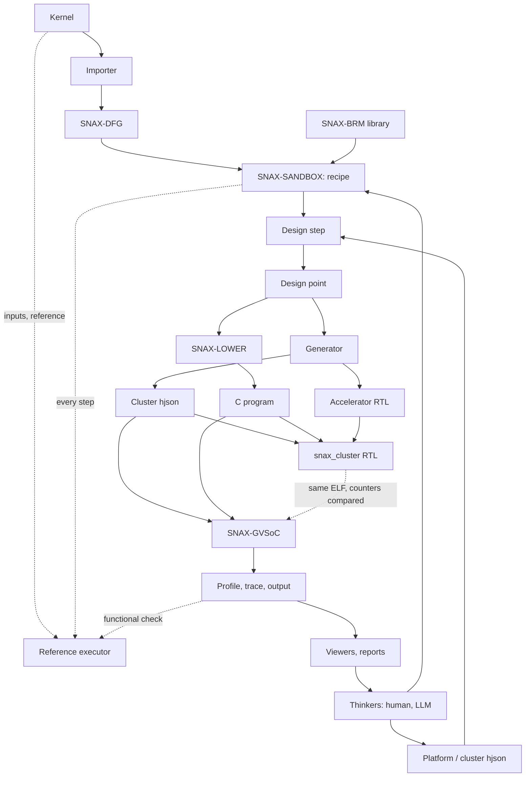

# SNAX-FORGE Architecture

What SNAX-FORGE is, its components and how they fit together. The why is in `docs/DECISIONS.md` (Dn), the artefacts field by field in `docs/CONTRACTS.md` (C§n), open work in `docs/STATUS.md`, each component's details in its module docstrings. A change to this file comes with a decision (D117).

Markers: **[PLANNED]** not built yet, with its milestone; **[OPEN]** undecided.

---

## 1. Purpose

SNAX-FORGE helps decide which accelerators a SNAX compute cluster should hold, and how they are composed, before committing to RTL.

- A user brings a workload and a library of accelerator block models (BRMs).
- SNAX-FORGE imports the workload into its own dataflow graph (SNAX-DFG), maps it by hand in SNAX-SANDBOX (loops split into temporal and spatial parts, accelerators bound), pairs it with a platform in the design step, and derives what a run needs.
- The run happens in SNAX-GVSoC, a GVSoC model of the SNAX cluster in which a Snitch core runs the real program (D116). The same design is generated for the SNAX cluster itself: the accelerator RTL, the cluster's hjson and the program (D111).
- Profiles, traces, views and reports tell a human or an LLM where the cycles went, so they can choose the next design.

The user describes the accelerator; the platform around it is the model's (D51). Model cycles are trusted as far as the comparison with snax_cluster's RTL shows (section 7).

## 2. Positioning

SNAX-FORGE complements analytical DSE tools such as ZigZag and Stream:

- **Cycle-level cluster microarchitecture**: bank arbitration, affine streamers, FIFO back-pressure, the DMA and the core's control, not analytical cost terms. The ideal estimate (D155) is a first look; the numbers come from the run.
- **Arbitrary dataflow graphs**, not only DNN layers: PolyBench kernels, stencils, reductions, later HDC workloads (D113).
- **Composition**: unit BRMs bound on the graph and stitched into accelerators (D112).
- **One description, two outputs**: a BRM gives the model's accelerator and its Chisel RTL; the hjson describes the cluster to both (D111, D116).
- **Human- and LLM-in-the-loop**: every artefact is text (D19).

The simulation technique is GVSoC's, not ours. `docs/PAPER.md` section 8 holds the related work.

## 3. Guiding principles

1. **The BRM is the user's source of truth.** The model's accelerator and the RTL are generated from it and checked against each other by one program on both (D116).
2. **One slice before generality.** A component is first built in the simplest form that carries a kernel end to end, then generalised when a real kernel needs it.
3. **The user owns the accelerator, the model owns the platform** (D51). The platform is SNAX's, read from its hjson and modelled to match its RTL.
4. **Decisions are separate from derivations.** SNAX-SANDBOX and the design step decide; SDFG ingest, the importer and SNAX-LOWER derive; the model measures.
5. **Everything is text and diffable**: graphs, BRMs, recipes, platforms, design points, task lists, programs, profiles, traces.
6. **Extend without editing the core**, by registration and namespaced attrs (D19).

## 4. System overview

- **The inner loop**: kernel → importer → SNAX-DFG → SNAX-SANDBOX (recipe) → design step (platform) → design point → SNAX-LOWER and the generator → a SNAX-GVSoC run → reports and views → the thinker edits the recipe or the platform. `pixi run flow` runs it once (section 5.8).
- **The SNAX link**: the same design point gives the bundle snax_cluster builds, and the flow's ELF runs on its RTL (section 5.7, `pixi run forge`).

## 5. Components

| Component | Code | Contract | Consumes | Produces |
|---|---|---|---|---|
| SDFG ingest | `sdfg/` | | a kernel's DaCe source in `kernels/` | raw, simplified and expanded SDFG |
| Importer | `dfg/import_sdfg.py` | C§2 | a kernel's expanded SDFG | `.snaxdfg` |
| Reference executor | `dfg/execute.py` | | `.snaxdfg`, inputs | golden output |
| SNAX-BRM | `brm/` | C§3 | hand-written BRMs | instances |
| SNAX-SANDBOX | `sandbox/` | C§4 | `.snaxdfg`, BRMs, recipe | a `.snaxdfg` per step |
| Design step | `design/` | C§5–C§7 | bound graph, platform | design point |
| Estimate | `estimate/` | C§13, C§14 | bound graph, platform and technology (both optional) | cycles, the expected BUSY_COUNTER (D155), the cost in five parts (D154, D167) |
| Cost tables | `char/` ([guide](../snax_forge/char/README.md)) | C§14 | snax-forge-experiments' tables (`pixi run import-costs`) | per block, streamer, crossbar and bank: area and energy |
| SNAX-LOWER | `lower/` | C§8, C§9 | design point | task list, `main.c` |
| Generator | `gen/gvsoc.py`, `gen/headers.py`, `gen/data.py` | C§9 | design point, the platform's source hjson | cluster and streamer hjson, `accelerator.json`, headers, `data.h`, `main.c` |
| HW generator | `gen/rtl.py`, `hw/chisel/` | C§10 | design point, the datapath catalogue | the accelerator RTL |
| Bundle | `gen/bundle.py` | C§11 | design point | snax_cluster's input |
| SNAX-GVSoC | `gvsoc/snax-gvsoc` (submodule), `gvsoc/Makefile` | | hjson, program | the program's check and window, events (D137) |
| Run | `run/` | C§12 | SNAX-GVSoC's events, the design point, the task list | profile, trace |
| Flow, forge | `flow/` | C§12 | recipe or bound graph, platform | all of the above, checked |
| Viewers | `viz/` | C§4, C§12 | run folders, `.snaxdfg` files | local HTML views |
| Reports | `report/` | | a flow folder | `design.md`, `run.md` |

Where things live:

- Packages are under `snax_forge/`, but `hw/chisel/`. SNAX-GVSoC is its own repository (D116), a submodule at `gvsoc/snax-gvsoc` that `gvsoc/Makefile` builds in snax-forge's image (D118).
- Each package's tests are in `tests/<package>/` (the Chisel specs in `hw/chisel/src/test/`, the examples' in `tests/flow/`), their fixtures beside them.
- The inputs: `kernels/`, `recipes/`, `platforms/` (with snax-forge's base cluster), `snax_forge/brm/library/`, `hw/chisel/blocks.json`.
- `util/`: the clean, environment-check, kernel-list and Markdown tools, and those that copy snax-forge-experiments' results into test fixtures.

### 5.1 SNAX-DFG and the importer

SNAX-FORGE's own dataflow graph, a `.snaxdfg` JSON file (D71, `dfg/`; C§2): symbols, containers and an ordered body of registered node kinds, body order being execution order.

- A map's loop is tagged in the sandbox (D73); a reduction is a map whose output memlet carries a `reduce` (D102); an accelerated node is one beat of a bound BRM instance (D82).
- Expressions use one grammar shared with the BRM (`expr.py`).
- `sdfg/expand.py` first expands DaCe's MatMul and Transpose into dot's shape. The importer (`pixi run import-dfg <kernel>`) reads the expanded SDFG, keeps the kernel's names, decides nothing, and names what it does not support; sequential loops and branches come with the kernels that need them (open item 36).

### 5.2 Reference executor

A NumPy interpreter of any `.snaxdfg`, imported, split or accelerated (D79, `dfg/execute.py`): maps run over their whole space at once, accelerated nodes firing by firing through their BRM's function. On the imported graph it must equal the kernel's own reference; every sandbox step and every run is compared with it.

### 5.3 SNAX-BRM

One hand-written JSON file per block in `snax_forge/brm/library/` (D68, `brm/`; C§3): a shared part and implementations, the timing always the user's numbers. The library holds `simd`, `accumulate`, `mac` and `lane_accumulate`.

- Each implementation's binding (D129) has two outputs: the GVSoC accelerator on `SnaxGroup` and `SnaxShell` (D134), and the Chisel RTL in its shell wrapper (D130).
- The pair is accepted when one ELF gives the same counters on both (D123).

### 5.4 SNAX-SANDBOX and the design step

**SNAX-SANDBOX** (D72, `sandbox/`; C§4): registered transforms rewrite a `.snaxdfg`, in the order a recipe names them, and the reference executor checks every step. `--set W=8` runs one point of a sweep.

- The transforms and their inverses are C§4's table: splitting and tagging (D73), `bind` (D82, D161), composition (`encapsulate`, `link`, `fuse_map`, `split_reduce`, D148, D150), `fuse_seed` (D163), `mark_transpose` (D164), sharing (`share`, `share_ports`, D165, D169), and recipe reuse (`lift`, `apply_recipe`, D166). **[PLANNED]** a tile transform (M15).
- Each transform may give a `site(g, selected)`, the graph-shape test of where it applies, which it calls first and the editor lists from (D72).
- The editor's session (`sandbox/session.py`) is a working recipe replayed in memory with a cursor for undo and redo; per step it gives the sites, the bind list, the marks, the diff, the estimate and the design checks, and Save writes a recipe after those checks.

**The design step** (D84–D87, `design/`; C§5–C§7) pairs a bound graph with a platform from `platforms/`, resolves the streamers (D12), makes the memory plan from registered passes, runs every design check, and writes `design_point.json`, SNAX-LOWER's and the generator's only input. `platforms/snax_forge.json` is read from snax-forge's base cluster, `platforms/snax_forge_cluster.hjson` (D131).

### 5.5 SNAX-LOWER

Turns a design point into what a run needs, and decides nothing (`lower/`):

- **Task list** (D64, `lower/derive.py`, `lower/waits.py`; C§8): a group of tasks per accelerated node, loads before and stores after, so two accelerators chain through L1 with one wait (D105); accelerators in series for now (D158).
- **C program** (D135, `lower/c.py`; C§9): the task list as `main.c` on snRuntime, one function per core, direct CSR writes on the generated headers' names, ending in `forge_check()`, the self-check against `data.h`'s goldens; main's entry and `forge_check()` bound the window.

### 5.6 SNAX-GVSoC

A GVSoC model of the SNAX cluster in its own repository: a detached copy of a chosen GVSoC commit with its history, the upstream changes listed in its `UPSTREAM.md` (D116). It builds two targets, `snitch` and `snax_hjson`, the second reading a cluster hjson at run time (`--param hjson=`, D134). It holds:

- **the core patch**: the Snitch core sends CSRs 0x3C0 to 0x5FF as IO requests to an accelerator component per core (D120); its loads as the RTL has them (D125);
- **the DMA**, GVSoC's iDMA fitted to the RTL by measurement (D121);
- **the streamers**, one per streamer set (D157), and a `SnaxPortMux` where a set's groups share its movers (D169);
- **the crossbar**, up to 128 inputs (D85), with the sparse interconnect's arbiter and the DMA on whole superbanks (D122);
- **`SnaxGroup`**, one component per group of `accelerator.json`, and its **`SnaxShell`** (the group's CSRs): the control model is one C++ class (`SnaxGroupRule`) over a registry of datapath classes, one per catalogue datapath, so a new block is one class there (D129). Its group and shell cases are what the Chisel control unit and wrapper are checked against too (C§10);
- **events**: `summary`, `events`, `beats` and `stalls` traces per component (its `docs/EVENTS.md`), which `run/` renames, never recounts (D137).

What it models is what snax_cluster's RTL does; where the two differ, the RTL wins (section 7).

### 5.7 SNAX link

A design point gives SNAX-GVSoC its hjson files, `accelerator.json` (D145), headers, `data.h` and `main.c`, and no generated code to compile (`gen/gvsoc.py`, D134; C§9). For snax_cluster it gives a bundle (`pixi run bundle`, D111; C§11): the same files and the accelerator RTL that `Emit --spec` builds from `accelerator.json` (C§10).

- The RTL is `<tag>_shell_wrapper` with its own CSR manager (D130), holding `<tag>_csr` (with `<tag>_peripherals`), `<tag>_ctrl` and `<tag>_datapath`, each register where its writer and reader are (D168), and a port mux where a set's groups share its movers (D169).
- The design's accelerators are streamer sets of the base cluster's one entry, `snax_forge_<design>` (D157), in the cluster `snax_forge_cluster`, so neither takes a name of snax_cluster's own (D131).
- `pixi run forge RECIPE` runs the flow, the bundle and its program, checks the program is the flow's ELF, writes `forge_expected.txt` and prints the commands that run it on snax_cluster's RTL. snax_cluster and snax-forge stay separate checkouts, joined only by the bundle's files (D130).
- The check is local (D123): `pixi run forge-set quick|full` makes a set's bundles and prints the one `make snax-forge-check` line that runs them in snax_cluster (`docs/TOOL.md` section 6).
- **Cosim** (M10, D52) swaps one accelerator for its RTL and checks its output, latency and II.

### 5.8 Feedback and the flow

- **The flow** (D136, D108, `flow/`; C§12): `pixi run flow RECIPE --platform P`, or from a bound `.snaxdfg`, runs the inner loop once on SNAX-GVSoC: the design point is generated, built and run, the program checks itself, and everything goes to `out/flow/<name>/`. The manual loop is flow, reports and viewer, then a changed `--set`.
- **The walk-throughs** (D98): `examples/loop1/` walks that loop and `examples/dot/` runs dot's six recipes, each with a test of its numbers; `examples/dryrun/` holds tutorials with no test: vecmul from the kernel through the editor to the RTL, dot 1 as two accelerators and encapsulated, dot 2 to 6 against SYN2.
- **Profile and trace** (D137, `run/`; C§12): SNAX-GVSoC's events converted, the trace at `task`, `beat`, `stall` or `finegrained`, and `--vcd` a gtkwave dump. A group of several linked units stays at `task` (open item 96).
- **Viewers** (D55, `viz/`; TOOL.md sections 4 and 5): a local server and a static page that only draws.
  - A run view goes through four layers, one job each: `run/`'s dataclasses; `viz/index.py`, the events grouped by their ids once at load; the queries (`viz/memory.py`, `movement.py`, `schedule.py`, `cluster.py`), which read no file; `viz/api.py`, whose routes return one query's dict.
  - The graph page (`viz/dfg/`) has two modes on one server: `view-dfg` shows given `.snaxdfg` files step by step, `edit-dfg` a session (`static/edit.js`). Each node is a compact box; independent chains are columns; a closed block is one box in its firing loops (D166); Details, the Estimate and the cost are worked out in Python (`viz/dfg/api.py`); Compare shows two steps as two columns.
- **Reports** (D55, `report/`; `pixi run report DIR`): `design.md` (what was built) and `run.md` (where the cycles went).

## 6. Correctness

Three levels, each checked against the one above:

1. **Reference executor:** the workload's golden output, equal to the kernel's reference.
2. **SNAX-GVSoC**: the same workload through the accelerators, streamers and memory; output equal to level 1.
3. **snax_cluster RTL:** the same ELF on the real cluster; output equal, counters compared (section 7). Cosim checks one accelerator on its own (D52).

Reductions are exact: integers first; a float reduction follows its BRM's accumulation order, and the check against NumPy is a tolerance (D28).

## 7. The baseline (M16)

SNAX-GVSoC is checked against snax_cluster's RTL by one ELF on both (D123). snax-gvsoc's `make regress` runs its cluster tests on the forge fixtures' cluster, snax-forge's base cluster (D131), and checks that every program finishes and each fixture's counters agree with its units' run lines. A generated design is accepted when snax-forge's ELF from its bundle prints the same `forge data` line on SNAX-GVSoC and on the RTL and each `forge counter` within its streamer fill, the verdicts of D123 (`snax-forge-check`, `docs/TOOL.md` section 6); the full set's numbers are open item 95's.

## 8. Build order

Done: M1, M3, M4a, M4b, M5, X1, M16 (the baseline) and M14 (generation to both sides). The order from here, each milestone's tasks in `docs/STATUS.md`:

1. **M13, the block library**: M7's tier A, the composed bind and the forge side of the baseline as one milestone, with the cost model of every block, streamer, crossbar and bank on Nangate 45 nm (D154, D167).
2. **M7 tiers B, C and P:** multi-cycle, multi-phase, then int8 packing.
3. **M15:** tiling, a DMA per tile.
4. **M7 tier D** with the GeMM (M9 inside it), then **tier E**.
5. **M11** and **M12** (layers, blocks, models) and the paper draft (P2).

Alongside: P1 (paper plan). When called for: M6 (contract freeze), M8 (automated DSE), M10 (cosim).

## 9. Non-goals, for now

- Generating the SNAX cluster itself: SNAX-FORGE writes its configuration, SNAX builds it (D111).
- Automated design-space search before manual exploration works.
- Bit-level accuracy in the model; that is RTL's job.
- Several clusters (HEMAIA) before one cluster matches its RTL.
