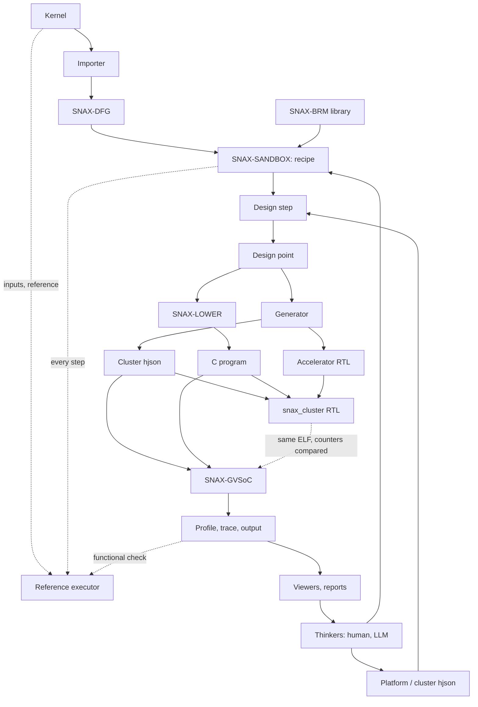

# SNAX-FORGE Architecture

What SNAX-FORGE is, its components and how they fit together. The why is in `docs/DECISIONS.md` (Dn), the artefacts in `docs/CONTRACTS.md` (C§n), open work in `docs/STATUS.md`, details in module docstrings. A change here comes with a decision (D117).

Markers: **[PLANNED]** not built yet, with its milestone; **[OPEN]** undecided.

---

## 1. Purpose

SNAX-FORGE helps decide which accelerators a SNAX compute cluster should hold, and how they are composed, before committing to RTL. A user brings a workload and a library of block models (BRMs); SNAX-FORGE imports the workload as a dataflow graph (SNAX-DFG), maps it by hand in SNAX-SANDBOX, pairs it with a platform, and runs it in SNAX-GVSoC, a GVSoC model of the SNAX cluster in which a Snitch core runs the real program (D116). The same design is generated for the SNAX cluster itself (D111), and model cycles are trusted as far as that comparison shows (section 7). Profiles, traces, views and reports tell a human or an LLM where the cycles went.

## 2. Positioning

SNAX-FORGE complements analytical DSE tools such as ZigZag and Stream with the cluster at cycle level (bank arbitration, streamers, back-pressure, the DMA, the core's control), any dataflow graph (D113), and unit BRMs composed on the graph (D112). The simulation technique is GVSoC's; `docs/PAPER.md` section 8 holds the related work.

## 3. Guiding principles

1. **The BRM is the user's source of truth**: the model's accelerator and the RTL come from it, checked by one program on both (D116).
2. **One slice before generality**: the simplest form that carries a kernel end to end, generalised when a kernel needs it.
3. **The user owns the accelerator, the model owns the platform** (D51), SNAX's, modelled to match its RTL.
4. **Decisions are separate from derivations**: SNAX-SANDBOX and the design step decide; SDFG ingest, the importer and SNAX-LOWER derive; the model measures.
5. **Everything is text and diffable** (D19).
6. **Extend without editing the core**, by registration and namespaced attrs (D19).

## 4. System overview

The inner loop, kernel to a SNAX-GVSoC run and back to the thinker who edits the recipe or the platform, is `pixi run flow` (section 5.8); the same design point gives the bundle snax_cluster builds, and the flow's ELF runs on its RTL (section 5.7, `pixi run forge`).

## 5. Components

| Component | Code | Contract | Consumes | Produces |
|---|---|---|---|---|
| SDFG ingest | `sdfg/` | | a kernel in `kernels/` | raw, simplified, expanded SDFG |
| Importer | `dfg/import_sdfg.py` | C§2 | expanded SDFG | `.snaxdfg` |
| Reference executor | `dfg/execute.py`, `reference.py` | | `.snaxdfg`, inputs | golden output |
| SNAX-BRM | `brm/` | C§3 | hand-written BRMs | instances |
| SNAX-SANDBOX | `sandbox/` | C§4 | `.snaxdfg`, BRMs, recipe | a `.snaxdfg` per step |
| Design step | `design/` | C§5–C§7 | bound graph, platform | design point |
| Estimate | `estimate/` | C§13, C§14 | bound graph; platform, technology (optional) | cycles, expected BUSY_COUNTER (D155), cost in six parts and the fixed ones, leakage beside (D154, D167, D201), a run's counts priced (D177) |
| Cost tables | `char/` ([guide](../snax_forge/char/README.md)) | C§14 | snax-forge-experiments' tables (`import-costs`) | area and energy per block, streamer, crossbar, bank |
| SNAX-LOWER | `lower/` | C§8, C§9 | design point | task list, `main.c` |
| Generator | `gen/gvsoc.py`, `accelerator.py`, `headers.py`, `data.py` | C§9, C§10 | design point, source hjson | cluster and streamer hjson, `accelerator.json`, headers, `data.h`, `main.c` |
| HW generator | `gen/rtl.py`, `gen/block.py`, `hw/chisel/` | C§10 | design point, datapath catalogue | accelerator RTL; a block alone |
| Bundle | `gen/bundle.py` | C§11 | design point | snax_cluster's input |
| SNAX-GVSoC | `gvsoc/snax-gvsoc`, `gvsoc/Makefile` | | hjson, program | the program's check and window, events (D137) |
| Run | `run/` | C§12 | events, design point, task list | profile, trace, snapshot windows (D177) |
| Flow, forge | `flow/` | C§12 | recipe or bound graph, platform | all of the above, checked |
| Viewers | `viz/` | C§4, C§12 | runs, `.snaxdfg` files | local HTML views |
| Reports | `report/` | | a flow folder | `design.md`, `run.md`, `energy.md` |

Where things live:

- Packages are under `snax_forge/`, but `hw/chisel/`; `expr.py` (the value grammar) and `common.py` (the artefacts' JSON form) are shared. SNAX-GVSoC is its own repository (D116), a submodule built in snax-forge's image (D118). Tests are in `tests/<package>/` (the Chisel specs in `hw/chisel/src/test/`).
- `util/`: the clean, environment, kernel-list and Markdown tools, `import_costs.py`, and the fixture writer `ctrl_regs.py`.

### 5.1 SNAX-DFG and the importer

The workload's graph, a `.snaxdfg` JSON file (D71, `dfg/`; C§2): symbols, containers and an ordered body of registered node kinds, body order being execution order. A map's loop is tagged in the sandbox (D73); a reduction is a map whose output memlet carries a `reduce` (D102); an accelerated node is one beat of a bound BRM instance (D82).

`sdfg/expand.py` first expands DaCe's MatMul and Transpose into dot's shape. The importer keeps the kernel's names, decides nothing, and names what it does not support; a widening convert folds into its reader as a cast (D143), a narrowing one of a computed value stays a nest of its own (D203); sequential loops and branches come with the kernels that need them (open item 36).

### 5.2 Reference executor

A NumPy interpreter of any `.snaxdfg`, imported, split or accelerated (D79, `dfg/execute.py`): maps over their whole space at once, accelerated nodes firing by firing through their BRM's function. On the imported graph it equals the kernel's reference (`dfg/reference.py`); every sandbox step and every run is compared with it.

### 5.3 SNAX-BRM

One hand-written JSON file per block in `snax_forge/brm/library/` (D68, `brm/`; C§3): `simd`, `accumulate`, `mac` and `lane_accumulate`, each a shared part and implementations, the timing the user's. Each binding (D129) gives the GVSoC accelerator (D134) and the Chisel RTL (D130), accepted when one ELF gives the same counters on both (D123).

### 5.4 SNAX-SANDBOX and the design step

**SNAX-SANDBOX** (D72, `sandbox/`; C§4): registered transforms rewrite a `.snaxdfg` in a recipe's order, the reference executor checking every step; `--set W=8` runs one point of a sweep.

- The transforms and their inverses are C§4's table: `split`, `tag_map` and `interchange_map` (D73), `bind` and `bake_scalar` (D82, D161), composition (`encapsulate`, `link`, `fuse_map`, `split_reduce`, D148, D150), the seed (`fuse_seed`, `carry_seed`, D163, D192), a scale moved past its sum (`factor_out`, D198), transposed reads (`mark_transpose`, `data_transpose`, D164, D182), sharing (`share`, `share_ports`, `fork_read`, D165, D169, D189), reuse (`lift`, `apply_recipe`, D166). **[PLANNED]** a tile transform (M15).
- A transform's `site(g, selected)` says where it applies (D72); the editor's session (`sandbox/session.py`) replays a working recipe with a cursor for undo and redo.

**The design step** (D84–D87, `design/`; C§5–C§7) pairs a bound graph with a platform, resolves the streamers (D12), makes the memory plan from registered passes, runs the design checks, and writes `design_point.json`, SNAX-LOWER's and the generator's only input; `platforms/snax_forge.json` is read from `platforms/snax_forge_cluster.hjson` (D131).

### 5.5 SNAX-LOWER

A design point into what a run needs, deciding nothing (`lower/`):

- **Task list** (D64, `lower/derive.py`, `tasks.py`, `waits.py`; C§8): a group of tasks per accelerated node, loads before and stores after, two accelerators chained through L1 with one wait (D105), in series for now (D158).
- **C program** (D135, `lower/c.py`; C§9): `main.c` on snRuntime, one function per core, CSR writes on the generated headers' names, ending in `forge_check()`, the self-check against `data.h`, which bounds the window with main's entry.

### 5.6 SNAX-GVSoC

A detached copy of GVSoC in its own repository, the upstream changes in its `UPSTREAM.md` (D116); its target `snax_hjson` reads a cluster hjson at run time (D134). It holds:

- **the core patch**: CSRs 0x3C0 to 0x5FF to an accelerator component per core (D120), loads as the RTL's (D125); **the DMA**, GVSoC's iDMA fitted to the RTL (D121);
- **the streamers**, one per set (D157), a `SnaxPortMux` for shared movers (D169); **the crossbar**, up to 128 inputs (D85), the sparse interconnect's arbiter, the DMA on whole superbanks (D122);
- **`SnaxGroup`** per group of `accelerator.json` and its **`SnaxShell`** (CSRs): one control class (`SnaxGroupRule`) over a registry of datapath classes, one per catalogue datapath (D129), whose cases check the Chisel control unit too (C§10);
- **events** per component (its `docs/EVENTS.md`), which `run/` renames, never recounts (D137), with counter snapshots on each core 0 write to CSR `0x7C5` (D177).

Where it and the RTL differ, the RTL wins (section 7).

### 5.7 SNAX link

A design point gives SNAX-GVSoC its hjson files, `accelerator.json` (D145), headers, `data.h` and `main.c`, nothing to compile (D134; C§9), and snax_cluster a bundle (D111; C§11): the same files and the RTL `Emit --spec` builds from `accelerator.json` (C§10).

- The RTL is `<tag>_shell_wrapper` with its own CSR manager (D130), holding `<tag>_csr`, `<tag>_ctrl` and `<tag>_datapath` (D168) and a port mux for shared movers (D169). The accelerators are streamer sets of one entry, `snax_forge_<design>` (D157), in `snax_forge_cluster` (D131).
- `pixi run forge RECIPE` adds the bundle to the flow, checks its program is the flow's ELF and writes `forge_expected.txt`; the repositories share only the bundle's files (D130). The check is local (D123): `pixi run forge-set quick|full` prints one `make snax-forge-check` line for a set (`docs/TOOL.md` section 6).
- **Cosim** (M10, D52) swaps one accelerator for its RTL and checks its output, latency and II.

### 5.8 Feedback and the flow

- **The flow** (D136, D108, `flow/`; C§12) runs the inner loop once, from a recipe or a bound `.snaxdfg`, into `out/flow/<name>/`, the program checking itself; `--energy` prices the run's windows (D177).
- **The walk-throughs** (D98): `examples/loop1/` and `examples/dot/` (dot's six recipes), each with a test of its numbers; `examples/dryrun/`'s tutorials have none (vecmul, dot 1, dot 2 to 6 against SYN2, mvt, bicg).
- **Profile and trace** (D137, `run/`; C§12): SNAX-GVSoC's events converted.
- **Viewers** (D55, `viz/`; TOOL.md sections 4 and 5): a local server and a static page (`viz/static/`) that only lays out and draws. A run view has four layers: `run/`'s dataclasses, `viz/index.py`, the queries (`memory.py`, `movement.py`, `schedule.py`, `cluster.py`) and `viz/api.py`. The graph page (`viz/dfg/`) gets each step's drawing (`drawing.py`, D185) and Estimate (`api.py`) from Python.
- **Reports** (D55, `report/`): `design.md` (what was built), `run.md` (where the cycles went), `energy.md` (`--energy`).

## 6. Correctness

Three levels, each checked against the one above:

1. **Reference executor:** the golden output, equal to the kernel's reference.
2. **SNAX-GVSoC**: through accelerators, streamers and memory; output equal to level 1.
3. **snax_cluster RTL:** the same ELF; output equal, counters compared (section 7).

Integer reductions are exact; a float one follows its BRM's order, checked to a tolerance (D28).

## 7. The baseline (M16)

SNAX-GVSoC is checked against snax_cluster's RTL by one ELF on both (D123). snax-gvsoc's `make regress` runs its cluster tests on snax-forge's base cluster (D131): every program finishes and each fixture's counters agree with its units' run lines. A generated design is accepted when its ELF prints the same `forge data` line on both and each `forge counter` within its streamer fill (section 5.7); the full set's numbers are STATUS's "The local RTL check".

## 8. Build order

Done: M1, M3, M4a, M4b, M5, X1, M16 (the baseline) and M14 (generation to both sides). The order from here (tasks in `docs/STATUS.md`):

1. **M13, the block library**: M7's tier A, the composed bind, the forge side of the baseline and the cost model on Nangate 45 nm (D154, D167).
2. **M7 tiers B, C and P:** multi-cycle, multi-phase, then int8 packing.
3. **M15:** tiling, a DMA per tile.
4. **M7 tier D** with the GeMM (M9 inside it), then **tier E**.
5. **M11** and **M12** (layers, blocks, models) and the paper draft (P2).

Alongside: P1 (paper plan). When called for: M6 (contract freeze), M8 (automated DSE), M10 (cosim).

## 9. Non-goals, for now

- Generating the SNAX cluster itself: SNAX-FORGE writes its configuration, SNAX builds it (D111).
- Automated design-space search before manual exploration works.
- Bit-level accuracy in the model; that is RTL's job.
- Several clusters (HEMAIA) before one cluster matches its RTL.
