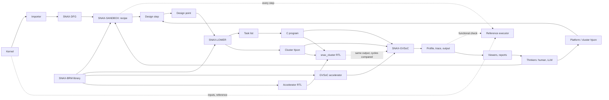

# SNAX-FORGE Architecture

> What SNAX-FORGE is, its components and how they fit together. Why:
> `docs/DECISIONS.md` (Dn); the artefacts field by field: `docs/CONTRACTS.md`
> (C§n); open work: `docs/STATUS.md`. A change to this file comes with a
> decision (D117). Each component's details live in its module docstrings.
>
> Markers: **[PLANNED]** = not built yet, with its milestone. **[OPEN]** =
> undecided.

---

## 1. Purpose

SNAX-FORGE is a platform for deciding which accelerators a SNAX compute
cluster should hold, and how they are composed, before committing to RTL.

A user brings a workload and a library of accelerator block models (BRMs).
SNAX-FORGE imports the workload into its own dataflow graph (SNAX-DFG), maps
it by hand in SNAX-SANDBOX (loops split into temporal and spatial parts,
accelerators bound), pairs it with a platform in the design step, and derives
what a run needs. The run happens in SNAX-GVSoC, a GVSoC model of the SNAX
cluster in which a Snitch core runs the real program (D116), and the same
design is generated for the SNAX cluster itself: the accelerator RTL, the
cluster's hjson and the program (D111). Profiles, traces, views and reports
tell a human or an LLM where the cycles went, so they can choose the next
design.

The user describes the accelerator; the platform around it is the model's
(D51). Model cycles are trusted as far as the comparison with snax_cluster
RTL shows (section 7).

The flow's runs happen in SNAX-GVSoC since FLOW3 (D136); SNAX-MODEL, the
pure-Python cluster model they happened in before, was removed in RET1
(D116).

## 2. Positioning

SNAX-FORGE complements analytical DSE tools such as ZigZag and Stream (D23):

- **Cycle-level cluster microarchitecture.** Bank arbitration, affine
  streamers, FIFO back-pressure, DMA and the control the core does, rather
  than analytical cost terms.
- **Arbitrary dataflow graphs**, not only DNN layers: PolyBench kernels,
  stencils, reductions, and later HDC workloads (D113).
- **Composition.** Unit BRMs bound on the graph and stitched into
  accelerators (D112).
- **One description, two outputs.** A BRM gives the model's accelerator and
  its Chisel RTL; the hjson describes the cluster to both (D111, D116).
- **Human- and LLM-in-the-loop.** Every artefact is text (D8).

The simulation technique is GVSoC's, not ours. `docs/PAPER.md` section 8
holds the related work.

## 3. Guiding Principles

1. **The BRM is the user's source of truth.** The model's accelerator and the
   RTL are generated from it and checked against each other by running one
   program on both (D116).
2. **One slice before generality.** Every component is first built in the
   simplest form that carries `vecadd` end to end, then generalised when a
   real kernel needs it.
3. **The user owns the accelerator, the model owns the platform** (D51). The
   platform is SNAX's, read from its hjson, and modelled to match its RTL.
4. **Decisions are separate from derivations.** SNAX-SANDBOX and the design
   step decide; importers and SNAX-LOWER derive; the model measures.
5. **Everything is text and diffable.** Graphs, BRMs, recipes, platforms,
   design points, task lists, programs, profiles and traces.
6. **Extend without editing the core**, by registration and namespaced attrs
   (D19).

## 4. System Overview

**Inner loop:** kernel → importer → SNAX-DFG → SNAX-SANDBOX (recipe) →
design step (platform) → design point → SNAX-LOWER → a run → reports and
views → the thinker edits the recipe or the platform. `pixi run flow` runs it
once (section 5.9). The run is SNAX-GVSoC's (FLOW3, D136); the profile and
trace come from its events (D137).

**SNAX link:** the same design point gives the bundle snax_cluster builds and
runs (section 5.8), and its RTL run is compared with the SNAX-GVSoC run.

## 5. Components

| Component | Code | Consumes | Produces | Status |
|---|---|---|---|---|
| SDFG ingest | `sdfg/` | a kernel's DaCe source in `kernels/` | raw and simplified SDFG | built |
| Importer | `dfg/import_sdfg.py` | a kernel's simplified SDFG | `.snaxdfg` | built |
| Reference executor | `dfg/execute.py` | `.snaxdfg`, inputs | golden output | built |
| SNAX-BRM | `brm/` | hand-written BRMs | instances | built; binding GEN3 (D129) |
| SNAX-SANDBOX | `sandbox/` | `.snaxdfg`, BRMs, recipe | a `.snaxdfg` per step | built |
| Design step | `design/` | bound graph, platform | design point | built |
| SNAX-LOWER | `lower/` | design point, BRMs | task list, `main.c` | built (C program GEN2a, D135) |
| SNAX-GVSoC | `gvsoc/snax-gvsoc` (submodule), `gvsoc/Makefile` | hjson, program | the program's check and window; counters and events in its own grammar (D137) | built (M16) |
| Run | `run/` | SNAX-GVSoC's events, the hjson files, design point and task list | profile, trace (C§7); the traces and options a level and its sources turn on | FLOW3 rounds 1b, 2a |
| Generator | `gen/` | design point, the platform's source hjson | cluster, streamer and accelerator hjson, CSR headers, `data.h`, `main.c`, manifest | GEN3, LNK2a, GEN2a (D134, D135) |
| HW generator | `gen/rtl.py`, `hw/chisel/` | design point, the block catalogue | `rtl.json`, then the accelerator RTL with its shell wrapper | GEN1 (D138) |
| Flow | `flow/` | recipe or bound graph, platform | all of the above, checked | built |
| Viewers | `viz/` | run directories, `.snaxdfg` files | local HTML views | built |
| Reports | `report/` | a flow folder or run directory | `design.md`, `run.md` | built |

Packages are under `snax_forge/` except `hw/chisel/`. SNAX-GVSoC is its own
KULeuven-MICAS repository (D116), a submodule at `gvsoc/snax-gvsoc` that
`gvsoc/Makefile` builds and runs in snax-forge's development image from
`container/` (D118).

### 5.1 SNAX-DFG and the importer

SNAX-FORGE's own dataflow graph, a `.snaxdfg` JSON file (D71, D77; C§11): a
tree of symbols, containers and an ordered body of registered node kinds.
`map` is one variable over a range, `tasklet` is `output = expression` per
output, and `accelerated` is one beat of a bound BRM instance inside the
temporal maps it runs over (D82). Body order is execution order; memlets sit
on the connectors of the nodes that use the data. A map's `loop.kind` is
absent as imported, then `tile`, `temporal` or `spatial` (D73). A reduction
is a map whose output memlet carries a `reduce` op and identity (D102).
Expressions use one grammar shared with the BRM (`expr.py`: ints, names,
`+ - * //`). Streamers are not nodes (D71).

The importer (D78, `pixi run import-dfg <kernel>`) reads the simplified SDFG
that `pixi run forge <kernel>` writes, keeps the kernel's names, decides
nothing, and names what it does not support. Sequential loops and branches
come with the kernels that need them (open item 36).

### 5.2 Reference executor

A NumPy interpreter of any `.snaxdfg`, as imported, split or accelerated
(D79): maps run over their whole space at once, accelerated nodes firing by
firing through their BRM's function, with named rates from `named_rates`
(D104). On the imported graph it must equal the kernel's own reference;
every sandbox step and every run is compared with it.

### 5.3 SNAX-BRM

One hand-written JSON file per accelerator in `snax_forge/brm/library/`
(D68; C§10): a shared part (interface, function with `code`, per-port
dataflow nest, pattern) and implementations (source, supported values,
timing `latency` / `initiation_interval` / `drain`, hardware binding).
Timing is always the user's numbers. `Brm.resolve` makes an instance from an
implementation and its design params. The library holds `elementwise_add`,
`elementwise_mul` and `accumulate`.

Each BRM has two outputs: the GVSoC accelerator from its binding on
`SnaxUnit` and `SnaxShell` (GEN3, D128, D129), and the Chisel RTL with the
generated shell wrapper (GEN1, D130, D138): the binding resolved into
`rtl.json`, checked against the block catalogue, then elaborated. The pair is
accepted when one ELF gives the same counters on both (D123, GEN2b), the
GVSoC side first against the BRM's predicted counter (GEN3, D127).

### 5.4 SNAX-SANDBOX and the design step

**SNAX-SANDBOX** (D72; C§12). Registered transforms rewrite a `.snaxdfg`; a
recipe in `recipes/` names a kernel, params, symbol values and the steps;
the reference executor checks every step; `--set W=8` runs one point of a
sweep. Transforms: `split_map`, `bind` (patterns `elementwise` and `reduce`;
design params read off the graph, D73, D104), and their inverses `unbind`
and `join_map`. **[PLANNED]** the composed bind (M13, D112) and a tile
transform (LOW3b).

**The design step** (D84–D87; C§13–15). It pairs a bound graph with a
platform file from `platforms/`, resolves the streamer shell (one streamer
per port, `<instance>_<port>`, D75), makes the memory plan from registered
passes (contiguous by default, with pins), runs every design check, and
writes `design_point.json`, SNAX-LOWER's only input. `--set platform.PATH=V`
and `--set memory.C.l1.base=N` change a working copy. A platform can also be
read from snax_cluster's hjson (`design from-hjson`, LNK1, D131).

### 5.5 SNAX-LOWER

Turns a design point into what a run needs, and decides nothing.

- **Task list** (D89, `lower/derive.py`; C§9): one group of tasks per
  accelerated node in execution order, loads before and stores after,
  streamer values from the memlets through the memory plan, `after` holding
  data dependences only, so two accelerators chain through L1 with one wait
  (D105). It is the hand-off to the backend, and its waits are placed
  once, only those correctness needs (D64, `lower/waits.py`).
- **C program** (D135, `lower/c.py`; C§16): the task list as `main.c` on
  snRuntime, one function per core from the cluster hjson, each a straight
  line: direct CSR writes on the generated headers' names, the DMA through
  snRuntime, the lowering's waits on SNAX components as polls and the
  DMA's on dependences only (its transfers queue), a hardware barrier where
  another core goes on, each accelerator task's counter stored after its
  wait, and `forge_check()`: the self-check against `data.h`'s goldens
  (`gen/data.py`), whose entry ends the program's window, which main's
  entry starts (one `mcycle` read at each, no task marks). The generator writes it with
  the hjson files; the same ELF is to run on SNAX-GVSoC and on snax_cluster
  RTL (GEN2b). One accelerator per program (open item 79).

### 5.6 SNAX-GVSoC

A GVSoC model of the SNAX cluster in its own repository: a detached copy of a
chosen GVSoC commit with its history, the submodules folded in, the upstream
hashes recorded and the license kept (D116). snax-forge holds it as a
submodule at `gvsoc/snax-gvsoc`, with `gvsoc/Makefile` that builds and runs
it (D128). It holds:

- one **SNAX target**, `snax_hjson`, read from a cluster hjson at run time
  (LNK2a, D134): `snax_alu` and `snax_alu_sparse` are it on their fixed
  file, a design point's cluster file is passed with `--param hjson=`;
- a small **core patch**: the Snitch core sends CSRs 0x3C0 to 0x5FF as
  32-bit IO requests at 4 × CSR on its `snax_csr` port, bound to an
  accelerator component per core, so a `csrw` reaches the accelerator's
  registers as in RTL (SG1, D120); the cores' **loads** as the hjson and
  the RTL have them, one integer load in flight and the measured path
  cycles (SG5, D125);
- the **DMA**: GVSoC's iDMA model fitted to the RTL by measurement, with the
  cluster's DMA perf counters (SG2, D121); a **streamer** configured from the
  hjson's streamer template; a **crossbar** in front of the banks for the
  streamer's ports, the cores and AXI, copying the plain or the sparse
  interconnect's arbiter, with the DMA taking whole superbanks (SG3, SG7,
  snax-gvsoc #10, D122); the hand-written **`snax_alu`**
  (SG4), and the generic **`SnaxUnit`** and **`SnaxShell`** in one standard
  composite built from a slot's datapath block, in place of the
  hand-written `SnaxAluAcc` (GEN3, LNK2a, D128, D134); each checked against the RTL by
  running the same ELF on both and comparing counters (D123), and the
  whole cluster per phase against a three-tier target, checked by hand from
  fresh runs of one ELF on both sides, while `make regress` checks that
  every program finishes and `dma-timing` that the DMA's counters stay the
  RTL's (SG5, SG6, SG7, D123);
- **events** for the profile and the views: a `summary`, `events` and
  `beats` trace per SNAX component (unit, streamer, crossbar, core, iDMA) in
  snax-gvsoc's own grammar, which snax-forge's converter renames into its
  profile and trace, never recounting (D137); a `stalls` trace and the beat
  and stall lines (grants, DMA beats, firings, pushes, stalls, queue counts,
  linked by ids) come in FLOW3 round 2a.

What it models is what snax_cluster's RTL does; where the two differ, the
RTL wins. Memory-mapped register writes may replace the CSR path later; the
register blocks then sit on the interconnect, with no new core patch.

### 5.7 The model: SNAX-GVSoC

The model is SNAX-GVSoC (section 5.6): the flow builds the generated
program and runs it there (D136). SNAX-MODEL, the pure-Python cluster model
the flow ran before, was removed in RET1 with its scenarios and contracts
(C§2–C§6, C§8; D116); its text is in git history (commit `cad6619`).

### 5.8 SNAX link

For SNAX-GVSoC, a design point gives the hjson files, the CSR headers and the
program, no generated Python (GEN3, LNK2a, GEN2a; `gen/`, D128, D134, D135).
For snax_cluster SNAX-FORGE writes a bundle, a folder per design point
(`pixi run bundle`, `gen/bundle.py`, C§18, D111; the flow does not call
it). The generated accelerator is `snax_forge` and its cluster
`snax_forge_cluster`, so neither takes a name of snax_cluster's own (D131,
D139):

- **accelerator RTL** from each BRM's hardware binding (GEN1, D138):
  `gen/rtl.py` resolves it into `rtl.json` (C§17) and checks it against
  the block catalogue `hw/chisel/blocks.json`; `Emit --spec` builds the
  Chisel blocks in `hw/chisel/` (D91) into `<tag>_shell_wrapper` on SNAX's
  CSR request/response and streamer ports, with its own CSR manager on
  ReqRspManager's protocol and a `ctrl` adapter (D130); `pixi run gen-rtl`
  alone, which the flow does not call (D136), and in the bundle's `rtl/`
  with `rtl/files.f`, its file list;
- **cluster hjson**, three files (D134): the cluster (the platform's source
  with its TCDM, DMA width and DRAM written back, the cluster renamed and
  the slot's name, CSR and port counts set, its manager off and its RTL's
  file list named, `snax_forge_rtl`), the streamer template lowered per
  design point, and the datapath block; SNAX-GVSoC reads the same files
  (LNK2a);
- the **program** (section 5.5).

snax_cluster and snax-forge stay separate checkouts, joined only by the
bundle's files (D139; LNK2b, snax_cluster #659): clustergen and snaxgen
resolve the cross-file `$ref`s, snaxgen turns `snax_forge_rtl` into
`generated/snax_forge.f`, which the vsim and Verilator builds read, and the
`snax_forge_cluster` Bender target builds the rest; snax_cluster's
`snax-forge-ci.yml` builds a vecadd bundle it keeps as a fixture (C§18).
Questa elaborates a bundle and Verilator builds it; running its program on
the RTL is GEN2b.

**Cosim** (M10, D52) swaps one accelerator for its RTL and checks its output,
latency and II.

### 5.9 Feedback and the flow

**Profile and trace** (C§7): the program's window (total cycles), cycle
classes per accelerator, streamer mover and core, firings and utilisation,
CSR accesses and waits per core, grants, conflicts and stalls per bank and
port, FIFO maxima, DMA traffic, and the functional check. SNAX-GVSoC writes
its counters and events in its own grammar into one file, and `run/`
converts them (D137). The trace is an event log at level `task`, `beat`,
`stall` or `finegrained` (none at `off`), and `--vcd` a gtkwave dump.

**Viewers** (D55, `pixi run view DIR ...`, `pixi run view-dfg FILE ...`): a
local server on 127.0.0.1 and a static page, stdlib only, offline. Run views
(D57) of a flow run: the profile report, the memory tab (D96) with data
movement (D97), and the schedule over the window with the cluster view at
the selected cycle. The DFG viewer
(D81) shows graphs side by side. A run view goes through four layers, one
job each: `run/`'s dataclasses (the events with their ids and lookups, the
regions, the cluster); `viz/index.py`, the run's events grouped by those
keys once at load, never matched by order, ids with their task (the
accelerator's tasks paired with their streamers' through the task list),
with the memory tab's marks registered on it; `viz/memory.py`, `viz/movement.py`,
`viz/schedule.py` (lanes, folded segments, detail rows) and `viz/cluster.py` (the cluster at
a cycle, event stepping), queries on the index that read no file; and `viz/api.py`, whose routes return one query's
dict for `static/` to draw; the page computes nothing of its own (D57).

**Reports** (D99, `pixi run report DIR`): `design.md` (what was built) and
`run.md` (where the cycles went), Markdown from dataclasses, for humans and
LLMs alike.

**The flow** (D90, D108, D136): `pixi run flow RECIPE --platform P [--set
...]`, or from a bound `.snaxdfg`, runs the inner loop once on SNAX-GVSoC:
the design point is generated (hjson, headers, `data.h` with the reference
executor's goldens, `main.c`), built and run, and the program checks itself;
everything goes to `out/flow/<name>/`, with `flow.log`. The manual loop is
flow, reports and viewer, then a changed `--set`; `examples/loop1/` walks
it on SNAX-GVSoC, and `examples/dot/` is parked until M13.

## 6. Correctness

Three levels, each checked against the one above:

1. **Reference executor:** the workload's golden output, equal to the
   kernel's reference.
2. **SNAX-GVSoC**: the same workload through the
   accelerators, streamers and memory; output equal to level 1.
3. **snax_cluster RTL:** the same program on the real cluster; output equal,
   cycles compared per phase (section 7). Cosim checks one accelerator on its
   own (D52).

Reductions are exact: integers first; a float reduction follows its BRM's
accumulation order, and the check against NumPy is a tolerance (D28).

## 7. The baseline (M16)

SNAX-GVSoC is checked against snax_cluster RTL before anything is generated.
It starts on `snax_alu` (SNAX's adder, `elementwise_add` at W = 4): SNAX's
hand-written `snax-alu` app runs unchanged on both, at a few sizes, and the
deviation is explained per phase against an error target fixed beforehand
(open item 3), checked by hand from fresh runs of one ELF; a regression
checks that every program finishes (SG5, SG6, D123). Generation (M14) is then
accepted when one ELF gives the same counters on the generated GVSoC
accelerator and the generated RTL (D123, GEN2b), the GVSoC side first against
the BRM's predicted counter (GEN3, D127).

## 8. Build Order

Done: M1, M4a, M3, M4b, M5 and X1 (git history at tag `pre-gvsoc`), and M16,
SNAX-GVSoC aligned with snax_cluster, the baseline. The order from here
(D116, `docs/STATUS.md` has the tasks):

1. **M14** (D127): to SNAX-GVSoC first (LNK1, GEN3, LNK2a, GEN2a, FLOW3,
   RET1 after its round 1), then to snax_cluster (GEN1, LNK2b, GEN2b), then
   clean-up (a housekeeping pass, one generator).
2. **M7 tier A:** 2-D plumbing, int64 mat-vecs (D113, PAPER §6.1).
3. **M13:** the composed bind, then the composed accelerator in SNAX (LNK3).
4. **M7 tiers B, C and P:** multi-cycle, multi-phase, then int8 packing.
5. **M15:** tiling, a DMA per tile.
6. **M7 tier D** with the GeMM (M9 inside it), then **tier E**.
7. **M11** and **M12** (layers, blocks, models) and the paper draft (P2).

Alongside: P1 (paper plan). When called for: M6 (contract freeze), M8
(automated DSE), M10 (cosim).

## 9. Non-Goals (for now)

- Generating the SNAX cluster itself: SNAX-FORGE writes its configuration,
  SNAX builds it (D111).
- Automated design-space search before manual exploration works.
- Bit-level accuracy in the model; that is RTL's job.
- Several clusters (HEMAIA) before one cluster matches its RTL.
