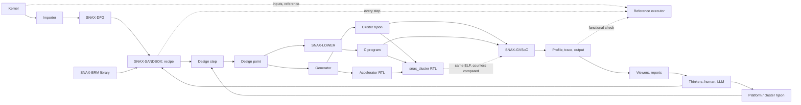

# SNAX-FORGE Architecture

> What SNAX-FORGE is, its components and how they fit together. Why: `docs/DECISIONS.md` (Dn); the artefacts field by field: `docs/CONTRACTS.md` (C§n); open work: `docs/STATUS.md`. A change to this file comes with a decision (D117). Each component's details live in its module docstrings.
>
> Markers: **[PLANNED]** = not built yet, with its milestone. **[OPEN]** = undecided.

---

## 1. Purpose

SNAX-FORGE is a platform for deciding which accelerators a SNAX compute cluster should hold, and how they are composed, before committing to RTL.

A user brings a workload and a library of accelerator block models (BRMs). SNAX-FORGE imports the workload into its own dataflow graph (SNAX-DFG), maps it by hand in SNAX-SANDBOX (loops split into temporal and spatial parts, accelerators bound), pairs it with a platform in the design step, and derives what a run needs. The run happens in SNAX-GVSoC, a GVSoC model of the SNAX cluster in which a Snitch core runs the real program (D116), and the same design is generated for the SNAX cluster itself: the accelerator RTL, the cluster's hjson and the program (D111). Profiles, traces, views and reports tell a human or an LLM where the cycles went, so they can choose the next design.

The user describes the accelerator; the platform around it is the model's (D51). Model cycles are trusted as far as the comparison with snax_cluster RTL shows (section 7).

## 2. Positioning

SNAX-FORGE complements analytical DSE tools such as ZigZag and Stream (D23):

- **Cycle-level cluster microarchitecture.** Bank arbitration, affine streamers, FIFO back-pressure, DMA and the control the core does, rather than analytical cost terms.
- **Arbitrary dataflow graphs**, not only DNN layers: PolyBench kernels, stencils, reductions, and later HDC workloads (D113).
- **Composition.** Unit BRMs bound on the graph and stitched into accelerators (D112).
- **One description, two outputs.** A BRM gives the model's accelerator and its Chisel RTL; the hjson describes the cluster to both (D111, D116).
- **Human- and LLM-in-the-loop.** Every artefact is text (D8).

The simulation technique is GVSoC's, not ours. `docs/PAPER.md` section 8 holds the related work.

## 3. Guiding Principles

1. **The BRM is the user's source of truth.** The model's accelerator and the RTL are generated from it and checked against each other by running one program on both (D116).
2. **One slice before generality.** Every component is first built in the simplest form that carries `vecadd` end to end, then generalised when a real kernel needs it.
3. **The user owns the accelerator, the model owns the platform** (D51). The platform is SNAX's, read from its hjson, and modelled to match its RTL.
4. **Decisions are separate from derivations.** SNAX-SANDBOX and the design step decide; SDFG ingest, importers and SNAX-LOWER derive; the model measures.
5. **Everything is text and diffable.** Graphs, BRMs, recipes, platforms, design points, task lists, programs, profiles and traces.
6. **Extend without editing the core**, by registration and namespaced attrs (D19).

## 4. System Overview

**Inner loop:** kernel → importer → SNAX-DFG → SNAX-SANDBOX (recipe) → design step (platform) → design point → SNAX-LOWER and the generator → a SNAX-GVSoC run → reports and views → the thinker edits the recipe or the platform. `pixi run flow` runs it once (section 5.8).

**SNAX link:** the same design point gives the bundle snax_cluster builds, and the flow's ELF runs on its RTL (section 5.7, `pixi run forge`).

## 5. Components

| Component | Code | Fields | Consumes | Produces |
|---|---|---|---|---|
| SDFG ingest | `sdfg/` | | a kernel's DaCe source in `kernels/` | raw, simplified and expanded SDFG |
| Importer | `dfg/import_sdfg.py` | C§11 | a kernel's expanded SDFG | `.snaxdfg` |
| Reference executor | `dfg/execute.py` | | `.snaxdfg`, inputs | golden output |
| SNAX-BRM | `brm/` | C§10 | hand-written BRMs | instances |
| SNAX-SANDBOX | `sandbox/` | C§12 | `.snaxdfg`, BRMs, recipe | a `.snaxdfg` per step |
| Design step | `design/` | C§13–C§15 | bound graph, platform | design point |
| SNAX-LOWER | `lower/` | C§9, C§16 | design point | task list, `main.c` |
| Generator | `gen/gvsoc.py`, `gen/headers.py`, `gen/data.py` | C§16 | design point, the platform's source hjson | cluster and streamer hjson, `accelerator.json`, CSR headers, `data.h`, `main.c` |
| HW generator | `gen/rtl.py`, `hw/chisel/` | C§17 | design point, the datapath catalogue | `accelerator.json`, the accelerator RTL |
| Bundle | `gen/bundle.py` | C§18 | design point | snax_cluster's input |
| SNAX-GVSoC | `gvsoc/snax-gvsoc` (submodule), `gvsoc/Makefile` | | hjson, program | the program's check and window, events (D137) |
| Run | `run/` | C§7 | SNAX-GVSoC's events, the design point, task list | profile, trace |
| Flow, forge | `flow/` | C§7 | recipe or bound graph, platform | all of the above, checked |
| Viewers | `viz/` | | run directories, `.snaxdfg` files | local HTML views |
| Reports | `report/` | | a flow folder or run directory | `design.md`, `run.md` |

Packages are under `snax_forge/` except `hw/chisel/`. SNAX-GVSoC is its own KULeuven-MICAS repository (D116), a submodule at `gvsoc/snax-gvsoc` that `gvsoc/Makefile` builds and runs in snax-forge's development image from `container/` (D118). Each package's tests are in `tests/<package>/` (the Chisel specs in `hw/chisel/src/test/`, the examples' in `tests/flow/`), their fixtures beside them (`tests/dfg/fixtures/`, `tests/run/fixtures/`, `hw/chisel/src/test/resources/rtl/`); the inputs are in `kernels/` (with `tests/kernels/`), `recipes/`, `platforms/` (with snax-forge's base cluster), `snax_forge/brm/library/` and `hw/chisel/blocks.json`; `util/` holds the clean, environment-check, kernel-list and Markdown tools.

### 5.1 SNAX-DFG and the importer

SNAX-FORGE's own dataflow graph, a `.snaxdfg` JSON file (D71, `dfg/`; C§11): symbols, containers and an ordered body of registered node kinds, body order being execution order, memlets on the connectors of the nodes that use the data. A map's loop is tagged in the sandbox (D73); a reduction is a map whose output memlet carries a `reduce` (D102); an accelerated node is one beat of a bound BRM instance (D82). Expressions use one grammar shared with the BRM (`expr.py`).

Before it, `sdfg/expand.py` expands DaCe's MatMul and Transpose into dot's shape, a multiply map and a Reduce over the contracted axis (D71). The importer (`dfg/import_sdfg.py`, `pixi run import-dfg <kernel>`) reads the expanded SDFG that `pixi run sdfg <kernel>` writes, keeps the kernel's names, decides nothing, and names what it does not support (D71). Sequential loops and branches come with the kernels that need them (open item 36).

### 5.2 Reference executor

A NumPy interpreter of any `.snaxdfg`, as imported, split or accelerated (D79, `dfg/execute.py`): maps run over their whole space at once, accelerated nodes firing by firing through their BRM's function. On the imported graph it must equal the kernel's own reference; every sandbox step and every run is compared with it.

### 5.3 SNAX-BRM

One hand-written JSON file per accelerator in `snax_forge/brm/library/` (D68, `brm/`; C§10): a shared part and implementations, the timing always the user's numbers. The library holds `elementwise_add`, `elementwise_mul` and `accumulate`.

Each implementation's binding (D129) has two outputs: the GVSoC accelerator on `SnaxGroup` and `SnaxShell` (D134), and the Chisel RTL in its shell wrapper (D130). The pair is accepted when one ELF gives the same counters on both (D123).

### 5.4 SNAX-SANDBOX and the design step

**SNAX-SANDBOX** (D72, `sandbox/`; C§12). Registered transforms rewrite a `.snaxdfg`; a recipe in `recipes/` names a kernel, params, symbol values and the steps; the reference executor checks every step; `--set W=8` runs one point of a sweep. Transforms: `split_map`, `tag_map` (a tag without a split), `bind` (patterns `elementwise`, `reduce` and `lane_fold`, design params read off the graph, D73), `encapsulate`, `split_reduce`, `fuse_map` and `link` (D148, D150), and their inverses `untag_map`, `unbind`, `join_map`, `unencapsulate`, `join_reduce`, `unfuse_map` and `unlink`. **[PLANNED]** a tile transform (LOW3b).

**The design step** (D84–D87, `design/`; C§13–C§15). It pairs a bound graph with a platform from `platforms/`, resolves the streamers (D12), makes the memory plan from registered passes, runs every design check, and writes `design_point.json`, SNAX-LOWER's and the generator's only input. The platform `platforms/snax_forge.json` is read from snax-forge's base cluster, `platforms/snax_forge_cluster.hjson` (`design from-hjson`, D131).

### 5.5 SNAX-LOWER

Turns a design point into what a run needs, and decides nothing (`lower/`).

- **Task list** (D64, `lower/derive.py`, `lower/waits.py`; C§9): one group of tasks per accelerated node, loads before and stores after, so two accelerators chain through L1 with one wait (D105).
- **C program** (D135, `lower/c.py`; C§16): the task list as `main.c` on snRuntime, one function per core, direct CSR writes on the generated headers' names, ending in `forge_check()`, the self-check against `data.h`'s goldens; main's entry and `forge_check()`'s bound the window. One accelerator per program, each of its groups a task of its own (D148).

### 5.6 SNAX-GVSoC

A GVSoC model of the SNAX cluster in its own repository: a detached copy of a chosen GVSoC commit with its history, the submodules folded in and the upstream changes listed (`UPSTREAM.md`, D116). The flow builds the generated program and runs it there (D136). It builds two targets, `snitch` and `snax_hjson`, the second read from a cluster hjson at run time (D134): a design point's cluster file is passed with `--param hjson=`, its default the vecadd fixture's. It holds:

- a **core patch**: the Snitch core sends CSRs 0x3C0 to 0x5FF as IO requests to an accelerator component per core (D120); its loads as the hjson and the RTL have them (D125);
- the **DMA**, GVSoC's iDMA fitted to the RTL by measurement (D121); the **streamer**, from the hjson's streamer template; the **crossbar**, with the sparse interconnect's arbiter and the DMA on whole superbanks (D122);
- the generic **`SnaxGroup`**, one component per group of `accelerator.json`, and its **`SnaxShell`** (the group's CSRs): the group's control model is one C++ class (`SnaxGroupRule`, `snax/snax_group.hpp`, the `<tag>_<group>_ctrl` of C§17) over a registry of datapath classes, one per catalogue datapath (`snax/snax_datapath.hpp`), so a new basic block is one class and one registry line there (D129); its group cases (`tests/snax/group/cases/`), and the shell's (`tests/snax/shell/cases/`), are what snax-forge's Chisel control unit and wrapper are checked against too (C§17);
- **events**: `summary`, `events`, `beats` and `stalls` traces per SNAX component in its own grammar (snax-gvsoc `docs/EVENTS.md`), which `run/` renames, never recounts (D137).

What it models is what snax_cluster's RTL does; where the two differ, the RTL wins (section 7).

### 5.7 SNAX link

A design point gives SNAX-GVSoC its cluster and streamer hjson and `accelerator.json` (D145), the CSR and cluster headers, `data.h` and `main.c`, and no generated code to compile (`gen/gvsoc.py`, D134; C§16). For snax_cluster it gives a bundle (`pixi run bundle`, `gen/bundle.py`, D111; C§18): the same files, and the accelerator RTL that `Emit --spec` builds from `accelerator.json` (C§17), checked against the datapath catalogue `hw/chisel/blocks.json`, as `<tag>_shell_wrapper` with its own CSR manager (D130). The accelerator is the base cluster's `snax_forge` slot and its cluster `snax_forge_cluster`, so neither takes a name of snax_cluster's own (D131).

`pixi run forge RECIPE [--set ...]` (`flow/forge.py`) runs the flow, the bundle and the bundle's program, checks that the program is the flow's ELF, writes each step's output to `out/forge/<name>/forge.log`, and prints the commands that run that ELF on snax_cluster's Verilator build. snax_cluster and snax-forge stay separate checkouts, joined only by the bundle's files (D130): snax_cluster's `snax_forge.mk` builds and runs a bundle, and its `snax-forge-ci.yml` does so for the vecadd and vsum fixtures it keeps (D123; `docs/RUN.md` section 8).

**Cosim** (M10, D52) swaps one accelerator for its RTL and checks its output, latency and II.

### 5.8 Feedback and the flow

**The flow** (D136, D108, `flow/`; C§7): `pixi run flow RECIPE --platform P [--set ...]`, or from a bound `.snaxdfg`, runs the inner loop once on SNAX-GVSoC: the design point is generated, built and run, and the program checks itself; everything goes to `out/flow/<name>/`, with `flow.log`. The manual loop is flow, reports and viewer, then a changed `--set`; `examples/loop1/` walks it, and `examples/dot/` runs dot's six recipes.

**Profile and trace** (D137, `run/`; C§7): SNAX-GVSoC's events converted, the trace at level `task`, `beat`, `stall` or `finegrained` (none at `off`), and `--vcd` a gtkwave dump.

**Viewers** (D55, D57, `viz/`; `pixi run view DIR ...`, `pixi run view-dfg FILE ...`): a local server and a static page. A run view goes through four layers, one job each: `run/`'s dataclasses; `viz/index.py`, the run's events grouped by their ids once at load; the queries (`viz/memory.py`, `viz/movement.py`, `viz/schedule.py`, `viz/cluster.py`), which read no file; and `viz/api.py`, whose routes return one query's dict for `static/` to draw.

**Reports** (D99, `report/`; `pixi run report DIR`): `design.md` (what was built) and `run.md` (where the cycles went).

## 6. Correctness

Three levels, each checked against the one above:

1. **Reference executor:** the workload's golden output, equal to the kernel's reference.
2. **SNAX-GVSoC**: the same workload through the accelerators, streamers and memory; output equal to level 1.
3. **snax_cluster RTL:** the same ELF on the real cluster; output equal, counters compared (section 7). Cosim checks one accelerator on its own (D52).

Reductions are exact: integers first; a float reduction follows its BRM's accumulation order, and the check against NumPy is a tolerance (D28).

## 7. The baseline (M16)

SNAX-GVSoC is checked against snax_cluster's RTL by one ELF on both, the counters free of the core's timing compared by hand (D123). snax-gvsoc's `make regress` runs its cluster tests on the forge fixtures' cluster, snax-forge's base cluster (D131), and checks that every program finishes and the fixtures' counters equal their beats. A generated design is accepted when snax-forge's ELF from its bundle gives the same `forge counter` on SNAX-GVSoC and on the RTL and the window within 10% (GEN2b, `docs/RUN.md` section 8).

## 8. Build Order

Done: M1, M4a, M3, M4b, M5 and X1 (git history at tag `pre-gvsoc`), M16 (the baseline) and M14 (generation to both sides, closed by CLN1). The order from here (D116, D141; `docs/STATUS.md` has the tasks):

1. **M13, the block library** (D141): M7's tier A, the composed bind and BASE1's forge side as one milestone, in nine phases, with RAM1 alongside: OpenRAM macros sized for the cluster, in snax-forge-experiments, so snax_cluster and snitch_cluster synthesize on the same macros.

   | Phase | Content |
   |---|---|
   | B0 flow pieces (`done`) | the runtime's cluster headers per design point (open item 68); the importer's scalars, views, `max`, `min` and casts; the MatMul and Transpose pass; ND1's slice; a restart every T < n |
   | B1 one description (`done`) | `accelerator.json` per design point (C§17, D145), read by Emit, the catalogue check and SNAX-GVSoC; groups with their own START, JOBS, STATUS, COUNTER and pins (D146); each block a pure datapath under one nest controller per group, three modules (D147); groups in SNAX-DFG and `encapsulate`, so dot variant 1 is one accelerator of two groups (D148) |
   | B1x links (`done`) | dot 2–6 and matvec 1–6 on one description with links (D112); the control unit per group (D147); `Mac`, `SerialAccumulate` and `LinkBuffer` (D149); `split_reduce`, `fuse_map` and `link` (D150); on SNAX-GVSoC, and checked locally on snax_cluster |
   | clean-up | snax_cluster's CI time (agreed with the cluster's maintainers first), and whatever B1x leaves |
   | VIEW2 | the interactive SNAX-DFG viewer: select a part of the graph, apply a transform from a side list, a step history with undo, save a recipe, a first-order profile |
   | SYN1 | synthesis of the basic blocks and kernels in KULeuven-MICAS/snax-forge-experiments |
   | HWCOST | a first-order area and energy estimate from SYN1 |
   | B2 (shrunk) | the 1-stream SIMD, axpy's CSR scalar, the lane accumulator without an op, the fold's `init` port, other group binds |
   | tier A | B3's fork, join, broadcast, hold and fragments, with B4's bicg, mvt, gesummv and atax |

2. **M7 tiers B, C and P:** multi-cycle, multi-phase, then int8 packing.
3. **M15:** tiling, a DMA per tile.
4. **M7 tier D** with the GeMM (M9 inside it), then **tier E**.
5. **M11** and **M12** (layers, blocks, models) and the paper draft (P2).

Alongside: P1 (paper plan). When called for: M6 (contract freeze), M8 (automated DSE), M10 (cosim).

## 9. Non-Goals (for now)

- Generating the SNAX cluster itself: SNAX-FORGE writes its configuration, SNAX builds it (D111).
- Automated design-space search before manual exploration works.
- Bit-level accuracy in the model; that is RTL's job.
- Several clusters (HEMAIA) before one cluster matches its RTL.
