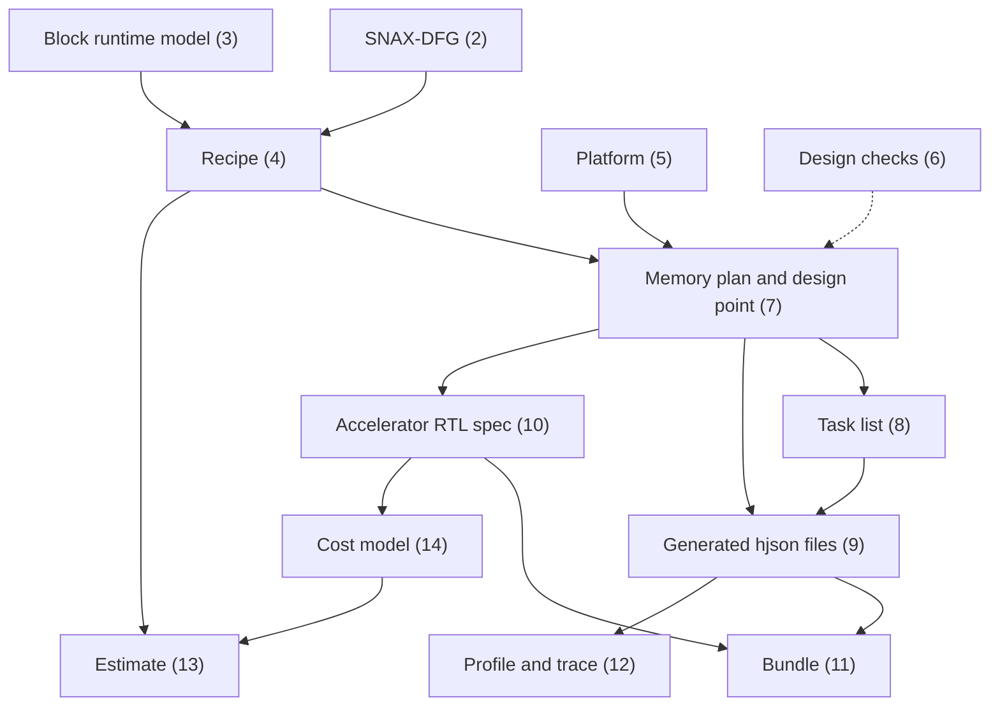
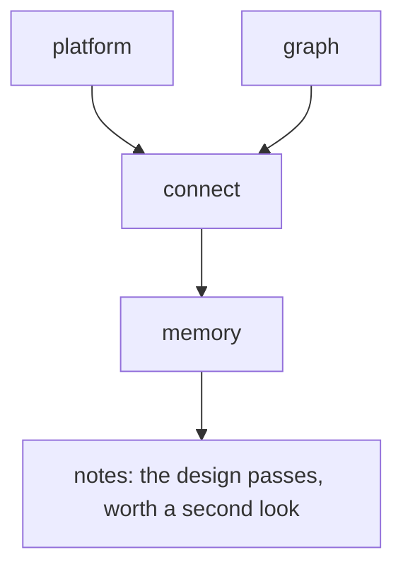

# SNAX-FORGE Contracts

What each artefact between the components holds, field by field, so a component can produce its output without reading another's code. Why each is so: `docs/DECISIONS.md` and the module docstrings.

- The artefacts are dataclasses with `to_dict` / `from_dict` and plain JSON until the M6 freeze (D26); the generated hjson files already have schemas (section 9).
- A fenced block under a `<!-- snippet: ... -->` line is copied verbatim from the file it names; `tests/test_contracts.py` fails if one drifts, and checks that every section the repository cites exists (D46).



---

## 1. Conventions

- **Addresses are bytes**: L1 and L2 addresses, a streamer's `base`, every stride, the DMA's bases.
- **The bank word is the unit of transfer** (D142). A word is the L1's `width_bits` wide and holds num_slc = `width_bits` / b elements of a container's dtype (b its bits), little-endian. A port of W lanes uses num_ch = W / num_slc streamer channels; `connect.pack` and `connect.num_ch` check it (section 6).
- **Integers first** (D28): the default `dtype` is `int64`.

The L1 of `platforms/snax_forge.json` (section 5):

<!-- snippet: platforms/snax_forge.json -->
```json
 "l1": {
  "n_banks": 32,
  "width_bits": 64,
  "rows": 512,
  "base_addr": 268435456,
  "wide_bits": 512,
  "max_xbar_inputs": 128,
  "warn_xbar_inputs": 64
 },
```

## 2. SNAX-DFG

The workload as one `.snaxdfg` JSON file (D71), written by an importer and rewritten by each sandbox transform. `Graph.load(path)` reads it; a missing key takes its default, an unknown key is an error, and a graph is validated when it is made.

| Field | Holds |
|---|---|
| `name` | the kernel |
| `symbols` | name → int or `null`: `null` as imported, the value once a recipe binds it |
| `containers` | name → `shape` (ints or expressions over symbols), `dtype` (a NumPy dtype name), `transient`, `attrs` (namespaced; `sdfg.scalar: true` marks a scalar argument of shape `[1]`) |
| `body` | the nodes, in execution order |
| `type_params` | optional, the kernel's type parameters it was imported at where not their default (`{"OP_TYPE": "int32"}`), so its reference runs at them too |

### Nodes

Every node has `id` (unique, D75), `kind`, `inputs`, `outputs`, `attrs` and, for a kind that has one, `body`. A connector maps to a memlet, `{"data": container, "subset": [dim, ...]}`, one entry per container dimension: an index or a range `begin:end[:step]`, end exclusive.

| Kind | Attrs | Body |
|---|---|---|
| `map` | `var`, `range`; `loop.kind` (absent, `tile`, `temporal`, `spatial`); `loop.dim`, `loop.piece` (D162); `loop.split` (the `var` and `range` before a split, and `valid`, the iteration count, when it is not a multiple of the factor: the lanes past it are padding, D144) | runs once per value of `var` |
| `tasklet` | `code`: one `output = expression` per output connector; its connectors are single elements | none |
| `link` | `container` (the transient it replaced, which writer and reader still name), `depth` (0 a wire, ≥ 1 a buffer), `from`, `to` (the units' instances) | none |
| `fork` | `container` (read by every reader), `readers` (`"<instance>.<port>"`, the graph's order, the first's streamer reading for all), `groups` (each member's group before, null for none); optional `buffers`, a reader down a chain to its buffer's depth ≥ 1 (D196) | none (D189) |
| `transpose` | `perm` (a permutation of its input's dimensions), `by` (`dma` or `core`: what makes the copy); one input `src` and one output `dst`, each its whole container (`0:<extent>` in every dimension), the output's shape the input's permuted by `perm`, the same dtype; the reference executor copies `np.transpose(src, perm)` into it | none |
| `accelerated` | `instance`, `brm`, `implementation`, `code` (the BRM's matched entry), `params` (design params), `replaced` (the subtree `bind` replaced), `locals`, `accelerator`, `group`, `opType` (the last four only when set; `opType` the op's type where the tasklet's casts set it, D143 · D175) | empty for a leaf block |

- An accelerated node's connectors are the BRM's ports, each port's lanes as a range: one beat. A slot read from a scalar has no value in `params`; its connector names the container (axpy's `k1` on `alpha[0]`).
- `replaced` is checked in the node's scope, never run; `unbind` and `join_map` take it back.
- Attrs without a namespace belong to the kind; namespaced ones (`loop.*`, `mem.*`, `hw.*`, `user.*`, `sandbox.*`) pass through. More kinds come with `register_kind`.

### Import

`dfg/import_sdfg.py` derives the graph from the kernel's simplified SDFG and decides nothing: a Scalar becomes a `[1]` container with `sdfg.scalar`, a Map one map per parameter, a Reduce one map per input dimension around `out = in1`; a map over `0:X` is named `lower(X)` (D162); a convert map is folded into its consumer as a value cast `int32(x)` (D143 · D175); control flow is refused by name.

### Folding writes

A tasklet's output memlet may hold `"reduce": {"op": ..., "identity": ...}` (D102): the elements start at `identity` and every iteration's value is folded in with `op` (`add`, `mul`, `min`, `max`; `register_reduction`).

- **With a seed** (`fuse_seed`, D163): `"seed": {"data": ..., "subset": [...]}` takes the identity's place; the tasklet keeps what `fuse_seed` took in `sandbox.seeded`.
- **Carried** (`carry_seed`, D192): `"carry": true` beside `identity`: the element is written again under loops outside every one its subset uses, each visit starting from what the last wrote. `bind` gives the unit its own output as its `seed` port.

### Accelerators, groups and shared instances

A bound graph nests accelerator ⊃ groups ⊃ units and links (D146, D148):

- A **unit** is an accelerated node. A **group** is a connected set of units and links, one chain or several a fork joins (D189); an unlinked unit is a group of its own, named after its instance; a linked group's units carry its name in `group`.
- By default each group is its own **accelerator**; `encapsulate` puts several into one, sharing one streamer set (section 9). An accelerator's name is no instance's.
- A **fused map** (`fuse_map`) is one nest of two tasklets joined by a local value (`loop.local`, `loop.fused`), kept by `bind` in the node's `locals`; `split_reduce` records its parts in `loop.split_reduce`.
- **Shared instances** (D165): several nodes may share one instance, run once per node in body order, each its own task on the same streamers; `share` does it for a linked group.

### A transposed read

- `mark_transpose` (D164) records on a tasklet `sandbox.transpose`, `{connector: π}`, π ordering the container's dimensions by the depth of their outermost map; `bind` carries it onto the accelerated node, keyed by port. An element narrower than the bank word is refused.
- `data_transpose` (D182) adds a transient `<container>_T` and a `transpose` node (perm π) copying the whole container before the nest, whose memlets then name the copy, permuted by π. Only `by` `dma` is built.

### Names and expressions

- Every name in an expression is a symbol or an enclosing map's `var`; shapes use symbols only; symbols, containers and variables never share a name.
- An expression is ints, names, `+ - * //`, `max(a, b)` and `min(a, b)` (`snax_forge/expr.py`), stored as `ast.unparse` writes it. A tasklet's code also takes value casts `int8(x)` … `uint64(x)`.

vecadd after `split_map` (W = 4) and `bind`:

<!-- snippet: tests/dfg/fixtures/vecadd_accelerated.snaxdfg -->
```json
     "inputs": {
      "a": {"data": "A", "subset": ["4 * n_1_t:4 * n_1_t + 4"]},
      "b": {"data": "B", "subset": ["4 * n_1_t:4 * n_1_t + 4"]}
     },
     "outputs": {"out": {"data": "C", "subset": ["4 * n_1_t:4 * n_1_t + 4"]}},
     "attrs": {
      "instance": "acc",
      "brm": "simd",
      "implementation": "chisel_tiled_spatial",
      "code": "out = a + b",
      "params": {"W": 4, "op": "add", "streams": 2},
      "replaced": {
       "id": "add_map_s",
       "kind": "map",
```

## 3. Block runtime model

One accelerator block as plain data (D68, D70): a hand-written JSON file in `snax_forge/brm/library/`, named after the block, in the form `Brm.to_json` writes. `load_brm(name)` reads it; an unknown key or a missing part is refused by name.

| Part | Holds | Read by |
|---|---|---|
| `interface` | params (`design`, `runtime`) and ports (name, direction, lanes, rate, dtype, `when`) | everything below |
| `function` | a kind registered in `brm/function.py` (`simd`, `reduce`, `mac`, ...), its params, and `code`: what one lane computes (D82) | the reference executor; `bind` |
| `dataflow` | a notation (`affine`, `stream`) and one nest per port | the streamer values |
| `pattern` | `family` (a matcher registered in the sandbox) and its `attrs` | `bind` (section 4) |
| `implementations` | per name: `source` (`chisel`), `supports`, `timing`, `binding` | SNAX-GVSoC and the generator |

The first four are shared: designs that differ only in timing, supported values or RTL are implementations of one BRM.

### Ports

| Field | Meaning |
|---|---|
| `name` | not a Python keyword, not starting with `_`; by convention `a`, `b`, ... in, `out` out |
| `rate` | a beat every `rate` firings, an int or a runtime param's name: an input at firings `0, r, 2r, ...`, an output at `r-1, 2r-1, ...` (a SIMD block 1 everywhere; a reduction 1 in, `T` out) |
| `when` | `{param: value, ...}` over design params: the port exists only when every one holds (`simd`'s `b` only at `streams` 2, `accumulate`'s and `mac`'s `seed` only at `seed` 1) |
| `dtypes` | the dtypes the port takes (`brm/dtypes.py`); every integer dtype by default, written only when narrowed |

### Timing and params

| Field | Meaning |
|---|---|
| `latency` (L) | a firing to its push; the only one that delays a result |
| `initiation_interval` (II) | the least cycles between firings |
| `drain` | the cycles, from a push, in which no input is taken; 0, as the control unit has none (`gen.drain`) |
| `span` | the cycles a unit reads one input beat in place (section 10); 1 by default |

- Each is an int or an expression over design params, stored canonical.
- A **design** param is fixed per instance; `default` applies when none is given, `values` and an implementation's `supports` limit it. A null `default` means unset unless `bind` or a code entry sets it.
- The **runtime** params are exactly `n` (the firings in a task) and every named port rate, in port order: the accelerator task's `values` (section 8). `n` must be a multiple of every rate.

### The function and its code

`code` is one `output = expression` per output port over the input ports, per lane of one firing, with the ops `add`, `sub`, `mul`, `min`, `max`, `and`, `or` and `xor` (types: D143). A tasklet's operand casts set the unit's `opType` and are stripped before matching (D175). `code` may instead be a list of entries, `{"params": {...}, "code": ...}`, each fixing design params. How `bind` picks an entry (D82):

1. It tries the entries in order, and every assignment of the tasklet's array inputs to the entry's present ports.
2. The code must equal the tasklet's, with `+`, `*`, `min` and `max` commuting.
3. A **slot** (a design param the code names that is not a port) matches either an int that fits the op type, baked (D143), or a scalar read at run time from an R/W CSR (D161).
4. An entry fits only when every slot its code names has a value and every other slot is unset.
5. The first match's params and baked values become the instance's; a bind param that contradicts them is refused. A null `code` cannot be bound.

### The binding

`brm/binding.py` (D129): `{datapath, args, controller, ports}`: a catalogue datapath (`hw/chisel/blocks.json`, section 10) that `resolve` checks takes the instance; its `args`, expressions over design params; `controller` `counted` (D147); optional `ports`, BRM port → datapath port. The CSRs follow from the unit's group (section 10).

| BRM | Implementation | Datapath | Notes |
|---|---|---|---|
| `simd` | `chisel_tiled_spatial` | `SimdLanes` (`lanes` W, `op`) | |
| `accumulate` | `chisel_adder_tree` | `TreeAccumulate` (`a` → `in`) | `seed` 0 or 1 adds the input `seed`, one lane at rate T, read once per job (D163) |
| `accumulate` | `chisel_serial` | `SerialAccumulate` | one lane a cycle, so `span` = lanes |
| `mac` | `chisel_mac` | `Mac` (`accumulate` true, `regOut` false) | `out = a * b` folded per lane over T beats (D149); `seed` 0 or 1 adds the input `seed`, W lanes at rate T, read once per job (D187); a `b` bound as one lane is given to every lane (D186); `rows` R > 1 (default 1) keeps R rows of W sums, one a firing in turn, a job giving R results (D191), seeded a seed beat a row on the job's first R firings (D194), and a `b` whose memlet skips the rows' loops is read once a row and held (D190) |
| `lane_accumulate` | `chisel_lane_accumulate` | `LaneAccumulate` | rowsum 2: `out = a`, each lane folding its own element over T beats; a front op is refused (bind `mac`) |

`mac`'s pattern, `lane_fold`, is a fused nest (section 4): a multiply and a reduce joined by a local value:

<!-- snippet: snax_forge/brm/library/mac.json -->
```json
 "function": {
  "accel": "mac",
  "params": {"lanes": "W", "op": "op", "seed": "seed", "rows": "rows"},
  "code": "out = a * b"
 },
 "dataflow": {"notation": "stream", "ports": {"a": {}, "b": {}, "seed": {}, "out": {}}},
 "pattern": {"family": "lane_fold", "attrs": {"op": "mul", "fold": "add"}},
```

### Two notations

- **`stream`**, which every library BRM uses: the nest is empty; lanes, rate and dtype are the interface's and the bound memlet gives the element order.
- **`affine`**: the operand's `shape`, an `offset` and `loops`, outermost first, each a `bound`, one stride per dimension and a `spatial` flag; temporal loops first, spatial loops last, multiplying to the port's lanes. `bind` checks that the memlets give this order.

## 4. Recipe

SNAX-SANDBOX's ordered list of transforms (D72): a JSON file in a category folder of `recipes/` (`custom/` for what the editor saves), found by its name (`find_recipe`), so names are unique across the folders. `Recipe.load(path)` reads it; an unknown key is an error.

| Field | Holds |
|---|---|
| `name` | the recipe; its steps are written to `out/sandbox/<name>/` |
| `id` | optional, what it builds in `recipes/README.md`'s words (`mvt_dot2seed_colseed_i8_o32`); a checked-in recipe has one, the editor shows it beside the step and in the recipe list; recipes that build the same units share one (D188) |
| `description` | optional, the same in one to three sentences (the id's tooltip) |
| `kernel` | the kernel whose import it starts from |
| `params` | recipe params, each an int or a string; `--set NAME=VALUE` overrides one |
| `types` | optional, one of the kernel's type presets (its `SPEC.presets`: `i8`, `i16`, `i32`), the dtypes of its containers and type parameters (`OP_TYPE`) at once (D113 · D173); `--set types=i8` |
| `symbols` | a value per graph symbol: an int or an expression over the params |
| `dtypes` | optional, container or type parameter → NumPy integer dtype in place of the kernel's, on top of `types` (D113): applied before DaCe builds the SDFG, the inputs cast to it (`vecadd_v1_1`: A, B, C and OP_TYPE `int32`); `--set dtypes.C=int16` |
| `steps` | in order: `transform` (a registered name) and its `params`; an int param takes an int or an expression over the recipe params (`"factor": "W"`) |

Running a recipe binds the symbols (step 0), applies the steps and checks each against the reference executor on the same seeded inputs, writing `<i>_<transform>.snaxdfg` and `recipe.json`:

<!-- snippet: recipes/elementwise/vecadd_v1.json -->
```json
 "params": {"W": 4, "N": 64},
 "symbols": {"N": "N"},
 "steps": [
  {"transform": "split_map", "params": {"map": "add_map", "factor": "W"}},
```

### Transforms

Each has an inverse, and each refuses with the fix named. The loop names follow D162; a transform's site (D72) says where it applies.

| Transform | Params | Does |
|---|---|---|
| `split` | `map`, `factor` | a map over `b:e` becomes an untagged map over `0:(e - b) // factor` (same id) around `<id>_inner` over `0:factor`, the dimension's pieces renumbered (`n` → `n_1`, `n_2`). A length n not a multiple of the factor gives `0:(n + factor - 1) // factor` and `loop.split.valid` n: the lanes past n are padding (D144) |
| `split_map` | `map`, `factor` | `split`, then `temporal` outside and `spatial` inside, in one step; keeps the ids `<id>` and `<id>_s`, which old recipes bind (D73) |
| `tag_map` / `untag_map` | `map`, `kind` (`temporal`, `tile`, `spatial`) | tags an untagged map, its variable taking `_t`, `_tile` or `_s`; on a fused nest's level both nests are tagged. `untag_map` refuses a map around a bound unit |
| `join_map` | `map` | a split map and its inner map, whatever their tags, become the map they were split from |
| `bind` / `unbind` | `node`, `brm`, `implementation`, `instance`, `params` | the tasklet (or a fused nest's spatial map, or a folding spatial map for `lane_accumulate`) and its spatial map become an accelerated node (below); `unbind` gives back what it `replaced` |
| `encapsulate` / `unencapsulate` | `accelerator`, `units` | the units' groups become one accelerator sharing one streamer set (D148), in graph order |
| `split_reduce` / `join_reduce` | `map`, `factor` | a folding map is split as `split_map` splits it, each lane writing a partial into `<output>_partial`; a final sum `<tasklet>_final` in a spatial map `<map>_final` over `0:factor` folds them (a seed stays on the final sum) |
| `fuse_map` / `unfuse_map` | `first`, `second` | two nests with the same ranges and tags down to one tasklet each, joined by a transient at the same index, become one nest of two tasklets; the transient becomes a local value. An untagged level takes the other's tag; a split on one side only is refused with the split that fixes it (D150), and lanes on different dimensions of the transient (one nest in the row form, the other in the column form) naming both dimensions |
| `carry_seed` / `uncarry_seed` | `map` | a fold whose output a map outside the ones it moves with revisits (the strips of `matvec_v9`) becomes carried (`reduce.carry`, D192); refused for a seeded fold or one written once per element |
| `fuse_seed` / `unfuse_seed` | `first`, `second` | a fold writing t with ⊕, read only by a nest computing `t ⊕ x` in place over t: the nest and t go and the fold starts from x (`reduce.seed`, D163; matvec_acc's q += A p). Refused for another reader, op, subset, a float or a bound fold |
| `factor_out` / `unfactor_out` | `container` | a kernel scalar k read by one scale nest `t = k * a`, t read only by a product `t * x` that one fold sums into s: the nest and t go, the product reads a and the fold writes `<s>_sum`. When s is a transient read by one elementwise tasklet, k lands there (it reads `k * <s>_sum` for s, s goes); else a nest over s just after the fold writes `s = k * <s>_sum` (D198; gesummv's α A x). The tasklet k lands in keeps what went in `sandbox.factored`, one record per scalar. Refused for a k that scales several nests or is baked already, another reader of t, a fold that is not an unseeded sum, a type narrower than s's from the scale to s, a float, or a bound node |
| `bake_scalar` / `unbake_scalar` | `container`, `value` (an int or `csr`) | at an int the scalar becomes a literal and the container goes (axpy's alpha 3: `bind` bakes `k1 = 3`); at `csr` the tasklet names the container, read at run time (D161) |
| `interchange_map` | `map`, `with` | two maps of one perfect nest trade places, each keeping id, variable, range and tag; its own inverse. Refused when a range would name an inner variable or the swap reorders an order-dependent fold (rowsum 2: `sum_map_s` with `sum_map_1`) |
| `mark_transpose` / `unmark_transpose` | `node`, `container` | marks a read across the loop order (section 2, D164); nothing else changes. Refused for an element narrower than a bank word |
| `data_transpose` | `node`, `container`, `by` (`dma`; `core` refused, not built yet) | the container copied transposed into `<container>_T` by a `transpose` node before the nest, which reads the copy in loop order (section 2, D182). Its sites are `mark_transpose`'s. Refused: an existing `<container>_T`, a nest reading the container in two orders. No inverse yet: the step is undone by removing it |
| `share` / `unshare` | `group`, `with` | `group` runs on `with`'s units: the same shape unit by unit (BRM, implementation, params, links and depths), its nodes renamed to `with`'s (D165). Refused naming what differs (`vmul_x2 and vmul_x1 differ: W = 4 against 8`) |
| `share_ports` / `unshare_ports` | `container`, `accelerator` | the container's writer's and reader's groups go on one accelerator whose movers they share, the k-th widest port of each on mover k (D169); the container is marked `hw.share_ports` |
| `link` / `unlink` | `container`, `depth`, `group` | a transient between two bound units becomes a link node, their groups merge under `group`, and the transient leaves L1; a held input counts one beat a bank row (D197). On a forked container, a buffer of `depth` on the branch to the reader down a chain, the fork's `buffers` (D196); the link into that reader comes after it. Refused: not one writer and one reader (`link.container`), an end not bound (`link.unbound`), the beats not in the same order (`link.order`), a clashing name (`link.group`), a fork or join of links (`link.chain`), a fork's branch not buffered or not down a chain (`link.fork`) |
| `fork_read` / `unfork_read` | `container`, `group` | the bound units reading the container (each a chain's head, one port each) get one reader, a fork node recording them and their groups, which merge under `group` (D189). Refused: fewer than two readers, a reader not bound, a seed or two ports of one unit (`fork.container`, `fork.unbound`, `fork.port`), other beats or the same in another order (`fork.order`, naming `interchange_map`), a head fed by a link (`fork.head`), a shared unit (`fork.shared`), a clashing name (`fork.group`); `unfork_read` after the group changed (`fork.changed`) |
| `lift` / `unlift` | `kernel`, `at` | the region matching a kernel's import becomes a block, `sandbox.block` = `{name, kernel, heads}` (D166) |
| `apply_recipe` / `unapply` | `recipe`, `region` or `block`, `params`, `name` | another recipe's steps run on the region, its names renamed onto it (`_1`, `_2` on a clash); a param its symbols name is the region's, refused in `params`; one step, one reference check (D166) |
| `name_block` | `nodes`, `name` | a region becomes a block by hand, with no kernel or recipe |

What `bind` checks:

- Every map around the spatial map is `temporal`; the lanes param comes from the spatial bound.
- The tasklet's code equals the BRM's `function.code` (section 3). A folding output without the spatial variable is one lane (D102); an input without it is a broadcast (D186), on a lane-wise datapath only (`SimdLanes`, `Mac`).
- A carried fold (D192) needs a `seed` port at `seed` 1. A `Mac`'s `rows` R (D191) takes the innermost firing loops its output uses whose counts multiply to R; an input using none of them is held (D190).
- A fused nest binds as one fold (`lane_fold`) or one code; a tasklet that needs `fuse_map` or `split_reduce` first is refused with that fix (D150).

### The library's recipes

dot binds the multiply to `simd` and the sum to `accumulate`: `dot_v1` as two accelerators (D157, D158), `dot_v1_1` encapsulated, dot 2 and 3 linked at depth 1 and 0, dot 4–6 on `mac` (5 and 6 with `chisel_serial`); `matvec_1`–`matvec_v6` the same per row. Recipes of recipes (D166): `matvec_v1_1`–`matvec_v6_1` apply `dot/dot_<k>` per row, `mvt_v1_1`, `mvt_v1_2_1` and `mvt_v2_1` a matvec recipe per half.

### The editor's session

`edit-dfg` keeps a session in `out/sessions/<name>/` (`sandbox/session.py`):

| File | Holds |
|---|---|
| `recipe.json` | every step applied so far; the graphs are rebuilt by replaying it |
| `session.json` | `cursor` (the step shown; undo and redo move it) and `platform` |
| `export/<k>_<transform>.snaxdfg` | a step's graph, written by Export |

- **Params**: a session starts from its kernel's symbols; every factor and depth the editor writes names a param (`W`, `W_2`, … and `D`, `D_2`, …; `fresh_param`). `POST /api/apply` takes `new_params`; `POST /api/params` takes `rename` (`params.rename`) or `drop` (`params.drop`) and replays. A bound map's factor is renamed `W_<instance>` unless shared; `bind`'s default instance is `acc_N`.
- **Replay**: a step applied before the last is refused (`session.drop`); a param change replays up to the cursor.
- **Checks**: every apply and param change runs Save's design checks; `problems` and `notes` each are `{code, where, message, fix, before_save}`.
- **Save** writes steps 1 to the cursor as `recipes/custom/<name>.json` and the steps to `out/sandbox/<name>/`; it never overwrites (`save.name`) and refuses a graph-stage problem (`save.graph`), any other design problem unless forced (`save.design`).

### The viewer's API

Python builds every box, port, edge, text and number (`viz/dfg/api.py`, `viz/dfg/drawing.py`); the page measures, lays out and draws them (D55, D185).

| Route | Gives |
|---|---|
| `GET /api/steps` | each step's `name` (`<folder>/<stem>` when the files come from several folders, `-2`, `-3` on a clash), `folder`, `label` |
| `GET /api/step/<k>` | `drawing`, Details, the Estimate (section 13), the cost (section 14), the left column (`symbols_section`, `containers_section`, `bindings_section`), `blocks`, `shared`, `partners`, in edit mode `problems` and `notes` |
| `GET /api/step/<k>/site?sel=<id>&sel=<id>` | each transform's site for the selection, in the order selected; a transform that takes one item refuses several (`site.one`) |
| `GET /api/compare/<j>/<k>` | `columns`: `labels`, Details' and the Estimate's rows `{label, under, a, b, differs}`, `caveat`, `cost_tables`, `cost_bars` (`area`, `energy`, `energy_leakage`: per side its segments on one scale) |
| `GET /api/find?step=<ref>` | a step from a bare stem or a number |

The `drawing` is `{nodes, edges, outlines, tasks}`; positions are the page's, never in the API.

| Field | Holds |
|---|---|
| node `id` | a container version `A@1`, a map or node id, or a hardware key: `unit:<instance>`, `link:<from>.<port>><to>.<port>`, `fifo:<fork>><instance>.<port>` (a fork's buffered branch, D196), `slicer:<instance>.<port>`, `packer:<instance>.<port>`, `mux:<instance>[.<port>]`, `demux:<instance>.<port>` |
| node `kind`, `text`, `sub` | container, loop, tasklet, unit, link, slicer, packer, mux, demux, copy or block; its text; a loop's `var · n`, a fold's `over …` |
| node `sel` | what a click selects (a node, map or container name; a unit its first node) |
| node `ins`, `outs` | port names in order; none on a container or loop, whose edges get a port each |
| node `parent`, `chips` | its outline; `[node, task]` per node a unit runs, or a merged loop's other maps |
| node `layer`, `row`, `port_tasks`, `width_of` | `first` for a kernel input; a front loop's row; a mux's port per task; the unit a mux is as wide as |
| edge `from`, `from_port`, `to`, `to_port` | its ends |
| edge `sel` | what a click on it selects when not the edge: a link's edges their link node, a forked read's edges and its FIFO the container (`link`, `unlink`) |
| edge `style`, `task`, `label` | data, seed, link, fork, local, wire or empty; its task after `share`; the dtype where it changes, `↻ var` for an outer loop skipped, `Aᵀ`, `broadcast`, `held a row` (D190) |
| edge `data`, `node`, `port`, `sub` | the container, the node and port it feeds or leaves, the memlet |
| edge `via` | a fork's other reader's edge (D189): `{node, port}` of the first reader, whose hops to the container a click on it lights too |
| outline | `id` (`grp:`, `acc:`, `block:`), `kind`, `text`, `sel`, `parent`; a group that took an open block's boxes also `block` (the first), its text naming the others (`group bicg_types · from matvec, matvec_1`) |

- **The cost's bars**: the area in the six parts and the core and the rest (D200); the energy in the six parts, dynamic. A "with leakage" checkbox, off by default, adds the design's leakage as one striped segment (the cost's `leakage`: its power, its energy over the estimate's cycles at 10 ns, the bar's `parts`; D201), for comparison only.
- The URL hash holds the whole view: `step=`, `sel=`, `cmp=`, `tech=`, `open=`, `fold=`, `focus=1`, `zoom=` and `zoomc=`.
- **Bindings** is a tree, `{kind: accelerator | group, name, children}` down to `{kind: entry, index}` into `entries`.
- **One box per configuration**: every bound group is an outline holding its units, links, slicers and packers (D174, D180) and the loops that drive only it; a closed block (D166) is one box inside its firing loops.

## 5. Platform

The SNAX cluster around the accelerators (D84): a file in `platforms/` that never names a recipe (`snax_forge.json`, `small16.json`). `Platform.load` reads it; a missing key takes its default (`l2` missing: no L2), and unknown keys and wrong types are all reported at once (section 6).

| Field | Holds |
|---|---|
| `name` | the platform, an identifier |
| `base`, `changes` | the platform it was made from (null for an original) and every `--set` path → value since, in order |
| `hjson` | the source cluster file, a path from snax-forge's root, or null: what the generator writes the cluster file from (section 9) |
| `accelerator_slot` | the prefix of the generated entry's name, `<accelerator_slot>_<design>` (`snax_forge`, D131) |
| `acc_csr` | the widths of the accelerator's CSRs (below) |
| `l1`, `l2` | the memories (below); `l2` null for an L1-only cluster |
| `wait_mode` | `poll` or `signal` (the program refuses `signal`, `c.signal`) |
| `streamers` | the streamer shell: `default`, then an entry per streamer it changes (below) |

`L1Config` (`design/platform.py`):

| Field | Meaning | Default | Checked |
|---|---|---|---|
| `n_banks` | single-port banks | 32 | ≥ 1 |
| `width_bits` | bits per bank word | 64 | a multiple of 8 |
| `rows` | words per bank | 512 | ≥ 1 |
| `base_addr` | the first L1 byte | 0 | |
| `wide_bits` | the widest port (the DMA's) | 512 | a power-of-two multiple of `width_bits` |
| `max_xbar_inputs` | the most crossbar inputs: 128 as checked against SNAX's crossbar RTL, up to SNAX-GVSoC's 256 by `--set` (D85) | 128 | 1 to 256 |
| `warn_xbar_inputs` | above it the note `design.xbar_inputs`: the cost is extrapolated beyond the tables | 64 | 1 to `max_xbar_inputs` |

`L2Config`:

| Field | Meaning | Default | Checked |
|---|---|---|---|
| `size_bytes` | flat size | 1 MiB | a positive multiple of the beat |
| `base_addr` | the first L2 byte | 0 | |
| `beat_bits` | one DMA beat | 512 | equal to the L1's `wide_bits` (`platform.l2`) |
| `width_bits` | as the L1's, and equal to it (`platform.l2`) | 64 | a multiple of 8 |

`AccCsrConfig`, written into `accelerator.json` (section 10):

| Field | Meaning | Default | Checked |
|---|---|---|---|
| `job_width` | bits of JOBS, every JOB_BEATS and the control units' counters | 32 | 1 to 32 |
| `busy_counter_width` | bits of BUSY_COUNTER, which saturates at 2^w − 1; null follows `job_width` | null | 1 to 32 or null |

### The streamer shell

One streamer per port of every accelerated instance, `<instance>_<port>`, but a port on a link (D12).

- **From the port**: `write`, `n_ports` (its lanes) and, unless an entry gives them, `spatial_bounds` (fastest first).
- **From the graph**: `temporal_dims`, the firing loops the port's memlet runs over (at least 1).
- **From the platform**: `default.fifo_depth` (≥ 1); an entry named after a streamer overrides it and `spatial_bounds`, and may give `num_ch` (never in `default`), else W / num_slc, or 1 for an output packed d_out = num_slc / W results to a word or an input sliced d_in = num_slc / W pops from one (D142 · D174 · D180).

### Working copies and cluster files

`pixi run design GRAPH --platform P --set platform.PATH=VALUE` writes `out/design/<name>/platform.json`; `pixi run design save SRC NAME` keeps it as `platforms/NAME.json`; `pixi run design from-hjson HJSON NAME` (D131) writes an original platform from a cluster hjson, as `snax_forge.json` from `platforms/snax_forge_cluster.hjson` (D170):

<!-- snippet: platforms/snax_forge.json -->
```json
 "hjson": "platforms/snax_forge_cluster.hjson",
 "accelerator_slot": "snax_forge",
```

## 6. Design checks

Before the design step writes anything it runs every registered check (`register_check(code, stage, fn)`) on a bound graph and a platform, and reports every problem as `[code] where: why` with a `fix:` line where one exists (D85). `pixi run design check GRAPH --platform P` runs them only.



The `platform` and `graph` stages run independently, `connect` when both passed, `memory` when `connect` passed.

| Code | Fails when |
|---|---|
| `platform.keys` | the file does not parse; an unknown or missing key or a wrong type; a `--set` path that does not exist, is the tools' (`name`, `base`, `changes`) or the port's (`write`, `n_ports`) |
| `platform.values` | a value its section rejects (`n_banks` 0) |
| `platform.streamer` | a streamer value below 1, spatial bounds not a non-empty list of ints ≥ 1, a `num_ch` not an int ≥ 1 |
| `platform.l2` | L2 and L1 disagree on the beat or the word |
| `platform.banks` | with an L2, `n_banks` not a multiple of `wide_bits / width_bits` |
| `design.schedule` | a schedule other than `serial`, `pipeline`, `pipeline_compute` and `sequential` (the message names them), or a `--set design.` path other than `schedule` and `data`; checked in the `platform` stage |
| `design.data` | a data choice other than `kernel` and `full` (D199); checked in the `platform` stage |
| `graph.load` | the graph does not load (section 2) |
| `graph.symbols` | a symbol still null: bind it in the recipe |
| `graph.unbound` | work outside every accelerated node, or no accelerated node: the program drives accelerators only |
| `graph.brm` | an unknown BRM or implementation, params that do not resolve, connectors that are not the BRM's, code that is not the BRM's |
| `graph.instance` | an instance named `dma` or after a streamer, or two streamers with one name |
| `connect.streamer_key` | a streamer entry that matches no port (the fix names the closest) |
| `connect.derived` | a streamer entry that sets `write` or `n_ports` |
| `connect.lanes` | an entry's `spatial_bounds` that are not the port's lanes |
| `connect.dtype` | containers that break the BRM's dtype rule (`brm/dtypes.py`, D143: each port's dtype allowed, every output at least as wide as every input, no signed input with a `uint64` one), or two dtypes on one port of an instance |
| `connect.pack` | a port neither wired nor sliced (an input) or packed (an output) (D142 · D174 · D180), below |
| `connect.pad` | a fold reading through a tail what an accelerator wrote, unless the producer's tasklet on its pad values gives the fold's identity (D144), below |
| `connect.num_ch` | a `num_ch` other than the derived one (W / num_slc, or 1 for a packed output or a sliced input; D142 · D174 · D180); the message lists the values that would fit |
| `connect.xbar_inputs` | more crossbar inputs than `l1.max_xbar_inputs`, below |
| `share.shape` | a shared set's user whose spatial bounds do not fit in its mover's first channels (D169, `design/streamers.py`'s `shared_movers`) |
| `connect.temporal` | a map around an accelerated node that is not `temporal`, or a subset not affine in the firing loops |
| `memory.pin` | a memory working copy that does not load, a bad `--set memory.` path, a pin on an unknown container, on a memory it is not in, or on L2 (the link places it) |
| `memory.residency` | a layout in a memory the platform lacks; a non-transient container that lives nowhere; an accelerator operand without an L1 layout |
| `memory.layout` | a layout whose shape is not its container's |
| `memory.align` | an L1 base not on a word, a stride not a multiple of the itemsize; a container the DMA moves whose L1 layout is not contiguous whole wide beats on a beat (open item 38) |
| `memory.fit` | an L1 layout past L1's end (the message names its bytes), or an L2 layout larger than L2 |
| `memory.runtime` | an L1 layout reaching into the top of L1 that snRuntime keeps: a 1 KiB stack per core plus `RUNTIME_MARGIN` (256 B) |
| `memory.overlap` | two L1 layouts that share bytes |
| `point.keys` | a design point with unknown or missing keys |
| `point.streamers` | a design point whose `streamers` are not the platform's shell for its graph |

- **`connect.pack`**: a wired port's fastest spatial bound is a multiple of num_slc, its fastest spatial loop steps 1 element, and every other step and the start are multiples of num_slc. When W divides num_slc, an input is sliced and an output packed: contiguous, its start and outer strides whole words. At num_slc = 1 every port passes.
- **`connect.xbar_inputs`** counts every streamer's num_ch, a shared set's movers' channels once (D169), one per core and one for AXI.

### Notes

A note is registered (`register_note(code, fn)`) and runs once the checks passed: the design step prints `note [code] where: why` with its `fix:` and still exits 0, and `design.md` lists it under Notes.

| Code | Noted when |
|---|---|
| `design.serial_one_lane` | a unit bound to `SerialAccumulate` at lanes 1, the same work as `TreeAccumulate` at lanes 1; the fix binds `chisel_adder_tree` |
| `design.xbar_inputs` | more crossbar inputs than `l1.warn_xbar_inputs`: "85 TCDM crossbar inputs, above 64 (l1.warn_xbar_inputs): beyond SNAX's own crossbar, its cost extrapolated from the tables" (mvt_v2 at W = 8) |
| `char.missing` | a unit or buffer link the technology does not characterize (section 14): its comb part costs 0 |
| `cost.extrapolated` | a streamer or the crossbar priced outside the tables' grid, "streamer outside the table's grid on channels 32 (grid 1–16)", or an L1 bank the table does not hold (the memory costed 0) |

## 7. Memory plan and design point

### Memory plan

`design/memory.py` (D86): a layout per container and memory it lives in, `base` (the byte address of index 0), `shape` and one byte stride per dimension (`lower/layout.py`). Word `i` is in bank `i % n_banks`. Three passes make it, each registered by name (`register_memory_pass(kind, name, fn)`):

| Pass | Decides | Default |
|---|---|---|
| `residency` | each container's memories | a non-transient container in L2 and L1 (L1 alone without an L2); a transient in L1, but none for a link's container or a fused nest's local value |
| `layout` | shape and strides, base 0 | `contiguous`: row-major over the padded shape (a tail pads to a multiple of W, D144), each element its itemsize |
| `placement` | each L1 base (an L2 layout stays at 0: the program's link places its array) | `contiguous`: in graph order from L1's first byte, around the pins; a container in both memories on a wide beat, padded to whole beats (D105), the others on a word |

- `padded_rows` (`--set memory.passes.layout=padded_rows`): as `contiguous`, but the last dimension's pitch of a container of two or more dimensions is rounded up to an odd number of words.
- `--set memory.<container>.l1.base=N` pins an L1 base; `--set memory.passes.<pass>=NAME` picks a pass. Passes read a `MemoryContext` (graph, platform, shapes, memory ranges, `accesses`).
- A container read only through a slot lives in L2 (in L1 without an L2).
- The design step writes `out/design/<name>/memory.json` (`passes`, `changes`, `layouts`), which `--memory` continues from.

### Design point

`design/point.py` (D87): written to `out/design/<name>/design_point.json` once every check passed, never by hand. It holds no recipe; loading it runs every check again.

| Field | Holds |
|---|---|
| `name` | the design's name: the recipe's beside the graph (never a `--set` suffix), else the graph's stem; the generated entry is named after it (section 9) |
| `graph_from` | the `.snaxdfg` it was made from (D108) |
| `graph` | that graph as read |
| `platform` | the platform working copy (section 5) |
| `streamers` | the resolved shell, `<instance>_<port>` → `instance`, `port`, `write`, `n_ports`, `spatial_bounds`, `temporal_dims`, `dtype`, `num_slc`, `num_ch`, `d_out` (1 unless packed), `d_in` (1 unless sliced), `fifo_depth` |
| `memory` | the plan: `passes`, `changes`, `layouts` (container → memory → layout) |
| `schedule` | how LOWER orders the accelerators (D179, section 8): `serial` (the default; a file without the field), `pipeline`, `pipeline_compute` or `sequential` (D183), from `--set design.schedule=` |
| `data` | where data.h's inputs come from (D199): `kernel`, the kernel's `make_inputs` (the default; a file without the field, and the field is written only when it is not), or `full`, each input uniform over its dtype; from `--set design.data=` |


## 8. Task list

SNAX-LOWER's ordered list of tasks (D64): which component runs which task with which values, where each is configured and started, and what it waits for. It is derived from a design point (`lower/derive.py`, `pixi run lower tasks DP`) or written by hand; `lower/c.py` turns it into the program (section 9).

A task list is `name` and `steps`, each with an `op`:

| `op` | Fields | Becomes |
|---|---|---|
| `configure` | `task_name`, `type`, `component`, `after`, `wait_mode`, `values` | the component's configuration, written here |
| `start` | `tasks` | the waits these tasks need, then their start writes in list order |
| `sync` | `task`, `mode` | one wait on the task's component |

`after` lists earlier tasks this one needs finished (default `[]`); `wait_mode` is `poll` (default) or `signal`. Only the loops a task uses are given; the program pads the rest with bound 1 and stride 0. `type` says how `values` are read:

| `type` | `values` |
|---|---|
| `streamer` | `base`, `temporal_bounds`, `temporal_strides`, `spatial_strides`, in bytes and bank words (D142) |
| `dma` | `direction` (`l2_to_l1`, `l1_to_l2`, `l1_to_l1`); `src` and `dst`, each with bounds and strides, innermost first, the same bounds on both, an L1 side with `base`, an L2 side with `symbol` (its container's `data.h` array); `size`, optional, a burst's bytes (D182). Without it each step moves a wide beat, one `snrt_dma_start_1d` or `_2d`; with it each step of the innermost loop is one burst of `size` bytes, that loop one `snrt_dma_start_2d`'s repeat and every outer loop a C `for` |
| `accel` | `n`, then each named rate (`T`), then each slot read from a scalar as `{"from": <container>}` (axpy's `k1: {"from": "alpha"}`), written to the slot's CSR before START |

- **A streamer's strides**: the fastest spatial loop runs S_0 / num_slc channels, its stride num_slc × the element stride × the itemsize; every other stride is the element stride × the itemsize; `base` is the layout's base plus the offset's bytes.
- **An idle mover** (another group's in the same encapsulated set, D148): every temporal bound 0 and every temporal stride a bank word, never 0.
- **A shared set's movers** (D169) keep a task per port; the program writes each mover once per start.
- **Names** (D75): streamer `<instance>_<port>`, task `<node>_<component>`, DMA task `load_<container>`, `store_<container>` or `transpose_<dst>`, `_<k>` added for tile `k`.

### Checks

- When a list is made: task names are unique; `after`, `start` and `sync` name tasks configured earlier; a component has at most one configured task not yet started; a task starts once, after its `after` tasks; every configured task is started.
- Against the design point (`check_values`): the component exists with the task's type, the values have exactly the type's keys, a streamer's loops fit it, a DMA's sides have the same bounds and its `size` divides the beat, every bound is at least 1 (an idle mover's all 0).
- JOBS and every JOB_BEATS fit `acc_csr.job_width`, and a group's head firings (JOBS × every T) are below 2^32.

### Waits

`lower/waits.py`'s `placed_waits`: before a `start`, one wait per component on its latest task, for every `after` task not yet covered. A wait on a writer streamer also covers its unit and the readers started with it; an idle mover's task needs no wait.

### Derived

`lower/derive.py`, per accelerated node in execution order: `load_<C>` for each input not yet in L1 (or `transpose_<C>`), a task per streamer, the accelerator task (`n` and each named rate, D102), one `start` of them all, `store_<C>` for each output written for the last time; at the end one `sync` per non-transient output.

- **Encapsulated**: each task also configures the other groups' movers idle, and its `start` launches every mover.
- **A linked group** is one task `<node>_<group>`: streamers only on the ports on no link, and one accelerator task whose `values` are each unit's, by unit. The program writes JOBS = n_s / T_s of the chain's last unit s (n_u / ∏ T_v over its first unit u and its folds v, but across a held link, D197), each fold's JOB_BEATS, each bank's ROWS (D191), each carried unit's CARRY (D192), and a `JOBS_<SINK>` per chain (D189). A fork's buffer holds at least the folds' T between the fork and its reader's held input (D196).
- **In place**: a writer never waits for a reader it starts with, allowed only when the reader is a port of its own unit visiting the same addresses in the same order.
- **A packed output** (D174): its writer's innermost loop of n pushes at stride s = W · b / 8 bytes becomes $(\lceil n / d_{out} \rceil, d_{out}\thinspace s)$; a sliced input's reader (D180) the same with d_in.
- **A copy** (D182): a `transpose` node is the DMA task `transpose_<dst>`, `l1_to_l1`, one burst of an element a step (`size`). Rank 2 only.
- **Schedules**: `serial` (D158) puts one `sync` on the previous accelerator's task before each accelerator's `start`; `sequential` (D183) a `sync` after every start; `pipeline` (D179) no serial sync, each store moving down past other accelerators' blocks; `pipeline_compute` also gathers consecutive blocks that share no component and wait only on DMA tasks.

vecadd's design point on `platforms/snax_forge.json` gives `tests/lower/fixtures/vecadd_v1_tasks.json` exactly; its end:

<!-- snippet: tests/lower/fixtures/vecadd_v1_tasks.json -->
```json
  {
   "op": "configure",
   "task_name": "add_acc",
   "type": "accel",
   "component": "acc",
   "after": [],
   "wait_mode": "poll",
   "values": {"n": 16}
  },
  {"op": "start", "tasks": ["add_acc_a", "add_acc_b", "add_acc_out", "add_acc"]},
  {
   "op": "configure",
   "task_name": "store_C",
   "type": "dma",
   "component": "dma",
   "after": ["add_acc_out"],
   "wait_mode": "poll",
   "values": {
    "direction": "l1_to_l2",
    "src": {"base": 268436480, "bounds": [8], "strides": [64]},
    "dst": {"symbol": "C", "bounds": [8], "strides": [64]}
   }
  },
  {"op": "start", "tasks": ["store_C"]},
  {"op": "sync", "task": "store_C", "mode": "poll"}
```

## 9. Generated hjson files

What `pixi run gen-gvsoc DP [--out DIR]` writes per design point (D134, `gen/gvsoc.py`), by default to `out/gvsoc/<design>/`: what SNAX-GVSoC's `snax_hjson` target reads and what snax-gvsoc's generic app (`sw/apps/forge/`) builds. One design point gives byte-identical files wherever written.

| File | Holds |
|---|---|
| `<platform>.hjson` | the cluster: the platform's `hjson`, comments dropped and key order kept, with the TCDM, DMA and DRAM values written from the platform, `cluster.name` `snax_forge_cluster`, and the slot (below) |
| `<tag>_streamer_<set>.hjson` | one per streamer set: `data_reader_params` and `data_writer_params`, unit by unit in its groups' order, each port with `spatial_bounds` in words, fastest first (`[S_0 / num_slc, S_1, ...]`), `temporal_dim`, `num_channel` and `fifo_depth` |
| `accelerator.json` | the accelerator's description (section 10) |
| `include/` | per set `streamer_<set>_csr_addr_map.h` (`VMUL_STREAMER_START_CSR`), per accelerator `<acc>_csr.h` (every CSR by section 10's name, in CSR order), and snRuntime's `snitch_cluster_cfg.h` and `snitch_cluster_addrmap.h`, rendered as snax_cluster's templates render them (`gen/headers.py`, D126) |
| `data.h` | per container the DMA moves an array named after it (const for the inputs and goldens, in graph order; a slot's container in L2 only) (`<container>_l2` where C or the runtime takes the name, `common.py`'s `c_name`): an input from the kernel's `make_inputs` (seed 0), or a zeroed output and its `<name>_golden` from the reference executor; in its padded shape (a tail's pads hold 0 or a fold's identity, D144), padded with zeros to whole DMA beats and aligned to the beat (D105) |
| `main.c` | the program (below) |
| `obs_marks.json` | the quiet build's sections in order, each `{mark, kind, label}` (below) |
| `manifest.json` | `design`, `design_point`, `symbols`, `cluster`, `files`, `program`, `trace`, `csrs`, `tasks` (below) |

The accelerators come in the order the graph first uses them, their groups in graph order. A shared set (D169) gives each mover its widest user's channels and spatial bounds, the most temporal dims and the deepest FIFO.

`<acc>_csr.h` names every CSR by section 10's name: a one-group accelerator's without the group, an encapsulated one's with it, a shared one's ending with `<ACC>_RW_PORT_MUX_SEL`.

### The slot

The source's one slot, on core 0, renamed `<accelerator_slot>_<design>` (the tag, D131): `bender_target`, `snax_streamer_cfg`, `snax_num_rw_csr` and `snax_num_ro_csr` dropped; `snax_streamer_sets` one per accelerator in CSR order (D157); `snax_tcdm_ports` the sum of the sets' movers' num_ch; added `snax_disable_csr_manager` `true` (D130), `snax_forge_rtl` `"rtl/files.f"` (in a bundle only) and `snax_datapath_cfg` `{$ref: "accelerator.json"}`.

### The CSRs

Per accelerator its streamer's CSRs, then its own (section 10's order), packed from `0x3C0` (D157). With $s_k$ and $c_k$ accelerator $k$'s streamer and own CSRs, of $K$:

$$b_0 = 960, \qquad b_{k+1} = b_k + s_k + c_k$$

streamer $k$ at $[b_k, b_k + s_k)$, its own at $[b_k + s_k, b_{k+1})$, and $b_K - 1 \le$ `0x5FD` (`gen.csrs`). The shell sees its own CSRs from 0.

### The program

`main.c` (`lower/c.py`, D135): `main` reads `mcycle`, runs one function per core and stores each accelerator task's counter after its wait (`forge_counter[]`); `forge_check()` prints `forge cycles: <n>`, checks the outputs against their goldens (`forge data:`) and each counter against its beats (`forge counter <task>:`), and prints `forge errors:`. The quiet build (`-DFORGE_QUIET`) waits on every start right after it and marks each section by a write to CSR `0x7c5`, listed in `obs_marks.json` (`mark` 1 up, at most 255; `kind`; `label`).

### The manifest

| Key | Holds |
|---|---|
| `trace` | the trace path: a unit's `snax_acc0/unit`, a linked group's `snax_acc0/group_<group>`, with several groups the accelerator's `snax_acc0` |
| `csrs` | `streamers`, one `{name, first, last, trace}` per set (`snax_acc0/streamer_<set>`), and `accelerator`, each CSR's header name → its number |
| `tasks` | per accelerator task in order: its `beats` (a linked group's most firing unit's n), its group's CSR values (JOBS = n / T, and JOB_BEATS = T for a fold without `params.T`, named with its unit in a linked group, `MAC_JOB_BEATS`; a `JOBS_<SINK>` per chain in a group of several, D189), with several groups its group's `trace` |

### Checks

The streamer file and `accelerator.json` have snax-forge's schemas (`gen/schema/`, JSON Schema 2020-12); the cluster file validates against snax_cluster's. `gen.platform`, `gen.source` and `gen.slot` refuse a platform the cluster file cannot express (the design check's limits `l1.max_xbar_inputs` and `l1.warn_xbar_inputs` aside, which are not in it), one without a source, and a source without exactly one slot.

<!-- snippet: snax_forge/gen/schema/accelerator.schema.json -->
```json
 "required": ["design_point", "tag", "accelerators"],
```

## 10. Accelerator RTL spec

`accelerator.json`, the one description of a design point's accelerators (D145, `gen/accelerator.py`). snax-forge writes it once and checks it against the datapath catalogue (D130); SNAX-GVSoC (`snax_cfg.py`) and `Emit --spec` (`hw/chisel/`) read it, and snax_cluster only resolves the slot's `$ref` to it. Plain JSON, concrete values only.

| Key | Holds |
|---|---|
| `design_point` | the design point's path, as section 9's files name it |
| `tag` | the generated entry's name, `<accelerator_slot>_<design>` (D131); the modules are named after it |
| `accelerators` | in CSR order, each one streamer set (D157): `name`, `inputs` and `outputs` (its outer ports as `"<unit>.<port>"`, in reader and writer order; a forked input one entry, the list of the ports its reader feeds, the first the reader's, D189), `groups`; with `share_ports` (D169) also `movers` and `port_mux` (below) |
| a group | `name`, `csrs` (its own: START, JOBS, STATUS, BUSY_COUNTER; with several chains a `JOBS_<SINK>` per chain in place of JOBS, in the order of their sinks, D189), `units`, `links`, each link `{name, from, to, depth}` from an `out` port to an `in` port (a held, broadcast `in` port one lane, D197); `fork_links` when there is one, each `{name, to, depth}`, a forked port down a chain fed by a ring buffer of `depth` beats (D196) (depth 0 a wire, ≥ 1 a buffer of that many beats) |

A unit:

| Key | Holds |
|---|---|
| `name`, `brm`, `datapath` | the bind's instance, its BRM, a catalogue datapath |
| `ports` | per BRM port, in its order: `port` (the datapath's), `dir`, `dtype`, `lanes`; an outer output that a packer feeds also `d_out`, an outer input that a slicer feeds `d_in` (each absent at 1, D174 · D180); a broadcast input `broadcast` true (absent when false, D186): its lanes stay the unit's, its stream carries one; a held input `hold` true (absent when false, D190): read once a bank row; a carried seed `carry` true (D192): the unit's own output, 0 on its first CARRY jobs |
| `opType` | a SIMD or `Mac` unit's op type, NumPy's result type of its inputs or of the kernel's casts (D143 · D175) |
| `params` | only what the ports do not give: `op`, a baked slot (relu's `k`), a `Mac`'s `accumulate` and `regOut` and its bank's `rows` (absent at 1, D191), `T` when fixed at design time (then no JOB_BEATS) |
| `scalars` | each slot read from a scalar and its type (axpy's `{"k1": "int32"}`), each an R/W CSR with its datapath `pin` |
| `timing` | `latency`, `ii`, `span` (the cycles a unit reads one input in place; its throughput is one beat per max(ii, span)) |
| `csrs` | its R/W CSRs |

A CSR is `name`, `access` (`rw`, `ro`), `offset` from the shell's first CSR, `width` (START 1, JOBS, every JOB_BEATS and CARRY `acc_csr.job_width`, ROWS the bits of `rows`, STATUS 2, BUSY_COUNTER `busy_counter_width`), `pin` (a scalar's). A reader checks offsets and widths and never recomputes them.

- **`movers`**, with `share_ports`: per mover `{name (reader<k>, writer<k>), role, num_channel, masked, users}`, each user `{group, port, num_channel}`.
- **`port_mux`**: `{groups (in PORT_MUX_SEL's order), csr}`; PORT_MUX_SEL is the accelerator's last CSR, R/W.
- **Derived, never stored**: each port's num_slc and num_ch (D142), each link's kind and `to_input`, every unit's firings.

dot 4's file, snax-gvsoc's fixture:

<!-- snippet: gvsoc/snax-gvsoc/forge/dot_v4/accelerator.json -->
```json
{
 "design_point": "out/design/dot_v4/design_point.json",
 "tag": "snax_forge_dot_v4",
 "accelerators": [
  {
   "name": "dot",
   "inputs": ["mac.a", "mac.b"],
   "outputs": ["sum.out"],
   "groups": [
    {
     "name": "dot",
     "csrs": [
      {"name": "START", "access": "rw", "offset": 0, "width": 1},
      {"name": "JOBS", "access": "rw", "offset": 1, "width": 32},
      {"name": "STATUS", "access": "ro", "offset": 3, "width": 2},
      {"name": "BUSY_COUNTER", "access": "ro", "offset": 4, "width": 32}
     ],
     "units": [
      {
       "name": "mac",
       "brm": "mac",
       "datapath": "Mac",
       "ports": {
        "a": {"port": "a", "dir": "in", "dtype": "int64", "lanes": 4},
        "b": {"port": "b", "dir": "in", "dtype": "int64", "lanes": 4},
        "out": {"port": "out", "dir": "out", "dtype": "int64", "lanes": 4}
       },
       "opType": "int64",
       "params": {"accumulate": true, "regOut": false},
       "timing": {"latency": 1, "ii": 1, "span": 1},
       "csrs": [{"name": "JOB_BEATS", "access": "rw", "offset": 2, "width": 32}]
      },
      {
       "name": "sum",
       "brm": "accumulate",
       "datapath": "TreeAccumulate",
       "ports": {
        "a": {"port": "in", "dir": "in", "dtype": "int64", "lanes": 4},
        "out": {"port": "out", "dir": "out", "dtype": "int64", "lanes": 1}
       },
       "params": {"op": "add", "T": 1},
       "timing": {"latency": 1, "ii": 1, "span": 1},
       "csrs": []
      }
     ],
     "links": [{"name": "out_partial", "from": "mac.out", "to": "sum.a", "depth": 0}]
    }
   ]
  }
 ]
}
```

### What reads it

`pixi run gen-rtl DP` (`gen/rtl.py`) checks every unit against the catalogue (`gen.catalogue`, `gen.params`, `gen.port_map`, `gen.timing`) and runs `Emit --spec accelerator.json --out DIR/`, which lists what it wrote in `emitted.json`. `Emit --block NAME --params JSON --out DIR` builds one catalogue datapath, `FifoPacker` or `FifoSlicer` alone (`pixi run gen-block LIST.json` runs a list). The Chisel specs' fixtures (`gen-rtl --fixture`) read snax-gvsoc's `forge/<design>/accelerator.json`.

### Refused

Each a `GenError`, before anything is written: the entry (`gen.tag`); a unit (`gen.binding`, `gen.datapath`, `gen.controller`, `gen.drain`, `gen.timing`, `gen.args`, `gen.op`, `gen.ports`, `gen.rate`, `gen.lanes`, `gen.dtype`, `gen.seed`, `gen.broadcast`); links and groups (`gen.link`, `gen.link_port`, `gen.outer`, `gen.group`, `gen.fork`, `gen.share`); and until lifted, a group that is not a chain in unit order (`gen.chain`) or a unit of span > 1 on an outer input (`gen.span`).

### Types, groups and firings

- **Types** (D142, D143): a unit's types are its ports' dtypes, fixed at elaboration. Each input is extended to `opType` by its own signedness, and the result extended or wrapped into the output's type; a `Mac` forms the product at `opType`, casts it to `outType` and folds there.
- **Firings** (D146): a group has one JOBS per chain (D189). A sink gives R = its chain's JOBS results; a unit k before its successor s gives R_k = R_s · T_s, so it fires n_k = R_k · T_k times, every T in beats.

### The CSRs

Per accelerator and per group in order, from offset 0 (D146): START (R/W), JOBS (R/W; a `JOBS_<SINK>` per chain, D189), each unit's R/W CSRs (JOB_BEATS for a fold without `params.T`, ROWS for a bank, CARRY for a carried seed, then its scalars, a 64-bit one as two, low word first), STATUS (R/O), BUSY_COUNTER (R/O). With c_g a group's chains, f_u = 1 for a fold without `params.T`, b_u = 1 for a bank, s_u = 1 for a carried seed and k_u a unit's scalar CSRs:

$$rw = \sum_g \Big(1 + c_g + \sum_u (f_u + b_u + s_u + k_u)\Big), \qquad ro = 2G$$

All are in `<tag>_csr`, BUSY_COUNTER in `<tag>_peripherals` (D152, D168). Per group:

- **START** is a strobe: no register, it reads 0; a write with bit 0 set starts the group.
- **A busy group holds its writes**: a write to any of its R/W CSRs waits (`csr_req_ready_o` low) until E + 1, E the cycle its run ends (D168).
- **An empty run**, any JOBS 0 or any JOB_BEATS 0, ends in the cycle it starts, BUSY_COUNTER 0, in a done.
- **STATUS**: bit 0 busy, bit 1 done (sticky: set by the done pulse in E, cleared by an accepted start).
- **BUSY_COUNTER**: the busy cycles after the accepted start, saturating at 2^busy_counter_width − 1; on the RTL it may differ from SNAX-GVSoC's by up to the group's streamer fill (3, or 2 with one outer input, D123).
- **Pins**: `<group>_busy_o` (STATUS bit 0) and `<group>_done_o` (high in E + 1).

The header names a CSR `<ACC>_<RW|RO>_[<GROUP>_][<UNIT>_]<NAME>` (`Accelerator.define`), without the group when the accelerator has one, without the unit when the group has one.

| Design | Offsets | rw, ro | Task values |
|---|---|---|---|
| vecadd | START 0, JOBS 1, STATUS 2, BUSY_COUNTER 3 | 2, 2 | JOBS 16 |
| vsum_v1_1_1 | START 0, JOBS 1, JOB_BEATS 2, STATUS 3, BUSY_COUNTER 4 | 3, 2 | JOBS 1, JOB_BEATS 16 |
| dot 1 (vmul, vsum) | VMUL: START 0, JOBS 1, STATUS 2, BUSY_COUNTER 3; VSUM: START 4, JOBS 5, JOB_BEATS 6, STATUS 7, BUSY_COUNTER 8 | 5, 4 | VMUL JOBS 16; VSUM JOBS 1, JOB_BEATS 16 |
| dot 2–6, matvec 2–6 | START 0, JOBS 1, JOB_BEATS 2, STATUS 3, BUSY_COUNTER 4 | 3, 2 | dot JOBS 1, matvec 16; JOB_BEATS T = N / W (128 at N = 512, W = 4) |
| axpy (`k1` from alpha; at int64 K1_LO 2, K1_HI 3) | START 0, JOBS 1, K1 2, STATUS 3, BUSY_COUNTER 4 | 3, 2 | JOBS 16, K1 alpha[0] |
| matvec_acc_v1 (groups mul, sum; the seed has no CSR) | as dot 1 | 5, 4 | MUL JOBS 1024; SUM JOBS 8, JOB_BEATS 128 (M = 8, N = 512, W = 4) |

### The datapath catalogue

`hw/chisel/blocks.json`, equal to `Emit --describe` (D147): per datapath its params, ports, latency, `span`, `flops` (its register bits, `width(t)` a dtype param's bits, D154), pins, and the rule that fills it from a unit's ports. A port or pin with `when`, `{param: value}`, exists only when every one holds.

| Datapath | Computes | L | Pins | Flops |
|---|---|---|---|---|
| `SimdLanes(inTypes, opType, outType, lanes, op, streams, k)` | per lane `a op b`; at one stream `k` (a `const`) drives `b`, the module name ending `_k<k>` (`_km3` for −3); axpby `k1 * a + k2 * b`; a slot read from a scalar is a pin (`_k1r`) | 0 | | 0 |
| `TreeAccumulate(inType, outType, lanes, op, seed)` | acc ← (first ? seed : acc) + tree(in); unseeded, acc ← first ? tree(in) : acc + tree(in) | 1 | `fire`, `first` | `width(outType)` |
| `Mac(inTypes, opType, outType, lanes, accumulate, regOut, seed, rows)` | with `accumulate`, per lane s ← first ? a·b : s + a·b; seeded (`seed`, only with `accumulate`), s ← (first ? seed : s) + a·b, the seed of the output's type and lanes (D187); a bank (`rows` R ≥ 2, D191) R rows of such s, a firing into row `row` and `out` row `drain`, seeded each row from its own seed beat on `first` (D194), the module name ending `_r<R>`; otherwise a·b + c | 1 (0, or 1 with `regOut` and pin `en`) | `fire`, `first`; `row`, `drain` at R ≥ 2 | `lanes * width(outType) * max(accumulate, regOut) * rows` |
| `LaneAccumulate(inType, outType, lanes)` | per lane s ← first ? a : s + a | 1 | `fire`, `first` | `lanes * width(outType)` |
| `SerialAccumulate(inType, outType, lanes, seed)` | lane k in cycle k, acc ← (first ∧ k = 0) ? x_k : acc + x_k; span = lanes | 1 | `read`, `lane`, `first` | `width(outType)` |
| `LinkBuffer(depth, lanes, dtype)` | D beats, depth ≥ 1 | 1 | `load`, `wslot`, `rslot` | `depth * lanes * width(dtype)` |

A wire is no datapath: plain connections with the same dtype and lanes at both ends.

### Modules and control

One set of modules per design, shared by its accelerators (D168):

| Module | Holds |
|---|---|
| `<tag>_shell_wrapper` | the ports snax_cluster connects (below) |
| `<tag>_csr` ⊃ `<tag>_peripherals` | the CSRs by offset (ReqRspManager's protocol, D130), STATUS's done bit, the read answer, the hold of a busy group's writes, PORT_MUX_SEL; the peripherals hold the BUSY_COUNTERs, left out of every reported figure |
| `<tag>_ctrl` ⊃ `<tag>_<group>_ctrl` | per group: busy, the counters, the done pulse, the pins |
| `<tag>_datapath` | a submodule per unit, per buffer and per fork link (D196); no valid, ready or counter inside |
| `<tag>_<accelerator>_port_mux` | per accelerator whose groups share its movers (D169) |

A group's control unit follows snax-gvsoc's `SnaxGroupRule` (`snax/snax_group.hpp`), with a Python twin (`snax/snax_group_rule.py`) and Chisel's `GroupRule` (D147):

- **Each cycle**: a forward pass over the units in topological order gives what each offers, and a backward pass its room, whether it is frozen, fires and reads.
- **Outer ports**: a unit fires only with every one of its outer valids, so valid never depends on ready; a seed is taken on a job's first firing only.
- **Classes**, at the units owning the outer outputs: stall_out > busy > stall_in > flush.
- **Span**: a unit reads lane l in place at span S, firing on lane S − 1.
- **A bank** (D191): R rows of sums, `row` = the beat mod ROWS (ROWS ≤ R); a job of T firings gives ROWS results; a chain's sink only, seeded a beat a row (D194).
- **A carried seed** (D192) is 0 while the unit's jobs counter is below CARRY; **a held input** (D190) is taken where `row` = 0; a **forked input** (D189) when every head fires.
- **A held link** (D197) into a bank is popped where `row` = 0 (the unit's `take`), so its producer gives a result every ROWS of the bank's firings; **a fork link** (D196) is a ring of D beats in the control unit (`<head>_<to>_fork_occupancy` and its slots), loaded when the fork's units fire and popped by its consumer's firing, the fork held while the ring is full and its consumer does not pop.
- **Counting** (D153): a register only for what a firing changes, counting up; every counter job_width bits, a fixed T a ⌈log₂ T⌉-bit counter. Done is the sink's JOBS-th push.

### Cycles

dot's variants alone on ideal streams, J jobs of T beats at W lanes, checked by snax-gvsoc's `tests/snax/group/gen.py`:

$$C_2 = JT + 2, \quad C_3 = JT + 1, \quad C_4 = JT + 2, \quad C_5 = J(T + W - 1) + 2, \quad C_6 = (J - 1)\max(T, W) + T + W + 2$$

| Point | T | 2 | 3 | 4 | 5 | 6 |
|---|---|---|---|---|---|---|
| dot, N = 512, W = 4 | 128 | 130 | 129 | 130 | 133 | 134 |
| dot, N = 512, W = 8 | 64 | 66 | 65 | 66 | 73 | 74 |
| row, 16 × 512, W = 4 | 128 | 2050 | 2049 | 2050 | 2098 | 2054 |
| row, 16 × 512, W = 8 | 64 | 1026 | 1025 | 1026 | 1138 | 1034 |

These plus the streamers' fill (3, or 2 for a one-input unit) are the expected BUSY_COUNTER, a guide and not a check (D155, section 13).

### The wrapper

`<tag>_shell_wrapper` has the ports snax_cluster's `snax_acc_wrapper.sv.tpl` connects with `snax_disable_csr_manager`:

- `clk_i`, `rst_ni` (active low); `csr_req_addr_i`, `csr_req_data_i` (32 bits), `csr_req_write_i`, `csr_req_valid_i`, `csr_req_ready_o`, `csr_rsp_data_o` (32 bits), `csr_rsp_valid_o`, `csr_rsp_ready_i`.
- Per input port k, numbered across the sets in set order, `stream2acc_<k>_data_i`, `_valid_i`, `_ready_o`; per output port `acc2stream_<k>_data_o`, `_valid_o`, `_ready_i`, in the order of `inputs` and `outputs`. Data is `num_channel × 64` bits, lane i at bits `[w(i+1)-1 : wi]` (D142).
- Per group `<group>_busy_o` and `<group>_done_o`.
- Between port and unit: a `FifoPacker` (`<unit>_<port>_packer`, D174) or `FifoSlicer` (`<unit>_<port>_slicer`, D180) on a one-word port, `<unit>_<port>_bcast` for a broadcast (D186), `<unit>_<port>_hold` for a held input (D190) or a held link's one-lane beat (D197); a shared accelerator's (D169) movers and port mux, selected by PORT_MUX_SEL.

### The shared cases

snax-gvsoc's `tests/snax/group/cases/`, `unit/cases/` and `shell/cases/` are checked against the C++ rules and driven through the Chisel by the specs (`SNAX_GVSOC_GROUP_CASES`, `SNAX_GVSOC_UNIT_CASES`, `SNAX_GVSOC_SHELL_CASES`). Where they disagree, the Chisel stands unless it breaks this section or D130.

## 11. Bundle

What `pixi run bundle DP [--out DIR]` writes per design point (D111, D130, `gen/bundle.py`), by default to `out/bundle/<design>/`: everything snax_cluster needs to build the design's cluster. `rtl/` is removed before each run.

| File | Holds |
|---|---|
| the root | section 9's files, the cluster file and `accelerator.json` among them |
| `rtl/sv/`, `rtl/emitted.json` | what `Emit --spec` wrote (section 10) |
| `rtl/files.f` | the RTL's file list, one path per line relative to `rtl/`, in `emitted.json`'s order |
| `bundle.json` | `design_point`, `tag`, `snax_forge_commit` (null outside git), `dirty` (uncommitted changes to tracked files; untracked ones such as `recipes/custom/` do not count), `top` (`<tag>_shell_wrapper`), `modules` (each of the wrapper's modules with its submodules, from `accelerator.json`, section 10's names, a group's units, buffers and fork links in that order, then each stream block module once: a sliced input's `FifoSlicer`, a packed output's `FifoPacker`), `expected` (`forge_expected.txt` or null) |
| `forge_expected.txt` | written by `pixi run forge` only, from the bundle's SNAX-GVSoC run: its `forge counter` lines, then its `forge data: 0 errors` line, then per counter `forge fill <task>: <n>`, the fill of the task's group (section 13's `fill`) |

Refused: what sections 9 and 10 refuse, then `bundle.empty` (`emitted.json` lists no file).

### How snax_cluster takes it

Through the cluster file alone (`CFG_OVERRIDE`, D130): snaxgen resolves the `$ref`s and in RTL mode writes `target/snitch_cluster/generated/snax_forge.f` from `snax_forge_rtl`; `target/snitch_cluster/snax_forge.mk` (`FORGE`, `ELF`, `SIM` `vlt` or `vsim`) builds and runs a program on the RTL into `logs/snax-forge-$(SIM).txt`.

### The local check

D123: `pixi run forge-set quick|full` makes a set's bundles and prints one `make snax-forge-check ...` line, which runs each bundle's ELF on its RTL and compares the `forge data` line exactly and each `forge counter` beyond its `forge fill`, into `logs/snax-forge-check.txt`.

| Verdict | When |
|---|---|
| `PERFECT` | every counter equals SNAX-GVSoC's |
| `NEAR` | the worst gap beyond the fill at most 10 % of its count |
| `WARNING` | up to 15 % |
| `FAIL` | beyond, or any data error; the only failing verdict |

## 12. Profile and trace

What the reports and the viewers read of a flow run (D137). SNAX-GVSoC writes its events (snax-gvsoc's `docs/EVENTS.md`) into `run/events.log`; `run/convert.py` renames them into the files below and checks its own invariants.

| File in `out/flow/<name>/run/` | Holds | When |
|---|---|---|
| `run.json` | what ran: the ELF's sha256, `elf_symbols`, the submodule's commit, `trace_level`, `trace_sources`, `vcd` | always |
| `profile.json` | the run's totals (below) | always |
| `trace.jsonl` | one event per line (below) | from `task` |
| `trace_meta.json` | `level`, `total_cycles`, `boot`, `sources`, `filter`, `start` (per core its last `func` at or before t = 0, and its state) | from `task` |
| `events.log.gz` | the raw events, gzipped by a passing run (a failing one keeps `events.log`); `read_events` reads either | always |
| `all.vcd`, `view.gtkw` | gtkwave's view, never read here | with `--vcd` |

- **The folder's name** (`flow/run.py`'s `default_name`): the recipe's name, each `--set` appended as `_<path><value>` (`vecmul_dry_W4`), a `-` between the two where the path ends in a digit, then `_<level>` above `off`.
- **The window**: `total_cycles` is the program's `mcycle` in `forge_check()` minus its read in main; every cycle is shifted so t = 0 is the read in main (the shift is `boot`), and events outside `[0, total_cycles)` are dropped.
- **Refusals**, each a `RunError`: `convert.path`, `convert.window`, `convert.summary`, `convert.tasks`, `convert.beats`, `convert.kind`, `convert.invariant`.
- **A failed run** (a non-zero exit or no `forge cycles:` line): the flow's error adds `; SNAX-GVSoC: <line>`, the first error line of `stdout.txt`, then `stderr.txt` (`first_error`).

### Profile

`run/profile.py`: the totals of one run.

<!-- snippet: snax_forge/run/profile.py -->
```python
@dataclass
class Profile:
    total_cycles: int  # the program's window, its `forge cycles:` line
    accelerators: dict[str, AccelProfile] = field(default_factory=dict)
    streamers: dict[str, StreamerProfile] = field(default_factory=dict)
    cores: dict[str, CoreProfile] = field(default_factory=dict)
    dmas: dict[str, DmaProfile] = field(default_factory=dict)
    ports: dict[str, PortProfile] = field(default_factory=dict)
    banks: BankProfile | None = None
    functional_check: dict[str, Any] | None = None
```

| Part | Holds |
|---|---|
| accelerator | its classes over its runs (`busy`: a firing or the II gap after one; `stall_in`, `stall_out`, `flush`), `idle` the rest, `firings`, `utilisation` (`busy` over the window) |
| streamer | per mover `busy`, `stall_xbar`, `stall_fifo`, `idle`, its crossbar ports, its FIFO's name, depth and highest count per lane |
| core | its window as `barrier`, else `poll` (reads of one CSR with one value), else `sleep` (`wfi`), else `run`; its SNAX CSR reads and writes; each wait with the block, first and last cycle (`None` and empty at `off`) |
| DMA | transfers, busy cycles (what `DMA_BUSY` counts), read and write beats, and bytes by the copies' sides against the L1, as SNAX-GVSoC's `dma` summary gives them: `bytes_l2_to_l1` (only the destination in L1), `bytes_l1_to_l2` (only the source), `bytes_l1_to_l1` (both; a copy between two L2 addresses is not counted) |
| port | per crossbar input its grants, stalls and the stalls lost to the DMA's superbank; a core's or AXI's over the whole run |
| banks | reads, writes and conflicts (cycles with two or more requests on a bank), from the streamers and the DMA only |
| `functional_check` | `kernel`, `seed`, `symbols`, `exit_code`, `data_errors` and `words`, `tasks` (per accelerator task its `counter`, `beats` and `group`), `passed` |

### Trace

`run/trace.py`: each line of `trace.jsonl` is a flat dict of `t`, `k`, `src` and the kind's fields. The levels add up: `task` turns on SNAX-GVSoC's `events` lines, `beat` its `beats`, `stall` its `stalls`, `finegrained` the cores' `insn` lines.

<!-- snippet: snax_forge/run/trace.py -->
```
    task         start    task  (t = the cycle the start is taken; busy from t + 1)
    task         done     task, cycles (the run's classes), then firings, first, last for an
                          accelerator  (t = first idle)
    task         csr      pc, csr, block, op (r/w), value, held (a held write's cycles)
    task         poll     pc, csr, block, value, count, last  (t = the first read)
    task         barrier  last  (t = the barrier's read; last = the cycle it is released)
    task         state    mode (run/sleep)  (t = the first cycle in it)
    task         func     name, pc  (t = the function's first instruction)
    task         issue    task, id, dir, from, to, size, from_stride, to_stride, reps  (a copy)
    task         done     task, id  (a DMA copy; t = the cycle it completes)
    beat         grant    task, op, mem, addr, bank, row, value, back, region, elems, vals;
                          b (a SNAX port's), size (under a word)  (src = the port)
    beat         dma      task, id, i, op, mem, addr, size, bank, row, value, l2, region,
                          elems, vals; back (a read's)  (a DMA beat on L1)
    beat         burst    task, id, op, mem, addr, size, back, region, elems  (a request to AXI)
    beat         fire     task, n, b, value, vals  (b, value, vals keyed by reader mover)
    beat         push     task, n, first, last, value, vals; unit (its sink, with two
                          or more outputs)
    beat         class    task, mode  (src = acc or the mover; t = the first cycle in it)
    stall        stall    task, addr, bank, row, by, by_addr, region, elems; b (a SNAX
                          port's)  (src = the port; one per cycle refused)
    stall        fifo     task, lane, count  (src = the mover; t = the first cycle it holds)
    finegrained  insn     pc, func, text  (src = the core)
```

- **`src`**: a unit, a linked group (its boundary's lines), a mover (`acc_a`), `dma`, `core0`, or for a `grant` or `stall` the crossbar port (`acc_a.lane0`, `core0`, `axi`). **`block`**: the component whose CSR it is.
- **Ids link lines, never order**: a streamer beat is its mover and `b`; a firing's `n` its index in the run, a push's its index among its output's results, equal to the writer's `b`; a DMA beat its copy's `id` and `i`.
- **Pairing**: a streamer line's `task` is paired with the unit task its start launched it with (`run/beats.py`'s `pairing`).
- **Classes**: a `done` carries its run's `cycles` by class; from `beat` on, `class` events cover the run with no gap and no overlap.
- **Added by the converter**: `task`, `mem`, the absolute `addr`, `region`, `elems`, `vals`, an `insn`'s `func`.
- **Sources**: `--trace LEVEL[:SOURCES]` names the sources whose beat, stall and instruction lines are written.

### Regions

`run/regions.py`, `run/elf.py` (D86): a container's L1 region is the design point's layout, its L2 region at its array's address from `run.json`'s `elf_symbols`; everything takes regions from `regions_of(point, elf_symbols)` only.

### The run report and the run viewer

`report/run.md` and `pixi run view` read the files above: a row per accelerator with its groups, CSRs, busy windows and BUSY_COUNTER (beside its expected value, a guide, D155), a row per unit and its movers, idle tasks marked (`viz/index.py`'s `idle_tasks`), and the cluster view at a cycle (`viz/cluster.py`).

### The energy run

With `--energy` (D177), the flow runs the program again with only the `summary` traces on, into `energy/`, and prices its windows: `energy/energy.json` (`flow/energy.py`'s `EnergyRun`) and `report/energy.md`. Under `serial` and `sequential` it is the quiet build, priced between its marks; under a pipelined schedule (D179) the default build, in one window. Each core 0 write to CSR `0x7C5` and the end (mark −1) make every component write its running totals (`run/snapshots.py`); window k is $n(k) = N(S_{k+1}) - N(S_k)$ for every counter N.

| `energy.json` field | Holds |
|---|---|
| `tech`, `source` | the table's technology and `SOURCE` |
| `prices` | per unit its `span` and `e_fire`, per buffer link or packer its producer (`from`) and `e_fire`, the control units' `ctrl_bits` and `e_ctrl`, per mover `write`, `channels`, `e_beat` (a shared mover also `e_beat_at`, its energy per beat at each narrower user's channels), then `e_xbar_ro`, `e_xbar_wo` (the crossbar's per request of a read-only and a write-only input), `e_rd`, `e_wr`, `e_dma_burst` (pJ), `superbank_banks` (the banks a DMA beat reads or writes, the estimate's) |
| `windows` | per window `index`, `mark`, `kind`, `label`, `first`, `last`, `cycles`, `counters`, `energy`: `parts` (nJ per part), `total`, `counts` (below), and `background` (nJ per line over its cycles) |
| `total` | nJ per part over every window |
| `static` | the estimate's six parts for one run of the accelerator, with the counts they were priced on |
| `background` | what a cycle costs whatever the accelerators do (D201): `design_uw` (the six parts' leakage), `core_uw`, `rest_uw`, `idle_pj_cycle` (the core's, the DMA's and the rest's idle floor), `clock_ns` |
| `background_total` | nJ per line over every window: `leak_design`, `leak_core`, `leak_rest`, `idle` |

The background stands beside the dynamic energy and never enters `total`; `energy.md` shows it per window in its own table. An `energy.json` written before it reads with none.

## 13. Estimate

The ideal estimate of a bound graph (D155, `estimate/`), with or without a platform, for the viewers and `design.md`. `estimate(graph, platform, tech)` also costs it on a technology (section 14; default `nangate45`, None leaves the cost out). It assumes ideal streams: no bank conflicts, no streamer fill, no core control, and no DMA but for a `transpose` node's copy.

| Field | Holds |
|---|---|
| `groups` | per group in graph order (below) |
| `accelerators` | per accelerator in CSR order: `name`, `groups`, `own_csrs`, `csrs` (its first and last, its streamer's then its own, section 9), `streamer` (`movers`, `channels`, `temporal_dims` per mover, `csrs`), `cost` (its streamers and L1 accesses, section 14); without a platform both `csrs` are null |
| `accelerator_cycles` | under `serial` and `sequential`, the sum of the groups' `cycles`: groups add up through L1 (D105); under a pipelined `schedule` (D179), the longest path through `runs` |
| `schedule`, `runs` | the design point's schedule (`serial` without one); per run of a group in start order (`estimate/schedule.py`) its `name` (its first node), `group`, `accelerator`, `cycles`, `words` through L1 and `after`: the earlier runs of its group or accelerator and those that write what it reads or writes, or read what it writes, in L1 |
| `not_mapped` | the iterations of each nest no unit runs, over every map around it but the spatial ones |
| `unmapped_iterations` | the same over every map, spatial ones included: lanes only exist once a unit runs them |
| `unmapped_cycles` | `unmapped_iterations` × `UNMAPPED_CYCLES_PER_ITERATION` (1, a labelled assumption: a core takes several cycles per iteration) |
| `copies` | per `transpose` node (D182, `estimate/copies.py`): `name`, `by`, `bursts` (the product of its input's shape: one burst per element), `size` (an element's bytes) and `cycles` = bursts × `DMA_CYCLES_PER_BURST` (8/3, measured on the RTL for short bursts inside L1: busy = 8/3 · bursts + 2) |
| `copy_cycles` | the copies' cycles added up and rounded; under a pipelined schedule added too, for now |
| `total_cycles` | `accelerator_cycles` + `unmapped_cycles` + `copy_cycles`, so a step before any bind compares with a bound one |
| `containers` | per container: `placement` (`l1`, `local`, `link` with its `depth`), `bytes` (the padded shape, D144), `reads` and `writes` in 64-bit words (a link's and a local value's traffic is not L1's) |
| `l1_footprint`, `l1_size` | the bytes placed in L1, and the platform's L1 size |
| `ports` | per outer port `<instance>.<port>`: `container`, its streamer's `loops`, `beats`, `num_ch` |
| `splits` | per split map with a tail: `n`, `w`, `lane_use` = n / (⌈n / W⌉ · W) |
| `cost` | on a technology (section 14): `tech`, `source`, the design's `area`, `area_design`, `energy`, `kernel_energy`, `parts`, `xbar`, `memory`, `missing`, `not_costed`, `extrapolated`, and each accelerator's figures |
| `hw_counts` | per streamer its FIFO depth, loops, channels, words and beats; the crossbar's inputs; the banks' shape; `superbank_banks`, the banks a DMA beat on L1 reads or writes, `l1.wide_bits` / `l1.width_bits` (the DMA's beat over the bank's word, 8 on `snax_forge.json`; null without a platform) (section 14) |

A group's fields:

| Field | Holds |
|---|---|
| `name`, `units`, `links` | the group (one unit, or linked units, D146) |
| `cycles` | snax-gvsoc's group rule (`snax_group_rule.py`) stepped by `estimate/cycles.py`'s `group_cycles`, every input valid and every output ready, JOBS (one per chain, D189) and each T as the program writes them, a forked input once, a sliced input through its slicer (one cycle more a run, D180) |
| `bottleneck` | the max over its units of n · max(II, span), summed over the runs when several nests share the group (D165) |
| `ramp` | the sum over its units of L + span − 1, plus 1 per buffer link, once per run |
| `stall` | `cycles` − `bottleneck` − `ramp` |
| `fill` | the streamers' fill a run adds: 3, or 2 for a group with one outer input |
| `counter` | `cycles` + `fill`: the expected BUSY_COUNTER (below) |
| `bank_bound` | ⌈Σ over its outer ports of beats × num_ch / `l1.n_banks`⌉, the fewest cycles of L1 time its streams take (null without a platform) |
| `channels`, `words_per_cycle` | the sum of num_ch over its outer ports; the 64-bit words they move per cycle |
| `bits`, `ctrl_bits` | per unit and buffer link its datapath's register bits (the catalogue's `flops`; a bank's R rows, while the catalogue's `Mac` has no `rows` its flops times R, and a held input's element, D190 · D191; the bank's read muxes and row enables are its lookup's comb, D193), a packed output's `FifoPacker` by `<unit>.<port>` ((d_out − 1) · W · b held, ⌈log₂ d_out⌉ count; D174), a sliced input's `FifoSlicer` by `<unit>.<port>` (64 held, ⌈log₂ d_in⌉ count, 1 full; D180), and its control unit's (`estimate/bits.py`): the cost model's counts (D154) |
| `cost` | on a technology, its units', links' and control unit's area and energy, and the totals (section 14) |

### The expected BUSY_COUNTER

A run's BUSY_COUNTER counts from its group's START until busy drops (section 10), so it includes bank conflicts and is shortened by the streamers' head start; `counter` is a guide shown beside it, not a check. `tests/estimate/` holds it equal to the SNAX-GVSoC counter of the designs it matches (`COUNTERS`). `bank_bound` is noted when it exceeds `cycles`. `ctrl_bits` counts the registers firtool keeps of a group's control unit (`estimate/bits.py`), a count of T taking ⌈log₂ T⌉ bits for a fixed T, else `job_width`:

| Register | Bits |
|---|---|
| per group `busy`, `done` | 1 each |
| per unit `<u>_job_beats_counter` | a count of its T; none at a fixed T of 1 |
| per bank `<u>_row` | ⌈log₂ R⌉ (D191) |
| per unit `<u>_<j>_job_beats_counter` | a count of each later unit j's T but a fixed 1, unless the unit borrows its consumer's test |
| per unit `jobs_counter` | `job_width`, unless the unit borrows |
| per unit `gap` | ⌈log₂(II + 1)⌉ at II > 1 |
| per unit `v` | max(L, 1), none at L 0 |
| per unit `lane` | ⌈log₂ span⌉ |
| per buffer link | occupancy ⌈log₂(depth + 1)⌉, `wslot` and `rslot` ⌈log₂ max(depth, 2)⌉; none for a wire or a depth-1 buffer |

## 14. Cost model

What a design costs in area and energy before any synthesis: the blocks and control from CHAR1's model (D154 · D172), the streamers, crossbar and banks from HWCOST's tables (D167), every table from clock-gated synthesis. It aims at the large costs and at comparing variants, about 30 % of synthesis on the large costs; [`snax_forge/char/README.md`](../snax_forge/char/README.md) says where every number comes from. Only nangate45 is offered (`TECHS`; else `char.tech`).

### The tables

| File in `snax_forge/char/` | Holds | From |
|---|---|---|
| `<tech>.json` | `tech`, `clock_ns`, `units`, `source`; `flop` (`area_um2`, `leak_uw`, `e_load_fj`, `e_hold_fj`); `ctrl.counter_factor`; `blocks`, per datapath (and `FifoPacker`, `FifoSlicer`) one entry per params, so per width pair: `params`, `lanes_rule` (`copy`, `interpolate`, `slope`, `none`), a narrow fold's `slope` (`comb_um2`, `e_comb_pj`, `leak_comb_uw` per lane) and `points` (`lanes`, `depth`, `comb_um2`, `e_comb_pj`, `leak_comb_uw`; a packer's and a slicer's `flops`, `load_bits`); $e_{\mathit{ctrl}}$ is `counter_factor` × `e_hold_fj` | snax-forge-experiments' `results/char/<tech>/char.json`, X37, X83 · X85, X89, X94, X101 |
| `<tech>/streamer.csv` | one reader: FIFO depth 2–16 × loops 1–7 × channels 1–16, `area_um2`, `leak_uw`, `e_beat_pj` | X52 · X82, X83 · X85, X101 |
| `<tech>/xbar.csv` | the sparse interconnect: inputs 4–64 × banks 16, 32, 64, `area_um2`, `leak_uw`, `e_access_pj` where inputs ≤ banks | X53 · X54, X83 · X85, X101 |
| `<tech>/xbar_kinds.json` | the area's factor form's $f_{\mathit{ro}}$ and $f_{\mathit{wo}}$ (0.395299, 0.409746), the crosspoint form's coefficients; the energy's $g_{\mathit{ro}}(b)$, $g_{\mathit{wo}}(b)$ at 16, 32 and 64 banks (`energy.by_banks`; 0.331792, 0.471583 at 32) | X71, X93 |
| `<tech>/ram_table.csv` | CACTI 7, itrs-lstp cells: depth 32–4096 × width 8–256, `area_um2`, `e_rd_pj`, `e_wr_pj`, `leak_uw` (subthreshold plus gate) | X47 · X100, X48 |
| `<tech>/cluster_fixed.json` | the cluster's fixed parts (`parts`: `core`, `dma`, `rest`), each its `area_um2`, `leak_uw` and `idle_pj_cycle`, from one synthesized cluster's run window | X103 |
| `<tech>/dma_copy.json` | the DMA engine's energy per burst of a copy, `engine.e_burst_pj` | X95, X102 |

- `pixi run import-costs` copies the seven files with `<tech>/SOURCE` naming each file's origin and sha256; `tests/char/` checks them. A lookup gives a block's, a streamer's, the crossbar's and a bank's leakage (µW) beside its area, by the same rule; the crossbar's at the table's leakage per µm² at its inputs and banks.
- **Block lookup** (`lookup`, D176): the entry at the block's own pair if its inputs differ in width and that pair is measured (`exact_params`), else at its width pair (`pair_params`), then a point at its lanes (`measured`), else by `lanes_rule` (`copy`, `interpolate`, `slope`), depth, `width` or `unseeded`; a `Mac` bank from its rows-1 entry and the `bank` forms (D193). Else the comb part counts 0 (`char.missing`).
- **Table lookup** (`streamer_cost`, `xbar_cost`, `bank`): linear along one axis at a time; outside the grid linear through the two nearest values, clamped at zero, with `cost.extrapolated`. A writer is priced as a reader.

### The model

Per unit and per buffer link over one run: n_fire its fires, n_bits its `bits` (section 13); per group n_bits^ctrl its `ctrl_bits` and C_g its `cycles`. A flop that holds costs nothing (clock-gated, D154 · D172):

$$E_{\mathit{unit}} = n_{\mathit{fire}}\thinspace(e_{\mathit{comb}} + n_{\mathit{bits}}\thinspace e_{\mathit{load}}), \qquad E_{\mathit{ctrl}} = e_{\mathit{ctrl}}\thinspace n_{\mathit{bits}}^{\mathit{ctrl}}\thinspace C_g$$

$$A_{\mathit{unit}} = A_{\mathit{comb}} + n_{\mathit{bits}}\thinspace A_{\mathit{flop}}, \qquad A_{\mathit{ctrl}} = 2\thinspace n_{\mathit{bits}}^{\mathit{ctrl}}\thinspace A_{\mathit{flop}}$$

The whole design (D167), per port's streamer p with D_p its FIFO depth, L_p its loops, C_p its channels and W_p its words in L1; n_in the crossbar's inputs, n_ro and n_wo a reader's and a writer's channels; N_rd and N_wr the words read and written:

$$A = \sum_b A_b + \sum_g A_{\mathit{ctrl},g} + \sum_p A_{\mathit{strm}}(D_p, L_p, C_p) + A_{\mathit{xbar}}(n_{\mathit{in}}, n_{\mathit{banks}})\thinspace\Big(1 - f_{\mathit{ro}}\frac{n_{\mathit{ro}}}{n_{\mathit{in}}} - f_{\mathit{wo}}\frac{n_{\mathit{wo}}}{n_{\mathit{in}}}\Big) + n_{\mathit{banks}}\thinspace A_{\mathit{bank}}$$

$$E = \sum_b E_b + \sum_g E_{\mathit{ctrl},g} + \sum_p \frac{W_p}{C_p}\thinspace e_{\mathit{beat}}(D_p, L_p, C_p) + e_{\mathit{acc}}(n_{\mathit{banks}}, n_{\mathit{banks}})\thinspace\big(N_{\mathit{rd}}\thinspace(1 - g_{\mathit{ro}}) + N_{\mathit{wr}}\thinspace(1 - g_{\mathit{wo}})\big) + N_{\mathit{rd}}\thinspace e_{\mathit{rd}} + N_{\mathit{wr}}\thinspace e_{\mathit{wr}}$$

- **The six parts** (`PARTS`, D200): datapath, control, streamers, crossbar, memory, dma. The DMA's area and leakage are the cluster's DMA (`cluster_fixed.json`), its energy the copies' bursts × `e_burst` (D184). **The fixed parts** (`FIXED`): the core (Snitch and I-cache) and the rest of the cluster, in area and leakage only. The csr is not costed.
- **Leakage** (D201): each part's beside its area, by the same lookup; a block's $P_{\mathit{comb}} + n_{\mathit{bits}}\thinspace P_{\mathit{flop}}$, a control unit's $2\thinspace n_{\mathit{bits}}^{\mathit{ctrl}}\thinspace P_{\mathit{flop}}$, a bank's from `ram_table.csv`. Over C cycles at the table's clock $T_{clk}$ (10 ns, for illustration: it scales with the period), $E_{\mathit{leak}} = P_{\mathit{leak}}\thinspace C\thinspace T_{clk}$. The estimate's `leakage` lumps the six parts' over `total_cycles`; its `energy` stays dynamic.
- **A copy** (D184) is one beat read and one written on L1's superbank port per burst, on each of its S banks (`superbank_banks`).
- **By input kind** (D178): a read priced at $e_{\mathit{acc}}(1 - g_{ro})$, a write at $e_{\mathit{acc}}(1 - g_{wo})$; the crosspoint area form is an option (`Estimate.xbar_in("crosspoint")`).
- **A shared set's movers** (D169) are priced once each, at the mover's channels.

### The fields

`estimate/cost.py`; null throughout without a technology.

| Field | Holds |
|---|---|
| a group's `cost.units`, `cost.links` | per unit and buffer link (and a packed output's packer, `FifoPacker` by `<unit>.<port>`, a fire per result, its point's `load_bits` loading per push; a sliced input's slicer, `FifoSlicer` by `<unit>.<port>`, a fire per pop (its unit's firings, a seed's once a job), its point's `load_bits` loading per pop): `datapath`, `fires`, `found` (`measured`, `copy`, `interpolate`, `slope`, `width`, `unseeded`, or null), `area` (`comb`, `flops`, `total`, µm²), `energy` (`fire` in pJ, `task` in nJ) |
| a group's `cost.ctrl` | `bits`, `area` (`flops`, `comb`, `total`), `energy` |
| a group's `cost.area`, `cost.energy` | its units', links' and control unit's added up |
| an accelerator's `cost.streamers` | per port's streamer: its counts (`depth`, `loops`, `channels`, `words`, `beats`), `area`, `e_beat`, `energy`, `extrapolated` |
| an accelerator's `cost.l1` | its words through the crossbar and banks: `reads`, `writes`, `xbar`, `banks`, `energy` |
| the estimate's `cost` | `tech`, `source`, `area` (every part and the fixed ones), `area_design` (without the banks, the DMA, the core and the rest), `energy` (the six parts', dynamic), `kernel_energy` (datapath and control), `missing`, `parts` (per part `area`, `energy`, `leak`), `fixed` (the core and the rest: `area`, `leak`), `leakage` (`power` µW, `cycles`, `clock_ns`, `energy` nJ), `xbar` (`inputs`, `banks`, `accesses`, `reads`, `writes`, `area`, `e_access`, `e_ro`, `e_wo`, `energy`, `read_only`, `write_only`, `form`), `memory` (`banks`, `depth`, `width`, `reads`, `writes`, `area`, `e_rd`, `e_wr`, `energy`, `found`), `not_costed`, `extrapolated` |
| the estimate's `hw_counts` | what HWCOST prices, so `from_dict` rebuilds the cost: `streamers`, `xbar_inputs`, `bank_shape`, `superbank_banks` |

### What is shown

An area to 3 significant figures (`sig3`) and an energy to 3 decimals (`dec3`), display precision, not accuracy, under "Cost estimate (first-order) on <tech>" with `CAVEAT`, in `design.md` (`pixi run report DIR --tech T`) and the viewers.

### The dynamic energy

The dynamic energy prices what a run did rather than what the graph says (D177, `estimate/dynamic.py`): each window's counts times the static estimate's prices, part by part.

$$E_j = \sum_c \sum_k n_{c,k}(j)\thinspace e_{c,k} = E_{dp}(j) + E_{ctrl}(j) + E_{strm}(j) + E_{xbar}(j) + E_{mem}(j) + E_{dma}(j)$$

| Symbol | Meaning | From | Unit |
|---|---|---|---|
| $j$ | a window: from one snapshot to the next (section 12, "The energy run") | `run/snapshots.py` | — |
| $n_{c,k}(j)$, $e_{c,k}$ | the count of transactions of kind k in component c in window j, and the price of one | below | —, pJ |
| $f_u(j)$, $p_u(j)$ | unit u's firings and pushes (results given to its link or outer output) | the group's `snap` lines | — |
| $S_u$ | unit u's span: the cycles one firing reads lanes in place | the graph | — |
| $e_{fire}$ | a block's energy per fire: its comb energy plus its bits loading, $e_{comb} + n_{bits}\thinspace e_{load}$ (a `LinkBuffer` of depth D loads one entry, $n_{bits}/D$, D196) | `char.lookup` at its width pair (D176) | pJ |
| $\ell$, $src(\ell)$ | a buffer link or a packed output's packer, and the unit whose pushes it loads | the group's links | — |
| $b_h(j)$ | group h's busy-flag cycles: its `busy`, `stall_in`, `stall_out` and `flush` added | the group's `snap` line | cycles |
| $n_h^{ctrl}$, $e_{ctrl}$ | group h's control-unit bits, and their energy per bit and cycle (D154 · D172) | the control model | —, pJ |
| $m$, $I_m$, $C_m$ | a mover, its crossbar inputs (one per channel) and its channels | the cluster | — |
| $a_i(j)$, $s_i(j)$ | crossbar input i's grants and stalls (refused requests); $r_i = a_i + s_i$ its requests | the crossbar's `snap` lines | — |
| $e_{beat}(D_m, L_m, C_m)$ | a streamer's energy per beat at its FIFO depth, loops and channels | `streamer.csv` | pJ |
| $e_{acc}(b, b)$ | the crossbar's energy per access of a read-write input, at b inputs on b banks | `xbar.csv` | pJ |
| $g_{ro}(b)$, $g_{wo}(b)$ | the share a read-only or write-only input saves against a read-write one, at b banks (D178) | `xbar_kinds.json`'s `energy` | — |
| $e_{rd}$, $e_{wr}$ | a bank's energy per read and per write | `ram_table.csv` | pJ |
| $rd$, $wr$ | the movers that read and those that write | the cluster | — |
| $c_{rd}(j)$, $e_{burst}$ | the DMA's read beats inside L1 (one a burst), and the engine's energy per burst | the crossbar's `copies`; `dma_copy.json` | —, pJ |

$$E_{dp}(j) = \sum_u f_u(j)\thinspace S_u\thinspace e_{fire,u} + \sum_{\ell} p_{src(\ell)}(j)\thinspace e_{fire,\ell} + \sum_{s} f_{u(s)}(j)\thinspace e_{fire,s}$$

$$E_{ctrl}(j) = e_{ctrl} \sum_h n_h^{ctrl}\thinspace b_h(j)$$

$$E_{strm}(j) = \sum_m \frac{\sum_{i \in I_m} r_i(j)}{C_m}\thinspace e_{beat}(D_m, L_m, C_m)$$

$$E_{xbar}(j) = e_{acc}(b, b) \Big((1 - g_{ro}) \sum_{m \in rd} \sum_{i \in I_m} r_i(j) + (1 - g_{wo}) \sum_{m \in wr} \sum_{i \in I_m} r_i(j)\Big)$$

$$E_{mem}(j) = e_{rd} \sum_{m \in rd} \sum_{i \in I_m} a_i(j) + e_{wr} \sum_{m \in wr} \sum_{i \in I_m} a_i(j)$$

$$E_{dma}(j) = c_{rd}(j)\thinspace e_{burst}$$

A copy's own L1 accesses add to $E_{xbar}$ and $E_{mem}$ (D184). Beside $E_j$, never in it, each window pays its background (D201): $(P_{\mathit{design}} + P_{\mathit{core}} + P_{\mathit{rest}})\thinspace (\mathit{last} - \mathit{first})\thinspace T_{clk}$ of leakage and $e_{\mathit{idle}}\thinspace(\mathit{last} - \mathit{first})$ of idle floor (23.6 pJ a cycle on nangate45).

A request costs an access whether granted or refused; only a grant reaches a bank; held and idle cycles cost nothing. `graph_counts` puts the graph's counts in this form, so each part equals the static estimate's (`tests/estimate/test_dynamic.py`, to 1e-12).

### The checks and the known limits

- `tests/estimate/test_cost.py` checks consistency, not accuracy (`tests/estimate/fixtures/dot3_gated.json`); `tests/char/test_tables.py` checks the lookup rule.
- **Limits**: the control unit's comb area is a 1 : 1 estimate; a waiting streamer's clock and the crossbar's per-cycle part are not counted; prices from random data put a datapath on real data high (D177); an accumulator's isolated fire costs 25–30 % more than a back-to-back one; deep LinkBuffers come out about 1.4–1.8× high; comb energy per fire undercounts a unit whose inputs change more often than it fires.
