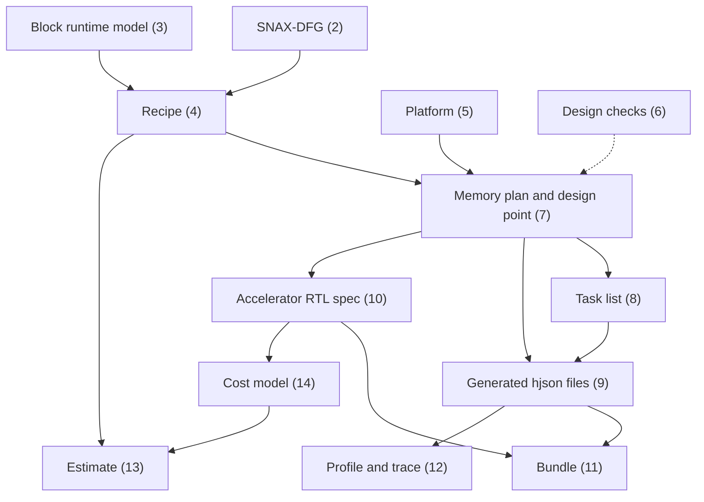
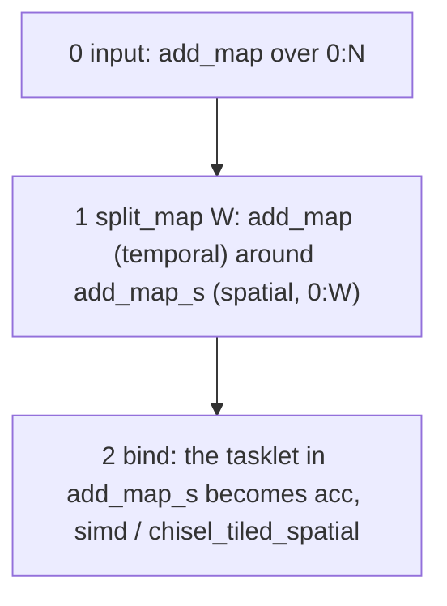
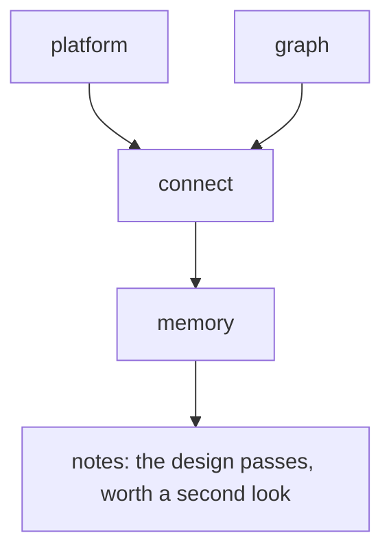
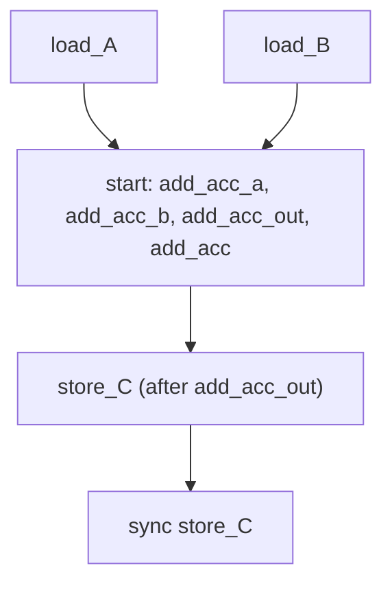

# SNAX-FORGE Contracts

What each artefact between the components holds, field by field, so a component can produce its output without reading another's code. Why each is so: `docs/DECISIONS.md` and the module docstrings.

- The artefacts are dataclasses with `to_dict` / `from_dict` and plain JSON until the M6 freeze (D26); the generated hjson files already have schemas (section 9).
- A fenced block under a `<!-- snippet: ... -->` line is copied verbatim from the file it names; `tests/test_contracts.py` fails if one drifts, and checks that every section the repository cites exists (D46).
- The sections follow the path: the graph and its blocks (2–4), the design step (5–7), what is generated (8–11), what is measured (12) and estimated (13, 14).



---

## 1. Conventions

- **Addresses are bytes**: L1 and L2 addresses, a streamer's `base`, every stride, the DMA's bases.
- **The bank word is the unit of transfer** (D142). A word is the L1's `width_bits` wide and holds num_slc = `width_bits` / b elements of a container's dtype (b its bits), little-endian as NumPy lays them out. A port of W lanes uses num_ch = W / num_slc streamer channels; `connect.pack` and `connect.num_ch` check it (section 6).
- **Integers first** (D28): the default `dtype` is `int64`.

The L1 of `platforms/snax_forge.json` (section 5):

<!-- snippet: platforms/snax_forge.json -->
```json
 "l1": {
  "n_banks": 32,
  "width_bits": 64,
  "rows": 512,
  "base_addr": 268435456,
  "wide_bits": 512,
  "max_xbar_inputs": 128,
  "warn_xbar_inputs": 64
 },
```

## 2. SNAX-DFG

The workload as one `.snaxdfg` JSON file (D71), written by an importer and rewritten by each sandbox transform. `Graph.load(path)` reads it; every field is written, a missing key takes its default, an unknown key is an error, and a graph is validated when it is made.

| Field | Holds |
|---|---|
| `name` | the kernel |
| `symbols` | name → int or `null`: `null` as imported, the value once a recipe binds it |
| `containers` | name → `shape` (ints or expressions over symbols), `dtype` (a NumPy dtype name), `transient`, `attrs` (namespaced; `sdfg.scalar: true` marks a scalar argument of shape `[1]`) |
| `body` | the nodes, in execution order |

### Nodes

Every node has `id` (unique: task names are built from it, D75), `kind`, `inputs`, `outputs`, `attrs` and, for a kind that has one, `body`. A connector maps to a memlet, `{"data": container, "subset": [dim, ...]}`, one entry per container dimension: an index (`n`, `4 * n_1_t + n_2_s`, `0`) or a range `begin:end[:step]`, end exclusive.

| Kind | Attrs | Body |
|---|---|---|
| `map` | `var`, `range`; `loop.kind` (absent, `tile`, `temporal`, `spatial`); `loop.dim`, `loop.piece` (D162); `loop.split` (the `var` and `range` before a split, and `valid`, the iteration count, when it is not a multiple of the factor: the lanes past it are padding, D144) | runs once per value of `var` |
| `tasklet` | `code`: one `output = expression` per output connector; its connectors are single elements | none |
| `link` | `container` (the transient it replaced, which writer and reader still name), `depth` (0 a wire, ≥ 1 a buffer), `from`, `to` (the units' instances) | none |
| `accelerated` | `instance`, `brm`, `implementation`, `code` (the BRM's matched entry), `params` (design params), `replaced` (the subtree `bind` replaced), `locals`, `accelerator`, `group` (the last three only when set) | empty for a leaf block |

- An accelerated node's connectors are the BRM's ports, each port's lanes as a range: one beat.
- A slot read from a scalar has no value in `params`; its slot connector names the container instead (axpy's `k1` on `alpha[0]`).
- `replaced` is checked in the node's scope, never run, and its ids may repeat live ones; `unbind` and `join_map` take it back.
- Attrs without a namespace belong to the kind and are all written; namespaced ones (`loop.*`, `mem.*`, `hw.*`, `user.*`, `sandbox.*`) pass through. More kinds come with `register_kind`.

### Import

`dfg/import_sdfg.py` derives the graph from the kernel's simplified SDFG and decides nothing:

- a Scalar becomes a `[1]` container with `sdfg.scalar`; a Map with several parameters becomes one map per parameter, outermost first; a Reduce becomes one map per input dimension around `out = in1`, its output folding;
- a map over `0:X` is named `lower(X)` (D162); other names are lower case with underscores stripped, `_1` added on a clash (`__tmp0` → `tmp0`);
- what it does not take (control flow, open item 36) is refused by name.

### Folding writes

A tasklet's output memlet may hold `"reduce": {"op": ..., "identity": ...}` (D102): the elements start at `identity` and every iteration's value is folded in with `op` (`add`, `mul`, `min`, `max`; `register_reduction`). dot as imported (`tests/dfg/fixtures/dot.snaxdfg`) folds its `sum` tasklet's `out[0]` so.

- **With a seed** (`fuse_seed`, D163): `"seed": {"data": ..., "subset": [...]}` takes the identity's place; each element starts from the seed's element, read with the inputs (matvec_acc's sum: `q[m_t]`, written in place). The tasklet keeps what `fuse_seed` took in `sandbox.seeded`, for `unfuse_seed`.

### Accelerators, groups and shared instances

A bound graph nests accelerator ⊃ groups ⊃ units and links (D146, D148):

- A **unit** is an accelerated node. A **group** is a connected set of units and links (`link`, section 4); an unlinked unit is a group of its own, named after its instance; a linked group's units carry its name in `group`. A link node sits before its reader in the body the two share.
- By default each group is its own **accelerator**, named after it; `encapsulate` puts several into one, which shares one streamer set (section 9), each group still a task of its own. The nodes of one instance carry the same `accelerator` or none, and an accelerator's name is no instance's.
- A **fused map** (`fuse_map`) is one nest of two tasklets; the transient between them becomes a local value, no longer in L1 (the container carries `loop.local`, the map records its two nests in `loop.fused`). `bind` on the nest keeps the local in the node's `locals`, so `unbind` then `unfuse_map` give the graph before `fuse_map` exactly. `split_reduce` records its partials and final sum in `loop.split_reduce`.
- **Shared instances** (D165): several nodes may share one instance, one BRM, implementation and params, run once per node in body order (mvt's variant 1, `recipes/mvt/mvt_1.json`). LOWER gives each node its own task on the same streamers; the estimate counts the area once and each run's cycles. A linked group is shared by `share`: a node per nest and a link node per nest on the same ports (`design/streamers.py`'s `group_links`), run once per set of nodes its links join (`group_runs`).

### A transposed read

`mark_transpose` (D164, `sandbox/transpose.py`) records on a tasklet `sandbox.transpose`, `{connector: π}`, for an input whose dimensions it reads across its loop order: π orders the container's dimensions by the depth of their outermost map. mvt's half 2 reads `A[m, n]` under the loops (n, m): π = (1, 0). No memlet changes; `bind` carries the mark onto the accelerated node, keyed by port.

### Names and expressions

- Every name in an expression is a symbol or an enclosing map's `var`; shapes use symbols only; symbols, containers and variables never share a name.
- An expression is ints, names, `+ - * //`, and `max(a, b)`, `min(a, b)` (`snax_forge/expr.py`), stored as `ast.unparse` writes it, one without names as an int.

vecadd after `split_map` (W = 4) and `bind` (`tests/dfg/fixtures/vecadd_accelerated.snaxdfg`): the accelerated node holds what it computes and what it replaced.

<!-- snippet: tests/dfg/fixtures/vecadd_accelerated.snaxdfg -->
```json
     "inputs": {
      "a": {"data": "A", "subset": ["4 * n_1_t:4 * n_1_t + 4"]},
      "b": {"data": "B", "subset": ["4 * n_1_t:4 * n_1_t + 4"]}
     },
     "outputs": {"out": {"data": "C", "subset": ["4 * n_1_t:4 * n_1_t + 4"]}},
     "attrs": {
      "instance": "acc",
      "brm": "simd",
      "implementation": "chisel_tiled_spatial",
      "code": "out = a + b",
      "params": {"W": 4, "op": "add", "streams": 2},
      "replaced": {
       "id": "add_map_s",
       "kind": "map",
```

## 3. Block runtime model

One accelerator block as plain data (D68, D70): a hand-written JSON file in `snax_forge/brm/library/`, named after the block, in the form `Brm.to_json` writes (every field, defaults included). `load_brm(name)` reads it; an unknown key or a missing part is refused by name.

| Part | Holds | Read by |
|---|---|---|
| `interface` | params (`design`, `runtime`) and ports (name, direction, lanes, rate, dtype, `when`) | everything below |
| `function` | a kind registered in `brm/function.py` (`simd`, `reduce`, `mac`, ...), its params, and `code`: what one lane computes (D82) | the reference executor; `bind` |
| `dataflow` | a notation (`affine`, `stream`) and one nest per port | the streamer values |
| `pattern` | `family` (a matcher registered in the sandbox) and its `attrs` | `bind` (section 4) |
| `implementations` | per name: `source` (`chisel`), `supports`, `timing`, `binding` | SNAX-GVSoC and the generator |

The first four are shared: designs that differ only in timing, supported values or RTL are implementations of one BRM.

### Ports

| Field | Meaning |
|---|---|
| `name` | not a Python keyword, not starting with `_`; by convention `a`, `b`, ... in, `out` out |
| `rate` | a beat every `rate` firings, an int or a runtime param's name: an input at firings `0, r, 2r, ...`, an output at `r-1, 2r-1, ...` (a SIMD block 1 everywhere; a reduction 1 in, `T` out) |
| `when` | `{param: value, ...}` over design params: the port exists only when every one holds (`simd`'s `b` only at `streams` 2, `accumulate`'s `seed` only at `seed` 1) |
| `dtypes` | the dtypes the port takes (`brm/dtypes.py`); every integer dtype by default, written only when narrowed |

### Timing and params

| Field | Meaning |
|---|---|
| `latency` (L) | a firing to its push; the only one that delays a result |
| `initiation_interval` (II) | the least cycles between firings |
| `drain` | the cycles, from a push, in which no input is taken; 0, as the control unit has none (`gen.drain`) |
| `span` | the cycles a unit reads one input beat in place (section 10); 1 by default |

- Each is an int or an expression over design params, stored canonical.
- A **design** param is fixed per instance (lanes, the op) and reaches the design point and the hjson. `default` applies when none is given, `values` limits it, an implementation's `supports` further. A null `default` means unset unless `bind` or a code entry sets it; an expression naming an unset param is not evaluated.
- The **runtime** params are exactly `n` (the firings in a task) and every named port rate, in port order: the accelerator task's `values` (section 8). `n` must be a multiple of every rate.

### The function and its code

`code` is one `output = expression` per output port over the input ports, per lane of one firing. The ops are `add`, `sub`, `mul`, `min`, `max`, `and`, `or` and `xor`; `simd` works at its inputs' result type, `reduce` casts its lanes to the output's dtype before its tree, `mac` multiplies at the inputs' result type, then casts (D143). A reduction says what one element contributes (`accumulate`'s `out = a`); its fold is its pattern's and kind's (D102).

`code` may instead be a list of entries, `{"params": {...}, "code": ...}`, each fixing design params. `simd` has twelve: add, sub, mul, min and max at two streams; the same five at one stream with the slot `k` for `b`; axpby as `out = k1 * a + k2 * b` and `out = k1 * a + b`.

How `bind` picks an entry (D82):

1. It tries the entries in order, and every assignment of the tasklet's array inputs to the entry's present ports.
2. The code must equal the tasklet's, with `+`, `*`, `min` and `max` commuting.
3. A **slot** (a design param the code names that is not a port) matches either an int with no names that fits the op type, baked (D143), or a scalar operand read at run time from an R/W CSR (D161).
4. An entry fits only when every slot its code names has a value and every other slot is unset (axpy, with `k2` unset, has one code).
5. The first match's params and baked values become the instance's; a bind param that contradicts them is refused. A null `code` cannot be bound.

### The binding

`brm/binding.py` (D129): `{datapath, args, controller, ports}`.

- `datapath`: one of the catalogue (`hw/chisel/blocks.json`, section 10); `resolve` checks it takes the instance.
- `args`: its parameters, each an expression over design params; a bool is a design-time variant.
- `controller`: `counted`, the group's control unit (D147).
- `ports`: optional, maps BRM ports to the datapath's (by default the same names).
- The CSRs are not the binding's: they follow from the unit's group (section 10).

The library's BRMs:

| BRM | Implementation | Datapath | Notes |
|---|---|---|---|
| `simd` | `chisel_tiled_spatial` | `SimdLanes` (`lanes` W, `op`) | |
| `accumulate` | `chisel_adder_tree` | `TreeAccumulate` (`a` → `in`) | `seed` 0 or 1 adds the input `seed`, one lane at rate T, read once per job (D163) |
| `accumulate` | `chisel_serial` | `SerialAccumulate` | one lane a cycle, so `span` = lanes |
| `mac` | `chisel_mac` | `Mac` (`accumulate` true, `regOut` false) | `out = a * b` folded per lane over T beats (D149) |
| `lane_accumulate` | `chisel_lane_accumulate` | `LaneAccumulate` | rowsum 2: `out = a`, each lane folding its own element over T beats; a front op is refused (bind `mac`) |

`mac`'s pattern, `lane_fold`, is a fused nest (section 4): a multiply and a reduce joined by a local value, the fold indexed by the spatial variable:

<!-- snippet: snax_forge/brm/library/mac.json -->
```json
 "function": {"accel": "mac", "params": {"lanes": "W", "op": "op"}, "code": "out = a * b"},
 "dataflow": {"notation": "stream", "ports": {"a": {}, "b": {}, "out": {}}},
 "pattern": {"family": "lane_fold", "attrs": {"op": "mul", "fold": "add"}},
```

### Two notations

- **`stream`**, which every library BRM uses: the nest is empty; lanes, rate and dtype are the interface's and the bound memlet gives the element order. `bind` checks no order, LOWER takes the streamer's values from the memlet, the design step the spatial bounds from its ranges.
- **`affine`**: the operand's `shape`, an `offset` and `loops`, outermost first, each a `bound`, one stride per dimension and a `spatial` flag; a step's element is `offset + sum(i_l * strides_l)`. Temporal loops first (a step is a beat), spatial loops last, multiplying to the port's lanes; a temporal stride of 0 repeats a beat. `bind` checks that the memlets give this order.

## 4. Recipe

SNAX-SANDBOX's ordered list of transforms (D72): a JSON file in a category folder of `recipes/` (`elementwise/`, `reduce/`, `dot/`, `matvec/`, `mvt/`, and `custom/` for what the editor saves). A recipe is found by its name (`find_recipe`), so names are unique across the folders. `Recipe.load(path)` reads it; every field is written (`dtypes` only when given), an unknown key is an error.

| Field | Holds |
|---|---|
| `name` | the recipe; its steps are written to `out/sandbox/<name>/` |
| `kernel` | the kernel whose import it starts from |
| `params` | recipe params, each an int or a string; `--set NAME=VALUE` overrides one |
| `symbols` | a value per graph symbol: an int or an expression over the params |
| `dtypes` | optional, container → NumPy integer dtype in place of the kernel's (D113): applied before DaCe builds the SDFG, the inputs cast to it (`vecadd_i32`: A, B, C `int32`) |
| `steps` | in order: `transform` (a registered name) and its `params`; an int param takes an int or an expression over the recipe params (`"factor": "W"`) |

Running a recipe binds the symbols (step 0), applies the steps and checks each against the reference executor on the same seeded inputs, writing `<i>_<transform>.snaxdfg` and `recipe.json`. vecadd's, `recipes/elementwise/vecadd.json`:

<!-- snippet: recipes/elementwise/vecadd.json -->
```json
 "params": {"W": 4, "N": 64},
 "symbols": {"N": "N"},
 "steps": [
  {"transform": "split_map", "params": {"map": "add_map", "factor": "W"}},
```



### Transforms

Each has an inverse, and each refuses with the fix named. The loop names follow D162; a transform's site (D72) says where it applies.

| Transform | Params | Does |
|---|---|---|
| `split` | `map`, `factor` | a map over `b:e` becomes an untagged map over `0:(e - b) // factor` (same id) around `<id>_inner` over `0:factor`, the dimension's pieces renumbered (`n` → `n_1`, `n_2`). A length n not a multiple of the factor gives `0:(n + factor - 1) // factor` and `loop.split.valid` n: the lanes past n are padding (D144) |
| `split_map` | `map`, `factor` | `split`, then `temporal` outside and `spatial` inside, in one step; keeps the ids `<id>` and `<id>_s`, which old recipes bind (D73) |
| `tag_map` / `untag_map` | `map`, `kind` (`temporal`, `tile`, `spatial`) | tags an untagged map, its variable taking `_t`, `_tile` or `_s`; on a fused nest's level both nests are tagged. `untag_map` refuses a map around a bound unit |
| `join_map` | `map` | a split map and its inner map, whatever their tags, become the map they were split from |
| `bind` / `unbind` | `node`, `brm`, `implementation`, `instance`, `params` | the tasklet (or a fused nest's spatial map, or a folding spatial map for `lane_accumulate`) and its spatial map become an accelerated node (below); `unbind` gives back what it `replaced` |
| `encapsulate` / `unencapsulate` | `accelerator`, `units` | the units' groups become one accelerator sharing one streamer set (D148), in graph order |
| `split_reduce` / `join_reduce` | `map`, `factor` | a folding map is split as `split_map` splits it, each lane writing a partial into `<output>_partial`; a final sum `<tasklet>_final` in a spatial map `<map>_final` over `0:factor` folds them (a seed stays on the final sum) |
| `fuse_map` / `unfuse_map` | `first`, `second` | two nests with the same ranges and tags down to one tasklet each, joined by a transient at the same index, become one nest of two tasklets; the transient becomes a local value. An untagged level takes the other's tag; a split on one side only is refused with the split that fixes it (D150) |
| `fuse_seed` / `unfuse_seed` | `first`, `second` | a fold writing t with ⊕, read only by a nest computing `t ⊕ x` in place over t: the nest and t go and the fold starts from x (`reduce.seed`, D163; matvec_acc's q += A p). Refused for another reader, op, subset, a float or a bound fold |
| `bake_scalar` / `unbake_scalar` | `container`, `value` (an int or `csr`) | at an int the scalar becomes a literal and the container goes (axpy's alpha 3: `bind` bakes `k1 = 3`); at `csr` the tasklet names the container, read at run time (D161) |
| `interchange_map` | `map`, `with` | two maps of one perfect nest trade places, each keeping id, variable, range and tag; its own inverse. Refused when a range would name an inner variable or the swap reorders an order-dependent fold (rowsum 2: `sum_map_s` with `sum_map_1`) |
| `mark_transpose` / `unmark_transpose` | `node`, `container` | marks a read across the loop order (section 2, D164); nothing else changes |
| `share` / `unshare` | `group`, `with` | `group` runs on `with`'s units: the same shape unit by unit (BRM, implementation, params, links and depths), its nodes renamed to `with`'s (D165). Refused naming what differs (`vmul_x2 and vmul_x1 differ: W = 4 against 8`) |
| `share_ports` / `unshare_ports` | `container`, `accelerator` | the container's writer's and reader's groups go on one accelerator whose movers they share, the k-th widest port of each on mover k (D169); the container is marked `hw.share_ports` |
| `link` / `unlink` | `container`, `depth`, `group` | a transient between two bound units becomes a link node, their groups merge under `group`, and the transient leaves L1. Refused: not one writer and one reader (`link.container`), an end not bound (`link.unbound`), the beats not in the same order (`link.order`), a clashing name (`link.group`) |
| `lift` / `unlift` | `kernel`, `at` | the region matching a kernel's import becomes a block, `sandbox.block` = `{name, kernel, heads}` (D166) |
| `apply_recipe` / `unapply` | `recipe`, `region` or `block`, `params`, `name` | another recipe's steps run on the region, its names renamed onto it (`_1`, `_2` on a clash); one step, one reference check (D166) |
| `name_block` | `nodes`, `name` | a region becomes a block by hand, with no kernel or recipe |

What `bind` checks:

- Every map around the spatial map is `temporal` (an untagged one names `tag_map`; `tile` is not lowered yet). The lanes param comes from the spatial bound, and the dimension over the spatial variable becomes the lanes' range.
- The tasklet's code on the port names equals the BRM's `function.code` (section 3). A folding output without the spatial variable becomes one lane (D102).
- A fused nest binds as one: as a fold (`lane_fold`) or, when the second tasklet is plain, as one code with the first's expression in place of the local value (axpy's `y + alpha * x`).
- A tasklet that needs a fused map or a split reduction is refused with the fix ("fuse_map first", "split_reduce first", D150).

### The library's recipes

- `vecadd_undo` takes vecadd's last step back to the first.
- dot binds the multiply to `simd` and the sum to `accumulate`'s `chisel_adder_tree`, whose `out` is one lane every `T = N / W` firings. `dot_1` has two accelerators, `vmul` and `vsum`, run one after the other (D157, D158); `dot_1_enc` encapsulates them as `dot`, each group's task setting the other's movers idle (section 8). dot 2 and 3 link `tmp0` at depth 1 and 0; dot 4–6 `split_reduce` the sum, fuse the nests and bind `mac`, dot 5 and 6 with `chisel_serial`. `matvec_1`–`matvec_6` do the same on each row.
- **Recipes of recipes** (D166): `matvec_dot1`–`matvec_dot6` apply `dot/dot_<k>` on each row; `mvt_1_reuse`, `mvt_1_dot2_reuse` and `mvt_2_reuse` apply a matvec recipe on each half, the `vadd` and the sharing by hand.

### The editor's session

`edit-dfg` keeps a session in `out/sessions/<name>/` (`sandbox/session.py`):

| File | Holds |
|---|---|
| `recipe.json` | every step applied so far; the graphs are rebuilt by replaying it |
| `session.json` | `cursor` (the step shown; undo and redo move it) and `platform` |
| `export/<k>_<transform>.snaxdfg` | a step's graph, written by Export |

- **Params**: a session from a kernel starts from its symbols, each a param (`edit-dfg --kernel K --set N=…`). Every factor and depth the editor writes names a param: the form defaults to `W`, `W_2`, … and `D`, `D_2`, …, and a number given instead becomes a new param at that value (`fresh_param`). `POST /api/apply`'s `new_params` (`{"W_mul": 8}`) adds them before the step.
- **Renames**: when its map is bound, an editor-named factor is renamed to `W_<instance>` through the session (dot 1's `W_mul` and `W_sum`), unless several units share it (dot 2–6's `W`). `bind`'s default instance is `acc_N`, N the bind's order in the session.
- **Replay**: a step applied before the last is refused (`session.drop`) until the later ones are dropped. A param change (`POST /api/params`) replays up to the cursor; the later steps are replayed when the cursor reaches them.
- **Checks**: every apply and param change runs Save's design checks; the step view's `problems` and `notes` each are `{code, where, message, fix, before_save}`. `graph.unbound` while building is a note, but Save refuses it.
- **Save** writes steps 1 to the cursor as `recipes/custom/<name>.json`, with only the params its steps and symbols use, and the steps to `out/sandbox/<name>/`. It never overwrites (`save.name`) and refuses a graph-stage problem (`save.graph`), any other design problem unless forced (`save.design`).

### The viewer's API

The page only draws; Python builds every text and number (`viz/dfg/api.py`, D55).

| Route | Gives |
|---|---|
| `GET /api/steps` | each step's `name` (`<folder>/<stem>` when the files come from several folders, `-2`, `-3` on a clash), `folder`, `label` |
| `GET /api/step/<k>` | the drawing (boxes, rows, columns, edges), Details, the Estimate (section 13), the cost (section 14), the left column (`symbols_section`, `containers_section`, `bindings_section`), `shared`, `partners`, in edit mode `problems` and `notes` |
| `GET /api/step/<k>/site?sel=<id>&sel=<id>` | each transform's site for the selection, in the order selected; a transform that takes one item refuses several (`site.one`) |
| `GET /api/compare/<j>/<k>` | `columns`: `labels`, Details' and the Estimate's rows `{label, under, a, b, differs}`, `caveat`, `cost_tables` |
| `GET /api/find?step=<ref>` | a step from a bare stem or a number |

- The URL hash holds the whole view (`step=`, `tech=`, `open=` for the blocks opened); `?tech=` names the technology (`char.tech` for an unknown one).
- **Bindings** is a tree, `{kind: accelerator | group, name, children}` down to `{kind: entry, index}` into `entries`: one entry per bound unit with its split's params, a split not bound yet, a link whose depth is a param. A param several entries name says `shared with …`.
- **Blocks** (D166): a closed block is drawn as one box inside its firing loops, each edge labelled with the slice one firing takes (`A[m_t, 0:N]`).
- **Partners**: a selected map's partners for `fuse_map`, `fuse_seed` and `interchange_map`, from the transforms' own sites, and a near partner with its refusal and fix.

## 5. Platform

The SNAX cluster around the accelerators (D84): a file in `platforms/` that never names a recipe (`snax_forge.json`, read from snax-forge's base cluster; `small16.json`, with no source hjson). `Platform.load` reads it; every field is written, a missing key takes its default (`l2` missing: no L2), and unknown keys and wrong types are all reported at once (section 6).

| Field | Holds |
|---|---|
| `name` | the platform, an identifier |
| `base`, `changes` | the platform it was made from (null for an original) and every `--set` path → value since, in order |
| `hjson` | the source cluster file, a path from snax-forge's root, or null: what the generator writes the cluster file from (section 9) |
| `accelerator_slot` | the prefix of the generated entry's name, `<accelerator_slot>_<design>` (`snax_forge`, D131) |
| `acc_csr` | the widths of the accelerator's CSRs (below) |
| `l1`, `l2` | the memories (below); `l2` null for an L1-only cluster |
| `wait_mode` | `poll` or `signal` (the program refuses `signal`, `c.signal`) |
| `streamers` | the streamer shell: `default`, then an entry per streamer it changes (below) |

`L1Config` (`design/platform.py`):

| Field | Meaning | Default | Checked |
|---|---|---|---|
| `n_banks` | single-port banks | 32 | ≥ 1 |
| `width_bits` | bits per bank word | 64 | a multiple of 8 |
| `rows` | words per bank | 512 | ≥ 1 |
| `base_addr` | the first L1 byte | 0 | |
| `wide_bits` | the widest port (the DMA's) | 512 | a power-of-two multiple of `width_bits` |
| `max_xbar_inputs` | the most crossbar inputs, as SNAX-GVSoC's crossbar asserts (D85) | 128 | ≥ 1 |
| `warn_xbar_inputs` | above it the note `design.xbar_inputs`: the cost is extrapolated beyond the tables | 64 | 1 to `max_xbar_inputs` |

`L2Config`:

| Field | Meaning | Default | Checked |
|---|---|---|---|
| `size_bytes` | flat size | 1 MiB | a positive multiple of the beat |
| `base_addr` | the first L2 byte | 0 | |
| `beat_bits` | one DMA beat | 512 | equal to the L1's `wide_bits` (`platform.l2`) |
| `width_bits` | as the L1's, and equal to it (`platform.l2`) | 64 | a multiple of 8 |

`AccCsrConfig`, written into `accelerator.json` (section 10):

| Field | Meaning | Default | Checked |
|---|---|---|---|
| `job_width` | bits of JOBS, every JOB_BEATS and the control units' counters | 32 | 1 to 32 |
| `busy_counter_width` | bits of BUSY_COUNTER, which saturates at 2^w − 1; null follows `job_width` | null | 1 to 32 or null |

Neither memory has an element type: each container's dtype decides how many elements a word holds (D142).

### The streamer shell

One streamer per port of every accelerated instance, `<instance>_<port>`, but a port on a link (D12).

- **From the port**: `write`, `n_ports` (its lanes) and, unless an entry gives them, `spatial_bounds` (fastest first: an `affine` nest's spatial loops, a `stream` port's memlet ranges).
- **From the graph**: `temporal_dims`, the firing loops the port's memlet runs over (at least 1, the most over an instance's nodes), recorded per streamer in the design point.
- **From the platform**: `default.fifo_depth` (≥ 1); an entry named after a streamer overrides it and `spatial_bounds` for that streamer, and may give `num_ch` (never in `default`), the TCDM channels it uses, else W / num_slc (D142).

### Working copies and cluster files

- `pixi run design GRAPH --platform P --set platform.PATH=VALUE` sets a field by its path (`l1.n_banks`, `streamers.acc_out.fifo_depth`; the value as JSON, else text) and writes `out/design/<name>/platform.json`; `pixi run design save SRC NAME` keeps it as `platforms/NAME.json`.
- `pixi run design from-hjson HJSON NAME` (D131, `design/hjson_platform.py`) writes an original platform: L1 and L2 from the hjson (the reader's docstring lists the keys), `streamers.default` from the one accelerator's streamer template, whose movers must agree, the rest small16's. `snax_forge.json` is read so from `platforms/snax_forge_cluster.hjson`, which has one core holding the accelerator slot and the DMA (D170):

<!-- snippet: platforms/snax_forge.json -->
```json
 "hjson": "platforms/snax_forge_cluster.hjson",
 "accelerator_slot": "snax_forge",
```

## 6. Design checks

Before the design step writes anything it runs every registered check (`register_check(code, stage, fn)`) on the pair of a bound graph and a platform, and reports every problem as `[code] where: why` with a `fix:` line where one exists (D85). `pixi run design check GRAPH --platform P` runs them only.



The `platform` and `graph` stages run independently, `connect` when both passed, `memory` when `connect` passed.

| Code | Fails when |
|---|---|
| `platform.keys` | the file does not parse; an unknown or missing key or a wrong type; a `--set` path that does not exist, is the tools' (`name`, `base`, `changes`) or the port's (`write`, `n_ports`) |
| `platform.values` | a value its section rejects (`n_banks` 0) |
| `platform.streamer` | a streamer value below 1, spatial bounds not a non-empty list of ints ≥ 1, a `num_ch` not an int ≥ 1 |
| `platform.l2` | L2 and L1 disagree on the beat or the word |
| `platform.banks` | with an L2, `n_banks` not a multiple of `wide_bits / width_bits` |
| `graph.load` | the graph does not load (section 2) |
| `graph.symbols` | a symbol still null: bind it in the recipe |
| `graph.unbound` | work outside every accelerated node, or no accelerated node: the program drives accelerators only |
| `graph.brm` | an unknown BRM or implementation, params that do not resolve, connectors that are not the BRM's, code that is not the BRM's |
| `graph.instance` | an instance named `dma` or after a streamer, or two streamers with one name |
| `connect.streamer_key` | a streamer entry that matches no port (the fix names the closest) |
| `connect.derived` | a streamer entry that sets `write` or `n_ports` |
| `connect.lanes` | an entry's `spatial_bounds` that are not the port's lanes |
| `connect.dtype` | containers that break the BRM's dtype rule (`brm/dtypes.py`, D143: each port's dtype allowed, every output at least as wide as every input, no signed input with a `uint64` one), or two dtypes on one port of an instance |
| `connect.pack` | a port whose elements do not fill whole words (D142), below |
| `connect.pad` | a fold reading through a tail what an accelerator wrote, unless the producer's tasklet on its pad values gives the fold's identity (D144), below |
| `connect.num_ch` | a `num_ch` other than W / num_slc, which needs the FIFO slicer (D142); the message lists the values that would fit |
| `connect.xbar_inputs` | more crossbar inputs than `l1.max_xbar_inputs`, below |
| `share.shape` | a shared set's user whose spatial bounds do not fit in its mover's first channels (D169, `design/streamers.py`'s `shared_movers`) |
| `connect.temporal` | a map around an accelerated node that is not `temporal`, or a subset not affine in the firing loops |
| `memory.pin` | a memory working copy that does not load, a bad `--set memory.` path, a pin on an unknown container, on a memory it is not in, or on L2 (the link places it) |
| `memory.residency` | a layout in a memory the platform lacks; a non-transient container that lives nowhere; an accelerator operand without an L1 layout |
| `memory.layout` | a layout whose shape is not its container's |
| `memory.align` | an L1 base not on a word, a stride not a multiple of the itemsize; a container the DMA moves whose L1 layout is not contiguous whole wide beats on a beat (open item 38) |
| `memory.fit` | an L1 layout past L1's end (the message names its bytes), or an L2 layout larger than L2 |
| `memory.runtime` | an L1 layout reaching into the top of L1 that snRuntime keeps: a 1 KiB stack per core plus `RUNTIME_MARGIN` (256 B) |
| `memory.overlap` | two L1 layouts that share bytes |
| `point.keys` | a design point with unknown or missing keys |
| `point.streamers` | a design point whose `streamers` are not the platform's shell for its graph |

The three checks that need the most explaining:

- **`connect.pack`**: a word holds num_slc elements of the container's dtype. The fastest spatial bound must be a multiple of num_slc (W < num_slc: make the container 64-bit or give the port num_slc lanes), the fastest spatial loop must step 1 element (not a column), and every other step and the start must be multiples of num_slc (the fix pads the leading dimension). Row strides are over the padded shape: a 3 × 7 int32 matrix split by 4 has row stride 8. At num_slc = 1 every port passes.
- **`connect.pad`**: the hardware masks nothing, so a producer's pad lanes reach the fold. dot 1 at W_mul = W_sum = 10 passes (0 × 0 = 0, add's identity); at W_mul = 8, W_sum = 10 the producer never writes the pad words and is refused (open item 106). The fix: a size that W divides, or a factor that divides n.
- **`connect.xbar_inputs`**: the inputs as the generated cluster file gives them to SNAX-GVSoC: every streamer's num_ch, a shared set's movers' channels once (D169), one per core and one for AXI. vecmul at W = 64: `acc: 194 TCDM crossbar inputs, the platform takes at most 128 (192 streamer channels, 2 for the core and AXI; …)`; W = 32 has 98, which passes with a note. The fix: fewer lanes, or `share_ports`.

### Notes

A note is registered (`register_note(code, fn)`) and runs once the checks passed: the design step prints `note [code] where: why` with its `fix:` and still exits 0, and `design.md` lists it first under Notes. The bank notes compare the streamers of one group only, since an accelerator's groups run one after the other: `bank_bound` (section 13), and `design.md`'s address notes (two movers whose containers start in the same banks or lie a whole number of bank rows apart).

| Code | Noted when |
|---|---|
| `design.serial_one_lane` | a unit bound to `SerialAccumulate` at lanes 1, the same work as `TreeAccumulate` at lanes 1; the fix binds `chisel_adder_tree` |
| `design.xbar_inputs` | more crossbar inputs than `l1.warn_xbar_inputs`: "85 TCDM crossbar inputs, above 64 (l1.warn_xbar_inputs): beyond SNAX's own crossbar, its cost extrapolated from the tables" (mvt_2 at W = 8) |
| `char.missing` | a unit or buffer link the technology does not characterize (section 14): its comb part costs 0 |
| `cost.extrapolated` | a streamer or the crossbar priced outside the tables' grid, "streamer outside the table's grid on channels 32 (grid 1–16)", or an L1 bank the table does not hold (the memory costed 0) |

## 7. Memory plan and design point

### Memory plan

`design/memory.py` (D86): a layout per container and memory it lives in, `base` (the byte address of index 0), `shape` and one byte stride per dimension (`lower/layout.py`). Word `i` is in bank `i % n_banks`. Three passes make it, each registered by name (`register_memory_pass(kind, name, fn)`):

| Pass | Decides | Default |
|---|---|---|
| `residency` | each container's memories | a non-transient container in L2 and L1 (L1 alone without an L2); a transient in L1, but none for a link's container or a fused nest's local value |
| `layout` | shape and strides, base 0 | `contiguous`: row-major over the padded shape (a tail pads to a multiple of W, D144), each element its itemsize |
| `placement` | each L1 base (an L2 layout stays at 0: the program's link places its array) | `contiguous`: in graph order from L1's first byte, around the pins; a container in both memories on a wide beat, padded to whole beats (D105), the others on a word |

- `padded_rows` (`--set memory.passes.layout=padded_rows`, never in a recipe): as `contiguous`, but a container of two or more dimensions gets its last dimension's pitch rounded up to an odd number of words, in every memory, the pad words zero, so lanes reading down a column start in different banks (rowsum 2's A: 8 × 65 words).
- `--set memory.<container>.l1.base=N` pins an L1 base; `--set memory.passes.<pass>=NAME` picks a pass.
- Passes read a `MemoryContext`: the graph, the platform, the shapes, the memory ranges and each port's element-index stream (`accesses`).
- A container read only through a slot lives in L2 (in L1 without an L2): the core reads it, never a streamer. A layout the DMA moves keeps its last beat to itself.
- The design step writes `out/design/<name>/memory.json` (`passes`, `changes`, `layouts`), which `--memory` continues from.

### Design point

`design/point.py` (D87): written to `out/design/<name>/design_point.json` once every check passed, never by hand. It holds no recipe; loading it runs every check again.

| Field | Holds |
|---|---|
| `name` | the design's name: the recipe's beside the graph (never a `--set` suffix), else the graph's stem; the generated entry is named after it (section 9) |
| `graph_from` | the `.snaxdfg` it was made from (D108) |
| `graph` | that graph as read |
| `platform` | the platform working copy (section 5) |
| `streamers` | the resolved shell, `<instance>_<port>` → `instance`, `port`, `write`, `n_ports`, `spatial_bounds`, `temporal_dims`, `dtype`, `num_slc`, `num_ch`, `fifo_depth` |
| `memory` | the plan: `passes`, `changes`, `layouts` (container → memory → layout) |

## 8. Task list

SNAX-LOWER's ordered list of tasks (D64): which component runs which task with which values, where each is configured and started, and what it waits for. It is derived from a design point (`lower/derive.py`, `pixi run lower tasks DP`) or written by hand; `lower/c.py` turns it into the program (section 9).

A task list is `name` and `steps`, each with an `op`:

| `op` | Fields | Becomes |
|---|---|---|
| `configure` | `task_name`, `type`, `component`, `after`, `wait_mode`, `values` | the component's configuration, written here |
| `start` | `tasks` | the waits these tasks need, then their start writes in list order |
| `sync` | `task`, `mode` | one wait on the task's component |

- `after`: earlier tasks this one needs finished (data it reads, a buffer it overwrites); default `[]`.
- `wait_mode`: `poll` (default) or `signal`, used whenever lowering waits for this task.
- Only the loops a task uses are given; the program pads the rest with bound 1 and stride 0. Every field is written back, and an unknown key is an error.

`type` says how `values` are read:

| `type` | `values` |
|---|---|
| `streamer` | `base`, `temporal_bounds`, `temporal_strides`, `spatial_strides`, in bytes and bank words (D142) |
| `dma` | `direction` (`l2_to_l1`, `l1_to_l2`); `src` and `dst`, each with bounds and strides (one wide beat per step), the L1 side with `base`, the L2 side with `symbol` (its container's `data.h` array) |
| `accel` | `n`, then each named rate (`T`), then each slot read from a scalar as `{"from": <container>}` (axpy's `k1: {"from": "alpha"}`), written to the slot's CSR before START |

- **A streamer's strides**: a channel moves one bank word of num_slc elements. The fastest spatial loop runs S_0 / num_slc channels, its stride num_slc × the element stride × the itemsize; every other stride is the element stride × the itemsize; `base` is the layout's base plus the offset's bytes. Spatial bounds are design-time, in elements, from the design point's streamers.
- **An idle mover** (another group's in the same encapsulated set, D148): every temporal bound 0, so it never starts, and every temporal stride a bank word, never 0 (a reader whose first loop has stride 0 runs that loop once whatever its bound, as snax_cluster's `Reader.scala` does).
- **A shared set's movers** (D169) keep a task per port; the program writes each mover once per start.
- **Names** (D75): streamer `<instance>_<port>` (`acc_a`), task `<node>_<component>` (`add_acc`), DMA task `load_<container>` or `store_<container>`, `_<k>` added for tile `k`.

### Checks

- When a list is made: task names are unique; `after`, `start` and `sync` name tasks configured earlier; a component has at most one configured task not yet started; a task starts once, after its `after` tasks; every configured task is started.
- Against the design point (`check_values`): the component exists with the task's type, the values have exactly the type's keys, a streamer's loops fit it, a DMA's direction is valid, every bound is at least 1 (an idle mover's all 0).
- JOBS and every JOB_BEATS fit `acc_csr.job_width`, and a group's head firings (JOBS × every T) are below 2^32.

### Waits

`lower/waits.py`'s `placed_waits`: before a `start`, one wait per component on its latest task, for every `after` task not yet covered, leaving out a wait another covers. A wait on a writer streamer also covers its unit and the readers started with it; an idle mover's task needs no wait.

### Derived

`lower/derive.py`, per accelerated node in execution order:

1. `load_<C>` for each input not yet in L1.
2. A task per streamer, then the accelerator task (`n` the firings, each named rate from `named_rates`, D102).
3. One `start` of them all.
4. `store_<C>` for each output written for the last time; at the end one `sync` per non-transient output.



- **Encapsulated** (several groups on one streamer set): each task also configures the other groups' movers idle, and its `start` launches every mover. `dot_1_enc`'s `mult_vmul` starts `vmul_a`, `vmul_b`, `vmul_out`, with `vsum_a`, `vsum_out` idle.
- **A linked group** is one task at its first unit's node, `<node>_<group>`, on the group as its component: streamers only on the ports on no link (a link's container is never loaded or stored), and one accelerator task whose `values` are each unit's, by unit. Dot 6's `mult_dot`: `{"mac": {"n": 128, "T": 128}, "sum": {"n": 1, "T": 1}}`. The program writes the group's JOBS = n_u / ∏ T_v over its first unit u and its folds v, then each fold's JOB_BEATS (section 10).
- **Chains through L1** (D105): `after` holds data dependences only, so two groups chain with one wait, on the first's writer.
- **In place**: a writer never waits for a reader it starts with. That is an in-place update, allowed only when the reader is a port of its own unit visiting the same addresses in the same order (axpy's `y`, a fold's seed), and refused by name otherwise.
- **In series** (D158): before each accelerator's `start`, one `sync` on the previous accelerator's task, its own configures placed before it, so it is set up while the previous one runs. None when an `after` already holds that task, and none between the groups of one encapsulated accelerator. dot_serial: `sum_sum`'s configures, `sync mult_mul`, its start.

vecadd's design point on `platforms/snax_forge.json` gives `tests/run/fixtures/vecadd/tasks.json` exactly; its end:

<!-- snippet: tests/run/fixtures/vecadd/tasks.json -->
```json
  {
   "op": "configure",
   "task_name": "add_acc",
   "type": "accel",
   "component": "acc",
   "after": [],
   "wait_mode": "poll",
   "values": {"n": 16}
  },
  {"op": "start", "tasks": ["add_acc_a", "add_acc_b", "add_acc_out", "add_acc"]},
  {
   "op": "configure",
   "task_name": "store_C",
   "type": "dma",
   "component": "dma",
   "after": ["add_acc_out"],
   "wait_mode": "poll",
   "values": {
    "direction": "l1_to_l2",
    "src": {"base": 268436480, "bounds": [8], "strides": [64]},
    "dst": {"symbol": "C", "bounds": [8], "strides": [64]}
   }
  },
  {"op": "start", "tasks": ["store_C"]},
  {"op": "sync", "task": "store_C", "mode": "poll"}
```

## 9. Generated hjson files

What `pixi run gen-gvsoc DP [--out DIR]` writes per design point (D134, `gen/gvsoc.py`), by default to `out/gvsoc/<design>/`: what SNAX-GVSoC's `snax_hjson` target reads (`--param hjson=<dir>/<platform>.hjson`) and what snax-gvsoc's generic app (`sw/apps/forge/`) builds. One design point gives byte-identical files wherever written.

| File | Holds |
|---|---|
| `<platform>.hjson` | the cluster: the platform's `hjson`, comments dropped and key order kept, with the TCDM, DMA and DRAM values written from the platform, `cluster.name` `snax_forge_cluster`, and the slot (below) |
| `<tag>_streamer_<set>.hjson` | one per streamer set: `data_reader_params` and `data_writer_params`, unit by unit in its groups' order, each port with `spatial_bounds` in words, fastest first (`[S_0 / num_slc, S_1, ...]`), `temporal_dim`, `num_channel` and `fifo_depth` |
| `accelerator.json` | the accelerator's description (section 10) |
| `include/` | per set `streamer_<set>_csr_addr_map.h` (`VMUL_STREAMER_START_CSR`), per accelerator `<acc>_csr.h` (every CSR by section 10's name, in CSR order), and snRuntime's `snitch_cluster_cfg.h` and `snitch_cluster_addrmap.h`, rendered as snax_cluster's templates render them (`gen/headers.py`, D126) |
| `data.h` | per container the DMA moves an array named after it (const for the inputs and goldens, in graph order; a slot's container in L2 only) (`<container>_l2` where C or the runtime takes the name, `common.py`'s `c_name`): an input from the kernel's `make_inputs` (seed 0), or a zeroed output and its `<name>_golden` from the reference executor; in its padded shape (a tail's pads hold 0 or a fold's identity, D144), padded with zeros to whole DMA beats and aligned to the beat (D105) |
| `main.c` | the program (below) |
| `obs_marks.json` | the quiet build's sections in order, each `{mark, kind, label}` (below) |
| `manifest.json` | `design`, `design_point`, `symbols`, `cluster`, `files`, `program`, `trace`, `csrs`, `tasks` (below) |

- Each hjson and C file starts with a `//` comment naming the design point; `accelerator.json` names it in its `design_point` key.
- The accelerators come in the order the graph first uses them, their groups in graph order.
- A set's streamer header is snax_cluster's text byte for byte, its timestamp line naming the design point.
- A shared set (D169) gives each mover its widest user's channels and spatial bounds, the most temporal dims and the deepest FIFO, and `configurable_channel` where a narrower user is masked.
- `<acc>_csr.h`: a one-group accelerator's names have no group (dot 1's `VMUL_RW_START` to `VMUL_RO_BUSY_COUNTER`), an encapsulated one's do (`DOT_RW_VMUL_START`), a shared one's end with `<ACC>_RW_PORT_MUX_SEL`.

### The slot

The source's one slot, on core 0, renamed `<accelerator_slot>_<design>` (the tag, D131; not an identifier is `gen.tag`):

- **Dropped**: its `bender_target` (the RTL comes from the bundle), `snax_streamer_cfg`, `snax_num_rw_csr`, `snax_num_ro_csr`.
- **`snax_streamer_sets`**: one per accelerator in CSR order, `{name, snax_streamer_cfg: {$ref: "<tag>_streamer_<set>.hjson"}, snax_num_rw_csr, snax_num_ro_csr}`, also for one set (D157).
- **`snax_tcdm_ports`**: the sum of the sets' movers' num_ch; the source's `sparse_interconnect_config` becomes one group per set.
- **Added**: `snax_disable_csr_manager` `true` (D130), `snax_forge_rtl` `"rtl/files.f"` (in a bundle only), `snax_datapath_cfg` `{$ref: "accelerator.json"}`. snax_cluster's schema lists them, none with a default (open item 88).

### The CSRs

Per accelerator its streamer's CSRs, then its own (section 10's order), packed from `0x3C0`; snax_cluster's `snax_csr_range_demux` sends each range to its set (D157). With $s_k$ and $c_k$ accelerator $k$'s streamer and own CSRs, of $K$:

$$b_0 = 960, \qquad b_{k+1} = b_k + s_k + c_k$$

streamer $k$ at $[b_k, b_k + s_k)$, its own at $[b_k + s_k, b_{k+1})$, and $b_K - 1 \le$ `0x5FD` (`gen.csrs`; snax_cluster routes `0x5FE` and `0x5FF` to its task queues). The shell sees its own CSRs from 0. dot 1:

| Accelerator | Streamer | Own CSRs | In the shell |
|---|---|---|---|
| `vmul` | 960–977 | 978–981 | 0–3 |
| `vsum` | 982–994 | 995–999 | 4–8 |

### The program

`main.c` (`lower/c.py`, D135):

1. `main` reads `mcycle`, then runs one function per core, each step on its component's core, storing each accelerator task's counter after its wait (`forge_counter[]`).
2. A shared set's task (D169) writes every mover once (its group's port, a masked mover's `ENABLED_CHANNEL` = (1 << num_ch) − 1, the rest idle), then `PORT_MUX_SEL` when it changes, after the wait on the set's previous task (`c.port_mux`), then `STREAMER_START`, then the group's `START`.
3. `forge_check()` reads `mcycle` and prints `forge cycles: <n>`, then checks the outputs' valid elements against their goldens (`forge data:`), each task's counter against its beats (`forge counter <task>:`), and prints `forge errors:`; `main` returns the error count.

The quiet build (`-DFORGE_QUIET`): every start waited on right after it, each section marked by the next value written to CSR `0x7c5` (core 0's `obs_o`), no `printf`. Its parts are `#ifdef FORGE_QUIET` blocks, so the default build compiles without them (`strip_quiet`). `obs_marks.json` lists the sections: `mark` 1 up (0 from reset to the first, at most 255, `c.obs`), `kind` (`dma_in`, `dma_out`, `streamer_config`, `acc_config`, `run`, `check`), `label` (`dma load_A`, `run dot`).

### The manifest

| Key | Holds |
|---|---|
| `trace` | the trace path: a unit's `snax_acc0/unit`, a linked group's `snax_acc0/group_<group>`, with several groups the accelerator's `snax_acc0` |
| `csrs` | `streamers`, one `{name, first, last, trace}` per set (`snax_acc0/streamer_<set>`), and `accelerator`, each CSR's header name → its number |
| `tasks` | per accelerator task in order: its `beats` (a linked group's most firing unit's n), its group's CSR values (JOBS = n / T, and JOB_BEATS = T for a fold without `params.T`, named with its unit in a linked group, `MAC_JOB_BEATS`), with several groups its group's `trace` |

### Checks

- The streamer file and `accelerator.json` have snax-forge's schemas (`gen/schema/`, JSON Schema 2020-12); the cluster file validates against snax_cluster's (snax-gvsoc's copy, `sw/docs/schema/snitch_cluster.schema.json`).
- `gen.platform`: a platform value the cluster file cannot express (an L1 that is not whole KiB); `gen.source`: a platform without a source; `gen.slot`: a source with no slot or several. What the description refuses is section 10's.

<!-- snippet: snax_forge/gen/schema/accelerator.schema.json -->
```json
 "required": ["design_point", "tag", "accelerators"],
```

## 10. Accelerator RTL spec

`accelerator.json`, the one description of a design point's accelerators (D145, `gen/accelerator.py`). snax-forge writes it once (`pixi run gen-gvsoc`, section 9; also at the bundle's root, section 11) and checks it against the datapath catalogue (D130); SNAX-GVSoC (`snax_cfg.py`) and `Emit --spec` (`hw/chisel/`) read it, and snax_cluster only resolves the slot's `$ref` to it. Plain JSON, concrete values only. The examples are snax-gvsoc's fixtures, `forge/<design>/accelerator.json`.

| Key | Holds |
|---|---|
| `design_point` | the design point's path, as section 9's files name it |
| `tag` | the generated entry's name, `<accelerator_slot>_<design>` (D131); the modules are named after it |
| `accelerators` | in CSR order, each one streamer set (D157): `name`, `inputs` and `outputs` (its outer ports as `"<unit>.<port>"`, in reader and writer order), `groups`; with `share_ports` (D169) also `movers` and `port_mux` (below) |
| a group | `name`, `csrs` (its own), `units`, `links`, each link `{name, from, to, depth}` from an `out` port to an `in` port (depth 0 a wire, ≥ 1 a buffer of that many beats) |

A unit:

| Key | Holds |
|---|---|
| `name`, `brm`, `datapath` | the bind's instance, its BRM, a catalogue datapath |
| `ports` | per BRM port, in its order: `port` (the datapath's), `dir`, `dtype`, `lanes` |
| `opType` | a SIMD or `Mac` unit's op type, NumPy's result type of its inputs (D143) |
| `params` | only what the ports do not give: `op`, a baked slot (relu's `k`), a `Mac`'s `accumulate` and `regOut`, `T` when fixed at design time (then no JOB_BEATS) |
| `scalars` | each slot read from a scalar and its type (axpy's `{"k1": "int32"}`), each an R/W CSR with its datapath `pin` |
| `timing` | `latency`, `ii`, `span` (the cycles a unit reads one input in place; its throughput is one beat per max(ii, span)) |
| `csrs` | its R/W CSRs |

A CSR is `name`, `access` (`rw`, `ro`), `offset` from the shell's first CSR, `width` (START 1, JOBS and every JOB_BEATS `acc_csr.job_width`, STATUS 2, BUSY_COUNTER `busy_counter_width`), `pin` (a scalar's). snax-forge computes offsets and widths once; a reader checks them and never recomputes them.

- **`movers`**, with `share_ports`: per mover in the streamer's order `{name (reader<k>, writer<k>), role, num_channel, masked, users}`, each user `{group, port, num_channel}`.
- **`port_mux`**: `{groups (in PORT_MUX_SEL's order), csr}`; PORT_MUX_SEL is the accelerator's last CSR, R/W, as wide as a group's index.
- **Derived, never stored**: each port's num_slc and num_ch (D142), each link's kind and `to_input` (the fed port's place among its unit's inputs), every unit's firings.

dot 4's file, one accelerator `dot` of one group `dot`, the MAC's lane partials wired into the tree:

<!-- snippet: gvsoc/snax-gvsoc/forge/dot_4/accelerator.json -->
```json
{
 "design_point": "out/design/dot_4/design_point.json",
 "tag": "snax_forge_dot_4",
 "accelerators": [
  {
   "name": "dot",
   "inputs": ["mac.a", "mac.b"],
   "outputs": ["sum.out"],
   "groups": [
    {
     "name": "dot",
     "csrs": [
      {"name": "START", "access": "rw", "offset": 0, "width": 1},
      {"name": "JOBS", "access": "rw", "offset": 1, "width": 32},
      {"name": "STATUS", "access": "ro", "offset": 3, "width": 2},
      {"name": "BUSY_COUNTER", "access": "ro", "offset": 4, "width": 32}
     ],
     "units": [
      {
       "name": "mac",
       "brm": "mac",
       "datapath": "Mac",
       "ports": {
        "a": {"port": "a", "dir": "in", "dtype": "int64", "lanes": 4},
        "b": {"port": "b", "dir": "in", "dtype": "int64", "lanes": 4},
        "out": {"port": "out", "dir": "out", "dtype": "int64", "lanes": 4}
       },
       "opType": "int64",
       "params": {"accumulate": true, "regOut": false},
       "timing": {"latency": 1, "ii": 1, "span": 1},
       "csrs": [{"name": "JOB_BEATS", "access": "rw", "offset": 2, "width": 32}]
      },
      {
       "name": "sum",
       "brm": "accumulate",
       "datapath": "TreeAccumulate",
       "ports": {
        "a": {"port": "in", "dir": "in", "dtype": "int64", "lanes": 4},
        "out": {"port": "out", "dir": "out", "dtype": "int64", "lanes": 1}
       },
       "params": {"op": "add", "T": 1},
       "timing": {"latency": 1, "ii": 1, "span": 1},
       "csrs": []
      }
     ],
     "links": [{"name": "out_partial", "from": "mac.out", "to": "sum.a", "depth": 0}]
    }
   ]
  }
 ]
}
```

### What reads it

- **`pixi run gen-rtl DP`** (`gen/rtl.py`) writes the same bytes, checks every unit against the catalogue (`gen.catalogue`, `gen.params`, `gen.port_map`, `gen.timing`) and every buffer link against `LinkBuffer`, and runs `Emit --spec accelerator.json --out DIR/`, which lists what it wrote in `emitted.json`. Its java runs on a classpath sbt exports once per environment into `hw/chisel/target/emit-classpath-<hash>.txt`, again when `hw/chisel/src/main/` or `build.sbt` is newer.
- **`Emit --block NAME --params JSON --out DIR`** builds one catalogue datapath alone, as an accelerator holds it, for snax-forge-experiments: the full params as the catalogue lists them (`{"inType":"int64","outType":"int64","lanes":8,"op":"add"}`), its ports as they are, into `DIR/sv/` with `emitted.json` (`block`, `params`, `top`, `modules`, `files`). It differs from the accelerator's module only where the accelerator ties a pin to a constant, which firtool folds in. `pixi run gen-block LIST.json` (`gen/block.py`) runs a list of them in one java call.
- **The Chisel specs' fixtures** (`hw/chisel/src/test/resources/rtl/<design>/vectors.json`, `gen-rtl --fixture`) read their `accelerator.json` from snax-gvsoc's `forge/`.

### Refused

Each a `GenError`, before anything is written:

- **The entry**: a tag that is not an identifier, or a platform without an `accelerator_slot` (`gen.tag`: a design named `dot-1`).
- **A unit**: a null binding (`gen.binding`), an unregistered datapath (`gen.datapath`), a controller other than `counted` (`gen.controller`), a drain other than 0 (`gen.drain`), timing other than the catalogue's (`gen.timing`), and what the datapath refuses: args (`gen.args`), op (`gen.op`), ports (`gen.ports`), rates (`gen.rate`), lanes not whole 64-bit channels (`gen.lanes`), a dtype not intN or uintN (`gen.dtype`).
- **Links and groups**: a link not from an `out` to an `in` of the same dtype and lanes (`gen.link`), a port on two links (`gen.link_port`), `inputs` or `outputs` not exactly the unlinked ports (`gen.outer`), a group not connected (`gen.group`), a shared accelerator not as `movers` and `port_mux` say (`gen.share`).
- **Until the phase that lifts it**: a group that is not a chain in unit order, only the last unit's output outer (`gen.chain`, until tier A), and a unit of span > 1 on an outer input (`gen.span`, until B2).

### Types, groups and firings

- **Types** (D142, D143): a unit's types are its ports' dtypes, fixed at elaboration. Each input is extended to `opType` by its own signedness (a fold's lanes to its output's type before its tree), and the result is extended or wrapped into the output's type; a `Mac` forms the product at `opType`, casts it to `outType` and folds there. Python decides every type; the datapaths only construct.
- **Firings** (D146): a group has one JOBS. The sink gives R = JOBS results; a unit k before its successor s gives R_k = R_s · T_s, one on every T_k-th firing, so it fires n_k = R_k · T_k times, every T in beats (the one-lane vsum's `SerialAccumulate` has T = 1 and span W).

### The CSRs

Per accelerator and per group in order, from offset 0 (D146): START (R/W), JOBS (R/W), each unit's R/W CSRs (JOB_BEATS for a fold without `params.T`, then its scalars, a 64-bit one as two, low word first), STATUS (R/O), BUSY_COUNTER (R/O). With f_u = 1 for a fold without `params.T` and k_u a unit's scalar CSRs:

$$rw = \sum_g \Big(2 + \sum_u (f_u + k_u)\Big), \qquad ro = 2G$$

They are the accelerator's interface, all in `<tag>_csr`, BUSY_COUNTER in its submodule `<tag>_peripherals` (D152, D168). A read gives a CSR's bits, the upper ones 0. Per group:

- **START** is a strobe: no register, it reads 0. A write with bit 0 set starts the group; the accepted start is a bare strobe to its control unit, which reads JOBS and each JOB_BEATS from `<tag>_csr` as wires through the run (a unit without JOB_BEATS has T 1, or its `params.T`).
- **A busy group holds its writes**: while it runs, a write to any of its R/W CSRs waits (`csr_req_ready_o` low) until E + 1, E the cycle its run ends, so its settings stay constant (D168). Writes to other groups and every read go through. Programming the next task during a run is open item 123.
- **An empty run**, JOBS 0 or any JOB_BEATS 0, ends in the cycle it starts: busy never rises, BUSY_COUNTER is 0, and it ends in a done.
- **STATUS**: bit 0 busy, bit 1 done (sticky: set by the done pulse in E, cleared by an accepted start). The program polls bit 0.
- **BUSY_COUNTER**: the busy cycles after the accepted start, held after the run, saturating at 2^busy_counter_width − 1. On snax_cluster's RTL it may differ from SNAX-GVSoC's by up to the group's streamer fill (3, or 2 with one outer input, D123): the streamer's head start before START counts, which the core's timing sets (`dot_1_enc` at N = 512: `vmul` 128 on the RTL against 131).
- **Pins**: `<group>_busy_o` (STATUS bit 0) and `<group>_done_o` (the done pulse, high in E + 1), which snax_cluster leaves unconnected (open item 92).

The header names a CSR `<ACC>_<RW|RO>_[<GROUP>_][<UNIT>_]<NAME>` (`Accelerator.define`, for the header and the program), without the group when the accelerator has one, without the unit when the group has one: vecadd's `ACC_RW_START`, dot 4's `DOT_RW_MAC_JOB_BEATS`, dot 1's `VSUM_RW_JOB_BEATS`, `dot_1_enc`'s `DOT_RW_VSUM_JOB_BEATS`.

| Design | Offsets | rw, ro | Task values |
|---|---|---|---|
| vecadd | START 0, JOBS 1, STATUS 2, BUSY_COUNTER 3 | 2, 2 | JOBS 16 |
| vsum_tree_i32 | START 0, JOBS 1, JOB_BEATS 2, STATUS 3, BUSY_COUNTER 4 | 3, 2 | JOBS 1, JOB_BEATS 16 |
| dot 1 (vmul, vsum) | VMUL: START 0, JOBS 1, STATUS 2, BUSY_COUNTER 3; VSUM: START 4, JOBS 5, JOB_BEATS 6, STATUS 7, BUSY_COUNTER 8 | 5, 4 | VMUL JOBS 16; VSUM JOBS 1, JOB_BEATS 16 |
| dot 2–6, matvec 2–6 | START 0, JOBS 1, JOB_BEATS 2, STATUS 3, BUSY_COUNTER 4 | 3, 2 | dot JOBS 1, matvec 16; JOB_BEATS T = N / W (128 at N = 512, W = 4) |
| axpy (`k1` from alpha; at int64 K1_LO 2, K1_HI 3) | START 0, JOBS 1, K1 2, STATUS 3, BUSY_COUNTER 4 | 3, 2 | JOBS 16, K1 alpha[0] |
| matvec_seed (groups mul, sum; the seed has no CSR) | as dot 1 | 5, 4 | MUL JOBS 1024; SUM JOBS 8, JOB_BEATS 128 (M = 8, N = 512, W = 4) |

### The datapath catalogue

`hw/chisel/blocks.json`, equal to `Emit --describe` (D147): per datapath its params, ports, latency (an int or an expression over its params), `span`, `flops` (its register bits, with `width(t)` a dtype param's bits; `BlockFlopsSpec` counts them in the emitted SV, D154), pins, and the rule that fills it from a unit's ports. A port or pin may carry `when`, `{param: value}`: it exists only when every one holds. A datapath is data and enables only.

| Datapath | Computes | L | Pins | Flops |
|---|---|---|---|---|
| `SimdLanes(inTypes, opType, outType, lanes, op, streams, k)` | per lane `a op b`; at one stream `k` (a `const`) drives `b`, the module name ending `_k<k>` (`_km3` for −3); axpby `k1 * a + k2 * b`; a slot read from a scalar is a pin (`_k1r`) | 0 | | 0 |
| `TreeAccumulate(inType, outType, lanes, op, seed)` | acc ← (first ? seed : acc) + tree(in); unseeded, acc ← first ? tree(in) : acc + tree(in) | 1 | `fire`, `first` | `width(outType)` |
| `Mac(inTypes, opType, outType, lanes, accumulate, regOut)` | with `accumulate`, per lane s ← first ? a·b : s + a·b; otherwise a·b + c | 1 (0, or 1 with `regOut` and pin `en`) | `fire`, `first` | `lanes * width(outType) * max(accumulate, regOut)` |
| `LaneAccumulate(inType, outType, lanes)` | per lane s ← first ? a : s + a | 1 | `fire`, `first` | `lanes * width(outType)` |
| `SerialAccumulate(inType, outType, lanes, seed)` | lane k in cycle k, acc ← (first ∧ k = 0) ? x_k : acc + x_k; span = lanes | 1 | `read`, `lane`, `first` | `width(outType)` |
| `LinkBuffer(depth, lanes, dtype)` | D beats, depth ≥ 1 | 1 | `load`, `wslot`, `rslot` | `depth * lanes * width(dtype)` |

A wire is no datapath: plain connections with the same dtype and lanes at both ends.

### Modules and control

One set of modules per design, shared by its accelerators (D168):

| Module | Holds |
|---|---|
| `<tag>_shell_wrapper` | the ports snax_cluster connects (below) |
| `<tag>_csr` ⊃ `<tag>_peripherals` | the CSRs by offset (ReqRspManager's protocol, D130), STATUS's done bit, the read answer, the hold of a busy group's writes, PORT_MUX_SEL; the peripherals hold the BUSY_COUNTERs, left out of every reported figure |
| `<tag>_ctrl` ⊃ `<tag>_<group>_ctrl` | per group: busy, the counters, the done pulse, the pins |
| `<tag>_datapath` | a submodule per unit and per buffer; no valid, ready or counter inside |
| `<tag>_<accelerator>_port_mux` | per accelerator whose groups share its movers (D169) |

A group's control unit is generated from the description (D147). Its rule is snax-gvsoc's `SnaxGroupRule` (`snax/snax_group.hpp`), with a Python twin (`snax/snax_group_rule.py`) and Chisel's `GroupRule`, one rule on three sides:

- **Each cycle**: a forward pass over the units in topological order gives what each offers whatever its room (its outer valids and every in-edge's offer; a wire its producer's offer, a buffer occupancy > 0), and a backward pass gives its room (its outer output's ready, and every out-edge's take), whether it is frozen, fires and reads.
- **Outer ports**: a unit fires only with every one of its outer valids (ready_k = fire_{u(k)}), so valid never depends on ready. A seed is taken on a job's first firing only: fire = a.valid ∧ (¬first ∨ seed.valid).
- **Classes**, at the unit owning the outer output: stall_out (it is frozen) > busy (a unit fires, reads or is in its II gap) > stall_in (a unit wants to fire and an outer input has no beat) > flush.
- **Span**: a unit reads lane l in place at span S, firing on lane S − 1; a frozen unit reads nothing; busy counts every read.
- A fork, a join, a cycle or two chains are refused until tier A.

**Counting** (D153, D168): a register only for what a firing changes, counting up with no product and no copy of a setting (the tests read the csr's JOBS and JOB_BEATS live).

- A unit of T ≠ 1 keeps its beat counter d (`<unit>_job_beats_counter`): first = (d = 0), last = (d + 1 = JOB_BEATS); a fixed T a ⌈log₂ T⌉-bit counter.
- A unit at L 0 whose out-link is a wire borrows its consumer's test, since its giving firing is the consumer's firing.
- Any other unit counts its giving firings up in mixed radix, a digit per later unit with T ≠ 1 (`<unit>_<downstream>_job_beats_counter`), then a jobs digit g (`<unit>_jobs_counter`); it has finished when g equals JOBS.
- Done is the sink's JOBS-th push, read off its jobs digit and its pipeline. The empty run is tested on the csr's wires in the start's cycle.
- Every counter is job_width bits; LOWER refuses a JOBS or JOB_BEATS above 2^job_width − 1 (`lower/tasks.py`'s `_check_widths`).

### Cycles

dot's variants alone on ideal streams, J jobs of T beats at W lanes, which snax-gvsoc's `tests/snax/group/gen.py` checks the rule against:

$$C_2 = JT + 2, \quad C_3 = JT + 1, \quad C_4 = JT + 2, \quad C_5 = J(T + W - 1) + 2, \quad C_6 = (J - 1)\max(T, W) + T + W + 2$$

| Point | T | 2 | 3 | 4 | 5 | 6 |
|---|---|---|---|---|---|---|
| dot, N = 512, W = 4 | 128 | 130 | 129 | 130 | 133 | 134 |
| dot, N = 512, W = 8 | 64 | 66 | 65 | 66 | 73 | 74 |
| row, 16 × 512, W = 4 | 128 | 2050 | 2049 | 2050 | 2098 | 2054 |
| row, 16 × 512, W = 8 | 64 | 1026 | 1025 | 1026 | 1138 | 1034 |

- dot 5's MAC stalls (J − 1)(W − 1) cycles; a depth-1 buffer acts as a pipeline register, so dot 2 is dot 3 plus a cycle; dot 6 runs without a stall only at T ≥ W.
- These cycles plus the streamers' fill (3, or 2 for a one-input unit) are the expected BUSY_COUNTER, a guide and not a check (D155, section 13).
- A linked group's counter in `vectors.json` comes from the rule's model (`gen/rtl.py`'s `group_counter`).

### The wrapper

`<tag>_shell_wrapper` has the ports snax_cluster's `snax_acc_wrapper.sv.tpl` connects with `snax_disable_csr_manager`:

- `clk_i`, `rst_ni` (active low); `csr_req_addr_i`, `csr_req_data_i` (32 bits), `csr_req_write_i`, `csr_req_valid_i`, `csr_req_ready_o`, `csr_rsp_data_o` (32 bits), `csr_rsp_valid_o`, `csr_rsp_ready_i`.
- Per input port k, numbered across the sets in set order, `stream2acc_<k>_data_i`, `_valid_i`, `_ready_o`; per output port `acc2stream_<k>_data_o`, `_valid_o`, `_ready_i`, in the order of `inputs` and `outputs`. Data is `num_channel × 64` bits, lane i at bits `[w(i+1)-1 : wi]` (D142).
- Per group `<group>_busy_o` and `<group>_done_o`.
- **A shared accelerator** (D169) has its movers at the wrapper instead, readers then writers, and its port mux between them and its groups' ports, pure wires selected by PORT_MUX_SEL (reset 0, never held): a reader's data to each user, its valid and ready the selected group's only; a writer the selected user's data, zero-padded. snax-gvsoc's `SnaxPortMuxRule` without its fatal cases.

### The shared cases

snax-gvsoc's `tests/snax/group/cases/` (the group rule), `unit/cases/` and `shell/cases/` (`SnaxShellRule`, the CSRs above) are checked against the C++ rules by its testbenches and driven through the Chisel by the specs (`SNAX_GVSOC_GROUP_CASES`, `SNAX_GVSOC_UNIT_CASES`, `SNAX_GVSOC_SHELL_CASES`, set by CI's chisel job). Where they disagree, the Chisel stands unless it breaks this section or D130, and SNAX-GVSoC follows it.

## 11. Bundle

What `pixi run bundle DP [--out DIR]` writes per design point (D111, D130, `gen/bundle.py`), by default to `out/bundle/<design>/`: everything snax_cluster needs to build the design's cluster, made afresh by the snax-forge checked out. `rtl/` is removed before each run.

| File | Holds |
|---|---|
| the root | section 9's files, the cluster file and `accelerator.json` among them |
| `rtl/sv/`, `rtl/emitted.json` | what `Emit --spec` wrote (section 10) |
| `rtl/files.f` | the RTL's file list, one path per line relative to `rtl/`, in `emitted.json`'s order |
| `bundle.json` | `design_point`, `tag`, `snax_forge_commit` (null outside git), `dirty` (uncommitted changes, untracked files included), `top` (`<tag>_shell_wrapper`), `modules` (each of the wrapper's modules with its submodules, from `accelerator.json`, section 10's names), `expected` (`forge_expected.txt` or null) |
| `forge_expected.txt` | written by `pixi run forge` only, from the bundle's SNAX-GVSoC run: its `forge counter` lines, then its `forge data: 0 errors` line, then per counter `forge fill <task>: <n>`, the fill of the task's group (section 13's `fill`) |

Refused: what sections 9 and 10 refuse (`gen.elaborate` among them), then `bundle.empty` (`emitted.json` lists no file).

### How snax_cluster takes it

Through the cluster file alone (`CFG_OVERRIDE`, D130):

- clustergen and snaxgen resolve a `$ref` against the cluster file's real folder;
- in RTL mode snaxgen writes `target/snitch_cluster/generated/snax_forge.f` from the slot's `snax_forge_rtl`: the bundle's files, then its own (each set's streamer files and `<tag>_wrapper.sv`), all absolute; vsim and Verilator read it when it is non-empty;
- each set's streamer header lands in `sw/snax/<tag>/include/`; `snax-forge-sw` fails when its `#define` lines differ from the bundle's copy;
- `target/snitch_cluster/snax_forge.mk` runs a program on the RTL: `CFG_OVERRIDE`, `FORGE` (the program's folder), `ELF` (default the one built from `FORGE`), `SIM` (`vlt`, or `vsim`); `snax-forge-sim` builds the simulator, `snax-forge-run` runs into `logs/snax-forge-$(SIM).txt` and fails on a nonzero exit code.

### The local check

D123: `pixi run forge-set quick|full` makes a set's bundles with their `forge_expected.txt` and prints one `make snax-forge-check BUNDLES=... SIM=vsim SNAX_CLUSTER_IMAGE=...` line. In snax_cluster's `target/snitch_cluster` it runs each bundle's ELF on its RTL and compares the `forge data` line exactly and each `forge counter` beyond its `forge fill`; a file without fill lines takes every fill as 0.

| Verdict | When |
|---|---|
| `PERFECT` | every counter equals SNAX-GVSoC's |
| `NEAR` | the worst gap beyond the fill at most 10 % of its count |
| `WARNING` | up to 15 % |
| `FAIL` | beyond, or any data error; the only failing verdict |

The verdicts go to `logs/snax-forge-check.txt` with each run's `forge cycles`. `docs/TOOL.md` section 6 runs it; CLAUDE.md says when each set is due.

## 12. Profile and trace

What the reports and the viewers read of a flow run (D137). SNAX-GVSoC writes its events (snax-gvsoc's `docs/EVENTS.md`) into `run/events.log`; `run/convert.py` renames them into the files below and checks its own invariants.

| File in `out/flow/<name>/run/` | Holds | When |
|---|---|---|
| `run.json` | what ran: the ELF's sha256, `elf_symbols`, the submodule's commit, `trace_level`, `trace_sources`, `vcd` | always |
| `profile.json` | the run's totals (below) | always |
| `trace.jsonl` | one event per line (below) | from `task` |
| `trace_meta.json` | `level`, `total_cycles`, `boot`, `sources`, `filter`, `start` (per core its last `func` at or before t = 0, and its state) | from `task` |
| `events.log.gz` | the raw events, gzipped by a passing run (a failing one keeps `events.log`); `read_events` reads either | always |
| `all.vcd`, `view.gtkw` | gtkwave's view, never read here | with `--vcd` |

- **The folder's name** (`flow/run.py`'s `default_name`): the recipe's name, each `--set` appended as `_<path><value>` (`vecmul_dry_W4`), a `-` between the two where the path ends in a digit (`dot_1_dry_W_acc_1-10`), then `_<level>` above `off`.
- **The window**: `total_cycles` is the program's `mcycle` in `forge_check()` minus its read in main (the `forge cycles:` line). The converter finds both reads in the core's events, checks they are `total_cycles` apart, shifts every cycle so t = 0 is the read in main (the shift is `boot`), and drops events outside `[0, total_cycles)`.
- **Refusals**, each a `RunError`: `convert.path` (a line of no component or port), `convert.window` (the two `mcycle` reads not found or not `total_cycles` apart), `convert.summary`, `convert.tasks` (starts and copies against the task list), `convert.beats`, `convert.kind`, `convert.invariant` (a count that does not add up), `convert.level` (a level a design's events do not support).
- **A failed run**: when SNAX-GVSoC exits non-zero or prints no `forge cycles:` line, the flow's error adds `; SNAX-GVSoC: <line>`, the first error line of `stdout.txt`, then `stderr.txt` (`first_error`). Example, vecmul at W = 32: `check: no 'forge cycles:' line in the program's output; SNAX-GVSoC: nb_inputs must be in (0, 64], got 99`. The `sw` step first checks that `clang` and `ld.lld` are on PATH.

### Profile

`run/profile.py`: the totals of one run.

<!-- snippet: snax_forge/run/profile.py -->
```python
@dataclass
class Profile:
    total_cycles: int  # the program's window, its `forge cycles:` line
    accelerators: dict[str, AccelProfile] = field(default_factory=dict)
    streamers: dict[str, StreamerProfile] = field(default_factory=dict)
    cores: dict[str, CoreProfile] = field(default_factory=dict)
    dmas: dict[str, DmaProfile] = field(default_factory=dict)
    ports: dict[str, PortProfile] = field(default_factory=dict)
    banks: BankProfile | None = None
    functional_check: dict[str, Any] | None = None
```

| Part | Holds |
|---|---|
| accelerator | its classes over its runs (`busy`: a firing or the II gap after one; `stall_in`, `stall_out`, `flush`), `idle` the rest, `firings`, `utilisation` (`busy` over the window) |
| streamer | per mover `busy`, `stall_xbar`, `stall_fifo`, `idle`, its crossbar ports, its FIFO's name, depth and highest count per lane |
| core | its window as `barrier`, else `poll` (reads of one CSR with one value), else `sleep` (`wfi`), else `run`; its SNAX CSR reads and writes; each wait with the block, first and last cycle (`None` and empty at `off`) |
| DMA | transfers, busy cycles (what `DMA_BUSY` counts), read and write beats, bytes each way |
| port | per crossbar input its grants, stalls and the stalls lost to the DMA's superbank; a core's or AXI's over the whole run |
| banks | reads, writes and conflicts (cycles with two or more requests on a bank), from the streamers and the DMA only |
| `functional_check` | `kernel`, `seed`, `symbols`, `exit_code`, `data_errors` and `words`, `tasks` (per accelerator task its `counter`, `beats` and `group`), `passed` |

Names, ports and FIFO depths come from the hjson files and the design point.

### Trace

`run/trace.py`: each line of `trace.jsonl` is a flat dict of `t`, `k`, `src` and the kind's fields. The levels add up: `task` turns on SNAX-GVSoC's `events` lines, `beat` its `beats`, `stall` its `stalls`, `finegrained` the cores' `insn` lines.

<!-- snippet: snax_forge/run/trace.py -->
```
    task         start    task  (t = the cycle the start is taken; busy from t + 1)
    task         done     task, cycles (the run's classes), then firings, first, last for an
                          accelerator  (t = first idle)
    task         csr      pc, csr, block, op (r/w), value, held (a held write's cycles)
    task         poll     pc, csr, block, value, count, last  (t = the first read)
    task         barrier  last  (t = the barrier's read; last = the cycle it is released)
    task         state    mode (run/sleep)  (t = the first cycle in it)
    task         func     name, pc  (t = the function's first instruction)
    task         issue    task, id, dir, from, to, size, from_stride, to_stride, reps  (a copy)
    task         done     task, id  (a DMA copy; t = the cycle it completes)
    beat         grant    task, op, mem, addr, bank, row, value, back, region, elems, vals;
                          b (a SNAX port's), size (under a word)  (src = the port)
    beat         dma      task, id, i, op, mem, addr, size, bank, row, value, l2, region,
                          elems, vals; back (a read's)  (a DMA beat on L1)
    beat         burst    task, id, op, mem, addr, size, back, region, elems  (a request to AXI)
    beat         fire     task, n, b, value, vals  (b, value, vals keyed by reader mover)
    beat         push     task, n, first, last, value, vals
    beat         class    task, mode  (src = acc or the mover; t = the first cycle in it)
    stall        stall    task, addr, bank, row, by, by_addr, region, elems; b (a SNAX
                          port's)  (src = the port; one per cycle refused)
    stall        fifo     task, lane, count  (src = the mover; t = the first cycle it holds)
    finegrained  insn     pc, func, text  (src = the core)
```

- **`src`**: a unit (`acc`; with several groups each unit, `mul`, `sum`), a linked group (`dot`, SNAX-GVSoC's one component for its units), a mover (`acc_a`), `dma`, `core0`, or for a `grant` or `stall` the crossbar port (`acc_a.lane0`, `core0`, `axi`).
  - A linked group's lines are its boundary's: `count` and `firings` are the head unit's, a `push`'s `first` and `last` the head's firings it folds. Its beat lines are not read yet, so its runs stop at `task` (open item 96).
  - Each streamer set is read at the manifest's `csrs.streamers[].trace` (`snax_acc<i>/streamer_<set>`), its movers numbered within the set (`reader0` of `streamer_vsum` is `vsum_a`); the crossbar's inputs are `snax_acc<i>.streamer_<set>.<mover>.lane<l>`.
- **`block`**: the component whose CSR it is: `acc`, a unit or linked group, or `<accelerator>_streamer`.
- **Ids link lines, never order**: a streamer beat is its mover and `b` (a reader's numbered in its AGU's order per run, a writer's in hand-over order; a repeated beat is one `b`); a firing's `n` is its index in the run, a push's its index among the results, equal to the writer's `b`; a DMA beat is its copy's `id` and `i`.
- **Pairing**: a streamer line's `task` is its mover's task, paired with the unit task its start launched it with (`run/beats.py`'s `pairing`), so a firing's operands are the grants of the streamer tasks launched with it.
- **DMA copies**: `dir` (`l2_to_l1`, `l1_to_l2`) comes from the addresses; copies match the task list's `load_<C>` and `store_<C>` in issue order.
- **Added by the converter**: `task` (the task bracketing the line on its component; null for a core's or AXI's access), `mem` and the absolute `addr`, `region` (the container the address is in), `elems` (the flat indexes of its elements in the word), `vals` (their values by the region's dtype), an `insn`'s `func`. The raw words stay: `value`, `bank` and `row`, `back`.
- **Classes**: a `done` carries its run's `cycles` by class; from `beat` on, a `class` event gives the first cycle of each run of one class, covering the run with no gap and no overlap.
- **Sources**: `--trace LEVEL[:SOURCES]` names the sources whose beat, stall and instruction lines are written; by default the accelerator, its movers and the DMA (at `finegrained` also every core). `summary` and `events` lines are always whole.

### Regions

`run/regions.py`, `run/elf.py` (D86). A container's L1 region is the design point's layout. Its L2 region has the plan's shape and dtype at its array's address in the linked program, from `run.json`'s `elf_symbols` (container -> `addr` and `size`, its padded bytes in whole DMA beats, `lower.layout.l2_bytes`); a missing symbol or another size stops the flow. Everything takes regions from `regions_of(point, elf_symbols)` only.

### The run report and the run viewer

`report/run.md` and `pixi run view` read the files above.

- **Accelerators**: a row per accelerator (its streamer set, D157) with its groups, its CSRs, its streamer's busy windows (one per start) and each group's BUSY_COUNTER. Example, dot 1 at N = 64: `vmul` 960–981 and `vsum` 982–999; `dot_1_enc`'s `dot` 960–996 in two windows.
- **Units and movers**: a row per unit (a linked group under its name); the movers in a drop-down per group, `vmul ▸ vmul_a, vmul_b, vmul_out`, with each mover's port, direction, num_ch, busy, stalls and FIFO highest against depth.
- **Idle tasks**: a streamer task whose temporal bounds are all 0, started only because an encapsulated set's movers share one start, is marked idle (`mult_vsum_a (idle)`), its schedule bar dashed (`viz/index.py`'s `idle_tasks`).
- **BUSY_COUNTER**: shown beside its expected value, a guide and not a check (`mult_mul 256 (expected 259, a guide)`, D155).
- **The schedule** has lanes accelerator ▸ group: per group its movers, then its unit.
- **The cluster view at a cycle** (`viz/cluster.py`): `acc` is the unit whose task is open, `accelerator` the entry's name, `units` every unit's task, class, fire and push, `streamers` one per set, busy while a task of its movers is open; a shared mover's lanes name the user its mux serves.

## 13. Estimate

The ideal estimate of a bound graph (D155, `estimate/`), with or without a platform: what a mapping buys before any run, for the viewers and `design.md`. `estimate(graph, platform, tech)` also costs it on a technology (section 14; default `nangate45`, None leaves the cost out). It assumes ideal streams: no bank conflicts, no streamer fill, no DMA and no core control.

An `Estimate` is a dataclass with `to_dict` / `from_dict`; the totals are written and derived again when read.

| Field | Holds |
|---|---|
| `groups` | per group in graph order (below) |
| `accelerators` | per accelerator in CSR order: `name`, `groups`, `own_csrs`, `csrs` (its first and last, its streamer's then its own, section 9), `streamer` (`movers`, `channels`, `temporal_dims` per mover, `csrs`), `cost` (its streamers and L1 accesses, section 14); without a platform both `csrs` are null |
| `accelerator_cycles` | the sum of the groups' `cycles`: groups add up through L1 (D105) |
| `not_mapped` | the iterations of each nest no unit runs, over every map around it but the spatial ones |
| `unmapped_iterations` | the same over every map, spatial ones included: lanes only exist once a unit runs them |
| `unmapped_cycles` | `unmapped_iterations` × `UNMAPPED_CYCLES_PER_ITERATION` (1, a labelled assumption: a core takes several cycles per iteration) |
| `total_cycles` | `accelerator_cycles` + `unmapped_cycles`, so a step before any bind compares with a bound one |
| `containers` | per container: `placement` (`l1`, `local`, `link` with its `depth`), `bytes` (the padded shape, D144), `reads` and `writes` in 64-bit words (a link's and a local value's traffic is not L1's) |
| `l1_footprint`, `l1_size` | the bytes placed in L1, and the platform's L1 size |
| `ports` | per outer port `<instance>.<port>`: `container`, its streamer's `loops`, `beats`, `num_ch` |
| `splits` | per split map with a tail: `n`, `w`, `lane_use` = n / (⌈n / W⌉ · W) |
| `cost` | on a technology (section 14): `tech`, `source`, the design's `area`, `area_design`, `energy`, `kernel_energy`, `parts`, `xbar`, `memory`, `missing`, `not_costed`, `extrapolated`, and each accelerator's figures |
| `hw_counts` | per streamer its FIFO depth, loops, channels, words and beats; the crossbar's inputs; the banks' shape (section 14) |

A group's fields:

| Field | Holds |
|---|---|
| `name`, `units`, `links` | the group (one unit, or linked units, D146) |
| `cycles` | snax-gvsoc's group rule (`snax_group_rule.py`) stepped by `estimate/cycles.py`'s `group_cycles`, every input valid and the output ready, JOBS and each T as the program writes them |
| `bottleneck` | the max over its units of n · max(II, span), summed over the runs when several nests share the group (D165) |
| `ramp` | the sum over its units of L + span − 1, plus 1 per buffer link, once per run |
| `stall` | `cycles` − `bottleneck` − `ramp` |
| `fill` | the streamers' fill a run adds: 3, or 2 for a group with one outer input |
| `counter` | `cycles` + `fill`: the expected BUSY_COUNTER (below) |
| `bank_bound` | ⌈Σ over its outer ports of beats × num_ch / `l1.n_banks`⌉, the fewest cycles of L1 time its streams take (null without a platform) |
| `channels`, `words_per_cycle` | the sum of num_ch over its outer ports; the 64-bit words they move per cycle |
| `bits`, `ctrl_bits` | per unit and buffer link its datapath's register bits (the catalogue's `flops`), and its control unit's (`estimate/bits.py`): the cost model's counts (D154) |
| `cost` | on a technology, its units', links' and control unit's area and energy, and the totals (section 14) |

How the cycles grow along dot's recipe at N = 512:

| Step | `not_mapped` | `unmapped_iterations` | `total_cycles` |
|---|---|---|---|
| imported | 1024 | 1024 | 1024 |
| `mult_map` split and tagged | 640 | 1024 | 1024 |
| after `split_reduce` on `sum_map` | 257 | 1028 (the final sum's 4 lanes) | 1028 |

### The expected BUSY_COUNTER

A run's BUSY_COUNTER counts from its group's START every cycle until busy drops (section 10), so it includes bank conflicts and is shortened by the streamers' head start: the program starts the streamers, then the accelerator, so a stream may have data waiting. `counter` is a guide that the viewer and `run.md` show beside the measured value, not a check.

- dot 1 at N = 2048, W = 8: `dot_1_enc`'s vmul 256 against 259 (its START 10 cycles after the shared streamer's), `dot_1`'s vmul and vsum 259 against 259; vecmul at W = 1: 2048 against 2051.
- `tests/estimate/` holds it equal to the SNAX-GVSoC counter of the designs in open item 95 it matches (`COUNTERS`). It does not match rowsum_2's contiguous layout (131 against 134, bank conflicts), the seeded sums (matvec_seed's 1028 against 1027) and rowsum_serial (67 against 65).
- `bank_bound` is noted in the page, `design.md` and `run.md` when it exceeds `cycles`, over one group's streamers: `mul: the streams move 6144 words over 32 banks, at least 192 cycles of L1 time against the ideal 128` (dot 1 at W_mul = 16, whose streams took 211 cycles and BUSY_COUNTER 186).
- Against SYN2's 48 synthesized points (`tests/estimate/fixtures/syn2_flops.json`), each datapath's `bits` matches the flops DC kept and `ctrl_bits` is held within 10 %: a check of the counts, not of the cost's accuracy (section 14).

`ctrl_bits` counts the registers firtool keeps of a group's control unit (`estimate/bits.py`), a count of T taking ⌈log₂ T⌉ bits for a fixed T, else `job_width`:

| Register | Bits |
|---|---|
| per group `busy`, `done` | 1 each |
| per unit `<u>_job_beats_counter` | a count of its T; none at a fixed T of 1 |
| per unit `<u>_<j>_job_beats_counter` | a count of each later unit j's T but a fixed 1, unless the unit borrows its consumer's test |
| per unit `jobs_counter` | `job_width`, unless the unit borrows |
| per unit `gap` | ⌈log₂(II + 1)⌉ at II > 1 |
| per unit `v` | max(L, 1), none at L 0 |
| per unit `lane` | ⌈log₂ span⌉ |
| per buffer link | occupancy ⌈log₂(depth + 1)⌉, `wslot` and `rslot` ⌈log₂ max(depth, 2)⌉; none for a wire or a depth-1 buffer |

## 14. Cost model

What a design costs in area and energy before any synthesis, beside the estimate's cycles: the blocks and control from CHAR1's model (D154), the streamers, crossbar and banks from HWCOST's tables (D167). It aims at the large costs and at comparing variants, about 30 % of synthesis on the large costs; a small block can be much further off. [`snax_forge/char/README.md`](../snax_forge/char/README.md) says where every number comes from, with a worked example. Only nangate45 is offered (`TECHS`); nangate15's table stays as data and is refused (`char.tech`).

- **Evidence**: on CHAR1's checked designs (vecmul, vsum, dot 4 and 5 at W = 8 and 32) the kernel energy landed at 0.99–1.04 of SYN2's synthesized accelerators, the Mac at 1.03–1.04, the small sums at 0.06–0.78; the streamer and crossbar tables reproduce their own points within 4 % (a reader's energy) and 2.5 % (the crossbar's) leave-one-out.

### The tables

| File in `snax_forge/char/` | Holds | From |
|---|---|---|
| `<tech>.json` | `tech`, `clock_ns`, `units`, `source`; `flop` (`area_um2`, `e_load_fj`, `e_hold_fj`); `ctrl.counter_factor`; `blocks`, per datapath entries of `params`, `lanes_rule` (`copy`, `interpolate`) and `points` (`lanes`, `depth`, `comb_um2`, `e_comb_pj`) | snax-forge-experiments' `results/char/<tech>/char.json` |
| `<tech>/streamer.csv` | one reader: FIFO depth 2–16 × loops 1–7 × channels 1–16, `area_um2`, `e_beat_pj` | X52 |
| `<tech>/xbar.csv` | the sparse interconnect: inputs 4–64 × banks 16, 32, 64, `area_um2`, `e_access_pj` where inputs ≤ banks | X53, X54 |
| `<tech>/xbar_kinds.json` | the factor form's $f_{\mathit{ro}}$ and $f_{\mathit{wo}}$ (0.396496, 0.41077), the crosspoint form's coefficients | X71 |
| `<tech>/ram_table.csv` | CACTI 7: depth 32–4096 × width 8–256, `area_um2`, `e_rd_pj`, `e_wr_pj` | X47, X48 |

- `pixi run import-costs` copies the CSV and JSON files as they are, with `SOURCE` naming the commit and each file's sha256; never run in CI. `tests/char/` checks every block entry against the catalogue and the tables against `SOURCE`.
- **Block lookup** (`lookup(table, datapath, params, lanes, depth=None)`): the entry whose params equal the block's (lanes and depth aside), then a point at these lanes as is (`measured`); else under `copy` lanes × the lanes-1 point; under `interpolate` linear between the two measured lanes around it; a LinkBuffer depth linear between two measured depths. Anything else is None (a dtype other than int64, lanes outside the range): the comb part counts 0 and `char.missing` names it.
- **Table lookup** (`tables.py`'s `streamer_cost`, `xbar_cost`, `bank`): linear along one axis at a time between the two grid values around the query, the crossbar's energy in 1/inputs, and where inputs > banks its value at inputs = banks. Outside the grid, linear through the two nearest grid values, clamped at zero, with `cost.extrapolated`. The banks are a lookup, never interpolated: a bank off the grid costs 0 and is noted. A writer is priced as a reader.

### The model

Per unit and per buffer link over one run of the accelerator: n_fire its fires (a unit's firings times its span; a buffer's loads), n_bits its `bits` (section 13), C_acc the `accelerator_cycles` (with no clock gating every flop holds through every group's cycles); per group n_bits^ctrl its `ctrl_bits`:

$$E_{\mathit{unit}} = n_{\mathit{fire}}\thinspace\big(e_{\mathit{comb}} + n_{\mathit{bits}}\thinspace(e_{\mathit{load}} - e_{\mathit{hold}})\big) + C_{\mathit{acc}}\thinspace n_{\mathit{bits}}\thinspace e_{\mathit{hold}}, \qquad E_{\mathit{ctrl}} = f_{\mathit{ctrl}}\thinspace n_{\mathit{bits}}^{\mathit{ctrl}}\thinspace C_{\mathit{acc}}\thinspace e_{\mathit{hold}}$$

$$A_{\mathit{unit}} = A_{\mathit{comb}} + n_{\mathit{bits}}\thinspace A_{\mathit{flop}}, \qquad A_{\mathit{ctrl}} = 2\thinspace n_{\mathit{bits}}^{\mathit{ctrl}}\thinspace A_{\mathit{flop}}$$

The control unit's comb area is taken equal to its flops' (the 2), a rough estimate; its comb energy is taken as negligible.

The whole design (D167), per port's streamer p with D_p its FIFO depth, L_p its loops, C_p its channels and W_p the 64-bit words it moves in L1 in one run (a link's container is not in L1); n_in the crossbar's inputs, n_ro and n_wo of them a reader's and a writer's channels; n_banks the banks; N_rd and N_wr the words read and written:

$$A = \sum_b A_b + \sum_g A_{\mathit{ctrl},g} + \sum_p A_{\mathit{strm}}(D_p, L_p, C_p) + A_{\mathit{xbar}}(n_{\mathit{in}}, n_{\mathit{banks}})\thinspace\Big(1 - f_{\mathit{ro}}\frac{n_{\mathit{ro}}}{n_{\mathit{in}}} - f_{\mathit{wo}}\frac{n_{\mathit{wo}}}{n_{\mathit{in}}}\Big) + n_{\mathit{banks}}\thinspace A_{\mathit{bank}}$$

$$E = \sum_b E_b + \sum_g E_{\mathit{ctrl},g} + \sum_p \frac{W_p}{C_p}\thinspace e_{\mathit{beat}}(D_p, L_p, C_p) + \Big(\sum_p W_p\Big)\thinspace e_{\mathit{acc}}(n_{\mathit{banks}}, n_{\mathit{banks}}) + N_{\mathit{rd}}\thinspace e_{\mathit{rd}} + N_{\mathit{wr}}\thinspace e_{\mathit{wr}}$$

- **The five parts** (`PARTS`): datapath (the units and buffer links, b), control (g), streamers, crossbar, memory (the banks). The csr, the cores, the I-cache and the DMA are not costed: the DMA's traffic is the same for every variant, and the cores' and AXI's ports enter only as crossbar inputs.
- **The crossbar's energy** has one price per access for a bank count, a full crossbar's ($e_{\mathit{acc}}$ at inputs = banks, 2.739443 pJ on 32 banks), so it follows the accesses alone: dot 5 linked (20 inputs, 4097 accesses) costs 72.371 nJ against 72.648 nJ unlinked (36 inputs, 4113).
- **The crossbar's area** prices a reader's channel as a read-only input and a writer's as write-only, since synthesis removes what their constant bits make dead (X70, X71). The factor form above is the default; the crosspoint form, $b\thinspace(c_{\mathit{rw}}\thinspace n_{\mathit{rw}} + c_{\mathit{ro}}\thinspace n_{\mathit{ro}} + c_{\mathit{wo}}\thinspace n_{\mathit{wo}}) + d\thinspace n_{\mathit{in}} + e\thinspace b + g$, is an option (`Estimate.xbar_in("crosspoint")`). dot 3 at W = 16 on the one-core cluster (35 inputs, 32 read-only, 1 write-only): 113 776 µm², where every input read-write gave 181 823; the synthesized cluster has 102 884 µm².
- **A shared set's movers** (D169) are priced once each: each user's beats at its own C_p, the area only at the mover's first user, at the mover's channels (`StreamerCounts`' `mover`, `mover_channels`, `area`). The port mux costs nothing.
- Every count is read where it is made, so a change to it (the crossbar's inputs, a port's channels) changes the cost without touching the model.

Worked example, vecmul at W = 8 and N = 2048 (three ports of 8 channels and one loop, 256 beats each; 27 inputs on 32 banks, 16 read-only and 8 write-only; 4096 reads, 2048 writes):

| Part | Area (µm²) | Energy (nJ) |
|---|---|---|
| datapath | 55 300 | 23.137 |
| control | 362 | 0.066 |
| streamers | 116 000 | 30.457 |
| crossbar | 89 600 | 16.831 |
| memory | 433 000 | 27.738 |
| total (without the banks) | 694 000 (261 000) | 98.229 |

### The fields

`estimate/cost.py`; null throughout without a technology.

| Field | Holds |
|---|---|
| a group's `cost.units`, `cost.links` | per unit and buffer link: `datapath`, `fires`, `found` (`measured`, `copy`, `interpolate`, or null), `area` (`comb`, `flops`, `total`, µm²), `energy` (`fire` and `hold` in pJ, `task` in nJ) |
| a group's `cost.ctrl` | `bits`, `area` (`flops`, `comb`, `total`), `energy` |
| a group's `cost.area`, `cost.energy` | its units', links' and control unit's added up |
| an accelerator's `cost.streamers` | per port's streamer: its counts (`depth`, `loops`, `channels`, `words`, `beats`), `area`, `e_beat`, `energy`, `extrapolated` |
| an accelerator's `cost.l1` | its words through the crossbar and banks: `reads`, `writes`, `xbar`, `banks`, `energy` |
| the estimate's `cost` | `tech`, `source`, `area`, `area_design` (without the banks), `energy`, `kernel_energy` (datapath and control), `missing`, `parts`, `xbar` (`inputs`, `banks`, `accesses`, `area`, `e_access`, `energy`, `read_only`, `write_only`, `form`), `memory` (`banks`, `depth`, `width`, `reads`, `writes`, `area`, `e_rd`, `e_wr`, `energy`, `found`), `not_costed`, `extrapolated` |
| the estimate's `hw_counts` | what HWCOST prices, so `from_dict` rebuilds the cost: `streamers`, `xbar_inputs`, `bank_shape` |

### What is shown

- The fields keep full precision. A reader sees an area to 3 significant figures (`sig3`: 63 200 µm²) and an energy to 3 decimals in its unit (`dec3`: 26.285 nJ per run, 97.259 pJ per fire), so two close designs can be told apart (dot 4 and dot 5 at W = 8: 26.285 and 26.339 nJ). The decimals are display precision, not accuracy.
- Every cost is shown under "Cost estimate (first-order) on <tech>" with one line, `CAVEAT`.
- `design.md` (`pixi run report DIR --tech T`) shows each group's area and energy beside its cycles, how each unit, link and control unit is costed, each port's streamer, each accelerator's L1 words, the cost by part with its shares, and what is not characterized, not costed or extrapolated; the viewers show the same, the parts as two bars to scale.

### The checks and the known limits

- `tests/estimate/test_cost.py` checks consistency, not accuracy: on vecmul, vsum_tree, dot 4 and dot 5 at W = 8 and 32 the kernel energy is within 0.5 % of snax-forge-experiments' model of the same designs (`tests/estimate/fixtures/char_model.json`, from `util/char_model.py`). It also prices vecmul at W = 8, dot 4 and mvt_1_dot2 by hand from the tables' rows, and vecmul at W = 32 off the grid. `tests/char/test_tables.py` checks the lookup rule against `cost_tables.md`'s four worked examples.
- **Limits**:
  - The control unit's comb area is only its 1 : 1 estimate.
  - A streamer is priced per beat and a crossbar access at one price: a streamer's clock while it waits, the crossbar's per-cycle part and its conflicts are not counted, and a writer is priced as a reader.
  - An accumulator's isolated fire costs 25–30 % more than a back-to-back one.
  - Deep LinkBuffers come out about 1.4–1.8× high on nangate45 (X35).
  - Comb energy is counted per fire, so a unit fed by another is undercounted when its inputs change more often than it fires: dot 4's tree sum comes out at 0.06–0.19 of SYN2, the kernel staying within 4 %.
