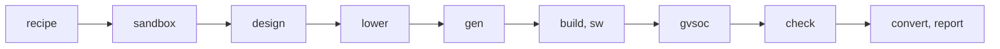

# The tools

Every command of snax-forge by job: what it does, reads and writes, the flags that matter, one example (`...` for lines left out, the numbers as printed when written). snax-gvsoc's own `docs/TOOL.md` covers its build, fixtures and regression.

| Job | Commands | Section |
|---|---|---|
| Set up | `git clone`, the image, `pixi install` | 1 |
| Run a recipe on SNAX-GVSoC | `flow` | 2 |
| Run one stage alone | `kernels`, `sdfg`, `import-dfg`, `check-dfg`, `sandbox`, `design`, `lower`, `gen-gvsoc`, `gen-rtl`, `bundle`, `gen-block` | 3 |
| Look at the results | `view`, `view-dfg`, `report` | 4 |
| Build a recipe by hand | `edit-dfg` | 5 |
| Check against snax_cluster's RTL | `forge`, `forge-set`, snax_cluster's `snax-forge-check` | 6 |
| Work on SNAX-GVSoC | `gvsoc/Makefile`, refreshing a fixture | 7 |
| Keep the repository clean | `test`, `lint`, `fmt`, `clean`, the `chisel-*` tasks, `import-costs` | 8 |

## 1. Set up

Clone snax-forge (and snax_cluster beside it, for section 6) into one folder, `$ROOT` below, and check out the submodule once:

```bash
git clone https://github.com/KULeuven-MICAS/snax-forge.git
git clone https://github.com/KULeuven-MICAS/snax_cluster.git --recurse-submodules
cd snax-forge && git submodule update --init gvsoc/snax-gvsoc && cd ..
```

Everything else runs in snax-forge's image, which holds GVSoC's build tools, snax_cluster's RISC-V toolchain and pixi:

```bash
podman run --rm -it -v "$PWD":"$PWD" -w "$PWD/snax-forge" ghcr.io/kuleuven-micas/snax-forge:main
pixi install && pixi run check
```

- `pixi install` writes the environment to `.pixi/`, the same path inside and outside the container, so it also works from the host but for SNAX-GVSoC and the program builds; `pixi run check` checks DaCe and its pins. `-v ~/.cache/rattler:/root/.cache/rattler` keeps pixi's downloads across containers.
- The viewers serve on 127.0.0.1. On a server, start the image with `--network host`, forward the port (`ssh -N -L 8765:127.0.0.1:8765 <user>@<server>`; 8766 for `view-dfg`, 8767 for `edit-dfg`) and open `http://localhost:<port>/`.
- The image is built from `container/`: `docker build -t ghcr.io/kuleuven-micas/snax-forge:main container`, then `docker push` the same tag.

## 2. Run a recipe: `flow`

`pixi run flow RECIPE --platform PLATFORM` takes a recipe through every stage below, SNAX-GVSoC built the first time; it reads the recipe, the kernel and the platform and writes `out/flow/<name>/`.



| Flag | What it does |
|---|---|
| `--platform P` | the platform the design point is on; `platforms/snax_forge.json` is snax_cluster's base cluster |
| `--set NAME=VALUE` | a recipe param (`W=8`), the type preset (`types=i8`) or one dtype (`dtypes.C=int16`), a design one with `platform.` or `memory.` in front (`memory.passes.layout=padded_rows`), or the schedule (`design.schedule=serial|pipeline|pipeline_compute|sequential`, D179 · D183; default `serial`); each is added to the folder name |
| `--trace LEVEL[:SOURCES]` | how much of the run is traced (the table below); the level is added to the folder name |
| `--vcd` | also writes gtkwave's `run/all.vcd` and `run/view.gtkw` of the traced sources |
| `--keep-work` | keeps gvrun's `run/work/` after a passing run |
| `--energy` | runs the program again into `energy/` and prices it: `energy/energy.json`, `report/energy.md` (below) |
| `--graph G`, `--kernel K` | start from a bound `.snaxdfg` instead of the import; a recipe argument ending in `.snaxdfg` does the same and skips the sandbox |
| `--name`, `--out`, `--seed`, `--memory` | the run's name and folder, the seed of the inputs, a memory working copy to start from |

Example: vecadd's add bound to `simd` at W = 4.

```bash
pixi run flow recipes/elementwise/vecadd_v1.json --platform platforms/snax_forge.json
```

    flow vecadd_v1 (vecadd_v1: W=4, N=64; N=64) on snax_forge -> out/flow/vecadd_v1/
      ...
      check     passed: 214 cycles (main to forge_check); data 0 errors (64 words); counters add_acc 19 (16 beats)
      convert   run/events.log -> profile.json (the summary lines; trace off)
      report    report/design.md, report/run.md

It exits 0, as the program does. In the `check` line, `214 cycles` is the program's window (`mcycle` at main's entry to `forge_check()`'s entry), `data 0 errors (64 words)` every output word against its golden value in `data.h`, `add_acc 19 (16 beats)` the group's BUSY_COUNTER for the task beside its beats.

- The run's folder holds `flow.log` (these lines, the checks that ran, each stage's time), the logs, `tasks.json`, and `sandbox/`, `design/`, `gen/`, `sw/`, `run/` and `report/`; `run/stdout.txt` has the program's own `forge` lines, `run/run.json` what ran (the ELF's sha256, where each L2 container lies, the submodule's commit), `run/profile.json` what was measured (CONTRACTS, "Profile and trace").
- The folder is named after the recipe with each `--set` appended: `--set W=8` gives `out/flow/vecadd_v1_W8/`, and a param whose name ends in a digit gets a `-` before its value (`..._W_acc_1-10`).

Nothing is compiled per design point: SNAX-GVSoC's `snax_hjson` target reads the cluster file in `gen/` when it starts, and a later flow prints `build up to date` until the submodule's commit changes or its tree is dirty. A passing run gzips `run/events.log` and deletes `run/work/`.

### The energy run

`--energy` prices what the run did with the static estimate's prices per transaction (D177; CONTRACTS, "Profile and trace", the energy run, and "Cost model"). It reads the run's `summary` lines only, so it adds one run's time.

- Under `serial` and `sequential` it runs the quiet build `sw/forge_quiet.elf`, which marks each section in CSR `0x7C5`; on each mark SNAX-GVSoC writes every SNAX counter, and each window between two marks is priced in the six parts. A pipelined schedule runs `sw/forge.elf` instead (the quiet build would run it serially): one window, `the whole run`, from boot to the end.
- `report/energy.md` lists every window (index, kind, label as in `gen/obs_marks.json`, cycles) with its six parts in nJ, their sum and the static estimate's; then per window its leakage (the design's, the core's, the rest's) and the idle floor beside the dynamic energy, at a 10 ns clock; then the counts they were priced on. The numbers are first-order, for trends over a sweep: a refused request costs a granted one's price, and the tables were measured on random data.

### The trace levels

| Level | Adds | Profile |
|---|---|---|
| `off` | the summary lines only | cycles, firings, counters |
| `task` | every start, done, SNAX CSR access, poll, barrier, state change, function entry and DMA copy in the window; `run/trace.jsonl` | the same, plus each task's start and done in `report/run.md` |
| `beat` | every grant, DMA beat, burst, firing and push | the task level's |
| `stall` | every refused request and queue count | the task level's |
| `finegrained` | every core instruction | the task level's |

From `beat` on, the traced sources are the accelerator, its movers and the DMA unless `:SOURCES` names others (`--trace stall:acc,acc_a`). `t = 0` is the program's `mcycle` read in main; a linked group's beat lines are its boundary's (CONTRACTS, "Profile and trace"); snax-gvsoc's `docs/EVENTS.md` lists every line.

### What the flow refuses

It stops at the first stage that cannot go on and exits 1, before anything is built:

- A platform without a source hjson stops at `gen` (`[gen.source] platform small16 has no source hjson`, fix: `pixi run design from-hjson`).
- A design the platform cannot take stops at the design checks (CONTRACTS, "Design checks"), each problem with its code and fix: vecmul at W = 64 needs 194 TCDM crossbar inputs against at most 128 (`[connect.xbar_inputs]`, fix: fewer lanes, or share_ports).

## 3. Run one stage alone

The flow's stages are commands of their own. Each reads the previous one's output, so they chain:

| Command | Reads | Writes | Flags |
|---|---|---|---|
| `pixi run kernels` | `kernels/` | nothing; per kernel its folder, tier, dtype, whether its SDFG builds and `import-dfg` takes it | |
| `pixi run sdfg K` | the kernel | `out/sdfg/K.raw.sdfg`, `K.simplified.sdfg` | |
| `pixi run import-dfg K` | the kernel's SDFG | `out/dfg/K.snaxdfg` | |
| `pixi run check-dfg G --kernel K` | a graph | nothing; checks it against the kernel's reference | |
| `pixi run sandbox RECIPE` | a recipe | `out/sandbox/<name>/<i>_<transform>.snaxdfg`, each step checked against the reference | `--set`, `--graph G` (start from a graph), `--out`, `--seed` |
| `pixi run design G --platform P` | a bound graph | `out/design/<name>/`: `platform.json`, `memory.json`, `design_point.json` | `--set platform.PATH=V`, `--set memory.PATH=V`, `--set design.schedule=S`, `--memory`, `--out` |
| `pixi run design check G --platform P` | a bound graph | nothing; the design checks only | |
| `pixi run design save SRC NAME` | a platform working copy | `platforms/NAME.json` | |
| `pixi run design from-hjson HJSON NAME` | snax_cluster's cluster file | `platforms/NAME.json` (`--force` to replace) | |
| `pixi run lower tasks DP` | a design point | `tasks.json` beside it | |
| `pixi run gen-gvsoc DP` | a design point | `out/gvsoc/<design>/`: the cluster and streamer hjson, `accelerator.json`, headers, `data.h`, `main.c`, `manifest.json` | `--out DIR` |
| `pixi run gen-rtl DP` | a design point | `out/rtl/<design>/`: `accelerator.json`, `sv/`, `emitted.json` | `--fixture DIR` (a fixture for the Chisel specs) |
| `pixi run bundle DP` | a design point | `out/bundle/<design>/`: gen-gvsoc's files, `rtl/` with `files.f`, `bundle.json` | `--out DIR` |
| `pixi run gen-block LIST` | a JSON list of `{"datapath", "params", "out"}`, a catalogue datapath or a stream block | each block alone, as an accelerator holds it, into its `out/sv/` | |

Example: vecadd by hand, then its program and run with `gvsoc/Makefile` (section 7), which print the flow's four `forge` lines:

```bash
pixi run sandbox recipes/elementwise/vecadd_v1.json
pixi run design out/sandbox/vecadd_v1/2_bind.snaxdfg --platform platforms/snax_forge.json
pixi run gen-gvsoc out/design/vecadd_v1/design_point.json
make -C gvsoc sw APPS=forge FORGE=../out/gvsoc/vecadd_v1 DESIGN=vecadd_v1
make -C gvsoc run TARGET=snax_hjson DESIGN=vecadd_v1 \
    GVRUN_ARGS="--param hjson=$PWD/out/gvsoc/vecadd_v1/snax_forge.hjson" \
    ELF=../out/snax-gvsoc/sw/vecadd/forge.elf
```

`GVRUN_ARGS` takes gvrun's own options too, such as `--trace=snax_acc0/unit`.

The RTL commands need sbt; the flow calls none of them:

- `gen-rtl` checks `accelerator.json` against the datapath catalogue (`hw/chisel/blocks.json`), then runs `Emit --spec` on a classpath sbt exports once into `hw/chisel/target/emit-classpath-<hash>.txt` (again after a change under `hw/chisel/src/main/` or to `build.sbt`).
- The modules are named after the entry's tag, `<accelerator_slot>_<design>`: snax_cluster's `snax_acc_wrapper.sv.tpl` connects `snax_forge_vecadd_v1_shell_wrapper`, which holds its `_csr`, `_ctrl` and `_datapath`.
- `bundle` writes no `forge_expected.txt` (no SNAX-GVSoC run); `pixi run forge` does (section 6).
- `gen-block` is for snax-forge-experiments, which synthesizes a block alone. Beside the catalogue's datapaths it takes `FifoPacker` (D174; `inLanes`, `laneType`, `words`) and `FifoSlicer` (D180; `words`, `laneType`, `outLanes`):

```bash
echo '[{"datapath": "FifoPacker", "params": {"inLanes": 1, "laneType": "int32", "words": 1}, "out": "out/block/packer"}]' > blocks.json
pixi run gen-block blocks.json
```

    wrote out/block/packer: FifoPacker_n1_i32_w1, 1 file(s) in sv/

## 4. Look at the results

Two read-only viewers and the reports. Each viewer serves on 127.0.0.1 until Ctrl-C; the address bar holds the whole view.

| Command | Reads | Shows or writes | Port |
|---|---|---|---|
| `pixi run view RUN ...` | flow runs | the report, the Schedule, the cluster view, the memory tab | 8765 |
| `pixi run view-dfg FILE\|DIR ... --platform P` | `.snaxdfg` steps | one at a time, or two side by side with Compare | 8766 |
| `pixi run report RUN` | a flow folder | nothing served; writes the run's `report/design.md` and `report/run.md` again | |

**`view`**, on a run traced at `task` or above (`pixi run view out/flow/vecadd_v1_stall`):

- The Schedule tab draws the window as lanes: each core, the DMA, then per accelerator ▸ group its movers and its unit; quiet stretches of 16 cycles or more are folded, and a mover's task that moves nothing, started only by a shared streamer, is a dashed `idle (shared start)` bar.
- A click on a cycle shows the cluster view at it (the DMA, movers, streamers, units, crossbar and banks); the arrows step by event, shift by task boundary. From `beat` on, the memory tab shows where each container lies in L1 and L2 and how its words move.

**`view-dfg`** on a recipe's sandbox folder shows its steps in order. Without `--platform`, the Estimate costs only the datapath and control. Example, two designs compared:

```bash
pixi run view-dfg out/sandbox/dot_v4/ out/sandbox/dot_v5/ --platform platforms/snax_forge.json
```

- Each step is named `<folder>/<stem>`; Compare lays Details and the Estimate out as two columns, the cost cells as `before → after`.
- The step is a flat graph (D185): the inputs on top, each loop a box chained down to what it drives, an edge through the loops its subset uses (`↻ m_t` where it skips one), the hardware drawn once, after `share` a temporal mux and demux per task. Each container shows its dtype (`A[N] int8 L1 · 64 B`); a port's packing, loops and beats are in its Details.
- The Estimate: the accelerator's cycles, the unmapped work's (one cycle per iteration, an assumption), their total, and the cost per accelerator in µm² and nJ (CONTRACTS, "Cost model"). The left column lists the Symbols, Containers and Bindings.

Moving around the drawing, in `view-dfg` and `edit-dfg` alike:

| Do | To |
|---|---|
| drag the canvas, scroll | pan |
| Ctrl (⌘) and scroll, or pinch; `+` `-`; `1`; `0` | zoom about the pointer; zoom in and out; 100 %; the whole step in the panel |
| click; drag | select, its Details on the right; move a box or an outline with all it holds |
| `c`, `r`, `f` | lay the step out again; reset every move; focus on what the selection reads and feeds |
| double-click a loop, a block | fold its loop chain into one box, open or close the block |
| `/`; ← → | find a box by name, Enter for the next; the step before or after |

Lock views (with Compare) pans and zooms both panels together; the zoom, folds and focus are in the address bar.

## 5. Build a recipe by hand: `edit-dfg`

The editor builds a recipe one transform at a time on the drawn graph, each step checked against the reference (CONTRACTS, "Recipe"). It starts from a kernel (`--kernel vecadd --set N=64`, with `types` or `dtypes.<name>` as for a recipe's `--set`), a recipe (`--recipe recipes/elementwise/vecadd_v1.json`) or an earlier session (`--session out/sessions/vecadd`). A session opens on `platforms/snax_forge.json` unless `--platform` names another and lives in `out/sessions/<name>/`; Save writes `recipes/custom/<name>.json` and its steps to `out/sandbox/<name>/`. A recipe's `id` (D188) is shown beside the step until a new step changes what it builds.

Example, vecadd from its import (`pixi run edit-dfg --kernel vecadd --set N=64`, http://127.0.0.1:8767/):

1. Click `add_map`: the sidebar lists the transforms whose site accepts it, each with its form (shift-click adds to the selection, Esc clears it).
2. Apply `split` with factor `W`. W is not a param yet, so the form offers `new param W = 4`; keep it. The maps are now `add_map` over `n_1` around `add_map_inner` over `n_2`.
3. Apply `tag_map` `temporal` on `add_map` and `spatial` on `add_map_inner`.
4. Select `add` and `bind` it to `simd / chisel_tiled_spatial`. The form names the instance `acc_1` and the bind renames the split's W to `W_acc_1`; the log line ends `C 0 → 16 · unmapped 64 → 0 · renamed W → W_acc_1`.
5. Save recipe as `vecadd_mine`: it runs the design checks, writes `recipes/custom/vecadd_mine.json` and its steps, and lists the next commands (`sandbox`, `flow`, `forge`).

What else to know:

- The Estimate shows 64 cycles as imported, all unmapped; 64 after the split and the tags; 16 on the accelerator after the bind, with an expected BUSY_COUNTER of 19, a guide and not a check (the flow's run measures `add_acc 19`).
- Every Apply and param change also runs Save's design checks, listed under the Estimate; a note tagged "before Save" (an unbound tasklet, two accelerators not yet encapsulated) is still to do, and Save refuses it.
- Undo, redo and the step list move the cursor; Apply below the last step asks to drop the steps after it. A param changed in Bindings replays the steps up to the cursor; its ✎ renames it everywhere, an unused one has a × that drops it.
- With several units (dot 1), apply `encapsulate` on the groups' outlines to make one accelerator. `lift` and `apply_recipe` list their choices as rows, the one under the pointer lit on the drawing. Export step writes one step's graph to the session's `export/`.

## 6. Check against snax_cluster's RTL: `forge` and `forge-set`

One ELF, snax-forge's, runs on SNAX-GVSoC and on snax_cluster's RTL. The RTL run must print the SNAX-GVSoC run's `forge data` line and each `forge counter` line within its group's streamer fill: the BUSY_COUNTER counts the streamer's head start before START, which the core's timing sets and SNAX-GVSoC does not model (open items 65, 67). snax-forge never runs RTL; snax_cluster's `snax-forge-check` does.

| Command | Reads | Writes |
|---|---|---|
| `pixi run forge RECIPE` | a recipe, the platform | the flow, its bundle with `forge_expected.txt` and the bundle's ELF (checked to be the flow's), then prints snax_cluster's commands: `out/forge/<name>/forge.log`, `out/bundle/<name>/` |
| `pixi run forge-set quick\|full\|<task>` | the set's recipes (`snax_forge/flow/forge_set.py`; a task's own set while it is open, D195) | forge on each at once: `out/forge-set/<set>.md`, `out/forge-set/<set>/<design>.txt`, and one line to run in snax_cluster |
| snax_cluster's `make snax-forge-check BUNDLES=... SIM=...` | the bundles | one verdict per bundle; `logs/snax-forge-check.txt` (the verdicts, each run's `forge cycles`), `logs/snax-forge-<name>-<sim>.txt` |

- `forge` takes `--platform` (default `platforms/snax_forge.json`), `--set` and `--trace` for the flow. `forge-set` takes `--sim vsim|vlt` and `-j N`.
- `forge_expected.txt` holds the run's counter and data lines, then each counter's `forge fill` from the estimate.
- Beside `forge.elf`, forge leaves `forge_quiet.elf` (`-DFORGE_QUIET`: every start waited on at once, each section marked in CSR `0x7c5`, no prints) and its legend `obs_marks.json`, for a power run on the netlist.
- The sets (D195): `quick` is one point per integration feature, vecadd_v1_1 at W = 1 (sliced inputs, a packed output), axpy_v1, dot_v4, mvt_v1_2_2 at W = 8 (shared movers) and bicg_v4_1 (the fork, the bank, the hold and the carry). `full` adds vecadd_v1, rowsum_v2 under `padded_rows`, matvec_acc_v2, mvt_v4_1_1 and mvt_v5 under `sequential`, mvt_v6, atax_v4 (a held link, a fork's buffered branch), gesummv_v1_1 (a one-stream op at an opType wider than its input, k from its CSR), gesummv_v2_1 (axpby, k1 and k2 from their CSRs), and one point each at i8 (vsum_v1_1), i16 and i32 (dot_v3): 17 in all.
- CLAUDE.md says when each set is due; the numbers go into STATUS's "The local RTL check".

Example:

```bash
pixi run forge-set quick
```

    forge-set quick: 5 designs, 32 at a time; each forge's output in out/forge-set/quick/<design>.txt
      ...
    wrote out/forge-set/quick.md; from snax_cluster's target/snitch_cluster:
      make snax-forge-check BUNDLES="$ROOT/snax-forge/out/bundle/vecadd_v1_1_W1 ... $ROOT/snax-forge/out/bundle/bicg_v4_1" SIM=vsim SNAX_CLUSTER_IMAGE=<image>

Run that line from snax_cluster's `target/snitch_cluster`, outside the image:

- `<image>` is snax_cluster's development image for podman; on the MICAS servers, `d3d8f5572ff4`. That image has no sbt, Coursier or firtool cache: a `podman` wrapper first on `PATH` that adds `-v` mounts of persistent folders at `/root/.sbt`, `/root/.cache/sbt`, `/root/.cache/coursier` and `/root/.cache/llvm-firtool` to every `run` keeps them.
- With `SIM=vsim`, `rtl-gen` and `vsim_preparation` run in the image and the build and the run outside it, with Questa and bender on `PATH`; with `SIM=vlt` every step runs in the image. Each vsim design takes about 2 minutes; its run 6–13 s against SNAX-GVSoC's 1.5–2.2 s.

It fails only if a bundle FAILed. A counter that differs prints a line under its verdict, as `mult_vmul: counter 128 against 131, within its fill 3`.

| Verdict | When |
|---|---|
| `PERFECT` | every counter equals SNAX-GVSoC's |
| `NEAR` | every counter within its fill, or the worst gap beyond its fill at most 10 % of its count |
| `WARNING` | the worst gap beyond the fill up to 15 % |
| `FAIL` | a larger gap, or any data error |

One design by hand on Questa, `B` and `E` as forge printed them: in the image, from the folder that holds both checkouts, then the build and the run outside it.

```bash
podman run --rm -it -v "$PWD":"$PWD" -w "$PWD/snax_cluster" d3d8f5572ff4
make -C target/snitch_cluster clean-generated clean-vsim
make -C target/snitch_cluster rtl-gen CFG_OVERRIDE=$B
make -C target/snitch_cluster vsim_preparation CFG_OVERRIDE=$B
# outside the image:
make -C target/snitch_cluster snax-forge-sim SIM=vsim CFG_OVERRIDE=$B
make -C target/snitch_cluster snax-forge-run SIM=vsim CFG_OVERRIDE=$B ELF=$E
```

- Questa exits 0 whatever the program returns, so `snax-forge-run` reads the exit code from its last line (`[SUCCESS] Program finished successfully`); the output is also in `logs/snax-forge-vsim.txt`.
- `N` reaches the hardware only as CSR values, so a design's `N=512` bundle has the same `rtl/` as the default's, byte for byte, and one RTL build runs both ELFs.

## 7. Work on SNAX-GVSoC

[snax-gvsoc](https://github.com/KULeuven-MICAS/snax-gvsoc) is the submodule at `gvsoc/snax-gvsoc`. `gvsoc/Makefile` builds it and its programs:

| Target | Reads | Writes |
|---|---|---|
| `make -C gvsoc build` | the submodule | GVSoC for the SNAX targets in `out/snax-gvsoc/`; cleared when the checkout changes; a lock makes parallel flows build it once |
| `make -C gvsoc sw APPS=forge FORGE=DIR DESIGN=NAME` | a generated folder | its program, `out/snax-gvsoc/sw/NAME/forge.elf` |
| `make -C gvsoc run TARGET=snax_hjson DESIGN=NAME GVRUN_ARGS=... ELF=...` | the cluster hjson, the ELF | one run (section 3 has the example) |

The Makefile names the image's Python, CMake and host compilers, so it runs the same from the container's shell and through pixi (`pixi run make -C gvsoc ...`, as the flow does); `SNAX_GVSOC=../../snax-gvsoc` uses a sibling checkout instead of the submodule.

**Refreshing a fixture.** snax-gvsoc's `make regress` runs one generated design point per folder in `forge/<design>/`; `tests/gen/test_fixture.py` generates each again and compares it byte for byte with the submodule's copy (skipped without the submodule). When the generator or a design point changes, clear the folder in a snax-gvsoc checkout beside this one, write it again with section 3's commands and `gen-gvsoc ... --out ../snax-gvsoc/forge/vecadd_v1`, commit it in snax-gvsoc, then bump the submodule here.

## 8. Keep the repository clean

| Command | What it does |
|---|---|
| `pixi run test` | every test, on all cores; `-m "not slow"` leaves out the DaCe builds, the compiles and the largest design |
| `pixi run test-<block>` | one block: `lower`, `brm`, `dfg`, `sandbox`, `char`, `estimate`, `design`, `flow`, `run`, `report`, `gen`, `kernels`, `viz`, `docs` |
| `pixi run python -m tests.numbers` | writes the value snapshots again (`tests/composite/numbers/`, `tests/estimate/totals.json`); only for a change meant to move an estimate, a profile or a recipe's totals |
| `pixi run lint` | ruff's checks and format check, and the Markdown rule (`util/md_reflow.py --check`); CI runs it |
| `pixi run fmt` | ruff's fixes and format, then the Markdown rule (`util/md_reflow.py`) |
| `pixi run clean` | removes `out/` (but the GVSoC build and the editor's sessions, unless `--all`), caches and Chisel build trees; `--dry-run` lists first |
| `pixi run -e hw chisel-test`, `chisel-gen`, `chisel-check`, `chisel-fmt`, `chisel-compile`, `chisel-clean` | the Chisel specs, elaboration, scalafmt check and format, compile and clean in `hw/chisel/` (its README) |
| `pixi run import-costs [--experiments DIR]` | copies snax-forge-experiments' clock-gated block table (`results/char/<tech>/char.json`) to `snax_forge/char/<tech>.json` and its streamer, crossbar and bank tables, the cluster's fixed parts (`cluster_fixed.json`) and the DMA engine's price (`dma_copy.json`) into `snax_forge/char/<tech>/`, each named with its sha256 in `<tech>/SOURCE` |
