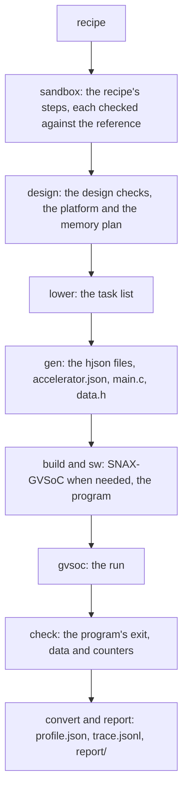

# The tools

Every command of snax-forge, grouped by job. Each entry says what the command does, what it reads and writes, the flags that matter, and one example with the lines to check; `...` stands for lines left out. The numbers are as printed when written. snax-gvsoc's own `docs/TOOL.md` covers its build, fixtures and regression.

| Job | Commands | Section |
|---|---|---|
| Set up | `git clone`, the image, `pixi install` | 1 |
| Run a recipe on SNAX-GVSoC | `flow` | 2 |
| Run one stage alone | `kernels`, `sdfg`, `import-dfg`, `check-dfg`, `sandbox`, `design`, `lower`, `gen-gvsoc`, `gen-rtl`, `bundle`, `gen-block` | 3 |
| Look at the results | `view`, `view-dfg`, `report` | 4 |
| Build a recipe by hand | `edit-dfg` | 5 |
| Check against snax_cluster's RTL | `forge`, `forge-set`, snax_cluster's `snax-forge-check` | 6 |
| Work on SNAX-GVSoC | `gvsoc/Makefile`, refreshing a fixture | 7 |
| Keep the repository clean | `test`, `lint`, `fmt`, `clean`, the `chisel-*` tasks, `import-costs` | 8 |

## 1. Set up

Clone snax-forge (and snax_cluster beside it, for section 6) into one folder, `$ROOT` below, and check out the submodule once:

```bash
git clone https://github.com/KULeuven-MICAS/snax-forge.git
git clone https://github.com/KULeuven-MICAS/snax_cluster.git --recurse-submodules
cd snax-forge && git submodule update --init gvsoc/snax-gvsoc && cd ..
```

Everything else runs in snax-forge's image, which holds GVSoC's build tools, snax_cluster's RISC-V toolchain and pixi:

```bash
podman run --rm -it -v "$PWD":"$PWD" -w "$PWD/snax-forge" ghcr.io/kuleuven-micas/snax-forge:main
pixi install && pixi run check
```

- `pixi install` writes the environment to `.pixi/` in the repository. The path is the same inside and outside the container, so the environment also works from the host, for everything but SNAX-GVSoC and the program builds.
- `-v ~/.cache/rattler:/root/.cache/rattler` keeps pixi's downloads across containers.
- The viewers serve on 127.0.0.1. On a server, start the image with `--network host` and forward the port from your machine, then open `http://localhost:<port>/`: `ssh -N -L 8765:127.0.0.1:8765 <user>@<server>` (8766 for `view-dfg`, 8767 for `edit-dfg`).
- The image is built from `container/`: `docker build -t ghcr.io/kuleuven-micas/snax-forge:main container`, then `docker push` the same tag.

## 2. Run a recipe: `flow`

`pixi run flow RECIPE --platform PLATFORM` takes a recipe through every stage: the recipe's steps on the kernel's graph, the design checks, the task list, the generated files and program, SNAX-GVSoC (built the first time), the program's own check, the profile and the reports.



| Flag | What it does |
|---|---|
| `--platform P` | the platform the design point is on; `platforms/snax_forge.json` is snax_cluster's base cluster |
| `--set NAME=VALUE` | a recipe param (`--set W=8`), or a design one with `platform.` or `memory.` in front (`--set memory.passes.layout=padded_rows`); each is added to the run's folder name |
| `--trace LEVEL[:SOURCES]` | how much of the run is traced (the table below); the level is added to the folder name |
| `--vcd` | also writes gtkwave's `run/all.vcd` and `run/view.gtkw` of the traced sources |
| `--keep-work` | keeps gvrun's `run/work/` after a passing run (a failing run always keeps it) |
| `--graph G`, `--kernel K` | start from a bound `.snaxdfg` instead of the import; a recipe argument ending in `.snaxdfg` does the same and skips the sandbox |
| `--name`, `--out`, `--seed`, `--memory` | the run's name and folder, the seed of the inputs, a memory working copy to start from |

Example: vecadd's add bound to `simd` at W = 4.

```bash
pixi run flow recipes/elementwise/vecadd.json --platform platforms/snax_forge.json
```

    flow vecadd (vecadd: W=4, N=64; N=64) on snax_forge -> out/flow/vecadd/
      sandbox   2 steps, each equal to the input graph on the reference check -> sandbox/
      design    24 checks passed; platform base snax_forge, 0 changes; memory contiguous, 0 changes -> design/
      lower     tasks.json (12 steps)
      gen       snax_forge.hjson, snax_forge_vecadd_streamer_acc.hjson, accelerator.json, main.c, data.h (seed 0) -> gen/
      build     up to date (snax-gvsoc 1e988679)
      sw        sw/forge.elf (sha256 3fa93c774886c3b3)
      gvsoc     snax_hjson, exit 0 -> run/
      check     passed: 214 cycles (main to forge_check); data 0 errors (64 words); counters add_acc 19 (16 beats)
      convert   run/events.log -> profile.json (the summary lines; trace off)
      report    report/design.md, report/run.md

It exits 0, as the program does. The `check` line reads:

- `214 cycles`: the program's window, `mcycle` at main's entry to `mcycle` at `forge_check()`'s entry.
- `data 0 errors (64 words)`: every output word against its golden value in `data.h`.
- `add_acc 19 (16 beats)`: the group's BUSY_COUNTER for the task `add_acc`, beside its beats.

What the run leaves in `out/flow/vecadd/`:

- `flow.log` (these lines, the checks that ran, each stage's time), the build and program logs, `tasks.json`, and the folders `sandbox/`, `design/`, `gen/`, `sw/`, `run/` and `report/`.
- `run/stdout.txt`: the program's own lines, `forge cycles: 214`, `forge data: 0 errors (64 words)`, `forge counter add_acc: 19`, `forge errors: 0`.
- `run/run.json`: what ran (the ELF's sha256, where the linker put each L2 container, the submodule's commit).
- `run/profile.json`: what was measured (CONTRACTS, "Profile and trace"), for example `"acc": {"cycles": {"busy": 16, "stall_in": 3, "stall_out": 0, "flush": 0, "idle": 195}, "firings": 16, ...}`.
- The folder is named after the recipe with each `--set` appended: `--set W=8` gives `out/flow/vecadd_W8/`, and a param whose name ends in a digit gets a `-` before its value (`--set W_acc_1=10` gives `..._W_acc_1-10`).

Nothing is compiled per design point: SNAX-GVSoC's `snax_hjson` target reads the cluster file in `gen/` when it starts. A later flow prints `build up to date` until the submodule's commit changes or its tree is dirty. A passing run gzips `run/events.log` and deletes `run/work/`.

### The trace levels

| Level | Adds | Profile |
|---|---|---|
| `off` | the summary lines only | cycles, firings, counters |
| `task` | every start, done, SNAX CSR access, poll, barrier, state change, function entry and DMA copy in the window; `run/trace.jsonl` | the same, plus each task's start and done in `report/run.md` |
| `beat` | every grant, DMA beat, burst, firing and push | the task level's |
| `stall` | every refused request and queue count | the task level's |
| `finegrained` | every core instruction | the task level's |

From `beat` on, the traced sources are the accelerator, its movers and the DMA unless `:SOURCES` names others (`--trace stall:acc,acc_a`). `t = 0` is the program's `mcycle` read in main. A group of linked units only goes to `task`: the converter reads its task lines only (open item 96). snax-gvsoc's `docs/EVENTS.md` lists every line.

```bash
pixi run flow recipes/elementwise/vecadd.json --platform platforms/snax_forge.json --trace stall
grep -m1 '"k": "stall"' out/flow/vecadd_stall/run/trace.jsonl
```

    ...
      convert   run/events.log -> profile.json, trace.jsonl (356 events in the window; boot 2822; sources acc, acc_a, acc_b, acc_out, dma)
    {"t": 122, "k": "stall", "src": "acc_b.lane0", "task": "add_acc_b", "addr": 268435968, "bank": 0, "row": 2, "by": "acc_a.lane0", "by_addr": 268435456, "b": 0, "region": "B", "elems": [0]}

From `task` on, `report/run.md` names each task and opens its Accelerators section with a row per accelerator (its groups, CSRs, its streamer's busy window and each group's BUSY_COUNTER):

    | Block | # | Task | Accelerator | Start | Done | Cycles | Direction | Bytes |
    |---|---:|---|---|---:|---:|---:|---|---:|
    | dma | 0 | load_A | – | 76 | 97 | 21 | L2 → L1 | 512 |
    | acc | 0 | add_acc | acc | 121 | 141 | 20 | – | – |
    | dma | 2 | store_C | – | 156 | 171 | 15 | L1 → L2 | 512 |

### What the flow refuses

It stops at the first stage that cannot go on and exits 1, before anything is built:

- A platform without a source hjson stops at `gen`: `pixi run flow recipes/elementwise/vecadd.json --platform platforms/small16.json` prints `FAILED ...: gen: [gen.source] platform small16 has no source hjson: read it from one with pixi run design from-hjson`.
- A design the platform cannot take stops at the design checks (CONTRACTS, "Design checks"). vecmul at W = 64 needs more crossbar inputs than SNAX-GVSoC's crossbar takes:

```
design check of out/sandbox/vecmul_W64/2_bind.snaxdfg on platforms/snax_forge.json: 1 problem
 [connect.xbar_inputs] acc: 194 TCDM crossbar inputs, the platform takes at most 128 (192 streamer channels, 2 for the core and AXI; l1.max_xbar_inputs, the limit SNAX-GVSoC's crossbar asserts)
     fix: fewer lanes, or share_ports on a container between two accelerators
```

## 3. Run one stage alone

The flow's stages are commands of their own. Each reads the previous one's output, so they chain:

| Command | Reads | Writes | Flags |
|---|---|---|---|
| `pixi run kernels` | `kernels/` | nothing; one line per kernel: folder, tier, dtype, whether its SDFG builds and `import-dfg` takes it | |
| `pixi run sdfg K` | the kernel | `out/sdfg/K.raw.sdfg`, `K.simplified.sdfg` | |
| `pixi run import-dfg K` | the kernel's SDFG | `out/dfg/K.snaxdfg` | |
| `pixi run check-dfg G --kernel K` | a graph | nothing; runs it against the kernel's reference | |
| `pixi run sandbox RECIPE` | a recipe | `out/sandbox/<name>/<i>_<transform>.snaxdfg`, each step checked against the reference | `--set`, `--graph G` (start from a graph), `--out`, `--seed` |
| `pixi run design G --platform P` | a bound graph | `out/design/<name>/`: `platform.json`, `memory.json`, `design_point.json` | `--set platform.PATH=V`, `--set memory.PATH=V`, `--memory`, `--out` |
| `pixi run design check G --platform P` | a bound graph | nothing; the design checks only | |
| `pixi run design save SRC NAME` | a platform working copy | `platforms/NAME.json` | |
| `pixi run design from-hjson HJSON NAME` | snax_cluster's cluster file | `platforms/NAME.json` (`--force` to replace) | |
| `pixi run lower tasks DP` | a design point | `tasks.json` beside it | |
| `pixi run gen-gvsoc DP` | a design point | `out/gvsoc/<design>/`: the cluster and streamer hjson, `accelerator.json`, headers, `data.h`, `main.c`, `manifest.json` | `--out DIR` |
| `pixi run gen-rtl DP` | a design point | `out/rtl/<design>/`: `accelerator.json`, `sv/`, `emitted.json` | `--fixture DIR` (a fixture for the Chisel specs) |
| `pixi run bundle DP` | a design point | `out/bundle/<design>/`: gen-gvsoc's files, `rtl/` with `files.f`, `bundle.json` | `--out DIR` |
| `pixi run gen-block LIST` | a JSON list of `{"datapath", "params", "out"}` | each block alone, as an accelerator holds it, into its `out/sv/` | |

Example: vecadd by hand, then its program and run with `gvsoc/Makefile` (section 7), which prints the same four `forge` lines as the flow:

```bash
pixi run sandbox recipes/elementwise/vecadd.json
pixi run design out/sandbox/vecadd/2_bind.snaxdfg --platform platforms/snax_forge.json
pixi run gen-gvsoc out/design/vecadd/design_point.json
make -C gvsoc sw APPS=forge FORGE=../out/gvsoc/vecadd DESIGN=vecadd
make -C gvsoc run TARGET=snax_hjson DESIGN=vecadd \
    GVRUN_ARGS="--param hjson=$PWD/out/gvsoc/vecadd/snax_forge.hjson" \
    ELF=../out/snax-gvsoc/sw/vecadd/forge.elf
```

- `pixi run sandbox recipes/elementwise/vecadd_undo.json --graph out/sandbox/vecadd/2_bind.snaxdfg --out out/sandbox/vecadd_undo` undoes a recipe: the graph comes back as imported.
- `GVRUN_ARGS` takes gvrun's own options too, such as `--trace=snax_acc0/unit`.

The RTL commands need sbt; the flow calls none of them:

- `gen-rtl` checks `accelerator.json` against the datapath catalogue (`hw/chisel/blocks.json`), then runs `hw/chisel/`'s `Emit --spec` on a classpath sbt exports once into `hw/chisel/target/emit-classpath-<hash>.txt` (again after a change under `hw/chisel/src/main/` or to `build.sbt`).
- The modules are named after the entry's tag, `<accelerator_slot>_<design>`: `snax_forge_vecadd_shell_wrapper` is what snax_cluster's `snax_acc_wrapper.sv.tpl` connects, and it holds `snax_forge_vecadd_csr`, `snax_forge_vecadd_ctrl` and `snax_forge_vecadd_datapath`.
- `bundle` writes no `forge_expected.txt` (a bundle alone has no SNAX-GVSoC run); `pixi run forge` does (section 6).
- `gen-block` is for snax-forge-experiments, which synthesizes and simulates a block alone:

```bash
echo '[{"datapath": "TreeAccumulate", "params": {"inType": "int64", "outType": "int64", "lanes": 8, "op": "add"}, "out": "out/block/tree"}]' > blocks.json
pixi run gen-block blocks.json
```

    ...
    wrote out/block/tree: TreeAccumulate_i64_i64_n8, 1 file(s) in sv/

## 4. Look at the results

Three read-only viewers and the reports. Each viewer serves on 127.0.0.1 until Ctrl-C; the address bar holds the whole view, so a link shows the same.

| Command | Shows | Port |
|---|---|---|
| `pixi run view RUN ...` | flow runs: the report, the Schedule, the cluster view, the memory tab | 8765 |
| `pixi run view-dfg FILE\|DIR ... --platform P` | `.snaxdfg` steps, one at a time, or two side by side with Compare | 8766 |
| `pixi run report RUN` | nothing served; writes the run's `report/design.md` and `report/run.md` again | |

**`view`**, on a run traced at `task` or above (`pixi run view out/flow/vecadd_stall`):

- The Schedule tab draws the window as lanes: each core, the DMA, then per accelerator ▸ group its movers and its unit. Quiet stretches of 16 cycles or more are folded.
- A mover's task that moves nothing, started only because a shared streamer starts all its movers at once (`dot_1_enc`'s `vsum_a` during the vmul's task), is a dashed bar, `idle (shared start)`.
- A click on a cycle shows the cluster view under it: the DMA, the movers with their lanes, one streamer box per set, the units, the crossbar and the banks at that cycle. The arrows step by event, shift steps by task boundary. A linked group shows its tasks only, since its runs stop at `task`.
- From `beat` on, the memory tab shows where each container lies in L1 and L2 and how its words move.

**`view-dfg`** on a recipe's sandbox folder shows its steps in order. Give it `--platform`: without one, the Estimate costs only the datapath and control, not the streamers, crossbar and memory.

- Details of each item (click a box, a container, an edge or an outline), and the Estimate: the accelerator's cycles, the unmapped work's (one cycle per iteration, an assumption), their total, and the cost per accelerator in µm² and nJ (CONTRACTS, "Cost model").
- The left column lists the Symbols, the Containers (`A: N · L1 · 16 KiB`) and the Bindings as a tree, accelerator ▸ group ▸ unit, each param with what it configures.
- To compare two designs, give both folders: `pixi run view-dfg out/sandbox/dot_4/ out/sandbox/dot_5/ --platform platforms/snax_forge.json`. Each step is then named `<folder>/<stem>`, and Compare lays Details and the Estimate out as two columns, the cost cells as `before → after`.

## 5. Build a recipe by hand: `edit-dfg`

The editor builds a recipe one transform at a time on the drawn graph, each step checked against the reference as the sandbox does (CONTRACTS, "Recipe").

| Start | Command |
|---|---|
| a kernel, its symbols given | `pixi run edit-dfg --kernel vecadd --set N=64` |
| a recipe | `pixi run edit-dfg --recipe recipes/elementwise/vecadd.json` |
| an earlier session | `pixi run edit-dfg --session out/sessions/vecadd` |

A session opens on `platforms/snax_forge.json` unless `--platform` names another, and lives in `out/sessions/<name>/`. Example, vecadd from its import (http://127.0.0.1:8767/):

1. Click `add_map`. The sidebar lists the transforms whose site accepts it, each with its form. Shift-click adds an item to the selection, Esc clears it.
2. Apply `split` with factor `W`. W is not a param yet, so the form offers `new param W = 4`; keep it. The maps are now `add_map` over `n_1` around `add_map_inner` over `n_2`.
3. Apply `tag_map` `temporal` on `add_map` and `spatial` on `add_map_inner`.
4. Select `add` and `bind` it to `simd / chisel_tiled_spatial`. The form names the instance `acc_1` and the bind renames the split's W to `W_acc_1`, so the unit's box reads `acc_1 · a + b · W_acc_1 4`.
5. The log line of each Apply gives the time, what changed and the cycles: the bind's ends `C 0 → 16 · unmapped 64 → 0 · renamed W → W_acc_1`.
6. Save recipe as `vecadd_mine`: it runs the design checks, writes `recipes/custom/vecadd_mine.json` and its steps to `out/sandbox/vecadd_mine/`, and lists the next commands (`sandbox`, `flow`, `forge` on the new recipe).

What else to know:

- The Estimate shows 64 cycles as imported, all unmapped; 64 after the split and the tags (a tag runs nothing); 16 on the accelerator after the bind, with an expected BUSY_COUNTER of 19, a guide and not a check (the flow's run measures `add_acc 19`).
- Every Apply and param change also runs Save's design checks, listed under the Estimate: problems first, then notes. A note tagged "before Save" (an unbound tasklet, two accelerators not yet encapsulated) is something still to do, and Save refuses it.
- Undo, redo and the step list move the cursor; Apply below the last step asks to drop the steps after it. A param changed in Bindings replays the steps up to the cursor; the later ones are replayed when the cursor reaches them.
- With several units (dot 1), shift-click the groups' outlines and apply `encapsulate` to make one accelerator of them.
- Export step writes one step's graph to the session's `export/`.

## 6. Check against snax_cluster's RTL: `forge` and `forge-set`

One ELF, snax-forge's, runs on SNAX-GVSoC and on snax_cluster's RTL. The RTL run must print the SNAX-GVSoC run's `forge data` line and each of its `forge counter` lines within that group's streamer fill: the BUSY_COUNTER counts the streamer's head start before START, which the core's timing sets and SNAX-GVSoC does not model (open items 65, 67). snax-forge never runs RTL; snax_cluster's `snax-forge-check` does.

| Command | What it does | Writes |
|---|---|---|
| `pixi run forge RECIPE` | the flow, the bundle of its design point with `forge_expected.txt`, the bundle's ELF (checked to be the flow's), then snax_cluster's commands for the design | `out/forge/<name>/forge.log`, `out/bundle/<name>/` |
| `pixi run forge-set quick\|full\|mvt` | forge on every recipe of a set at once | `out/forge-set/<set>.md`, `out/forge-set/<set>/<design>.txt`, and one line to run in snax_cluster |

- `forge` takes `--platform` (default `platforms/snax_forge.json`), `--set` and `--trace`, passed to the flow. `forge-set` takes `--sim vsim|vlt` and `-j N`.
- `forge_expected.txt` holds the run's counter and data lines, then each counter's `forge fill`, its group's streamer fill from the estimate.
- Beside `forge.elf`, forge leaves `forge_quiet.elf` (the same `main.c` with `-DFORGE_QUIET`: every start waited on at once, each section marked in CSR `0x7c5`, no prints) and its legend `obs_marks.json`, for a power run on the netlist.
- The sets: `quick` is vecadd_i32, vsum_tree_i8, dot_1, dot_1_enc, dot_4 and axpy. `full` adds seventeen more (the list in `snax_forge/flow/forge_set.py`), among them matvec_1, matvec_seed, matvec_seed_serial and rowsum_2 twice. `mvt` is eleven bundles at M = N = 40, not in the other two.
- When each set is due is CLAUDE.md's rule: the quick set on vsim before a PR that changes the emitted RTL or `main.c` merges, the full set at a phase's close, the numbers into open item 95.

Example:

```bash
pixi run forge-set quick
```

    forge-set quick: 6 designs, 32 at a time; each forge's output in out/forge-set/quick/<design>.txt
      vecadd_i32       passed
      ...
      axpy             passed
    wrote out/forge-set/quick.md; from snax_cluster's target/snitch_cluster:
      make snax-forge-check BUNDLES="$ROOT/snax-forge/out/bundle/vecadd_i32 ... $ROOT/snax-forge/out/bundle/axpy" SIM=vsim SNAX_CLUSTER_IMAGE=<image>

Run that line from snax_cluster's `target/snitch_cluster`, outside the image:

- `<image>` is snax_cluster's development image for podman; on the MICAS servers, `d3d8f5572ff4`.
- That image has no sbt, Coursier or firtool cache, so put a `podman` wrapper first on `PATH` that adds `-v` mounts of persistent folders at `/root/.sbt`, `/root/.cache/sbt`, `/root/.cache/coursier` and `/root/.cache/llvm-firtool` to every `run`.
- With `SIM=vsim`, `rtl-gen` and `vsim_preparation` run in the image and the build and the run outside it, with Questa and bender on `PATH`. With `SIM=vlt` every step runs in the image.
- Each vsim design takes about 2 minutes; its run 6–13 s against SNAX-GVSoC's 1.5–2.2 s.

It prints one verdict per bundle and fails only if one FAILed. `logs/snax-forge-check.txt` keeps the verdicts with each run's `forge cycles`, and `logs/snax-forge-<name>-<sim>.txt` each run's output.

| Verdict | When |
|---|---|
| `PERFECT` | every counter equals SNAX-GVSoC's |
| `NEAR` | every counter within its fill, or the worst gap beyond its fill at most 10 % of its count |
| `WARNING` | the worst gap beyond the fill up to 15 % |
| `FAIL` | a larger gap, or any data error |

A counter that differs prints a line under its verdict, as `dot_1_enc` at N = 512 on vsim, where the RTL's core starts `vmul` 6 cycles after its streamer:

    NEAR dot_1_enc_N512: the worst counter 0.0 % beyond its fill
      mult_vmul: counter 128 against 131, within its fill 3
      dot_1_enc_N512 forge cycles: 609

One design by hand on Questa, `B` and `E` as forge printed them: in the image, from the folder that holds both checkouts, then the build and the run outside it.

```bash
podman run --rm -it -v "$PWD":"$PWD" -w "$PWD/snax_cluster" d3d8f5572ff4
make -C target/snitch_cluster clean-generated clean-vsim
make -C target/snitch_cluster rtl-gen CFG_OVERRIDE=$B
make -C target/snitch_cluster vsim_preparation CFG_OVERRIDE=$B
# outside the image:
make -C target/snitch_cluster snax-forge-sim SIM=vsim CFG_OVERRIDE=$B
make -C target/snitch_cluster snax-forge-run SIM=vsim CFG_OVERRIDE=$B ELF=$E
```

- Questa exits 0 whatever the program returns, so `snax-forge-run` reads the exit code from its last line, `[SUCCESS] Program finished successfully`; the output is also in `logs/snax-forge-vsim.txt`.
- `N` reaches the hardware only as CSR values, so a design's `N=512` bundle has the same `rtl/` as the default's, byte for byte, and one RTL build runs both ELFs.

## 7. Work on SNAX-GVSoC

[snax-gvsoc](https://github.com/KULeuven-MICAS/snax-gvsoc) is the submodule at `gvsoc/snax-gvsoc`. `gvsoc/Makefile` builds it and its programs:

| Target | What it does |
|---|---|
| `make -C gvsoc build` | GVSoC for the SNAX targets into `out/snax-gvsoc/`; cleared when the checkout changes; a lock makes parallel flows build it once |
| `make -C gvsoc sw APPS=forge FORGE=DIR DESIGN=NAME` | the program of a generated folder into `out/snax-gvsoc/sw/NAME/forge.elf` |
| `make -C gvsoc run TARGET=snax_hjson DESIGN=NAME GVRUN_ARGS=... ELF=...` | one run (section 3 has the example) |

- The Makefile names the image's Python, CMake and host compilers, so it runs the same from the container's plain shell and through pixi (`pixi run make -C gvsoc ...`, as the flow does).
- `SNAX_GVSOC=../../snax-gvsoc` uses a sibling checkout instead of the submodule.

**Refreshing a fixture.** snax-gvsoc keeps one generated design point per folder in `forge/<design>/`, which its `make regress` runs. `tests/gen/test_fixture.py` generates each again and compares it byte for byte with the submodule's copy (it skips when the submodule is not checked out). When the generator or a design point changes, clear the folder in a snax-gvsoc checkout beside this one and write it again:

```bash
pixi run sandbox recipes/elementwise/vecadd.json
pixi run design out/sandbox/vecadd/2_bind.snaxdfg --platform platforms/snax_forge.json
pixi run gen-gvsoc out/design/vecadd/design_point.json --out ../snax-gvsoc/forge/vecadd
```

Commit the folder in snax-gvsoc as written, then bump the submodule here so the test compares against it.

## 8. Keep the repository clean

| Command | What it does |
|---|---|
| `pixi run test` | every test, on all cores; `-m "not slow"` leaves out the DaCe builds, the compiles and the largest design |
| `pixi run test-<block>` | one block: `lower`, `brm`, `dfg`, `sandbox`, `char`, `estimate`, `design`, `flow`, `run`, `report`, `gen`, `kernels`, `viz`, `docs` |
| `pixi run lint` | ruff's checks and format check, and the Markdown rule (`util/md_reflow.py --check`); CI runs it |
| `pixi run fmt` | ruff's fixes and format, then the Markdown rule (`util/md_reflow.py`) |
| `pixi run clean` | removes `out/` (but the GVSoC build and the editor's sessions, unless `--all`), caches and Chisel build trees; `--dry-run` lists first |
| `pixi run -e hw chisel-test`, `chisel-gen`, `chisel-check`, `chisel-fmt` | the Chisel specs, elaboration, and scalafmt check and format in `hw/chisel/` (its README) |
| `pixi run import-costs [--experiments DIR]` | copies the streamer, crossbar and bank tables from snax-forge-experiments into `snax_forge/char/<tech>/` |
