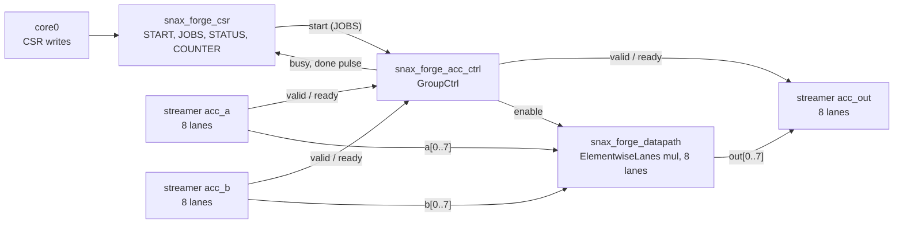

# Dry run 1: vecmul, from the kernel to SNAX-GVSoC

A snapshot of 3 Nov 2026 (snax-forge `ry/dry1` at `dry1-r2`, `5711764`; snax-gvsoc `c061e32b`; the cost table from snax-forge-experiments `6c727da`). The numbers are what these commits printed; no test checks them (D98), so they can drift as the code moves.

vecmul is $C_i = A_i \cdot B_i$ over N int64 elements (`kernels/polybench/vecmul.py`). It is the first half of dot, so it is the baseline the dot variants are read against. The designer's question: how many lanes W, given what a lane costs in area and what it buys in time?

The path: open the kernel in the editor, transform and bind it step by step, save a recipe, sweep W, run it on SNAX-GVSoC, look at the run in the cluster viewer, compare two points side by side, then look at what was generated.

## 1. Start the editor on the kernel

Everything runs in snax-forge's image (`docs/RUN.md` section 1). From the folder that holds `snax-forge`:

    podman run --rm -it --network host -v "$PWD":"$PWD" -w "$PWD" ghcr.io/kuleuven-micas/snax-forge:main
    cd snax-forge && pixi install

A session starts from the kernel's symbols, here only N:

    pixi run edit-dfg --kernel vecmul --set N=2048

    serving vecmul at http://127.0.0.1:8767/ (Ctrl-C to stop)

Without `--set N` it stops at `vecmul: give N, e.g. --set N=2048`. There is no W yet: W is a property of the split you make later, not of the kernel. N can change at any time in its chip in the top bar or in the Containers section; the session replays its steps at the new value.

Step 0 is the import: one map, `mult_map · i · 2048 · untagged`, holding the tasklet `mult · in1 * in2`. The Containers section on the left lists A, B and C, each of shape `N`, 2048 × int64, 16 KiB in L1; hovering N there lights up all three, since they share the symbol. The Estimate says 2048 iterations not mapped and an L1 footprint of 48 KiB of 128 KiB. Nothing runs on an accelerator yet, so there are no cycles and no cost.

## 2. Four steps

Click `mult_map`. The sidebar lists what applies there (`split`, `split_map`, `tag_map`) and, under "Not here", why the others don't (`bind`: a map binds only as a fused nest; `split_reduce`: the tasklet is no reduction).

| Step | Select | Apply | What changes |
|---|---|---|---|
| 1 | `mult_map` | `split`, factor `W`, new param W = 8 | `mult_map` now runs `i_1` over 256, around a new map `mult_map_inner` running `i_2` over 8; the tasklet reads `A[8 * i_1 + i_2]` |
| 2 | `mult_map` | `tag_map`, `temporal` | the outer loop becomes the streamers' loop |
| 3 | `mult_map_inner` | `tag_map`, `spatial` | the inner loop becomes lanes; not mapped drops from 2048 to 256 |
| 4 | `mult` | `bind`, `elementwise_mul / chisel_tiled_spatial`, instance `acc` | the tasklet becomes unit `acc` at 8 lanes; not mapped 0 |

In step 1, typing `W` into the factor field shows "new param W = 4" beside it; set it to 8 and Apply. W then appears as a chip in the top bar, so the saved recipe sweeps with `--set W=…`. Each split can name its own param (dot 1 will use `W_mul` and `W_sum`). The split's names (`i_1`, `i_2`, `mult_map_inner`) say nothing about which loop becomes what; the tags in steps 2 and 3 decide that. `split_map` does all three in one step, with the names `i_t`, `i_s` and `mult_map_s`.

At step 4 the bind list shows every BRM with its timing and, for those that don't fit, the reason: `elementwise_add` (the tasklet is mul, the pattern add), `accumulate` (no reduction), `mac` (needs `fuse_map` first, D150). Only `elementwise_mul` fits, with latency 0, II 1, span 1. The instance defaults to `acc`.

After the bind the Estimate shows one group, `acc`:

| Cycles | Bottleneck | Ramp | Stall | Expected COUNTER | Area | Energy |
|---:|---:|---:|---:|---:|---:|---:|
| 256 | 256 | 0 | 0 | 259 | 55 700 µm² | 23.265 nJ |

Cycles is $N / W$: one beat of W elements per cycle, nothing to fill since the unit has latency 0. The expected COUNTER adds the streamers' fill of 3 (D155, C§19). Below it, the cost table on nangate45:

| Block | Datapath | Area (µm²) | Energy (nJ) | Share |
|---|---|---:|---:|---:|
| acc | ElementwiseLanes | 55 300 | 23.137 | 99.4 % |
| acc ctrl | control unit | 351 | 0.128 | 0.6 % |

## 3. Save the recipe

Save recipe, as `vecmul_dry`, runs the design checks and writes `recipes/vecmul_dry.json`:

```json
{
 "name": "vecmul_dry",
 "kernel": "vecmul",
 "params": {"N": 2048, "W": 8},
 "symbols": {"N": "N"},
 "steps": [
  {"transform": "split", "params": {"map": "mult_map", "factor": "W"}},
  {"transform": "tag_map", "params": {"map": "mult_map", "kind": "temporal"}},
  {"transform": "tag_map", "params": {"map": "mult_map_inner", "kind": "spatial"}},
  {"transform": "bind", "params": {"node": "mult", "brm": "elementwise_mul", "implementation": "chisel_tiled_spatial", "instance": "acc"}}
 ]
}
```

The log pane then lists what to run next, each with what it does:

| Command | What it does |
|---|---|
| `pixi run sandbox recipes/vecmul_dry.json` | writes the steps and checks each against the reference |
| `pixi run flow recipes/vecmul_dry.json --platform platforms/snax_forge.json` | runs the recipe on SNAX-GVSoC and writes the reports |
| `pixi run forge recipes/vecmul_dry.json` | the flow plus the bundle for snax_cluster's RTL |

The steps also go to `out/sandbox/vecmul_dry/` as `0_input.snaxdfg` to `4_bind.snaxdfg`. The recipe is the thing to keep: it replays and sweeps, a `.snaxdfg` alone does not (D72). Save never overwrites a recipe, so pick a new name to save again.

## 4. Sweep W in the editor

Change W in its chip; the session replays its four steps and the Estimate follows. The tech dropdown switches between nangate45 and nangate15.

| W | Cycles | COUNTER (expected) | Channels | Area 45 nm (µm²) | Energy 45 nm (nJ) | ctrl share | Area 15 nm (µm²) | Energy 15 nm (nJ) |
|---:|---:|---:|---:|---:|---:|---:|---:|---:|
| 1 | 2048 | 2051 | 3 | 7 260 | 24.022 | 4.3 % | 2 300 | 7.945 |
| 2 | 1024 | 1027 | 6 | 14 200 | 23.510 | 2.2 % | 4 510 | 7.802 |
| 4 | 512 | 515 | 12 | 28 000 | 23.254 | 1.1 % | 8 930 | 7.730 |
| 8 | 256 | 259 | 24 | 55 700 | 23.265 | 0.6 % | 17 800 | 7.769 |
| 10 | 205 | 208 | 30 | 69 500 | 23.123 | 0.4 % | 22 200 | 7.695 |

How to read it:

- **Area grows with W, energy does not.** ElementwiseLanes is W copies of a one-lane multiplier with no registers (0 flops), so its area is $W \cdot A_1$ and its energy is N multiplies whatever W is. On nangate45 $A_1$ is 6 910 µm² of comb, about 11.3 pJ per 64-bit multiply.
- **The control unit is the only part that changes with time.** 66 bits held every cycle, $E_{\mathit{ctrl}} = f_{\mathit{ctrl}} \cdot 66 \cdot C \cdot e_{\mathit{hold}}$: 1.024 nJ at W = 1, 0.103 nJ at W = 10. That is the ctrl share column.
- **W = 10 does not divide N.** The split pads 2048 to 205 beats of 10 lanes (2 pad elements, D144); the Estimate shows a lane use of 99.9 %.
- **Differences under 1 % are the table, not the design.** The table has ElementwiseLanes measured at W = 1, 8 and 32 and copied in between (C§20), so W = 8 comes out 0.05 % above W = 4.
- **Leakage is not in it.** A dynamic-only model makes the slow, small W = 1 look as cheap per run as W = 10, which it is not once leakage over ten times the cycles counts (a known limit).

So on this model vecmul's choice is area against time at equal energy. Whether the cycles hold up in a run is the next section.

## 5. Run it on SNAX-GVSoC

The flow takes the saved recipe through the design checks, lowering and the generator, builds SNAX-GVSoC the first time (about 6 minutes), runs the program and reads each group's COUNTER:

    pixi run flow recipes/vecmul_dry.json --platform platforms/snax_forge.json

    flow vecmul_dry (vecmul_dry: N=2048, W=8; N=2048) on snax_forge -> out/flow/vecmul_dry/
      sandbox   4 steps, each equal to the input graph on the reference check -> sandbox/
      design    25 checks passed; platform base snax_forge, 0 changes; memory contiguous, 0 changes -> design/
      lower     tasks.json (12 steps)
      gen       snax_forge.hjson, snax_forge_streamer.hjson, accelerator.json, main.c, data.h (seed 0) -> gen/
      build     up to date (snax-gvsoc c061e32b)
      sw        sw/forge.elf (sha256 254f665a9aa34d27)
      gvsoc     snax_hjson, exit 0 -> run/
      check     passed: 1200 cycles (main to forge_check); data 0 errors (2048 words); counters mult_acc 259 (256 beats)
      convert   run/events.log -> profile.json (the summary lines; trace off)
      report    report/design.md, report/run.md

`mult_acc 259` is the group's COUNTER for the task `mult_acc`, equal to the editor's expected 259. `1200 cycles` is the program's window, from main to its check. `report/design.md` repeats the Estimate and the cost per block; `report/run.md` holds the counters, the DMA and the per-port grants and stalls.

The other points, each into its own folder (`out/flow/vecmul_dry_W4/` and so on):

    pixi run flow recipes/vecmul_dry.json --platform platforms/snax_forge.json --set W=4

| W | Expected COUNTER | COUNTER | Window | DMA busy |
|---:|---:|---:|---:|---:|
| 1 | 2051 | 2048 | 2999 | 789 |
| 2 | 1027 | 1027 | 1962 | 788 |
| 4 | 515 | 515 | 1455 | 789 |
| 8 | 259 | 259 | 1200 | 789 |
| 10 | 208 | 208 | 1169 | 792 |

The COUNTER is the estimate plus 3 at every point but W = 1, where it is 3 under (STATUS open item 104). The window falls much less than the COUNTER: from W = 4 to W = 10 the accelerator saves 307 cycles but the window only 286, and every point spends about 790 cycles on DMA and 150 on the cores. vecmul does one multiply per three words moved, so it is bound by memory traffic, not by compute; section 6 shows where the time goes.

**Beyond W = 10.** Two things stop more lanes paying off, and the tool now says both before a run:

- At W = 16 the three streams need $3W = 48$ words per cycle from L1's 32 banks, so a beat takes at least 1.5 cycles. The Estimate and both reports add a bank note: `acc: the outer ports move 6144 words over 32 banks, at least 192 cycles against the ideal 128`. The run's COUNTER is 194.
- At W = 32 the 96 streamer channels, the two cores and AXI make 99 inputs to the TCDM crossbar, which takes 64 in SNAX-GVSoC. The design step refuses it: `[connect.xbar_inputs] acc: 99 TCDM crossbar inputs, the platform takes at most 64`. Save in the editor lists the same problem.

## 6. The run in the cluster viewer

A run with a trace shows what each part of the cluster did in every cycle. `--trace beat` records every grant, DMA beat and firing, and adds `_beat` to the folder's name:

    pixi run flow recipes/vecmul_dry.json --platform platforms/snax_forge.json --trace beat

    ...
      check     passed: 1200 cycles (main to forge_check); data 0 errors (2048 words); counters mult_acc 259 (256 beats)
      convert   run/events.log -> profile.json, trace.jsonl (7753 events in the window; boot 22610; sources acc, acc_a, acc_b, acc_out, dma)

`report/run.md` now names every task with its start and end cycle:

| Block | # | Task | Start | Done | Cycles | Direction | Bytes |
|---|---:|---|---:|---:|---:|---|---:|
| dma | 0 | load_A | 89 | 359 | 270 | L2 → L1 | 16384 |
| dma | 1 | load_B | 94 | 615 | 521 | L2 → L1 | 16384 |
| acc_a | 0 | mult_acc_a | 619 | 877 | 258 | – | – |
| acc_b | 0 | mult_acc_b | 619 | 878 | 259 | – | – |
| acc_out | 0 | mult_acc_out | 619 | 883 | 264 | – | – |
| acc | 0 | mult_acc | 620 | 880 | 260 | – | – |
| dma | 2 | store_C | 894 | 1157 | 263 | L1 → L2 | 16384 |

The DMA brings A and B in one after the other (one 512-bit beat per cycle, 256 beats each), the accelerator and its three streamers run for 260 cycles, then the DMA writes C back. Nothing overlaps: the program loads, computes, then stores.

    pixi run view out/flow/vecmul_dry_beat

    serving vecmul_dry_beat at http://127.0.0.1:8765/ (Ctrl-C to stop)

What to look at:

- **Schedule.** One lane per core, the DMA, each streamer and the accelerator, over the window. The three phases above are three blocks one after the other; quiet stretches of 16 cycles or more are folded.
- **The cluster view.** Click a cycle in the schedule, e.g. 700, inside `mult_acc`: under the schedule the banks, crossbar, streamers, accelerator, DMA and cores at that cycle, each memory hop as a request and its read data: the 24 streamer lanes asking 24 banks for a word each cycle. The arrow keys step by event, shift-arrow by task boundary.
- **Memory.** Where A, B and C lie in L1 and L2 and how their words move. The design report's notes say why `acc_b` stalls once at the start: A, B and C lie a whole number of bank rows apart, so A[i], B[i] and C[i] are in the same bank for every i, and the first beat of B waits for A.

The address bar holds the whole view, so a link shows someone else the same cycle.

## 7. Two points side by side

The sandbox writes a recipe's steps at any params to a folder of its own, and `view-dfg` shows folders side by side:

    pixi run sandbox recipes/vecmul_dry.json --set W=4 --out out/sandbox/try/vecmul_w4
    pixi run sandbox recipes/vecmul_dry.json --set W=8 --out out/sandbox/try/vecmul_w8
    pixi run view-dfg out/sandbox/try/vecmul_w4/ out/sandbox/try/vecmul_w8/ --platform platforms/snax_forge.json

Turn Compare on and pick `vecmul_w4/4_bind` and `vecmul_w8/4_bind`: Details and the Estimate become two columns, cycles 512 → 256, area 28 000 → 55 700 µm², energy 23.254 → 23.265 nJ, and the cost table's cells read before → after. Both side panels resize on their inner edge.

## 8. What was generated

The flow wrote the design point's files to `out/flow/vecmul_dry/gen/`: the cluster and streamer hjson SNAX-GVSoC reads, the program `main.c` with its `data.h`, and `accelerator.json`, the one description both SNAX-GVSoC and the RTL are built from (D134, C§17). The RTL comes from `gen-rtl` on the same design point (the flow does not make RTL, D136):

    pixi run gen-rtl out/flow/vecmul_dry/design/design_point.json

It writes `out/rtl/vecmul_dry/accelerator.json` and runs `hw/chisel/`'s `Emit --spec` into `sv/`. The top is `snax_forge_shell_wrapper`, which snax_cluster connects to the streamers; inside it three parts:



**The CSRs.** `accelerator.json` lists them per group (D152):

| CSR | Access | Offset | Bits | What |
|---|---|---:|---:|---|
| START | R/W | 0 | 1 | a write with bit 0 set starts the group; it reads 0 |
| JOBS | R/W | 1 | 32 | how many jobs; here one job per beat, 256 |
| STATUS | R/O | 2 | 2 | bit 0 busy, bit 1 done (sticky, cleared by the next start) |
| COUNTER | R/O | 3 | 32 | the busy cycles of the last run |

The program (`gen/main.c`) sets the three streamers (base address, strides, 256 temporal beats each), writes `ACC_RW_JOBS` 256, starts the streamers and then `ACC_RW_START`, polls `ACC_RO_STATUS` until busy drops, and reads `ACC_RO_COUNTER`.

**The control.** `GroupCtrl` (`hw/chisel/.../ctrl/GroupCtrl.scala`) is generated from the group's description, not written per kernel: it takes the start with JOBS, runs the group rule (the same rule SNAX-GVSoC steps, `snax_group_rule.py`), and drives the handshakes. A beat is taken only when both input streams are valid and the output is ready; it then enables the datapath for that cycle. It raises `busy` from the start to the last push and a done pulse at the end, which the CSR block turns into STATUS and COUNTER. Its 66 flops are what the cost model counts: `busy` (1), `acc_jobs` (32, JOBS as the start gave it), `acc_jobs_counter` (32) and `done` (1), as `estimate/bits.py` lists them.

**The datapath.** `ElementwiseLanes` (`hw/chisel/.../datapath/ElementwiseLanes.scala`) is data only: W copies of `ElementwiseAlu` with the casts at its edges, no valid, ready or registers. In the cycle the control enables, `out(i)` is `a(i) * b(i)` at the op type, for each lane. That it has no registers is why its area is W times one lane and its energy is the same at every W.

## 9. What this gives the designer

Up to W = 10 the cycles fall as N / W and the area grows as W at the same energy. Past it L1's 32 banks cap the streams, so more lanes buy area only, and at W = 32 the platform refuses the design. End to end, DMA and core work dominate the window, since vecmul is bound by memory traffic, so a W of 4 to 8 is where its lanes pay off. dot starts from here: its multiply is this unit, and the question becomes what the sum after it costs.