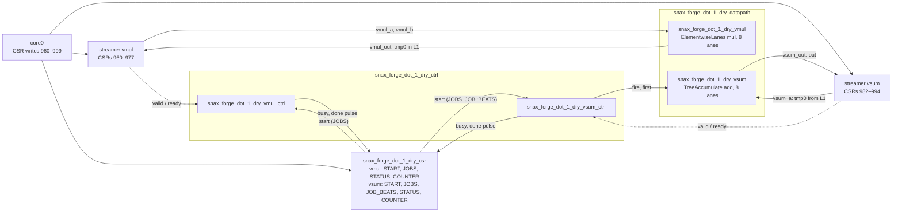

# Dry run 2: dot 1, two accelerators through L1

A snapshot of 5 Nov 2026 (snax-forge `main` at `58a703b`, SLOT1 #53; snax-gvsoc `61d1e8ac`, #43; the RTL on snax_cluster `main` at `4abd432c`, #679, in its image `d3d8f5572ff4`; the cost table from snax-forge-experiments `6c727da`). Sections 1, 2, 4, 7 and 9's editor steps ran through the editor's HTTP API. The numbers are what these commits printed; no test checks them (D98), so they can drift as the code moves.

dot is $\mathit{out} = \sum_i A_i \cdot B_i$ over N int64 elements (`kernels/polybench/dot.py`). dot 1 is its plainest hardware: a multiplier `vmul` writes the N products to a transient `tmp0` in L1, then an adder tree `vsum` reads them back and sums them. These are two accelerators, each a streamer set of the design's one snax_cluster entry, `snax_forge_<design>`, with its own streamer, START and CSRs (D157). The core runs them in series (D158): it sets up `vsum` while `vmul` runs, waits for `vmul`, then starts `vsum`. Encapsulating the two puts them on one shared streamer set, `dot_1_enc` (section 9); dot 2 to 6 instead join the two units in one group with a link (section 7).

The designer's questions: what does it cost to pass the products through L1 between two accelerators, should the two get different lanes, and is one streamer set or two the better shell? The path is `1_vecmul.md`'s: the editor, the steps, the saved recipe, a sweep, the run on SNAX-GVSoC, the reports and the cluster viewer, what a link would change, what was generated, then the encapsulated form.

## 1. Start the editor on the kernel

Everything runs in snax-forge's image (`docs/RUN.md` section 1). From the folder that holds `snax-forge`:

    podman run --rm -it --network host -v "$PWD":"$PWD" -w "$PWD" ghcr.io/kuleuven-micas/snax-forge:main
    cd snax-forge && pixi install
    pixi run edit-dfg --kernel dot --set N=2048

    serving dot at http://127.0.0.1:8767/ (Ctrl-C to stop)

Step 0 is the import: two maps, `mult_map · i · 2048 · untagged` holding `mult · in1 * in2`, and `sum_map · i · 2048 · untagged` holding `sum · fold +`, with `tmp0` between them. The left column: Symbols `N [2048]`; Containers `A: N · L1 · 16 KiB`, `B` the same, `out: 1 · L1 · 8 B` and `tmp0: N · L1 · 16 KiB`. `tmp0` is a transient, and like every transient it sits in L1 until a link takes it out; hovering N lights up A, B and tmp0. The Estimate reads `accelerator 0 + unmapped 4096 = total 4096`, two maps of 2048 iterations at one cycle each (D155), with 6144 words read and 4096 written: the fold writes `out` once per iteration while no unit runs it. The L1 footprint is 48 KiB of 128 KiB.

Under the Estimate, the design checks (Save's, run on every step) list two notes, `before Save: bind it` for `mult` and for `sum` (`graph.unbound`). They are notes, not problems: an unbound tasklet is normal while building, and Save would refuse it.

## 2. Eight steps

| Step | Select | Apply | What changes |
|---|---|---|---|
| 1 | `mult_map` | `split`, factor `W` with its value box set to 8 | `mult_map` runs `i_1` over 256 around `mult_map_inner` running `i_2` over 8; Bindings shows `mult_map split · W = 8 · not bound` |
| 2 | `mult_map` | `tag_map`, `temporal` | the streamers' loop |
| 3 | `mult_map_inner` | `tag_map`, `spatial` | the lanes; the total stays at 4096, since a tag alone runs nothing |
| 4 | `mult` | `bind`, `elementwise_mul / chisel_tiled_spatial`, instance `vmul` (the field offers `acc_1`) | the log ends `C 0 → 256 · unmapped 4096 → 2048 · renamed W → W_vmul · 1 note` (`sum` is still unbound); total 2304 |
| 5 | `sum_map` | `split`, factor `W`, 8 | `sum_map` runs `i_3` over 256 around `sum_map_inner` running `i_4` over 8 |
| 6 | `sum_map` | `tag_map`, `temporal` | |
| 7 | `sum_map_inner` | `tag_map`, `spatial` | |
| 8 | `sum` | `bind`, `accumulate / chisel_adder_tree`, instance `vsum` (the field offers `acc_2`) | `C 256 → 513 · unmapped 2048 → 0 · renamed W → W_vsum`; 0 problems, 0 notes |

Each split gets a param of its own. The factor field reads `W` both times, since the first `W` was renamed on its bind: a param the editor named and only one unit uses takes that unit's instance name, `W_vmul` and `W_vsum` (D156). The second split takes the next free pair of loop names, `i_3` and `i_4` (D73). The unit boxes read `vmul · a * b · W_vmul 8` and `vsum · fold + · W_vsum 8`, and Details give `mult_map`'s range as `0:N // W_vmul = 256`.

At step 8 the bind list offers two implementations: `chisel_adder_tree` (latency 1, II 1, span 1: the 8 lanes summed in one beat) and `chisel_serial` (span 8: one lane a cycle). `chisel_accumulator` is refused at W = 8 (it takes one lane), `mac` needs `split_reduce` first (D150), and both element-wise patterns are refused (`'out = in1' is not one operator over distinct inputs`).

Step 8 is a design Save takes as it is: two bound units are two accelerators, each its own streamer set in the one entry (D157), so nothing has to put them behind one shell. Bindings lists them side by side, `vmul · elementwise_mul · W_vmul = 8` and `vsum · accumulate · W_vsum = 8`, each param editable in place. Each accelerator is drawn with a dashed outline; section 9 selects both and encapsulates them.

The Estimate after step 8:

| Group | Cycles | Bottleneck | Ramp | Stall | Expected COUNTER | Channels | Area (µm²) | Energy (nJ) |
|---|---:|---:|---:|---:|---:|---:|---:|---:|
| vmul | 256 | 256 | 0 | 0 | 259 | 24 | 56 000 | 23.393 |
| vsum | 257 | 256 | 1 | 0 | 259 | 9 | 4 110 | 1.740 |

The two accelerators add through L1: the multiply runs its 256 beats, then the sum runs its 256 beats plus its latency of 1, so

$$C = \frac{N}{W_{\mathit{vmul}}} + \frac{N}{W_{\mathit{vsum}}} + 1 = 256 + 256 + 1 = 513.$$

The expected COUNTER adds the streamers' fill (3 for a group with two inputs, 2 with one); it is a guide from SNAX-DFG, not something a run must hit (section 5). Reads are 6144 words (A, B and tmp0), writes 2049 (tmp0 and the one `out`). Under the groups the panel names the streamers: `2 streamers (not costed, open item 110) · 40 CSRs: vmul 960–981, vsum 982–999`.

The cost table on nangate45, one per accelerator:

| Accelerator | Block | Datapath | Area (µm²) | Energy (nJ) | Share |
|---|---|---|---:|---:|---:|
| vmul | vmul | ElementwiseLanes | 55 300 | 23.137 | 45.9 % |
| vmul | vmul ctrl | control unit | 702 | 0.257 | 0.5 % |
| vmul | L1 accesses (placeholder, 4 × e_load per bit) | 6144 words, 393 216 bits | – | 27.005 | 53.6 % |
| vmul | total | | 56 000 | 50.398 | 100 % |
| vsum | vsum | TreeAccumulate | 2 710 | 1.231 | 11.5 % |
| vsum | vsum ctrl | control unit | 1 390 | 0.509 | 4.7 % |
| vsum | L1 accesses (placeholder, 4 × e_load per bit) | 2049 words, 131 136 bits | – | 9.006 | 83.8 % |
| vsum | total | | 4 110 | 10.746 | 100 % |

The design's total, above the tables: 60 100 µm² and 61.144 nJ.

How to read it:

- **The L1 accesses are a placeholder** (D154): until the streamers and OpenRAM's memories are characterized, every 64-bit word an accelerator's streamers read or write in L1 costs 4 × e_load per bit, 4.40 pJ on nangate45. `vmul`'s 6144 words are A and B (4096 reads) and tmp0's 2048 writes; `vsum`'s 2049 are tmp0's 2048 reads and `out`. The DMA's traffic is left out, being the same for every variant. Even as a placeholder it says what matters here: half of the 8193 words are tmp0's.
- **Two control units.** Each is its flops plus an equal comb area (the 1 : 1 placeholder). `vmul`'s has 66 bits, as vecmul's: busy, JOBS, the jobs counter and the done pulse. `vsum`'s has 131, since its T (256 beats per job) comes with the start: its JOB_BEATS (32 bits), the beats counter (32) and one valid bit for its latency. Each holds its bits over all 513 cycles, so `vmul ctrl` costs 0.257 nJ against vecmul's 0.128 nJ at the same 256 busy cycles: nothing is clock gated, so a control unit pays while the other accelerator runs.
- **The streamers are not in it.** Two streamers and the 40 CSRs are left out (open item 110); section 9 is where that matters.

## 3. Save the recipe

Save recipe, as `dot_1_dry`, runs the design checks and writes `recipes/dot_1_dry.json`:

```json
{
 "name": "dot_1_dry",
 "kernel": "dot",
 "params": {"N": 2048, "W_vmul": 8, "W_vsum": 8},
 "symbols": {"N": "N"},
 "steps": [
  {"transform": "split", "params": {"map": "mult_map", "factor": "W_vmul"}},
  {"transform": "tag_map", "params": {"map": "mult_map", "kind": "temporal"}},
  {"transform": "tag_map", "params": {"map": "mult_map_inner", "kind": "spatial"}},
  {
   "transform": "bind",
   "params": {
    "node": "mult",
    "brm": "elementwise_mul",
    "implementation": "chisel_tiled_spatial",
    "instance": "vmul"
   }
  },
  {"transform": "split", "params": {"map": "sum_map", "factor": "W_vsum"}},
  {"transform": "tag_map", "params": {"map": "sum_map", "kind": "temporal"}},
  {"transform": "tag_map", "params": {"map": "sum_map_inner", "kind": "spatial"}},
  {
   "transform": "bind",
   "params": {
    "node": "sum",
    "brm": "accumulate",
    "implementation": "chisel_adder_tree",
    "instance": "vsum"
   }
  }
 ]
}
```

It keeps only the params its steps and symbols use (D156). The log lists `pixi run sandbox`, `pixi run flow` and `pixi run forge` on it, each with what it does, as in `1_vecmul.md` section 3. `recipes/dot_1.json` builds the same hardware by hand with `split_map` and one shared `W`.

## 4. Sweep the two widths in Bindings

Change `W_vmul` or `W_vsum` in its Bindings entry; the session replays its steps up to the cursor and runs the checks again, and the log line gives the step's problems and notes as an Apply's does (`params W_vmul=8, W_vsum=10  ok · 8 steps replayed · 1 problem`). On both technologies:

| W_vmul | W_vsum | Cycles | Expected COUNTER | Channels | Area 45 nm (µm²) | Energy 45 nm (nJ) | of which L1 | Area 15 nm (µm²) | Energy 15 nm (nJ) |
|---:|---:|---:|---|---|---:|---:|---:|---:|---:|
| 1 | 1 | 4097 | 2051, 2051 | 3, 2 | 9 850 | 69.836 | 36.011 | 2 940 | 22.452 |
| 4 | 4 | 1025 | 515, 515 | 12, 5 | 31 400 | 62.285 | 36.011 | 9 800 | 20.135 |
| 8 | 4 | 769 | 259, 515 | 24, 5 | 59 000 | 61.925 | 36.011 | 18 700 | 20.071 |
| 8 | 8 | 513 | 259, 259 | 24, 9 | 60 100 | 61.144 | 36.011 | 18 900 | 19.823 |
| 10 | 4 | 718 | 208, 515 | 30, 5 | 72 900 | 61.735 | 36.037 | 23 100 | 19.985 |
| 10 | 8 | 462 | 208, 259 | 30, 9 | 73 900 | 60.955 | 36.037 | 23 400 | 19.738 |
| 10 | 10 | 411 | 208, 208 | 30, 11 | 74 500 | 60.812 | 36.046 | 23 500 | 19.692 |
| 16 | 4 | 641 | 131, 515 | 48, 5 | 114 000 | 61.536 | 36.011 | 36 400 | 19.928 |
| 16 | 8 | 385 | 131, 259 | 48, 9 | 115 000 | 60.756 | 36.011 | 36 600 | 19.680 |

How to read it:

- **The sum's lanes are nearly free.** The tree is 2 710 µm² at 8 lanes against the multiplier's 55 300, so 8/4 saves 1 100 µm² (1.8 %) and costs 256 cycles. Since the two accelerators add, the cheap way to save cycles is to give the sum at least as many lanes as the multiply. Its control unit stays at 1 390 µm² whatever W is, already about the tree's own size at 4 lanes.
- **Energy hardly moves.** From 8/4 to 10/10 it goes from 61.9 to 60.8 nJ: the 2048 multiplies cost the same at every W, the L1 accesses are the same 8193 words (a few more with a tail, below), and only the control units' holding shrinks with the cycles. W = 1 is the exception, 69.8 nJ, from holding 4097 cycles.
- **A tail needs the right pad.** At W_vmul = 10, 2048 pads to 205 beats of 10, and the pad words count too: A's and B's pad reads and tmp0's pad write make `vmul`'s 6150 words at 10/4 and 10/8, and tmp0's pad read `vsum`'s 2051 at 10/10. At 10/10 the multiplier's pad lanes compute $0 \cdot 0 = 0$ from A's and B's zero pads, which is the add's identity, so the sum may read them (D144). At 8/10 the multiplier never writes those words, and the checks list `[connect.pad] container tmp0: is written by mult and read through a tail by the fold sum: ... they are never written, so the program would have to write the fold's identity there before the fold's task, open item 106`.
- **Banks and the crossbar.** From W_vmul = 16 the multiply's streams need 48 words a cycle from 32 banks, and the Estimate adds `vmul: the streams move 6144 words over 32 banks, at least 192 cycles of L1 time against the ideal 128`. At 16/16 the 65 streamer channels, the two cores and AXI make 68 crossbar inputs, and the checks list `[connect.xbar_inputs] vmul, vsum: 68 TCDM crossbar inputs, the platform takes at most 64`.

So on the model, dot 1's sweep is the multiplier's area against time, with the sum set to match it; the energy is decided elsewhere, by the L1 traffic, which is the case for dot 2–6 (section 7).

## 5. Run it on SNAX-GVSoC

    pixi run flow recipes/dot_1_dry.json --platform platforms/snax_forge.json

    flow dot_1_dry (dot_1_dry: N=2048, W_vmul=8, W_vsum=8; N=2048) on snax_forge -> out/flow/dot_1_dry/
      sandbox   8 steps, each equal to the input graph on the reference check -> sandbox/
      design    24 checks passed; platform base snax_forge, 0 changes; memory contiguous, 0 changes -> design/
      lower     tasks.json (17 steps)
      gen       snax_forge.hjson, snax_forge_dot_1_dry_streamer_vmul.hjson, snax_forge_dot_1_dry_streamer_vsum.hjson, accelerator.json, main.c, data.h (seed 0) -> gen/
      build     up to date (snax-gvsoc 61d1e8ac)
      sw        sw/forge.elf (sha256 c79629823fa5683b)
      gvsoc     snax_hjson, exit 0 -> run/
      check     passed: 1218 cycles (main to forge_check); data 0 errors (1 words); counters mult_vmul 259 (256 beats), sum_vsum 259 (256 beats)
      convert   run/events.log -> profile.json (the summary lines; trace off)
      report    report/design.md, report/run.md

The generator writes one streamer file per accelerator, `snax_forge_dot_1_dry_streamer_vmul.hjson` and `..._vsum.hjson` (section 8). Two COUNTERs, one per accelerator, read by the program after each one's task. Three cycle numbers appear from here on:

| Number | What it counts | Where it comes from |
|---|---|---|
| Expected COUNTER | the group's ideal cycles plus the streamers' fill (3, or 2 for one input) | the estimate, a guide (D155) |
| COUNTER | every cycle from the group's START until its busy drops: bank conflicts included, shortened when the streamers started ahead | the group's COUNTER CSR, read by the program |
| Window | the program from `main` to `forge_check()` (D135): setup, the DMA loads, both accelerators, the core's handover, the DMA store | the core's `mcycle` |

The other points, each in its own folder, named after its `--set`s:

    pixi run flow recipes/dot_1_dry.json --platform platforms/snax_forge.json --set W_vmul=8 --set W_vsum=4

    flow dot_1_dry_W_vmul8_W_vsum4 (dot_1_dry: N=2048, W_vmul=8, W_vsum=4; N=2048) on snax_forge -> out/flow/dot_1_dry_W_vmul8_W_vsum4/

| W_vmul | W_vsum | Expected COUNTER | COUNTER | Window | DMA busy |
|---:|---:|---|---|---:|---:|
| 1 | 1 | 2051, 2051 | 2048, 2049 | 4822 | 534 |
| 4 | 4 | 515, 515 | 515, 515 | 1731 | 534 |
| 8 | 4 | 259, 515 | 256, 513 | 1496 | 534 |
| 8 | 8 | 259, 259 | 259, 259 | 1218 | 534 |
| 10 | 4 | 208, 515 | 208, 515 | 1440 | 537 |
| 10 | 8 | 208, 259 | 208, 259 | 1185 | 537 |
| 10 | 10 | 208, 208 | 205, 206 | 1161 | 536 |
| 16 | 4 | 131, 515 | 194, 515 | 1409 | 534 |
| 16 | 8 | 131, 259 | 194, 259 | 1154 | 534 |

8/10 stops at the design step with the `connect.pad` problem of section 4, and 16/16 with `connect.xbar_inputs`.

**Why a COUNTER is 3 under its guide in places.** The program sets up an accelerator's streamer and JOBS, then writes its STREAMER_START and its START one after the other. The COUNTER counts from START, so it holds the fill only when START lands right after the streamer's start. With `--trace task` the two writes are 1 cycle apart for both accelerators at 4/4 and 8/8 (`vmul` 608, 609; `vsum` 888, 889 at 8/8), and 10 cycles apart for both at 1/1 and 8/4 (`vmul` 620, 630; `vsum` 899, 909 at 8/4); at 10/10, 10 for `vmul` (622, 632) and 20 for `vsum` (850, 870). With a 10-cycle head start the streamer's FIFOs are already full when the group starts, so its COUNTER is its ideal cycles, 256 or 513 at 8/4, not 259 or 515. That is how the COUNTER is meant to count (D155), and it is why the expected COUNTER is a guide.

**At W_vmul = 16 the COUNTER is above the bank note.** The note bounds the streams' L1 time at 192 cycles; at 16/8 the multiply's streamer runs from 609 to 809, and its START lands at 610, a cycle after the streamer's, so its COUNTER is 194: the 192 cycles of L1 time and a fill of 2.

**The window.** At 8/8 the 1218 cycles are the DMA's two loads (77 to 603), the multiply (609 to 869), the core's handover (869 to 888: it polls `vmul`'s STATUS and its streamer's busy, reads the COUNTER and passes a barrier, then starts `vsum`'s streamer and `vsum`), the sum (889 to 1149) and the store of the one word (1163 to 1171). vecmul's window at W = 8 was 1200: dot 1 adds the sum's 260 cycles and the handover, but stores 8 B in place of 16 KiB. The DMA's 534 to 537 busy cycles are about the same at every point, so past W = 8 the window gains little: 10/10 is 57 cycles under 8/8 for 14 400 µm² more.

## 6. The run in the reports and the viewer

    pixi run flow recipes/dot_1_dry.json --platform platforms/snax_forge.json --trace beat

    ...
      check     passed: 1218 cycles (main to forge_check); data 0 errors (1 words); counters mult_vmul 259 (256 beats), sum_vsum 259 (256 beats)
      convert   run/events.log -> profile.json, trace.jsonl (9584 events in the window; boot 6357; sources vmul, vsum, vmul_a, vmul_b, vmul_out, vsum_a, vsum_out, dma)

`report/run.md` opens its Accelerators with a row per accelerator, its streamer set's CSRs, its streamer's busy window and its COUNTER:

| Accelerator | Groups | CSRs | Streamer busy | COUNTER |
|---|---|---|---|---|
| vmul | vmul | 960–981 | 608–870 | vmul 259 |
| vsum | vsum | 982–999 | 888–1150 | vsum 259 |

and names every task with its accelerator:

| Block | Group | # | Task | Accelerator | Start | Done | Cycles | Direction | Bytes |
|---|---|---:|---|---|---:|---:|---:|---|---:|
| dma | – | 0 | load_A | – | 77 | 347 | 270 | L2 → L1 | 16384 |
| dma | – | 1 | load_B | – | 92 | 603 | 511 | L2 → L1 | 16384 |
| vmul_a | vmul | 0 | mult_vmul_a | vmul | 608 | 866 | 258 | – | – |
| vmul_b | vmul | 0 | mult_vmul_b | vmul | 608 | 867 | 259 | – | – |
| vmul_out | vmul | 0 | mult_vmul_out | vmul | 608 | 870 | 262 | – | – |
| vmul | vmul | 0 | mult_vmul | vmul | 609 | 869 | 260 | – | – |
| vsum_a | vsum | 0 | sum_vsum_a | vsum | 888 | 1146 | 258 | – | – |
| vsum_out | vsum | 0 | sum_vsum_out | vsum | 888 | 1150 | 262 | – | – |
| vsum | vsum | 0 | sum_vsum | vsum | 889 | 1149 | 260 | – | – |
| dma | – | 2 | store_out | – | 1163 | 1171 | 8 | L1 → L2 | 64 |

Each accelerator's task starts only its own streamer, so no mover runs idle: ten tasks, each moving data. The units and each accelerator's movers follow in a collapsible (`vmul ▸ vmul_a, vmul_b, vmul_out`; `vsum ▸ vsum_a, vsum_out`). `vsum_out` shows 259 cycles waiting on its FIFO: it writes the one result at the end, so it waits for the tree the whole task, which costs nothing.

    pixi run view out/flow/dot_1_dry_beat

What to look at:

- **Schedule.** The lanes go accelerator ▸ group under a heading each; an accelerator of one group is named once, so the headings read `vmul` and `vsum`. The DMA's loads, then `mult_vmul` and its three streamer lanes, the handover, then `sum_vsum` and its two. Nothing overlaps: the second accelerator waits for the first, through the core. core0's lane carries its CSR writes: `vsum`'s twelve land from 610 to 646, while `vmul` runs.
- **The cluster view.** Inside the accelerator `snax_forge_dot_1_dry` it draws two streamer boxes, one per set: `vmul` (CSRs 960–977, movers `vmul_a`, `vmul_b`, `vmul_out`) and `vsum` (982–994, `vsum_a`, `vsum_out`). At cycle 700 `vmul`'s box is busy on `mult_vmul_a` and `vsum`'s idle; `vmul` fires beat 87 while `vmul_a` reads A[720..727] on banks 16–23, three beats ahead of the fire, `vmul_b` reads B[712..719] on banks 8–15, and `vmul_out` writes tmp0[688..695] on banks 24–31. At cycle 1000 the boxes have swapped: `vmul`'s idle, `vsum`'s busy on `sum_vsum_a`; `vsum` fires beat 108 while `vsum_a` reads tmp0[880..887] on banks 24–31 and `vsum_out` waits on its FIFO.
- **Memory and movement.** tmp0's round trip in one row of the Data movement table: written in L1 from cycle 614 to 869, read back from 890 to 1145, never touching L2. Those 4096 accesses are the cost section 2's placeholder prices and dot 2 removes. The port table under it lists each mover's lanes by task, `vmul_a.lane0` to `vsum_out.lane0`.

The design report keeps one bank note, within `vmul`: A and B lie a whole number of bank rows apart, so A[i] and B[i] share a bank and `vmul_b` is held one cycle at the start (the Memory table's stalls). Notes between streamers of different accelerators are not given, since those never run at once.

## 7. What a link would buy

In the same session, at step 8, select `tmp0`: the sidebar now offers `link`, with its depth `D` at 1 and the group it makes, `dot`. Step 9 is dot 2's hardware: one accelerator `dot` of one group with `vmul → tmp0 → vsum`, the products passed through a one-beat buffer instead of L1. Compare on, step 8 against step 9:

| | Step 8 (dot 1) | Step 9 (linked) |
|---|---:|---:|
| Cycles | 513 | 258 |
| Expected COUNTER | 259, 259 | 261 |
| Channels | 24 + 9 | 17 |
| Streamers, CSRs | 2, 40 | 1, 23 |
| L1 footprint | 48 KiB | 32 KiB |
| Words read, written | 6144, 2049 | 4096, 1 |
| Area (µm²) | 60 100 | 63 800 |
| Energy (nJ) | 61.144 | 45.133 |
| of which L1 accesses | 36.011 | 18.008 |

The link halves the cycles, since both units now run at once, and drops tmp0's 4096 L1 accesses. It costs a LinkBuffer (3 690 µm², 2.492 nJ) and a larger control unit for the one group (2 090 µm² against 702 + 1 390). The energy comes out 26 % lower only because of the L1 placeholder; without it the model would rank dot 1 cheaper, since an access through L1 would cost nothing. The real number needs the streamers' and the memories' characterization (HWCOST, RAM1). A link also needs both units at the same width: back at step 8, W_vsum = 4 is accepted, and moving to step 9 then refuses with `[link.order] link 'tmp0': mult.out gives 256 beats of 8 lanes, sum.a takes 512 of 4, or another order; a link passes the beats as they are`.

**What the link's depth costs.** `D` is a param like the widths: it appears in Bindings under the group `dot` as `link tmp0 · depth · D = 1`, and changing it replays the steps. At W = 8:

| D | Cycles | Expected COUNTER | Control bits | Area 45 nm (µm²) | Energy 45 nm (nJ) | Area 15 nm (µm²) | Energy 15 nm (nJ) |
|---:|---:|---:|---:|---:|---:|---:|---:|
| 1 | 258 | 261 | 196 | 63 800 | 45.133 | 19 900 | 14.724 |
| 2 | 258 | 261 | 199 | 68 500 | 49.131 | 21 000 | 16.141 |
| 4 | 258 | 261 | 202 | 75 800 | 54.320 | 23 100 | 17.700 |
| 8 | 258 | 261 | 205 | 91 300 | 63.395 | 27 200 | 20.625 |

The cycles do not move: both units take one beat a cycle, so a deeper buffer has no gap to absorb. Each extra slot is W × 64 bits more LinkBuffer and a few more control bits, so the area and the holding energy grow, and at D = 8 the linked design costs more energy than dot 1 (63.395 against 61.144 nJ). Depth pays only where the consumer is slower than the producer, as in dot 6, whose serial sum takes W cycles per beat; the editor's default of 1 is the right one here.

## 8. What was generated

The flow wrote the design point's files to `out/flow/dot_1_dry/gen/`: the cluster file, a streamer file per set, `accelerator.json`, the headers, `main.c`, `data.h` and `manifest.json`. The cluster file's slot is the one entry `snax_forge_dot_1_dry` with its two streamer sets (`snax_forge.hjson`). The entry's name is the design's tag, `snax_forge_<design>` with the design named after its recipe, so Save's `dot_1_dry` gives `snax_forge_dot_1_dry` here and in the RTL's module names, where the checked-in `recipes/dot_1.json` gives `snax_forge_dot_1`:

```json
  "snax_acc_cfg": [
   {
    "snax_acc_name": "snax_forge_dot_1_dry",
    "snax_tcdm_ports": 33,
    "sparse_interconnect_config": [[24, 1], [9, 1]],
    ...
    "snax_streamer_sets": [
     {
      "name": "vmul",
      "snax_streamer_cfg": {"$ref": "snax_forge_dot_1_dry_streamer_vmul.hjson"},
      "snax_num_rw_csr": 2,
      "snax_num_ro_csr": 2
     },
     {
      "name": "vsum",
      "snax_streamer_cfg": {"$ref": "snax_forge_dot_1_dry_streamer_vsum.hjson"},
      "snax_num_rw_csr": 3,
      "snax_num_ro_csr": 2
     }
    ],
    "snax_datapath_cfg": {"$ref": "accelerator.json"}
   }
  ],
```

The 33 TCDM ports are the sets' 24 and 9 channels, one interconnect group each. **The CSRs.** Each set's streamer CSRs come first, then its accelerator's own, packed from 960 (D157, C§16); the manifest numbers them all:

| CSRs | Set | What |
|---|---|---|
| 960–974 | vmul | `vmul_a`, `vmul_b`, `vmul_out`: base pointer (low, high), spatial stride, temporal bound, temporal stride, 5 each |
| 975, 976, 977 | vmul | STREAMER_START, STREAMER_BUSY, STREAMER_PERFORMANCE_COUNTER |
| 978, 979, 980, 981 | vmul | START (R/W, reads 0), JOBS (R/W, 256), STATUS (R/O, bit 0 busy, bit 1 done), COUNTER (R/O) |
| 982–991 | vsum | `vsum_a`, `vsum_out`: the same 5 each |
| 992, 993, 994 | vsum | STREAMER_START, STREAMER_BUSY, STREAMER_PERFORMANCE_COUNTER |
| 995, 996, 997, 998, 999 | vsum | START, JOBS (1), JOB_BEATS (R/W, 256), STATUS, COUNTER |

40 CSRs in all. The multiply has no fold, so every beat is a job; the tree folds 256 beats into one output, so it runs one job whose length comes with the start, its unit's own CSR JOB_BEATS. Each set has a header of its streamer's CSRs, `include/streamer_<set>_csr_addr_map.h`, its macros prefixed with the set's name:

```c
// streamer_vmul_csr_addr_map.h
#define VMUL_BASE_PTR_READER_0_LOW 960
#define VMUL_BASE_PTR_READER_0_HIGH 961
#define VMUL_S_STRIDE_READER_0_0 962
#define VMUL_T_BOUND_READER_0_0 963
#define VMUL_T_STRIDE_READER_0_0 964
...                                         // READER_1 965–969, WRITER_0 970–974
#define VMUL_STREAMER_START_CSR 975
#define VMUL_STREAMER_BUSY_CSR 976
#define VMUL_STREAMER_PERFORMANCE_COUNTER_CSR 977

// streamer_vsum_csr_addr_map.h
#define VSUM_BASE_PTR_READER_0_LOW 982
...                                         // READER_0 982–986, WRITER_0 987–991
#define VSUM_STREAMER_START_CSR 992
#define VSUM_STREAMER_BUSY_CSR 993
#define VSUM_STREAMER_PERFORMANCE_COUNTER_CSR 994
```

and each accelerator one of its own CSRs, `include/vmul_csr.h` (`VMUL_RW_START` 978 to `VMUL_RO_COUNTER` 981) and `include/vsum_csr.h` (`VSUM_RW_START` 995 to `VSUM_RO_COUNTER` 999). The program (`gen/main.c`) drives the two in series (D158): `vsum` is set up while `vmul` runs, then one wait covers `vmul` and its streamer before `vsum` starts:

```c
    csrw_ss(VMUL_RW_JOBS, 256);
    snrt_cluster_hw_barrier();                 // the DMA has loaded A and B
    csrw_ss(VMUL_STREAMER_START_CSR, 1);
    csrw_ss(VMUL_RW_START, 1);
    csrw_ss(VSUM_BASE_PTR_READER_0_LOW, 0x10008040);
    ...                                        // vsum's streamer: tmp0 in, out out
    csrw_ss(VSUM_RW_JOBS, 1);
    csrw_ss(VSUM_RW_JOB_BEATS, 256);
    while (csrr_ss(VMUL_RO_STATUS) & 1) {      // the serial sync: vmul and its streamer
    }
    while (csrr_ss(VMUL_STREAMER_BUSY_CSR)) {
    }
    forge_counter[0] = csrr_ss(VMUL_RO_COUNTER);
    snrt_cluster_hw_barrier();
    csrw_ss(VSUM_STREAMER_START_CSR, 1);
    csrw_ss(VSUM_RW_START, 1);
    while (csrr_ss(VSUM_RO_STATUS) & 1) {
    }
```

`vsum`'s set-up is twelve writes: five for each of its two movers, JOBS and JOB_BEATS.

The RTL comes from `gen-rtl` on the same design point (the flow does not make RTL, D136):

    pixi run gen-rtl out/flow/dot_1_dry/design/design_point.json

It writes `out/rtl/dot_1_dry/accelerator.json`, runs `hw/chisel/`'s `Emit --spec` into `sv/` and lists what it emitted in `emitted.json` (`snax_forge_dot_1_dry_shell_wrapper from out/rtl/dot_1_dry/accelerator.json: 11 module(s)`). Every module the design owns carries its tag, `snax_forge_dot_1_dry`; the shell's module tree, instance names first:

```text
snax_forge_dot_1_dry_shell_wrapper
├── csr   snax_forge_dot_1_dry_csr            both accelerators' START, JOBS, STATUS, COUNTER and vsum's JOB_BEATS
├── ctrl  snax_forge_dot_1_dry_ctrl
│   ├── ctrl    snax_forge_dot_1_dry_vmul_ctrl
│   └── ctrl_1  snax_forge_dot_1_dry_vsum_ctrl
└── dp    snax_forge_dot_1_dry_datapath
    ├── blocks_0_4  snax_forge_dot_1_dry_vmul
    │   └── m  ElementwiseLanes_i64xi64_i64_i64_n8_mul
    │       └── alus_0 … alus_7  ElementwiseAlu_w64_mul
    └── blocks_1_4  snax_forge_dot_1_dry_vsum
        └── m  TreeAccumulate_i64_i64_n8
```

The streamers are not in it: snax_cluster builds one per set from the cluster file and connects the shell's ports to them, `stream2acc_0` to `_2` (`vmul_a`, `vmul_b`, `vsum_a`) and `acc2stream_0`, `_1` (`vmul_out`, `vsum_out`), with each accelerator's busy and done pins (`vmul_busy_o`, `vmul_done_o`, `vsum_busy_o`, `vsum_done_o`):



The two accelerators share nothing but the CSR block and the shell's ports: each has its own streamer, its own control unit and its own busy and done pins. The CSR block numbers its nine registers 0 to 8 (`vmul` 0–3, `vsum` 4–8, as `accelerator.json` gives them), which the core reaches as 978–981 and 995–999. The multiplier is combinational and gets no enable, as in `1_vecmul.md`; the adder tree holds its running sum in a register, so its control unit tells it when a beat counts (`fire`) and which beat starts a job (`first`). `out/rtl/dot_1_dry/sv/` holds one module per file, in the order of `filelist.f`, the list snax_cluster compiles:

| File | Module |
|---|---|
| `snax_forge_dot_1_dry_csr.sv` | the CSR block: both accelerators' START, JOBS, STATUS and COUNTER and vsum's JOB_BEATS, offsets 0 to 8 |
| `snax_forge_dot_1_dry_vmul_ctrl.sv` | the group `vmul`'s control unit |
| `snax_forge_dot_1_dry_vsum_ctrl.sv` | the group `vsum`'s control unit |
| `snax_forge_dot_1_dry_ctrl.sv` | the control units of every group, here two |
| `ElementwiseAlu_w64_mul.sv` | one 64-bit lane's multiply |
| `ElementwiseLanes_i64xi64_i64_i64_n8_mul.sv` | the 8 lanes, the datapath block of `vmul` |
| `snax_forge_dot_1_dry_vmul.sv` | the unit `vmul`, around its block |
| `TreeAccumulate_i64_i64_n8.sv` | the 8-lane adder tree and its 64-bit running sum, the datapath block of `vsum` |
| `snax_forge_dot_1_dry_vsum.sv` | the unit `vsum`, around its block |
| `snax_forge_dot_1_dry_datapath.sv` | the datapaths of every unit, here two |
| `snax_forge_dot_1_dry_shell_wrapper.sv` | the top, the CSR block, the control and the datapath wired to the streamers |
| `filelist.f` | the files above, in compile order |

The two control units' registers, from `snax_forge_dot_1_dry_vmul_ctrl.sv` and `snax_forge_dot_1_dry_vsum_ctrl.sv`:

```systemverilog
// snax_forge_dot_1_dry_vmul_ctrl.sv
  reg         busy;
  reg  [31:0] vmul_jobs;
  reg  [31:0] vmul_jobs_counter;
  wire        vmul_offer =
    busy & vmul_jobs_counter != vmul_jobs & io_in_0_valid & io_in_1_valid;
  wire        vmul_frozen = vmul_offer & ~io_out_ready;
  ...
  reg         io_done_REG;

// snax_forge_dot_1_dry_vsum_ctrl.sv
  input  [31:0] io_start_bits_jobs,
                io_start_bits_beats_0,
  ...
  reg         busy;
  reg  [31:0] vsum_jobs;
  reg  [31:0] vsum_job_beats;
  reg  [31:0] vsum_job_beats_counter;
  reg  [31:0] vsum_jobs_counter;
  reg         vsum_v_0;
  wire        _GEN = busy & vsum_jobs_counter != vsum_jobs & io_in_0_valid;
  wire        vsum_frozen = vsum_v_0 & ~io_out_ready;
  ...
  reg         io_done_REG;
```

The adder tree, from `TreeAccumulate_i64_i64_n8.sv`:

```systemverilog
  reg [63:0] acc;
  ...
    else if (io_fire) begin
      automatic logic [63:0] _beat_T_12;
      _beat_T_12 =
        io_in_0 + io_in_1 + io_in_2 + io_in_3 + io_in_4 + io_in_5 + io_in_6 + io_in_7;
      if (io_first)
        acc <= _beat_T_12;
      else
        acc <= acc + _beat_T_12;
    end
  ...
  assign io_out = acc;
```

The CSR block's read mux over the nine offsets and the two saturating counters, from `snax_forge_dot_1_dry_csr.sv`:

```systemverilog
  wire [31:0] read =
    io_req_bits_addr == 32'h8
      ? vsum_counter
      : io_req_bits_addr == 32'h7
          ? {30'h0, vsum_done, io_busy_1}
          : io_req_bits_addr == 32'h6
              ? vsum_vsum_job_beats
              : io_req_bits_addr == 32'h5
                  ? vsum_jobs
                  : io_req_bits_addr == 32'h4
                      ? 32'h0
                      : io_req_bits_addr == 32'h3
                          ? vmul_counter
                          : io_req_bits_addr == 32'h2
                              ? {30'h0, vmul_done, io_busy_0}
                              : io_req_bits_addr == 32'h1 ? vmul_jobs : 32'h0;
  ...
      else if (io_busy_0 & vmul_counter != 32'hFFFFFFFF)
        vmul_counter <= vmul_counter + 32'h1;
      ...
      else if (io_busy_1 & vsum_counter != 32'hFFFFFFFF)
        vsum_counter <= vsum_counter + 32'h1;
```

Both START offsets (0 and 4) read 0: a start is a strobe (D152). Each COUNTER counts while its own accelerator's busy is high, so the two never mix.

**The control.** The two control units come from each group's description in `accelerator.json`, not written per kernel. `vmul`'s takes a beat when both inputs are valid and the output is ready (`vmul_offer` and not `vmul_frozen`); `vsum`'s when its one input is valid, and it holds the beat's result for one cycle in `vsum_v_0`, the tree's latency of 1, until the output is ready. Their registers are what the cost model counts (`estimate/bits.py`): `vmul`'s 66 bits are `busy` (1), `vmul_jobs` (32), `vmul_jobs_counter` (32) and `io_done_REG` (1, the done pulse a cycle later); `vsum`'s 131 add `vsum_job_beats` (32, JOB_BEATS as the start gave it), `vsum_job_beats_counter` (32) and `vsum_v_0` (1) to the same four (`vsum_jobs`, `vsum_jobs_counter`).

## 9. One streamer set: dot_1_enc

Back at step 8, click `vmul`'s dashed outline and shift-click `vsum`'s: on the two the sidebar offers only `encapsulate` (every one-item transform says `takes one selection, not 2`), with accelerator `dot` and units `vmul` and `vsum` both ticked. Applied at step 8 it first asks `Drop steps 9..9?`, the link of section 7; then step 9 is `encapsulate dot units=['vmul', 'vsum']`, `C 513 → 513`, 0 problems, 0 notes. Bindings reads as a tree, `accelerator dot ▸ group vmul ▸ vmul · elementwise_mul · W_vmul = 8` and `group vsum ▸ vsum · accumulate · W_vsum = 8`. The two groups keep their own START, JOBS, STATUS, COUNTER and control unit; what they now share is one streamer set, with one streamer and one STREAMER_START.

What changes in the Estimate: nothing in the groups' cycles or cost (513, 60 100 µm², 61.144 nJ, now in one table for `dot`), and the streamers line reads `1 streamer (not costed, open item 110) · 37 CSRs`, `dot`'s set from 960 to 996. Saved as `dot_1_enc_dry`, the recipe is section 3's with one more step, `{"transform": "encapsulate", "params": {"accelerator": "dot", "units": ["vmul", "vsum"]}}`; `recipes/dot_1_enc.json` is the same on `recipes/dot_1.json`.

What changes in the program and the run:

- **One set of 37 CSRs.** `streamer_dot_csr_addr_map.h` holds the five movers (readers `vmul_a`, `vmul_b`, `vsum_a`, then writers `vmul_out`, `vsum_out`) at 960–984, `DOT_STREAMER_START_CSR` 985, BUSY 986 and the performance counter 987; `dot_csr.h` the two groups' own, `DOT_RW_VMUL_START` 988 to `DOT_RO_VSUM_COUNTER` 996.
- **Idle movers in each task.** The one STREAMER_START starts all five movers, so each task sets the other group's movers to zero bounds. `vsum`'s set-up rewrites all five movers, 25 writes, then JOBS and JOB_BEATS: 27 writes where `dot_1_dry` needs 12.
- **The Tasks table** has five more rows, the idle movers, which finish in 2 cycles and move nothing: `mult_vsum_a (idle)` and `mult_vsum_out (idle)` in `vmul`'s task (608 to 610), `sum_vmul_a`, `sum_vmul_b`, `sum_vmul_out (idle)` in `vsum`'s (894 to 896). The Accelerators table has one row, `dot | vmul, vsum | 960–996 | 608–878, 894–1156 | vmul 256, vsum 259`, the schedule's headings read `dot ▸ vmul` and `dot ▸ vsum`, and the cluster view draws one streamer box, `dot` (CSRs 960–987, all five movers).

At N = 2048 and W = 8 the encapsulated run's window is 1230 against `dot_1_dry`'s 1218, its COUNTERs 256 and 259 against 259 and 259: `vmul`'s START lands 10 cycles after the streamer's (608, 618), so its COUNTER drops the fill (section 5), and `vmul` finishes 6 cycles later.

**Two sets against one, on the model and the RTL.** The checked-in recipes `dot_1` and `dot_1_enc` (W = 4), each through `pixi run forge` at N = 64 and with `--set N=512`, then the four bundles through snax_cluster's `snax-forge-check` on vsim:

| N | Design | Window, SNAX-GVSoC | Window, RTL (vsim) | COUNTER vmul, vsum (SNAX-GVSoC) | Streamers | CSRs | Estimate (nangate45) |
|---:|---|---:|---:|---|---:|---|---|
| 64 | dot_1 | 264 | 282 | 19, 19 | 2 | 40 (960–999) | 31 400 µm², 1.953 nJ |
| 64 | dot_1_enc | 304 | 302 | 19, 19 | 1 | 37 (960–996) | 31 400 µm², 1.953 nJ |
| 512 | dot_1 | 584 | 597 | 131, 131 | 2 | 40 (960–999) | 31 400 µm², 15.576 nJ |
| 512 | dot_1_enc | 586 | 609 | 131, 131 | 1 | 37 (960–996) | 31 400 µm², 15.576 nJ |

Every RTL run passes: `forge data: 0 errors`, and each COUNTER within its group's streamer fill of SNAX-GVSoC's (D123; `forge_expected.txt` gives each counter's `forge fill`). Three print SNAX-GVSoC's COUNTERs exactly; `dot_1_enc` at N = 512 passes with a note, `mult_vmul: counter 128 against 131, within its fill 3`, because on the RTL's core its STREAMER_START and START land 6 cycles apart (cycles 1174 and 1180 in core 0's trace), so the streamer's FIFOs are full when `vmul` starts and its COUNTER leaves out the fill (section 5's head start). The Estimate's cost is equal for both forms, since it leaves out the streamers (open item 110).

**Why two accelerators are faster.** `vsum`'s own set takes 12 CSR writes, where the shared streamer rewrites all five movers (27), and in both forms the writes overlap `vmul`'s run. At N = 64 `vmul` runs only 20 cycles (120 to 140 in `--trace beat`), shorter than either set-up: `dot_1`'s twelve writes end at 154 and `vsum` starts at 175, `dot_1_enc`'s 27 end at 189 and `vsum` starts at 209. So two sets save 40 cycles on SNAX-GVSoC and 20 on the RTL at N = 64. At N = 512 `vmul` runs about 130 cycles, longer than either set-up (the 27 writes took 67 cycles at N = 64), and the saving shrinks to 2 cycles on SNAX-GVSoC and 12 on the RTL. The gap between the model and the RTL is the core's timing, which SNAX-GVSoC does not model (open items 65, 67): the CSR writes and the handover take a different number of cycles on the RTL's core.

## 10. What this gives the designer

dot 1's time is the two accelerators' cycles added, plus the core's handover between them; its area is almost all the multiplier's. The sum's lanes cost little, so it should get as many as the multiply, and a W of 8 to 10 is where the window stops paying back the area, since the DMA's loads dominate it. W_vsum must divide N (or both widths must match at a tail, so the pads hold the add's identity); past W_vmul = 16 the banks and then the crossbar limit it. Two streamer sets beat one: each accelerator configures only its own movers while the other runs, which pays where a run is short.

The question dot 1 cannot answer by itself is what its round trip through L1 costs. Half of its L1 words are tmp0's, and with the placeholder price they are 58.9 % of its energy; a link removes them and halves the cycles for 3 700 µm². That is the case for dot 2 to 6, once the memory and the streamers are characterized.
