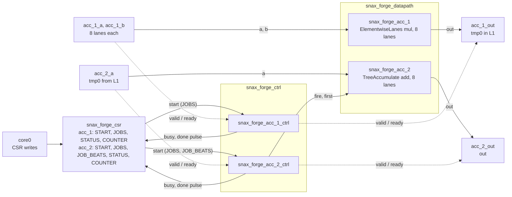

# Dry run 2: dot 1, two accelerators through L1

A snapshot of 4 Nov 2026 (snax-forge `ry/dry1-2` at `dry1-2-r3`, `c48dcb9`; snax-gvsoc `c061e32b`; the cost table from snax-forge-experiments `6c727da`). The numbers are what these commits printed; no test checks them (D98), so they can drift as the code moves.

dot is $\mathit{out} = \sum_i A_i \cdot B_i$ over N int64 elements (`kernels/polybench/dot.py`). dot 1 is its plainest hardware: a multiplier writes the N products to a transient `tmp0` in L1, then an adder tree reads them back and sums them. These are two groups, that is two stand-alone accelerators, each with its own START, JOBS, STATUS, COUNTER and control unit, put behind one shell because the platform has one accelerator slot (D148). The core drives them one after the other; the sum could run without the multiply. dot 2 to 6 instead join the two units in one group with a link.

The designer's questions: what does it cost to pass the products through L1 between two decoupled accelerators, and should the two get different lanes? The path is `1_vecmul.md`'s: the editor, the steps, the saved recipe, a sweep, the run on SNAX-GVSoC, the cluster viewer, then what a link would change and what was generated.

## 1. Start the editor on the kernel

Everything runs in snax-forge's image (`docs/RUN.md` section 1). From the folder that holds `snax-forge`:

    podman run --rm -it --network host -v "$PWD":"$PWD" -w "$PWD" ghcr.io/kuleuven-micas/snax-forge:main
    cd snax-forge && pixi install
    pixi run edit-dfg --kernel dot --set N=2048

    serving dot at http://127.0.0.1:8767/ (Ctrl-C to stop)

Step 0 is the import: two maps, `mult_map · i · 2048 · untagged` holding `mult · in1 * in2`, and `sum_map · i · 2048 · untagged` holding `sum · fold +`, with `tmp0` between them. The left column: Symbols `N [2048]`; Containers `A: N · L1 · 16 KiB`, `B` the same, `out: 1 · L1 · 8 B` and `tmp0: N · L1 · 16 KiB`. `tmp0` is a transient, and like every transient it sits in L1 until a link takes it out; hovering N lights up A, B and tmp0. The Estimate reads `accelerator 0 + unmapped 4096 = total 4096`, two maps of 2048 iterations at one cycle each (D155), with 6144 words read and 4096 written: the fold writes `out` once per iteration while no unit runs it. The L1 footprint is 48 KiB of 128 KiB.

Under the Estimate, the design checks (Save's, run on every step) list two notes, `before Save: bind it` for `mult` and for `sum` (`graph.unbound`). They are notes, not problems: an unbound tasklet is normal while building, and Save would refuse it.

## 2. Nine steps

| Step | Select | Apply | What changes |
|---|---|---|---|
| 1 | `mult_map` | `split`, factor `W` with its value box set to 8 | `mult_map` runs `i_1` over 256 around `mult_map_inner` running `i_2` over 8; Bindings shows `mult_map split · W = 8 · not bound` |
| 2 | `mult_map` | `tag_map`, `temporal` | the streamers' loop |
| 3 | `mult_map_inner` | `tag_map`, `spatial` | the lanes; the total stays at 4096, since a tag alone runs nothing |
| 4 | `mult` | `bind`, `elementwise_mul / chisel_tiled_spatial`, instance `acc_1` | the log ends `C 0 → 256 · unmapped 4096 → 2048 · renamed W → W_acc_1`; total 2304 |
| 5 | `sum_map` | `split`, factor `W`, 8 | `sum_map` runs `i_3` over 256 around `sum_map_inner` running `i_4` over 8 |
| 6 | `sum_map` | `tag_map`, `temporal` | |
| 7 | `sum_map_inner` | `tag_map`, `spatial` | |
| 8 | `sum` | `bind`, `accumulate / chisel_adder_tree`, instance `acc_2` | `C 256 → 513 · unmapped 2048 → 0 · renamed W → W_acc_2`; one note: `before Save: encapsulate acc_1, acc_2 into one accelerator` (`gen.instances`) |
| 9 | `acc_1` | `encapsulate`, accelerator `dot`, units `acc_1` and `acc_2` (both ticked) | 0 problems, 0 notes |

Each split gets a param of its own. The factor field reads `W` both times, since the first `W` was renamed on its bind: a param the editor named and only one unit uses takes that unit's instance name, `W_acc_1` and `W_acc_2`, and instances are numbered by bind order (D156). The second split takes the next free pair of loop names, `i_3` and `i_4` (D73). The unit boxes read `acc_1 · a * b · W_acc_1 8` and `acc_2 · fold + · W_acc_2 8`, and Details give `mult_map`'s range as `0:N // W_acc_1 = 256`.

At step 8 the bind list offers two implementations: `chisel_adder_tree` (latency 1, II 1, span 1: the 8 lanes summed in one beat) and `chisel_serial` (span 8: one lane a cycle). `chisel_accumulator` is refused at W = 8 (it takes one lane), `mac` needs `split_reduce` first (D150), and both element-wise patterns are refused (`out = in1` is not one operator over two inputs).

Step 9 is needed because the platform has one slot: two bound units are two accelerators, and Save at step 8 refuses with `gen.instances` unless they are put behind one shell. Bindings then reads as a tree, `accelerator dot ▸ group acc_1 ▸ acc_1 · elementwise_mul · W_acc_1 = 8` and `group acc_2 ▸ acc_2 · accumulate · W_acc_2 = 8`, each param editable in place.

The Estimate after step 9:

| Group | Cycles | Bottleneck | Ramp | Stall | Expected COUNTER | Channels | Area (µm²) | Energy (nJ) |
|---|---:|---:|---:|---:|---:|---:|---:|---:|
| acc_1 | 256 | 256 | 0 | 0 | 259 | 24 | 56 000 | 23.393 |
| acc_2 | 257 | 256 | 1 | 0 | 259 | 9 | 4 110 | 1.740 |

The two groups add through L1: the multiply runs its 256 beats, then the sum runs its 256 beats plus its latency of 1, so

$$C = \frac{N}{W_{\mathit{acc\_1}}} + \frac{N}{W_{\mathit{acc\_2}}} + 1 = 256 + 256 + 1 = 513.$$

The expected COUNTER adds the streamers' fill (3 for a group with two inputs, 2 with one); it is a guide from SNAX-DFG, not something a run must hit (section 5). Reads are 6144 words (A, B and tmp0), writes 2049 (tmp0 and the one `out`).

The cost table on nangate45:

| Block | Datapath | Area (µm²) | Energy (nJ) | Share |
|---|---|---:|---:|---:|
| acc_1 | ElementwiseLanes | 55 300 | 23.137 | 37.8 % |
| acc_1 ctrl | control unit | 702 | 0.257 | 0.4 % |
| acc_2 | TreeAccumulate | 2 710 | 1.231 | 2.0 % |
| acc_2 ctrl | control unit | 1 390 | 0.509 | 0.8 % |
| L1 accesses (placeholder, 4 × e_load per bit) | 8193 words | – | 36.011 | 58.9 % |
| total | | 60 100 | 61.144 | 100 % |

How to read it:

- **The L1 accesses are a placeholder** (D154): until the streamers and OpenRAM's memories are characterized, every 64-bit word an accelerator's streamers read or write in L1 costs 4 × e_load per bit, 4.40 pJ on nangate45. The 8193 words are A and B (4096 reads), tmp0's round trip (2048 writes, 2048 reads) and `out` (1). The DMA's traffic is left out, being the same for every variant. Even as a placeholder it says what matters here: half of these words are tmp0's.
- **Two control units.** Each is its flops plus an equal comb area (the 1 : 1 placeholder). `acc_1`'s has 66 bits, as vecmul's: busy, JOBS, the jobs counter and the done pulse. `acc_2`'s has 131, since its T (256 beats per job) comes with the start: its JOB_BEATS (32 bits), the beats counter (32) and one valid bit for its latency. Each holds its bits over all 513 cycles, so `acc_1 ctrl` costs 0.257 nJ against vecmul's 0.128 nJ at the same 256 busy cycles: nothing is clock gated, so a control unit pays while the other group runs.
- **The groups' lines leave the L1 accesses out**: 23.393 + 1.740 nJ is the kernel's 25.133 nJ; the accelerator's total adds the 36.011 nJ.

## 3. Save the recipe

Save recipe, as `dot_1_dry`, runs the design checks and writes `recipes/dot_1_dry.json`:

```json
{
 "name": "dot_1_dry",
 "kernel": "dot",
 "params": {"N": 2048, "W_acc_1": 8, "W_acc_2": 8},
 "symbols": {"N": "N"},
 "steps": [
  {"transform": "split", "params": {"map": "mult_map", "factor": "W_acc_1"}},
  {"transform": "tag_map", "params": {"map": "mult_map", "kind": "temporal"}},
  {"transform": "tag_map", "params": {"map": "mult_map_inner", "kind": "spatial"}},
  {
   "transform": "bind",
   "params": {"node": "mult", "brm": "elementwise_mul", "implementation": "chisel_tiled_spatial", "instance": "acc_1"}
  },
  {"transform": "split", "params": {"map": "sum_map", "factor": "W_acc_2"}},
  {"transform": "tag_map", "params": {"map": "sum_map", "kind": "temporal"}},
  {"transform": "tag_map", "params": {"map": "sum_map_inner", "kind": "spatial"}},
  {
   "transform": "bind",
   "params": {"node": "sum", "brm": "accumulate", "implementation": "chisel_adder_tree", "instance": "acc_2"}
  },
  {"transform": "encapsulate", "params": {"accelerator": "dot", "units": ["acc_1", "acc_2"]}}
 ]
}
```

The log lists `pixi run sandbox`, `pixi run flow` and `pixi run forge` on it, each with what it does, as in `1_vecmul.md` section 3. `recipes/dot_1.json` builds the same hardware by hand with `split_map` and one shared `W`.

## 4. Sweep the two widths in Bindings

Change `W_acc_1` or `W_acc_2` in its Bindings entry; the session replays its steps up to the cursor and runs the checks again. On both technologies:

| W_acc_1 | W_acc_2 | Cycles | Expected COUNTER | Channels | Area 45 nm (µm²) | Energy 45 nm (nJ) | of which L1 | Area 15 nm (µm²) | Energy 15 nm (nJ) |
|---:|---:|---:|---|---|---:|---:|---:|---:|---:|
| 1 | 1 | 4097 | 2051, 2051 | 3, 2 | 9 850 | 69.836 | 36.011 | 2 940 | 22.452 |
| 4 | 4 | 1025 | 515, 515 | 12, 5 | 31 400 | 62.285 | 36.011 | 9 800 | 20.135 |
| 8 | 4 | 769 | 259, 515 | 24, 5 | 59 000 | 61.925 | 36.011 | 18 700 | 20.071 |
| 8 | 8 | 513 | 259, 259 | 24, 9 | 60 100 | 61.144 | 36.011 | 18 900 | 19.823 |
| 10 | 4 | 718 | 208, 515 | 30, 5 | 72 900 | 61.735 | 36.037 | 23 100 | 19.985 |
| 10 | 8 | 462 | 208, 259 | 30, 9 | 73 900 | 60.955 | 36.037 | 23 400 | 19.738 |
| 10 | 10 | 411 | 208, 208 | 30, 11 | 74 500 | 60.812 | 36.046 | 23 500 | 19.692 |
| 16 | 4 | 641 | 131, 515 | 48, 5 | 114 000 | 61.536 | 36.011 | 36 400 | 19.928 |
| 16 | 8 | 385 | 131, 259 | 48, 9 | 115 000 | 60.756 | 36.011 | 36 600 | 19.680 |

How to read it:

- **The sum's lanes are nearly free.** The tree is 2 710 µm² at 8 lanes against the multiplier's 55 300, so 8/4 saves 1 100 µm² (1.8 %) and costs 256 cycles. Since the two groups add, the cheap way to save cycles is to give the sum at least as many lanes as the multiply. Its control unit stays at 1 390 µm² whatever W is, already about the tree's own size at 4 lanes.
- **Energy hardly moves.** From 8/4 to 10/10 it goes from 61.9 to 60.8 nJ: the 2048 multiplies cost the same at every W, the L1 accesses are the same 8193 words, and only the control units' holding shrinks with the cycles. W = 1 is the exception, 69.8 nJ, from holding 4097 cycles.
- **A tail needs the right pad.** At W_acc_1 = 10, 2048 pads to 205 beats of 10, and the pad words count too: A's and B's pad reads and tmp0's pad write make 8199 words at 10/4 and 10/8, and tmp0's pad read 8201 at 10/10. At 10/10 the multiplier's pad lanes compute $0 \cdot 0 = 0$ from A's and B's zero pads, which is the add's identity, so the sum may read them (D144). At 8/10 the multiplier never writes those words, and the Estimate lists `[connect.pad] container tmp0: ... they are never written, so the program would have to write the fold's identity there before the fold's task, open item 106`.
- **Banks and the crossbar.** From W_acc_1 = 16 the multiply's streams need 48 words a cycle from 32 banks, and the Estimate adds `acc_1: the streams move 6144 words over 32 banks, at least 192 cycles of L1 time against the ideal 128`. At 16/16 the 65 streamer channels, the two cores and AXI make 68 crossbar inputs, and the checks list `[connect.xbar_inputs] dot: 68 TCDM crossbar inputs, the platform takes at most 64`.

So on the model, dot 1's sweep is the multiplier's area against time, with the sum set to match it; the energy is decided elsewhere, by the L1 traffic, which is the case for dot 2–6 (section 7).

## 5. Run it on SNAX-GVSoC

    pixi run flow recipes/dot_1_dry.json --platform platforms/snax_forge.json

    flow dot_1_dry (dot_1_dry: N=2048, W_acc_1=8, W_acc_2=8; N=2048) on snax_forge -> out/flow/dot_1_dry/
      sandbox   9 steps, each equal to the input graph on the reference check -> sandbox/
      design    25 checks passed; platform base snax_forge, 0 changes; memory contiguous, 0 changes -> design/
      lower     tasks.json (21 steps)
      gen       snax_forge.hjson, snax_forge_streamer.hjson, accelerator.json, main.c, data.h (seed 0) -> gen/
      build     up to date (snax-gvsoc c061e32b)
      sw        sw/forge.elf (sha256 78f259a42d37d747)
      gvsoc     snax_hjson, exit 0 -> run/
      check     passed: 1230 cycles (main to forge_check); data 0 errors (1 words); counters mult_acc_1 256 (256 beats), sum_acc_2 259 (256 beats)
      convert   run/events.log -> profile.json (the summary lines; trace off)
      report    report/design.md, report/run.md

Two COUNTERs now, one per group, read by the program after each group's task. Three cycle numbers appear from here on:

| Number | What it counts | Where it comes from |
|---|---|---|
| Expected COUNTER | the group's ideal cycles plus the streamers' fill (3, or 2 for one input) | the estimate, a guide (D155) |
| COUNTER | every cycle from the group's START until its busy drops: bank conflicts included, shortened when the streamers started ahead | the group's COUNTER CSR, read by the program |
| Window | the program from `main` to `forge_check()` (D135): setup, the DMA loads, both groups, the core's handover, the DMA store | the core's `mcycle` |

The other points, each in its own folder:

    pixi run flow recipes/dot_1_dry.json --platform platforms/snax_forge.json --set W_acc_1=8 --set W_acc_2=4

| W_acc_1 | W_acc_2 | Expected COUNTER | COUNTER | Window | DMA busy |
|---:|---:|---|---|---:|---:|
| 1 | 1 | 2051, 2051 | 2051, 2049 | 4809 | 535 |
| 4 | 4 | 515, 515 | 512, 515 | 1740 | 535 |
| 8 | 4 | 259, 515 | 259, 513 | 1482 | 536 |
| 8 | 8 | 259, 259 | 256, 259 | 1230 | 535 |
| 10 | 4 | 208, 515 | 208, 515 | 1441 | 538 |
| 10 | 8 | 208, 259 | 208, 259 | 1186 | 538 |
| 10 | 10 | 208, 208 | 208, 206 | 1142 | 538 |
| 16 | 4 | 131, 515 | 185, 515 | 1413 | 535 |
| 16 | 8 | 131, 259 | 185, 259 | 1158 | 535 |

8/10 stops at the design step with the `connect.pad` problem of section 4, and 16/16 with `connect.xbar_inputs`.

**Why a COUNTER is 3 under its guide in places.** The program sets up a group's streamers and JOBS, then writes the streamers' start and the group's START one after the other. The COUNTER counts from START, so it holds the fill only when START lands right after the streamers' start. With `--trace task` (section 6) the two writes are 1 cycle apart for `acc_2` at 8/8 (894, 895) and 10 cycles apart for `acc_1` (608, 618); at 8/4 the other way round (`acc_1` 621, 622; `acc_2` 893, 903). With a 10-cycle head start the streamers' FIFOs are already full when the group starts, so its COUNTER is its ideal cycles, 256 or 513, not 259 or 515. That is how the COUNTER is meant to count (D155), and it is why the expected COUNTER is a guide.

**At W_acc_1 = 16 the COUNTER is under the bank note.** The note bounds the streams' L1 time, not the COUNTER: at 16/8 the multiply's streamers run from 609 to 820, 211 cycles, above the 192 of the note, but its START lands at 627, 18 cycles later, so its COUNTER is 185.

**The window.** At 8/8 the 1230 cycles are the DMA's two loads (77 to 604), the multiply (618 to 875), the core's handover (875 to 894: it polls `acc_1`'s STATUS and the streamers' busy, reads the COUNTER, then starts the streamers and `acc_2`), the sum (895 to 1155) and the store of the one word (1169 to 1177). vecmul's window at W = 8 was 1200: dot 1 adds the sum's 260 cycles and the handover, but stores 8 B in place of 16 KiB. The DMA's 535 busy cycles are the same at every point, so past W = 8 the window gains little: 10/10 is 88 cycles under 8/8 for 14 400 µm² more.

## 6. The run in the cluster viewer

    pixi run flow recipes/dot_1_dry.json --platform platforms/snax_forge.json --trace beat

    ...
      check     passed: 1230 cycles (main to forge_check); data 0 errors (1 words); counters mult_acc_1 256 (256 beats), sum_acc_2 259 (256 beats)
      convert   run/events.log -> profile.json, trace.jsonl (9626 events in the window; boot 6360; sources acc_1, acc_2, acc_1_a, acc_1_b, acc_2_a, acc_1_out, acc_2_out, dma)

`report/run.md` names every task:

| Block | Group | # | Task | Start | Done | Cycles | Direction | Bytes |
|---|---|---:|---|---:|---:|---:|---|---:|
| dma | – | 0 | load_A | 77 | 347 | 270 | L2 → L1 | 16384 |
| dma | – | 1 | load_B | 92 | 604 | 512 | L2 → L1 | 16384 |
| acc_1_a | acc_1 | 0 | mult_acc_1_a | 608 | 867 | 259 | – | – |
| acc_1_b | acc_1 | 0 | mult_acc_1_b | 608 | 868 | 260 | – | – |
| acc_1_out | acc_1 | 0 | mult_acc_1_out | 608 | 878 | 270 | – | – |
| acc_2_a | acc_1 | 0 | mult_acc_2_a (idle) | 608 | 610 | 2 | – | – |
| acc_2_out | acc_1 | 0 | mult_acc_2_out (idle) | 608 | 610 | 2 | – | – |
| acc_1 | acc_1 | 0 | mult_acc_1 | 618 | 875 | 257 | – | – |
| acc_1_a | acc_2 | 1 | sum_acc_1_a (idle) | 894 | 896 | 2 | – | – |
| acc_1_b | acc_2 | 1 | sum_acc_1_b (idle) | 894 | 896 | 2 | – | – |
| acc_1_out | acc_2 | 1 | sum_acc_1_out (idle) | 894 | 896 | 2 | – | – |
| acc_2_a | acc_2 | 1 | sum_acc_2_a | 894 | 1152 | 258 | – | – |
| acc_2_out | acc_2 | 1 | sum_acc_2_out | 894 | 1156 | 262 | – | – |
| acc_2 | acc_2 | 0 | sum_acc_2 | 895 | 1155 | 260 | – | – |
| dma | – | 2 | store_out | 1169 | 1177 | 8 | L1 → L2 | 64 |

The five streamers share one start, so each group's task also starts the other group's streamers with zero bounds; they finish in 2 cycles and move nothing, and the report tags them idle. The Accelerators section lists one row per unit, then each group's movers in a collapsible (`acc_1 ▸ acc_1_a, acc_1_b, acc_1_out`; `acc_2 ▸ acc_2_a, acc_2_out`). `acc_2_out` shows 259 cycles waiting on its FIFO: it writes the one result at the end, so it waits for the tree the whole task, which costs nothing.

    pixi run view out/flow/dot_1_dry_beat

What to look at:

- **Schedule.** The DMA's loads, then `mult_acc_1` and its three streamers, a short gap, then `sum_acc_2` and its two; the idle streamer tasks are drawn dashed. Nothing overlaps: the second accelerator waits for the first, through the core.
- **The cluster view.** At cycle 700, `acc_1` fires its 81st beat (`acc_1_a` 81, `acc_1_b` 81): `acc_1_a` reads A[712..719] on banks 8–15, 8 beats ahead of the fire, its FIFO full; `acc_1_b` reads B[704..711] on banks 0–7; `acc_1_out` writes tmp0[624..631] on banks 24–31. At cycle 1000, `acc_2` fires beat 102 while `acc_2_a` reads tmp0[832..839] on banks 8–15, and `acc_1`'s movers are idle.
- **Memory.** tmp0's round trip in one row of the Data movement table: written in L1 from cycle 622 to 877, read back from 896 to 1151, never touching L2. Those 4096 accesses are the cost section 4's placeholder prices and dot 2 removes.

The design report keeps one bank note, within `acc_1`: A and B lie a whole number of bank rows apart, so A[i] and B[i] share a bank and `acc_1_b` is held 2 cycles per lane at the start (the Memory table's stalls). Notes between streamers of different groups are not given, since those never run at once.

## 7. What a link would buy

In the same session, at step 9, select `tmp0`: the sidebar now offers `link`. Apply it with its depth `D` at 1. Step 10 is dot 2's hardware: one group `dot` with `acc_1 → tmp0 → acc_2`, the products passed through a one-beat buffer instead of L1. Compare on, step 9 against step 10:

| | Step 9 (dot 1) | Step 10 (linked) |
|---|---:|---:|
| Cycles | 513 | 258 |
| Expected COUNTER | 259, 259 | 261 |
| Channels | 24 + 9 | 17 |
| L1 footprint | 48 KiB | 32 KiB |
| Words read, written | 6144, 2049 | 4096, 1 |
| Area (µm²) | 60 100 | 63 800 |
| Energy (nJ) | 61.144 | 45.133 |
| of which L1 accesses | 36.011 | 18.008 |

The link halves the cycles, since both units now run at once, and drops tmp0's 4096 L1 accesses. It costs a LinkBuffer (3 690 µm², 2.492 nJ) and a larger control unit for the one group (2 090 µm² against 702 + 1 390). The energy comes out 26 % lower only because of the L1 placeholder; without it the model would rank dot 1 cheaper, since an access through L1 would cost nothing. The real number needs the streamers' and the memories' characterization (HWCOST, RAM1). A link also needs both units at the same width: back at step 9, W_acc_2 = 4 is accepted, and moving to step 10 then refuses with `[link.order] ... mult.out gives 256 beats of 8 lanes, sum.a takes 512 of 4`.

**What the link's depth costs.** `D` is a param like the widths: it appears in Bindings under the group `dot` as `link tmp0 · depth · D = 1`, and changing it replays the steps. At W = 8:

| D | Cycles | Expected COUNTER | Control bits | Area 45 nm (µm²) | Energy 45 nm (nJ) | Area 15 nm (µm²) | Energy 15 nm (nJ) |
|---:|---:|---:|---:|---:|---:|---:|---:|
| 1 | 258 | 261 | 196 | 63 800 | 45.133 | 19 900 | 14.724 |
| 2 | 258 | 261 | 199 | 68 500 | 49.131 | 21 000 | 16.141 |
| 4 | 258 | 261 | 202 | 75 800 | 54.320 | 23 100 | 17.700 |
| 8 | 258 | 261 | 205 | 91 300 | 63.395 | 27 200 | 20.625 |

The cycles do not move: both units take one beat a cycle, so a deeper buffer has no gap to absorb. Each extra slot is W × 64 bits more LinkBuffer and a few more control bits, so the area and the holding energy grow, and at D = 8 the linked design costs more energy than dot 1 (63.395 against 61.144 nJ). Depth pays only where the consumer is slower than the producer, as in dot 6, whose serial sum takes W cycles per beat; the editor's default of 1 is the right one here.

Moving back to step 9 keeps step 10 as a redo step; saving there keeps dot 1 and only the params its steps use.

## 8. What was generated

The flow wrote the design point's files to `out/flow/dot_1_dry/gen/`. `accelerator.json` describes one shell `dot` holding two groups, each with its own CSRs (D152):

| Group | CSR | Access | Offset | Bits | What |
|---|---|---|---:|---:|---|
| acc_1 | START | R/W | 0 | 1 | starts the group; reads 0 |
| acc_1 | JOBS | R/W | 1 | 32 | one job per beat: 256 |
| acc_1 | STATUS | R/O | 2 | 2 | bit 0 busy, bit 1 done |
| acc_1 | COUNTER | R/O | 3 | 32 | busy cycles of the last run |
| acc_2 | START | R/W | 4 | 1 | starts the group |
| acc_2 | JOBS | R/W | 5 | 32 | one job: 1 |
| acc_2 | JOB_BEATS | R/W | 6 | 32 | the unit's beats per job: 256 |
| acc_2 | STATUS | R/O | 7 | 2 | bit 0 busy, bit 1 done |
| acc_2 | COUNTER | R/O | 8 | 32 | busy cycles of the last run |

The multiply has no fold, so every beat is a job; the tree folds 256 beats into one output, so it runs one job whose length comes with the start, its unit's own CSR JOB_BEATS. The program (`gen/main.c`) drives them in this order, setting up `acc_2`'s streamers while `acc_1` runs:

```c
    csrw_ss(DOT_RW_ACC_1_JOBS, 256);
    snrt_cluster_hw_barrier();               // the DMA has loaded A and B
    csrw_ss(STREAMER_START_CSR, 1);
    csrw_ss(DOT_RW_ACC_1_START, 1);
    ...                                      // acc_2's streamers: tmp0 in, out out
    csrw_ss(DOT_RW_ACC_2_JOBS, 1);
    csrw_ss(DOT_RW_ACC_2_JOB_BEATS, 256);
    while (csrr_ss(DOT_RO_ACC_1_STATUS) & 1) {
    }
    while (csrr_ss(STREAMER_BUSY_CSR)) {
    }
    forge_counter[0] = csrr_ss(DOT_RO_ACC_1_COUNTER);
    csrw_ss(STREAMER_START_CSR, 1);
    csrw_ss(DOT_RW_ACC_2_START, 1);
    while (csrr_ss(DOT_RO_ACC_2_STATUS) & 1) {
    }
```

The RTL comes from `gen-rtl` on the same design point (the flow does not make RTL, D136):

    pixi run gen-rtl out/flow/dot_1_dry/design/design_point.json

It writes `out/rtl/dot_1_dry/accelerator.json`, runs `hw/chisel/`'s `Emit --spec` into `sv/` and lists what it emitted in `emitted.json`. The top is `snax_forge_shell_wrapper`, which snax_cluster connects to the five streamers; inside it one CSR block, one control unit per group and one datapath per unit:



The two groups share nothing but the CSR block and the shell's ports: each has its own control unit and its own busy and done pins (`acc_1_busy_o`, `acc_1_done_o`, `acc_2_busy_o`, `acc_2_done_o`). The multiplier is combinational and gets no enable, as in `1_vecmul.md`; the adder tree holds its running sum in a register, so its control unit tells it when a beat counts (`fire`) and which beat starts a job (`first`). `out/rtl/dot_1_dry/sv/` holds one module per file, in the order of `filelist.f`, the list snax_cluster compiles:

| File | Module |
|---|---|
| `snax_forge_csr.sv` | the CSR block: both groups' START, JOBS, STATUS and COUNTER and acc_2's JOB_BEATS, offsets 0 to 8 |
| `snax_forge_acc_1_ctrl.sv` | the group `acc_1`'s control unit |
| `snax_forge_acc_2_ctrl.sv` | the group `acc_2`'s control unit |
| `snax_forge_ctrl.sv` | the control units of every group, here two |
| `ElementwiseAlu_w64_mul.sv` | one 64-bit lane's multiply |
| `ElementwiseLanes_i64xi64_i64_i64_n8_mul.sv` | the 8 lanes, the datapath block of `acc_1` |
| `snax_forge_acc_1.sv` | the unit `acc_1`, around its block |
| `TreeAccumulate_i64_i64_n8.sv` | the 8-lane adder tree and its 64-bit running sum, the datapath block of `acc_2` |
| `snax_forge_acc_2.sv` | the unit `acc_2`, around its block |
| `snax_forge_datapath.sv` | the datapaths of every unit, here two |
| `snax_forge_shell_wrapper.sv` | the top, the CSR block, the control and the datapath wired to the streamers |
| `filelist.f` | the files above, in compile order |

The two control units' registers, from `snax_forge_acc_1_ctrl.sv` and `snax_forge_acc_2_ctrl.sv`:

```systemverilog
// snax_forge_acc_1_ctrl.sv
  reg         busy;
  reg  [31:0] acc_1_jobs;
  reg  [31:0] acc_1_jobs_counter;
  wire        acc_1_offer =
    busy & acc_1_jobs_counter != acc_1_jobs & io_in_0_valid & io_in_1_valid;
  wire        acc_1_frozen = acc_1_offer & ~io_out_ready;
  ...
  reg         io_done_REG;

// snax_forge_acc_2_ctrl.sv
  input  [31:0] io_start_bits_jobs,
                io_start_bits_beats_0,
  ...
  reg         busy;
  reg  [31:0] acc_2_jobs;
  reg  [31:0] acc_2_job_beats;
  reg  [31:0] acc_2_job_beats_counter;
  reg  [31:0] acc_2_jobs_counter;
  reg         acc_2_v_0;
  wire        _GEN = busy & acc_2_jobs_counter != acc_2_jobs & io_in_0_valid;
  wire        acc_2_frozen = acc_2_v_0 & ~io_out_ready;
  ...
  reg         io_done_REG;
```

The adder tree, from `TreeAccumulate_i64_i64_n8.sv`:

```systemverilog
  reg [63:0] acc;
  ...
    else if (io_fire) begin
      automatic logic [63:0] _beat_T_12;
      _beat_T_12 =
        io_in_0 + io_in_1 + io_in_2 + io_in_3 + io_in_4 + io_in_5 + io_in_6 + io_in_7;
      if (io_first)
        acc <= _beat_T_12;
      else
        acc <= acc + _beat_T_12;
    end
  ...
  assign io_out = acc;
```

The CSR block's read mux over the nine offsets and the two saturating counters, from `snax_forge_csr.sv`:

```systemverilog
  wire [31:0] read =
    io_req_bits_addr == 32'h8
      ? acc_2_counter
      : io_req_bits_addr == 32'h7
          ? {30'h0, acc_2_done, io_busy_1}
          : io_req_bits_addr == 32'h6
              ? acc_2_acc_2_job_beats
              : io_req_bits_addr == 32'h5
                  ? acc_2_jobs
                  : io_req_bits_addr == 32'h4
                      ? 32'h0
                      : io_req_bits_addr == 32'h3
                          ? acc_1_counter
                          : io_req_bits_addr == 32'h2
                              ? {30'h0, acc_1_done, io_busy_0}
                              : io_req_bits_addr == 32'h1 ? acc_1_jobs : 32'h0;
  ...
      else if (io_busy_0 & acc_1_counter != 32'hFFFFFFFF)
        acc_1_counter <= acc_1_counter + 32'h1;
      ...
      else if (io_busy_1 & acc_2_counter != 32'hFFFFFFFF)
        acc_2_counter <= acc_2_counter + 32'h1;
```

Both START offsets (0 and 4) read 0: a start is a strobe (D152). Each COUNTER counts while its own group's busy is high, so the two never mix.

**The control.** The two control units come from each group's description in `accelerator.json`, not written per kernel. `acc_1`'s takes a beat when both inputs are valid and the output is ready (`acc_1_offer` and not `acc_1_frozen`); `acc_2`'s when its one input is valid, and it holds the beat's result for one cycle in `acc_2_v_0`, the tree's latency of 1, until the output is ready. Their registers are what the cost model counts (`estimate/bits.py`): `acc_1`'s 66 bits are `busy` (1), `acc_1_jobs` (32), `acc_1_jobs_counter` (32) and `io_done_REG` (1, the done pulse a cycle later); `acc_2`'s 131 add `acc_2_job_beats` (32, JOB_BEATS as the start gave it), `acc_2_job_beats_counter` (32) and `acc_2_v_0` (1) to the same four (`acc_2_jobs`, `acc_2_jobs_counter`).

## 9. What this gives the designer

dot 1's time is the two accelerators' cycles added, plus the core's handover between them; its area is almost all the multiplier's. The sum's lanes cost little, so it should get as many as the multiply, and a W of 8 to 10 is where the window stops paying back the area, since the DMA's loads dominate it. W_acc_2 must divide N (or both widths must match at a tail, so the pads hold the add's identity); past W_acc_1 = 16 the banks and then the crossbar limit it.

The question dot 1 cannot answer by itself is what its round trip through L1 costs. Half of its L1 words are tmp0's, and with the placeholder price they are 58.9 % of its energy; a link removes them and halves the cycles for 3 700 µm². That is the case for dot 2 to 6, once the memory and the streamers are characterized.
