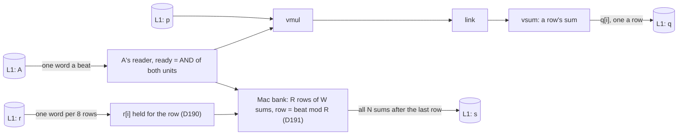

# Dry run 5: bicg, from two passes over A to one

Every number on this page is what the tools printed when it was written. No test checks them (D98), so they can drift as the code moves.

bicg is mvt without the add: $q = A p$ and $s = A^T r$, both assigned (`kernels/polybench/bicg.py`; `bicg_types.py` is the same with A, p and r at int8 and q, s at int32). q reads A along its rows. s needs A's columns, as mvt's half 2 does (dry run 4), so the same question comes back: how does s read A? bicg adds a second question: do the two products need to read A twice at all? This page runs bicg's forms from `recipes/bicg/` at 64 × 64 on SNAX-GVSoC with the energy run, sets them beside their vsim runs on snax_cluster's RTL, and ends with the one pass over A against two passes by W, for bicg and for mvt.

## 1. The forms

Each `id` (D188) names q's half first, then s's: `dot2` the linked dot group, `col` the column form (W `Mac` lanes on s's index, r broadcast, D186), `colbank` the column form with its sums in a bank (D191), `fork` A read once for both (D189), `strip` the row form in strips.

| Recipe | `id` | How s reads A | Accelerators | Crossbar inputs | Estimate (cycles) |
|---|---|---|---:|---:|---:|
| `bicg_v1` | `bicg_dot2` | down a column (the row form on Aᵀ) | 2 | 36 | 514 + 514 |
| `bicg_v2` | `bicg_dot2_col` | along its rows, the column form | 2 | 36 | 514 + 513 |
| `bicg_v2_1` | `bicg_dot2_col_i8_o32` | the same at int8 | 2 | 11 | 514 + 514 |
| `bicg_v3` | `bicg_dot2_col_fork_i8_o32` | the column form on q's read of A, at N = W (64 × 32, W = 32) | 1 | 28 | 67 |
| `bicg_v4` | `bicg_dot2_colbank_fork_i8_o32` | the column form on q's read, s's N sums in a bank of R rows | 1 | 8 | 1 027 (W = 4, R = 16) |
| `bicg_v4_1` | `bicg_dot2strip_colbank_fork_i8_o32` | the same in two strips of R·W columns, q carried across them | 1 | 9 | 1 027 (W = 4, R = 8) |

W = 8 unless named, two estimates when the two accelerators run one after the other (`sequential`); under `pipeline` they run at once and take the longer one. The crossbar inputs are the streamer channels plus the core and AXI (D85).

The one pass, drawn for `bicg_v4`: rows of A outer, each word of A feeds both products, q finishes once per row in the tree's register, and s's sums stay in the `Mac`'s bank until the last row.

## 2. Building them

`bicg_v1` and `bicg_v2` are four steps each, by reuse (D166): `lift matvec` at q's map and at s's, then `apply_recipe` of matvec's own recipes on each block, `matvec_v2` (the dot group per row) on q and `matvec_v2` again (`bicg_v1`) or `matvec_v7` (the column form, `bicg_v2`) on s. `bicg_v2_1` is `bicg_v2` at `types=i8`. `bicg_v3` adds a fifth step, `fork_read A`, which puts both chains in one group on one reader of A.

`bicg_v4` is the same five steps with `matvec_v8` on s: the column form rows outer. `matvec_v8` splits s's loop into strips of R·W columns, interchanges so A's rows run outside the strip's R beats, and binds the `Mac` with "bank rows" R. `bind` finds the hold itself: r's memlet uses none of the bank's row loops, so r is read once a row and held (D190). `bicg_v4_1` runs q in strips too (`matvec_v9`, `S = R * W`): q[i] is written once per strip, the first strip's seed masked to 0 and each later strip's the one before (`carry_seed`, D192). The sandbox checks each step against the reference:

    pixi run sandbox recipes/bicg/bicg_v4.json
    5 steps, each equal to the input graph on the reference check

    pixi run sandbox recipes/bicg/bicg_v4_1.json
    5 steps, each equal to the input graph on the reference check

mvt's one pass, `mvt_v6` (`mvt_dot2seed_colbankseed_fork_i8_o32`), is written by hand in 24 steps: half 1 as `mvt_v5`, half 2 as `matvec_v8`'s steps with `fuse_seed` into x₂ before the `bind`, then `fork_read A`. The bank is seeded: row ρ starts from x₂'s beat ρ on the job's first R firings (D194).

    pixi run sandbox recipes/mvt/mvt_v6.json
    24 steps, each equal to the input graph on the reference check

## 3. The runs

Each form through the flow with the energy run, here the one pass at W = 8:

    pixi run flow recipes/bicg/bicg_v4.json --platform platforms/snax_forge.json --set W=8 --set R=8 --energy

All runs: data 0 errors. The window is SNAX-GVSoC's, from main to the check; vsim's is the same ELF on snax_cluster's RTL (open item 95); energy is dynamic, SNAX-GVSoC's counts priced per transaction (D177), against the static estimate; area is the estimate's without the L1 banks (433 000 µm² in every form). 64 × 64, W = 8:

| # | Form | Type | Window | vsim | Dynamic (nJ) | Static (nJ) | Without banks (µm²) |
|---|---|---|---:|---:|---:|---:|---:|
| 1 | `bicg_v1`, contiguous, `sequential` | int64 | 4 638 | 4 685 | 355.467 | 242.500 | 380 000 |
| 2 | `bicg_v1`, contiguous, `pipeline` | int64 | 4 036 | 4 110 | 370.602 | 242.500 | 380 000 |
| 3 | `bicg_v1`, padded, `sequential` | int64 | 1 954 | 2 006 | 243.039 | 242.500 | 380 000 |
| 4 | `bicg_v1`, padded, `pipeline` | int64 | 1 325 | 1 341 | 248.865 | 242.500 | 380 000 |
| 5 | `bicg_v2`, `sequential` | int64 | 1 903 | 1 977 | 212.972 | 212.008 | 378 000 |
| 6 | `bicg_v2`, `pipeline` | int64 | 1 575 | 1 621 | 243.382 | 212.008 | 378 000 |
| 7 | `bicg_v2`, padded, `pipeline` | int64 | 1 448 | 1 481 | 226.3 | 212.008 | 378 000 |
| 8 | `bicg_v2_1`, `sequential` | int8 | 1 426 | 1 485 | 25.866 | 25.840 | 91 400 |
| 9 | `bicg_v2_1`, `pipeline` | int8 | 879 | 887 | 26.174 | 25.840 | 91 400 |
| 10 | `bicg_v4`, R = 8 | int8 | 855 | 873 | 26.447 | 26.428 | 97 000 |

At other sizes and widths:

| Form | Size, W | Window | vsim | Dynamic (nJ) | Static (nJ) | Without banks (µm²) |
|---|---|---:|---:|---:|---:|---:|
| `bicg_v2_1`, `sequential` | 40 × 64, 8 | 1 055 | 1 115 | 16.298 | 16.280 | 91 400 |
| `bicg_v2_1`, `pipeline` | 40 × 64, 8 | 648 | 661 | 16.432 | 16.280 | 91 400 |
| `bicg_v2_1`, `pipeline` | 64 × 32, 32 | 390 | 396 | 12.71 | 12.21 | 267 000 |
| `bicg_v3` | 64 × 32, 32 | 392 | 400 | 10.49 | 10.09 | 238 000 |
| `bicg_v4`, R = 16 | 64 × 64, 4 | 1 368 | 1 383 | within 2.3 % of static | 30.84 | 79 500 |
| `bicg_v4`, R = 16 | 40 × 64, 4 | 963 | 968 | within 2.3 % of static | – | 79 500 |
| `bicg_v4_1`, R = 8 | 64 × 64, 4 | 1 408 | 1 407 | within 2.3 % of static | 30.36 | 81 700 |

Every bicg one-pass point is PERFECT on vsim but `bicg_v3` (NEAR 4.2 %, open items 129 and 156); the two-pass points are PERFECT or NEAR, none past 3.9 % beyond the fill (open item 139). The two passes at int8 cannot be built at W = 4: s's column read steps 64 elements, so a word's two 4-lane slices are not popped in turn (`connect.pack`).

## 4. How to read it

- **The layout comes first at int64**, as for mvt. Contiguous, s's column of A sits in one bank: `bicg_v1` takes 4 638 cycles, s's counter 3 247 against q's 514 (6.3×). Padded, 1 954. The column form (`bicg_v2`) reads A along its rows in any layout: 1 903 cycles and 213.0 nJ, the least energy at int64, because r is broadcast (512 words against the row form's 4 096).
- **Pipelining at int64 meets the banks.** Both halves read W words of A a cycle; under `pipeline` `bicg_v2`'s column form stays on 8 banks for 64 beats while q's reader and p sweep all 32, and A's, p's and r's readers are refused on 30–36 % of their requests: 1 575 cycles, only 17 % under `sequential`, for 30 nJ more. Padding moves the strip one bank a beat (1 448, 226.3 nJ). The estimate does not see these conflicts (open item 155); the RTL shows the same counters.
- **At int8 the two passes pipelined are fast and small.** `bicg_v2_1` under `pipeline`: 879 cycles, 26.2 nJ, 91 400 µm² of logic. r's broadcast reads 64 words.
- **The one pass at N = W.** `bicg_v3` at 64 × 32, W = 32: the same time as its two-pass twin (392 against 390), 17 % less energy (10.49 against 12.71 nJ) and 11 % less logic (one reader of A and one control unit fewer). With N = W, s's sums fit in one row of the `Mac`, so no bank is needed.
- **The one pass with a bank.** At 64 × 64, W = 8, `bicg_v4` with R = 8 is 2.7 % faster than the two passes pipelined (855 against 879) and 1.0 % dearer in energy (26.45 against 26.17 nJ): A read once saves 5.2 nJ of streamers, crossbar and memory, and the bank's `Mac` costs 5.5 nJ more datapath. Section 5 shows how that balance moves with W.
- **Strips.** `bicg_v4_1` holds a strip of R·W = 32 sums and runs two strips. Time and area hardly change against one strip of 64 (1 408 against 1 368 cycles, 81 700 against 79 500 µm²). q is read back and rewritten each strip, its first strip's reads masked to 0 (D192). It is kept as a capability: an assigned output in strips is a narrow case.
- **What the add costs.** mvt is bicg plus x₁ and x₂ as start values, so each bicg form prices the add by its mvt twin: `bicg_v2_1` pipelined against `mvt_v5` pipelined, 879 against 904 cycles and 26.17 against 26.83 nJ; `bicg_v4` against `mvt_v6` at W = 8, 855 against 899 and 26.45 against 27.10. Both times the seeds cost about 0.65 nJ and 25–45 cycles, the price of loading and reading x₁ and x₂. At int64, `bicg_v1` padded against `mvt_v4` padded is 1 954 against 1 883 cycles and 243.0 against 244.8 nJ, but `mvt_v4` runs both halves on one shared group, so that pair compares sharing as much as the add.

## 5. One pass or two, by W

The one pass reads A once where the two passes read it twice; in exchange, s's sums live in a bank of R = N / W rows (one strip), and every firing pays for picking its row. Both forms at 64 × 64, int8, the two passes under `pipeline`:

| Kernel | W, R | Window, one pass / two | vsim, one / two | Dynamic nJ, one / two | Change | Without banks (µm²), one / two |
|---|---|---|---|---|---:|---|
| bicg | 8, 8 | 855 / 879 | 873 / 887 | 26.447 / 26.174 | +1.0 % | 97 000 / 91 400 |
| bicg | 16, 4 | 596 / 592 | 614 / 622 | 24.245 / 25.000 | −3.0 % | 148 000 / 150 000 |
| bicg | 32, 2 | 471 / 484 | 489 / 498 | 22.470 / 24.547 | −8.5 % | 247 000 / 267 000 |
| mvt | 8, 8 | 899 / 904 | 922 / 913 | 27.101 / 26.830 | +1.0 % | 135 000 / 129 000 |
| mvt | 16, 4 | 643 / 638 | 651 / 653 | 24.899 / 25.652 | −2.9 % | 213 000 / 215 000 |
| mvt | 32, 2 | 518 / 505 | 538 / 518 | 23.207 / 25.216 | −8.0 % | 371 000 / 390 000 |

bicg and mvt move together: the seed adds nothing to the trade. The trade fits in two terms, with M × N = 4 096 elements of A:

- **What reading A once saves.** The second read of A, its streamer beats and its crossbar grants: 5.2, 4.8 and 4.7 nJ on mvt at W = 8, 16, 32, about the same at every W, since the words of A do not depend on W. Per element of A that is $S \approx 5.0 / 4096 = 1.22$ pJ.
- **What the bank costs.** D193 prices a bank as the plain `Mac` plus $W (0.343 \log_2 R + 0.316)$ pJ a firing (X97, fitted on the `Mac` synthesized at R = 2 to 16), and the `Mac` fires $MN/W$ times, so the bank costs $MN (0.343 \log_2 R + 0.316)$ pJ in all. At W = 8, R = 8: $4096 \times (0.343 \times 3 + 0.316) = 5.5$ nJ; at W = 16, R = 4: 4.1 nJ; at W = 32, R = 2: 2.7 nJ, as measured.

Both terms grow with M × N, so the one pass pays when $0.343 \log_2 R + 0.316 < 1.22$, that is $R < 2^{2.64} \approx 6$ rows: at N = 64 from W = 16 on, and in general whenever the bank holds a strip of fewer than about 6 rows. Area follows the same line: R·W·32 flops is N·32 whatever W, while the second reader and control unit the one pass drops grow with W.

The windows do not follow: the one pass's group is busy 72–84 cycles less than the two passes' span, but it starts 43–52 cycles later (it waits for r and configures five streamers first) and stores q after its run, so the windows stay within a few percent of each other at every W. On mvt at W = 8 and 32, SNAX-GVSoC counts 4–5 cycles more than the rule while vsim counts the rule's own number: A, y₁, x₁ and x₂ each start at a multiple of 256 bytes, so their readers' first words all sit in bank 0 (open item 65).

## 6. What this gives the designer

At 64 × 64, best first, within each type:

| Measure | int64 (W = 8) | int8 |
|---|---|---|
| Cycles | `bicg_v1` padded pipelined (1 325), `bicg_v2` padded pipelined (1 448), `bicg_v2` pipelined (1 575), `bicg_v2` (1 903), `bicg_v1` padded (1 954), `bicg_v1` contiguous (4 036 pipelined, 4 638) | `bicg_v4` W = 32 (471), `bicg_v2_1` W = 32 pipelined (484), `bicg_v2_1` W = 16 pipelined (592), `bicg_v4` W = 16 (596), `bicg_v4` W = 8 (855), `bicg_v2_1` pipelined (879), `bicg_v2_1` (1 426) |
| Energy | `bicg_v2` (213.0), `bicg_v2` padded pipelined (226.3), `bicg_v1` padded (243.0), `bicg_v2` pipelined (243.4), `bicg_v1` padded pipelined (248.9), `bicg_v1` contiguous (355.5, 370.6 pipelined) | `bicg_v4` W = 32 (22.47), `bicg_v4` W = 16 (24.25), `bicg_v2_1` W = 32 pipelined (24.55), `bicg_v2_1` W = 16 pipelined (25.00), `bicg_v2_1` W = 8 (25.87), `bicg_v2_1` W = 8 pipelined (26.17), `bicg_v4` W = 8 (26.45) |
| Area without banks | `bicg_v2` (378 000), `bicg_v1` (380 000) | `bicg_v4` W = 4 (79 500), `bicg_v4_1` W = 4 (81 700), `bicg_v2_1` W = 8 (91 400), `bicg_v4` W = 8 (97 000) |

**At int64, `bicg_v2`** is the one to keep: the column form reads A along its rows in any layout and r once, the least energy of all; pipelining it buys 17 % of time for 14 % of energy, because the halves meet on the banks. **At int8, the one pass (`bicg_v4`)** is the form to keep from W = 16 on: 3–9 % less energy and 1–8 % less logic for the same time. At W = 8 the two passes pipelined (`bicg_v2_1`) are as good, and the smallest design is the one pass at W = 4. The same holds for mvt (`mvt_v6` against `mvt_v5`).

How far this holds: the cycles are SNAX-GVSoC's, and vsim's windows are within −0.1 % to +5.7 % of them; the energy is SNAX-GVSoC's counts at the cost tables' prices, within 2.3 % of the static estimate except where readers are refused (bank conflicts, open item 4), and first order against gate level (D154). The bank's price is X97's fit, within 14 % in energy and 5.8 % in area up to 2 048 bits a mux (D193); a bank of 4 096 bits a mux or more (R = 16 at W = 8) is outside it. One strip only for mvt: strips there would carry x₁'s tree across them from L1.
