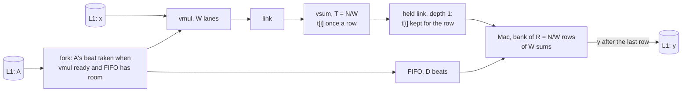

# Dry run 6: atax, from two passes to one group

Every number here is as the tools printed it when written; no test checks them (D98).

atax is $y = A^T (A x)$: two matvecs over one matrix, the second reading what the first wrote, t = A x (`kernels/polybench/atax.py`; `atax_types.py` with A and x at int8, t and y at int32, presets as bicg's, open item 152). Half 1 is bicg's q, half 2 its s with r = t. Unlike bicg the halves cannot overlap: y needs t[i] before row i of A. How is the dependence kept, and what does one group reading A once take? `recipes/atax/` at 64 × 64 on SNAX-GVSoC and vsim.

## 1. The forms

Each `id` (D188) names half 1, then half 2: `dot2` the linked dot group, `col` the column form, `colbank` with its sums in a bank (D191), `shared` one group for both halves (D165), `ports` the halves on shared movers (D169), `dmaT` A transposed by the DMA (D182), `link` t linked into half 2 (D197), `fork` A read once (D189, D196).

| Recipe | `id` | Half 2 | Accelerators | Estimate (cycles) |
|---|---|---|---:|---:|
| `atax_v1` | `atax_dot2` | the row form down A's columns | 2 | 514 + 514 |
| `atax_v1_1` | `atax_dot2_shared` | the same group as half 1 | 1 | 1 028 |
| `atax_v1_2` | `atax_dot2_i8_o32_dmaT` | the row form on Aᵀ, copied by the DMA | 2 | 514 + 514, copy 10 923 |
| `atax_v2` | `atax_dot2_col` | the column form | 2 | 514 + 513 |
| `atax_v2_1` | `atax_dot2_col_i8_o32` | the same at int8 | 2 | 514 + 514 |
| `atax_v1_3`, `atax_v1_2_1`, `atax_v2_2`, `atax_v2_1_1` | their parents' `_ports` | as their parents, on shared movers | 2 | as their parents |
| `atax_v3` | `atax_dot2_colbank_link_i8_o32` | the bank `Mac`, t over a link | 1 | 523 |
| `atax_v4` | `atax_dot2_colbank_link_fork_i8_o32` | the same, A read once | 1 | 523 (D = 10) |

int64 forms under `padded_rows` where they read down columns; two passes `serial`, `atax_v1_2` `sequential`. Half 2's `Mac` multiplies A at int8 by t at int32 (X98: 9 055 µm², 15.67 pJ a fire at W = 8, a third of the way from int8 × int8 to int32 × int32), so atax's two passes cost 5.5 nJ more than bicg's at int8.

## 2. The dependence

LOWER orders the halves (D179): half 2's reader of t has `after` its writer. Under `serial` the program syncs on half 1; under a pipelined schedule it places a wait on half 1's writer of t (`sum_out`) before half 2 starts. The estimate's runs wait on the writes they read ($c_1 + r_1 + r_2$), so `atax_v2_1` is 1 028 cycles under `pipeline` too, where `bicg_v2_1` is 514. On SNAX-GVSoC half 2 starts 10–19 cycles after half 1's writer is done.

The one-group forms keep the dependence inside the group instead: t[i] goes from the vsum to the `Mac` over a link, one a row, and the `Mac` holds it for the row (D197). t is in no memory.

## 3. The hardware of `atax_v4`

One group, A's one reader forked to the vmul and, through a FIFO of D beats, to the `Mac` (D196):

The trace at W = 2 (each latency one cycle), A rows (1, 2, 3, 4), (5, 6, 7, 8), (9, 10, 11, 12), x = (1, 2, 0, 1), so t = (9, 25, 41); a bank of 2 rows of 2 sums, a FIFO of N/W = 2 beats:

| Cycle | vmul reads | Tree | t on the link | FIFO after | `Mac` fires | Bank row 0 | Bank row 1 |
|---|---|---|---|---|---|---|---|
| 1 | row 0, (1, 2) | 5 | – | r0b0 | waits | (0, 0) | (0, 0) |
| 2 | row 0, (3, 4) | 9 → t₀ | – | r0b0, r0b1 | waits | (0, 0) | (0, 0) |
| 3 | row 1, (5, 6) | 17 | 9 | r0b1, r1b0 | (1, 2) × 9 | (9, 18) | (0, 0) |
| 4 | row 1, (7, 8) | 25 → t₁ | 9, popped | r1b0, r1b1 | (3, 4) × 9 | (9, 18) | (27, 36) |
| 5 | row 2, (9, 10) | 29 | 25 | r1b1, r2b0 | (5, 6) × 25 | (134, 168) | (27, 36) |
| 6 | row 2, (11, 12) | 41 → t₂ | 25, popped | r2b0, r2b1 | (7, 8) × 25 | (134, 168) | (202, 236) |
| 7 | – | – | 41 | r2b1 | (9, 10) × 41 | (503, 578) | (202, 236) |
| 8 | – | – | 41, popped | – | (11, 12) × 41 | (503, 578) | (653, 728) |

y = (503, 578, 653, 728). The `Mac`'s reads of A are the vmul's, T = N/W beats later; the FIFO holds those T beats, and the bank is W sums side by side over R rows in turn.

The FIFO's depth, with T = N/W the beats before t[i] exists and L the cycles from a row's last beat until t[i] reaches the `Mac`:

$$\text{cycles} \approx M\left(T + \max(0,\ T + L - D)\right) + T + L$$

- D < T: the FIFO fills before the `Mac`'s first t; neither branch moves again. LOWER refuses it, naming D ≥ T.
- T ≤ D < T + L: a stall of T + L − D cycles a row. At 64 × 64, W = 8 (T = 8, L = 2): D = 8 runs 649 cycles, D = 9 586.
- D ≥ T + L: the rate of a second read, 523 cycles. The recipe's default is T + 2.

Traced on SNAX-GVSoC at D = 8: 10 cycles a row, 8 with the vmul firing; then the `Mac` waits for t[i+1] (the vsum's L 1 and the held link) while the fork waits for room in the full FIFO; then the vsum pushes t. 63 rows × 2 = 126 = 652 − 526.

The FIFO costs (N + LW) · 8 flops at int8 (3 983 µm² at D = 10) and a push loads one entry, 1.07 nJ in all (0.58 loading, the rest the ring's mux); its slot pointers and occupancy are in the control unit.

## 4. Building them

The two passes are four steps by reuse (D166): `lift matvec` at t and at y, `apply_recipe` `matvec_v2` on t and `matvec_v2` or `matvec_v7` on y; `atax_v1_2` puts `data_transpose A` (by the DMA) first, `atax_v1_1` adds `share`, the `_ports` forms `share_ports tmp1`.

`atax_v3` takes `matvec_v8` (the bank) on y and links t; `atax_v4` adds `fork_read A` and `link A`, the FIFO on the `Mac`'s branch, before t's link (`link tmp1` into a forked reader without a buffer is refused):

    pixi run sandbox recipes/atax/atax_v4.json
    7 steps, each equal to the input graph on the reference check

In the viewer, open both halves (`open=matvec,matvec_1`): a click on a forked read's edge selects A (`link A` with its depth, `unlink A`), on t's link edges the link (`unlink`). Between `link A` and `link tmp1` the `Mac` is a chain of its own joined to the group by its FIFO; that step's estimate ignores the `Mac` reading t from L1 while the vsum writes it (open item 168).

- **The RTL.** A held link pops on a row's first firing into the `Mac`'s hold register, broadcast to the W lanes; the fork's FIFO is a `LinkBuffer` of D beats fed from the fork's reader, the fork's ready ANDed with its room (`<head>_<to>_fork_occupancy`, `_wslot`, `_rslot`). Every existing SV byte for byte; 71 group cases in the three rules, 729 Chisel specs; the fixture `atax_v4` at M = 4, N = 8, W = 4, R = 2, D = 4.

## 5. The runs

All runs: data 0 errors; area without the 433 000 µm² of L1 banks. 64 × 64, W = 8:

| # | Form | Type | Window | vsim | Verdict | Dynamic (nJ) | Static (nJ) | Without banks (µm²) |
|---|---|---|---:|---:|---|---:|---:|---:|
| 1 | `atax_v1`, padded | int64 | 1 754 | 1 807 | PERFECT | 243.152 | 242.500 | 379 929 |
| 2 | `atax_v1_1`, padded | int64 | 1 756 | 1 805 | PERFECT | 243.152 | 242.500 | 194 767 |
| 3 | `atax_v1_3`, padded | int64 | 1 746 | 1 794 | PERFECT | 243.039 | 242.500 | 256 998 |
| 4 | `atax_v2` | int64 | 1 723 | 1 783 | NEAR 0.9 % | 212.972 | 212.008 | 377 725 |
| 5 | `atax_v2_2` | int64 | 1 751 | 1 787 | PERFECT | 212.676 | 212.008 | 303 602 |
| 6 | `atax_v1_2`, `sequential` | int8 | 12 364 | 12 404 | PERFECT | 388.820 | 388.362 | 96 765 |
| 7 | `atax_v1_2_1`, `sequential` | int8 | 12 387 | 12 436 | PERFECT | 388.630 | 388.362 | 72 421 |
| 8 | `atax_v2_1` | int8 | 1 305 | 1 350 | PERFECT | 31.393 | 31.330 | 95 619 |
| 9 | `atax_v2_1_1` | int8 | 1 296 | 1 342 | NEAR, in the fill | 31.379 | 31.330 | 71 279 |
| 10 | `atax_v3` | int8 | 820 | 841 | NEAR, in the fill | 34.025 | 34.005 | 94 245 |
| 11 | `atax_v4`, D = 10 | int8 | 796 | 825 | NEAR, in the fill | 30.639 | 30.630 | 89 562 |
| 12 | `atax_v4`, D = 8 | int8 | 922 | 951 | NEAR, in the fill | 30.878 | 30.792 | 88 731 |

At other sizes and widths (int8):

| Form | Size, W | Window | vsim | Dynamic (nJ) | Static (nJ) | Without banks (µm²) |
|---|---|---:|---:|---:|---:|---:|
| `atax_v2_1` | 40 × 64, 8 | 891 | 933 | 19.747 | 19.712 | 95 619 |
| `atax_v4` | 40 × 64, 8 | 603 | 617 | 19.289 | 19.279 | 89 562 |
| `atax_v2_1` | 64 × 64, 16 | 792 | 840 | 29.211 | 29.129 | 158 785 |
| `atax_v4`, R = 4, D = 6 | 64 × 64, 16 | 523 | 534 | 28.383 | 28.369 | 145 369 |
| `atax_v2_1` | 64 × 64, 32 | 539 | 590 | 28.162 | 28.036 | 283 890 |
| `atax_v4`, R = 2, D = 4 | 64 × 64, 32 | 406 | 435 | 26.576 | 26.553 | 255 580 |

- **Counters** within a fill of the estimate: the halves 516 to 519, the one group 526 (523 and the streamers' fill of 3; 652 at D = 8); on vsim the forked `atax_v4` runs the estimate exactly (523, 649, 133), whose fill the RTL hides for the forked A, and `atax_v3` 3 over (open item 169). Beyond the fill, half 2 down one bank's column: `atax_v2`'s 532 against 516, `atax_v1_2`'s 533 against 517 on `A_T` (open item 139); `atax_v2_2` is PERFECT on vsim at the same 532.
- **Energy** within 0.5 % of static everywhere: nothing is refused for long.

## 6. How to read it

- **int64.** As bicg: `atax_v2`, rows in any layout, 213.0 nJ, the least. `atax_v1_1` (one group shared by the halves) halves the area at the same cycles (194 767 against 379 929 µm²); shared movers alone (`atax_v1_3`, 256 998) save two thirds as much.
- **int8, two passes.** `atax_v2_1`, 1 305 cycles, 31.39 nJ. The halves cannot overlap, so a pipelined schedule buys nothing here. Shared movers (`atax_v2_1_1`) take 25 % of the area (71 279 against 95 619 µm²) for nothing in time or energy, the cheapest atax by area. The DMA's copy (`atax_v1_2`) is the literal "matvec twice": 12 364 cycles and 388.8 nJ, the copy alone 341 nJ.
- **One group, t linked.** `atax_v3` runs y's rows as t's arrive: 820 against 1 305 cycles (−37 %), but 34.03 against 31.39 nJ (+8 %). Dropping t's trip through L1 saves 2.5 nJ (streamers 0.9, crossbar 0.5, memory 1.1); the bank `Mac` costs 5.0 nJ more in the datapath (D193).
- **One group, A read once.** `atax_v4` drops the second read (streamers 1.7, crossbar 0.9, memory 1.8 nJ) for the FIFO's 1.07 nJ: 30.64 nJ, 2.4 % below the two passes, at 61 % of the window and 6 % less area (89 562 against 95 619 µm²).
- **By W**, one group against two passes:

| W, R | Window, one / two | vsim, one / two | Dynamic nJ, one / two | Change | Without banks (µm²), one / two |
|---|---|---|---|---:|---|
| 8, 8 | 796 / 1 305 | 825 / 1 350 | 30.639 / 31.393 | −2.4 % | 89 562 / 95 619 |
| 16, 4 | 523 / 792 | 534 / 840 | 28.383 / 29.211 | −2.8 % | 145 369 / 158 785 |
| 32, 2 | 406 / 539 | 435 / 590 | 26.576 / 28.162 | −5.6 % | 255 580 / 283 890 |

bicg's one pass pays from W = 16 (dry run 5: the bank's $MN(0.343 \log_2 R + 0.316)$ pJ against 1.22 pJ an element saved by the one read). atax adds a second saving, t's write and read, and its one group takes the dependence's wait out of the window, so it wins at every W: in time by 25–39 %, in energy by 2–6 %, in area by 6–10 %.

## 7. What this gives the designer

At 64 × 64, best first:

| Measure | int64 (W = 8) | int8 |
|---|---|---|
| Cycles | `atax_v2` (1 723), `atax_v1_3` (1 746), `atax_v2_2` (1 751), `atax_v1` (1 754), `atax_v1_1` (1 756) | `atax_v4` W = 32 (406), `atax_v4` W = 16 (523), `atax_v2_1` W = 32 (539), `atax_v2_1` W = 16 (792), `atax_v4` W = 8 (796), `atax_v3` (820), `atax_v2_1` W = 8 (1 305) |
| Energy | `atax_v2_2` (212.7), `atax_v2` (213.0), `atax_v1_3` (243.0), `atax_v1`, `atax_v1_1` (243.2) | `atax_v4` W = 32 (26.58), `atax_v2_1` W = 32 (28.16), `atax_v4` W = 16 (28.38), `atax_v2_1` W = 16 (29.21), `atax_v4` W = 8 (30.64), `atax_v2_1_1` (31.38), `atax_v2_1` (31.39), `atax_v3` (34.03) |
| Area without banks | `atax_v1_1` (194 767), `atax_v1_3` (256 998), `atax_v2_2` (303 602) | `atax_v2_1_1` (71 279), `atax_v1_2_1` (72 421), `atax_v4` W = 8 (89 562), `atax_v3` (94 245), `atax_v2_1` (95 619) |

**int64: `atax_v2`** (or `atax_v2_2` for 20 % less area). **int8: `atax_v4`** at every W: at each width the fastest and the least energy; for the least area, the two passes on shared movers (`atax_v2_1_1`) at 1.6× the window.

How far this holds: vsim within 0.3–9.5 % of SNAX-GVSoC's windows, every counter within its fill or open item 139's; energy within 0.5 % of static; first order against gate level (D154). The bank's price is X97's fit (D193); the FIFO's the `LinkBuffer` table at one entry a push. One strip only: past R·W = N the one pass would carry partial sums through L1 (open item 165).
