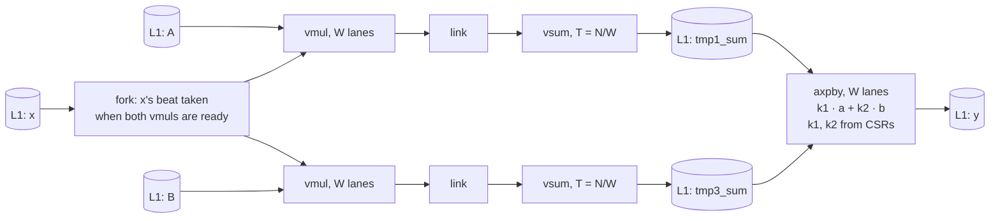

# Dry run 7: gesummv, the scales moved past their sums

Every number here is as the tools printed it when written; no test checks them (D98).

gesummv is $y = \alpha A x + \beta B x$: two matvecs over two matrices that share x, each scaled, then added (`kernels/polybench/gesummv.py`; `gesummv_types.py` with A, B and x at int8, alpha, beta and y at int32, presets as bicg's, open item 152). NPBench writes `alpha * A @ x`, which parses as $(\alpha A) x$: each scale multiplies a whole N × N matrix. Can the tool move the scales, and what do the halves gain from sharing x? `recipes/gesummv/` at 32 × 32 (int64) and 64 × 64 (int8) on SNAX-GVSoC and vsim.

## 1. The forms

Each `id` (D188) names the halves, then what ends the kernel: `dot2` the linked dot group per half, `scale_add` the two scales on `simd` units and an add, `axpby` one `simd` unit taking both sums, `shared` one dot group for both halves (D165), `ports` everything on shared movers (D169), `fork` x read once (D189).

| Recipe | `id` | Size, type | Accelerators | Estimate (cycles) |
|---|---|---|---:|---:|
| `gesummv_v1` | `gesummv_dot2_scale_add` | 32 × 32, int64 | 5 groups | 128 + 130 + 128 + 130 + 4 |
| `gesummv_v2` | `gesummv_dot2_axpby` | 32 × 32, int64 | 3 groups | 130 + 130 + 4 |
| `gesummv_v1_1` | `gesummv_dot2_scale_add_i8_o32` | 64 × 64, int8 | 5 groups | 512 + 514 + 512 + 514 + 8 |
| `gesummv_v1_1_1` | `..._ports_i8_o32` | 64 × 64, int8 | 1 (5 groups) | as `gesummv_v1_1` |
| `gesummv_v2_1` | `gesummv_dot2_axpby_i8_o32` | 64 × 64, int8 | 3 groups | 514 + 514 + 8; `pipeline` 522 |
| `gesummv_v2_1_1` | `..._shared_i8_o32` | 64 × 64, int8 | 2 groups | 1 028 + 8 |
| `gesummv_v2_1_2` | `..._ports_i8_o32` | 64 × 64, int8 | 1 (3 groups) | as `gesummv_v2_1` |
| `gesummv_v3` | `gesummv_dot2_axpby_fork_i8_o32` | 64 × 64, int8 | 2 groups | 514 + 8 |

int64 at 32 × 32: the literal form holds A, B, αA and βB, 130 KiB at 64 × 64 against L1's 128, and the runtime keeps its stack at L1's top (open item 171). At int8 the literal's scaled matrices are int32: 32 KiB beside A's and B's 8.

## 2. Moving the scales: `factor_out`

$\sum_j (\alpha A_{ij}) x_j = \alpha \sum_j A_{ij} x_j$, so the scale can follow the sum: N multiplies a half instead of $N^2$. `factor_out alpha` (D198), selected at the scalar, takes the nest scaling A and the product and sum after it, drops the N × N scaled container, lets the product read A and the sum write `tmp1_sum`, and puts the scale in the sum's reader. Here that reader is the add, so after both halves it reads `out = in3 * in1 + in4 * in2` (alpha, `tmp1_sum`, beta, `tmp3_sum`): one axpby, `k1 * a + k2 * b` with k1 and k2 from CSRs. Exact in integers mod $2^w$ when every type from the scale to the sum is at least the sum's width w; refused for floats (D28), a baked scalar, and a scalar scaling several nests. `unfactor_out` undoes it bit for bit.

Worked example (N = 2, α = 3, β = 2), $A = \begin{pmatrix} 1 & 2 \cr 3 & 4 \end{pmatrix}$, $B = \begin{pmatrix} 0 & 1 \cr 1 & 0 \end{pmatrix}$, x = (1, 2):

| Container | Import | After `factor_out` alpha and beta |
|---|---|---|
| tmp0 = αA | (3, 6; 9, 12) | gone |
| tmp1_sum = A x | – | (5, 11) |
| tmp3_sum = B x | – | (2, 1) |
| out | (15, 33) + (4, 2) = (19, 35) | 3 · (5, 11) + 2 · (2, 1) = (19, 35) |

At int8 the kernel's cast (`x.astype(OP_TYPE)`) keeps the product at int32, so the step is exact; with x left uncast the product is int8 and the step is refused, naming the cast.

## 3. The hardware of `gesummv_v3`

One group of two chains on one read of x (D189), the sums through L1, then the axpby:

The two chains run in step, so the group takes one half's time: 514 cycles at W = 8 where the two passes take 1 028. A fork joins the chains at their read; their sums meet again only in L1, because a unit fed by two links in one group (the join) is not built (open item 172). The `SimdLanes` axpby is X99's: at int32 and W = 1, 3 841 µm² and 4.42 pJ a fire, two multipliers beyond the add.

## 4. Building them

Each half is two steps by reuse (D166): `lift matvec` at its product nest, `apply_recipe matvec_v2`. The literal form binds each scale nest directly (`bake_scalar csr`, `tag_map`, `split_map`, `bind simd`) and the add by `lift vecadd`, `apply_recipe vecadd_v1`; the reordered forms take `factor_out alpha`, `factor_out beta` first and bind the add as the axpby (`split_map`, `bind simd`). `gesummv_v2_1_1` adds `share` (the second dot group onto the first), `gesummv_v2_1_2` `share_ports` on `tmp1_sum` and `tmp3_sum`, `gesummv_v3` `fork_read x`:

    pixi run sandbox recipes/gesummv/gesummv_v2_1.json
    10 steps, each equal to the input graph on the reference check

In the editor `factor_out` is offered on alpha and beta, `unfactor_out` on a factored scalar. A `share_ports` accelerator draws its movers in one `shared_port_mux` box: in `gesummv_v2_1_2`, reader0 serves A, B and `tmp1_sum` in turn (`PORT_MUX_SEL`), reader1 x, x and `tmp3_sum`, writer0 `tmp1_sum`, `tmp3_sum` and y.

- **The model.** A one-stream `SimdLanes` op runs at an opType that holds its input (the literal's int8 A scaled by an int32 alpha read from a CSR), as D143 and the Chisel have it; SNAX-GVSoC's check had asked for the input's type. A run prices a shared mover's beats at the channels each user takes (lanes 0 to n − 1 for a user of n), as the estimate prices each port.
- **The RTL.** No new block: every SV byte for byte. `gesummv_v1_1` (the widened scale) and `gesummv_v2_1` (the axpby with both scalars from CSRs) join `forge-set full`.

## 5. The runs

All runs: data 0 errors; area without the 433 000 µm² of L1 banks. W = 8:

| # | Form | Size, type | Window | vsim | Verdict | Dynamic (nJ) | Static (nJ) | Without banks (µm²) |
|---|---|---|---:|---:|---|---:|---:|---:|
| 1 | `gesummv_v1` | 32, int64 | 969 | 1 005 | NEAR, in the fill | 119.27 | 118.93 | 888 958 |
| 2 | `gesummv_v2` | 32, int64 | 681 | 697 | NEAR, in the fill | 62.73 | 62.39 | 665 198 |
| 3 | `gesummv_v1_1` | 64, int8 | 2 454 | 2 516 | NEAR 0.8 % | 127.20 | 126.27 | 298 842 |
| 4 | `gesummv_v1_1_1` | 64, int8 | 2 494 | 2 583 | NEAR 0.8 % | 127.21 | 126.28 | 135 299 |
| 5 | `gesummv_v2_1` | 64, int8 | 1 372 | 1 432 | NEAR, in the fill | 32.54 | 32.47 | 188 739 |
| 6 | `gesummv_v2_1`, `pipeline` | 64, int8 | 918 | 959 | NEAR, in the fill | 32.71 | 32.47 | 188 739 |
| 7 | `gesummv_v2_1_1` | 64, int8 | 1 383 | 1 432 | NEAR, in the fill | 32.54 | 32.47 | 158 153 |
| 8 | `gesummv_v2_1_2` | 64, int8 | 1 381 | 1 449 | NEAR 1.1 % | 32.54 | 32.48 | 141 782 |
| 9 | `gesummv_v3` | 64, int8 | 892 | 919 | NEAR, in the fill | 28.28 | 28.03 | 180 593 |

By W (int8, 64 × 64), x read once against the two engines side by side:

| W | Window, `v3` / `v2_1` `pipeline` | vsim | Dynamic nJ | Without banks (µm²) |
|---|---|---|---|---|
| 8 | 892 / 918 | 919 / 959 | 28.28 / 32.71 | 180 593 / 188 739 |
| 16 | 634 / 660 | 661 / 701 | 27.28 / 31.70 | 326 161 / 341 955 |
| 32 | 512 / 548 | 545 / 579 (NEAR 1.3 %) | 27.03 / 31.79 | 617 849 / 646 727 |

- **Counters.** The second dot and the axpby within their fill of the estimate (517, 11). The first dot runs 524–533 against 517: the program starts it, then loads B, whose copy wins banks from its readers (open item 173); `gesummv_v3`, which loads everything first, gives 518. The literal's scales run 522–528 against 514, their own int8 reader against their int32 writer (open item 175). Beyond the fill on vsim: `gesummv_v2_1_2`'s first dot, 533 against SNAX-GVSoC's 524, and `gesummv_v2_1` at W = 32 under `pipeline` (open item 174).
- **Energy** within 0.2–3.8 % of static: the larger gaps where two dots read at once (`pipeline`, the fork at W = 32) and meet in the banks.

## 6. How to read it

- **The rewrite.** At int64 `gesummv_v2` takes 30 % off the window (681 against 969) about half the energy (62.73 against 119.27 nJ) and a quarter of the area. At int8 the literal pays more: each scale reads A at int8 and writes it back at int32 (31.8 nJ a scale: memory 15.1, streamers 7.9, datapath 4.7, crossbar 4.1), and each dot then reads the scaled matrix at int32, 2 560 bank reads against 1 024. `gesummv_v2_1` takes 44 % off the window (1 372 against 2 454), three quarters of the energy (32.54 against 127.20 nJ) and 37 % of the area.
- **Sharing.** One dot group for both halves (`gesummv_v2_1_1`) saves 16 % of the area for 11 cycles and no energy; shared movers (`gesummv_v2_1_2`) save 25 % for nothing. On the literal, shared movers save 55 % (135 299 against 298 842 µm²) for 40 cycles, the shared set writing every port's CSRs at each section.
- **Two engines at once.** `pipeline` runs the halves side by side: 918 against 1 372 cycles, at 0.5 % more energy from their bank conflicts.
- **x read once.** `gesummv_v3` gets the side-by-side time (892) from one group, saving x's second read and a configuration: 13 % less energy than `pipeline` and 4 % less area, at every W (13–15 % less energy, 3–7 % fewer cycles, 4–5 % less area). Its energy falls with W (28.28 to 27.03 nJ) as the per-group costs spread; its area grows with the lanes (the axpby at int32 is 3 841 µm² a lane).

## 7. What this gives the designer

At 64 × 64, int8, best first:

| Measure | Forms |
|---|---|
| Cycles | `gesummv_v3` W = 32 (512), `gesummv_v2_1` W = 32 `pipeline` (548), `gesummv_v3` W = 16 (634), `gesummv_v2_1` W = 16 `pipeline` (660), `gesummv_v3` (892), `gesummv_v2_1` `pipeline` (918), `gesummv_v2_1` (1 372) |
| Energy | `gesummv_v3` W = 32 (27.03), W = 16 (27.28), W = 8 (28.28), `gesummv_v2_1` W = 16 `pipeline` (31.70), `gesummv_v2_1` (32.54) |
| Area without banks | `gesummv_v1_1_1` (135 299), `gesummv_v2_1_2` (141 782), `gesummv_v2_1_1` (158 153), `gesummv_v3` (180 593), `gesummv_v2_1` (188 739) |

**`factor_out` first, always:** it is exact and only removes work. Then **`gesummv_v3`** for time and energy at any W; for the least area, the two passes on shared movers (`gesummv_v2_1_2`) at 1.5× the window. The literal form's shared movers are smaller still, at 2.8× `gesummv_v3`'s window and 4.5× its energy.

How far this holds: vsim within 2–7 % of SNAX-GVSoC's windows, every counter within its fill or open items 173–175; energy first order against gate level (D154), the scalar forms priced at W = 1 and copied over lanes (X99). The halves' sums still meet in L1; the join (open item 172) would keep them in the group, worth 4N int32 accesses and the axpby's own pass.
